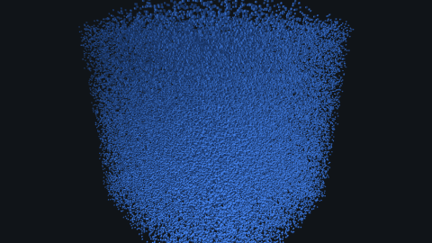
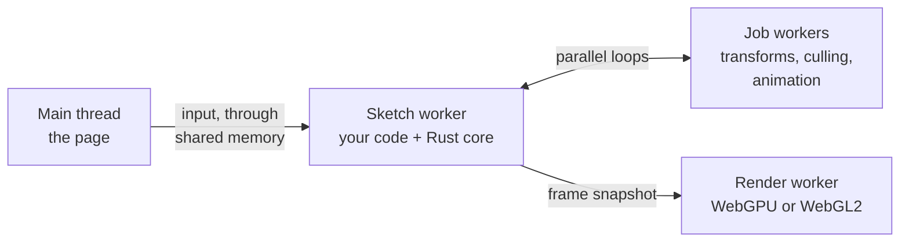

<p align="center">
  
</p>

<h1 align="center">null3D</h1>

<p align="center">
  <strong>A browser 3D engine for games and apps with many moving objects.</strong>
</p>

<p align="center">
  Its core is Rust compiled to WebAssembly, and it runs on worker threads. You write scenes in TypeScript, and it draws them with WebGPU or WebGL2.
</p>

<div align="center">

[](https://github.com/null3d-engine/null3d/actions/workflows/ci.yml)
[](https://www.npmjs.com/package/@null3d/engine)
[](#community-and-license)
[](#status-and-limits)

</div>

<p align="center">
  <a href="#quickstart">Quickstart</a>
  · <a href="#features">Features</a>
  · <a href="#performance">Performance</a>
  · <a href="#how-it-works">How it works</a>
  · <a href="https://github.com/null3d-engine/null3d/blob/generated/docs/index.md">Docs</a>
</p>

<p align="center">
  
  <br />
  <sub>100,000 boxes that the scene's code moves every frame, drawn by null3D with WebGPU.</sub>
</p>

## What is null3D?

null3D is a 3D engine for web pages. It is built for scenes where CPU time is the limit, such as many moving objects, deep scene graphs and animated crowds. In its scene-graph benchmark, a tree of 5,096 objects costs null3D 0.35 ms of CPU time per frame. three.js takes 3.18 ms for the same scene.

The engine's core is Rust compiled to WebAssembly. It runs on worker threads, so the page's main thread stays free for the page. It draws with WebGPU, and with WebGL2 where WebGPU is missing, from the same code. That matters on phones, because many of them still have no WebGPU.

## Quickstart

You need [Bun](https://bun.sh/) 1.4.3 or newer. The command line tool writes a new project:

```sh
bunx @null3d/cli create my-game
cd my-game
bun install
bunx vite
```

Open the address that Vite prints. A blue cube turns on a dark background.

In null3D, a 3D scene is called a **sketch**. A sketch is a TypeScript module that builds its scene and updates it every frame. It runs in a worker of its own. This is the new project's sketch, `src/sketch.ts`:

```ts
import { defineSketch } from '@null3d/engine';

export default defineSketch(({ scene, geometry, materials }) => {
  scene.setBackground('#101418');

  const camera = scene.createPerspectiveCamera({ fov: 60, position: [0, 1.5, 4], target: [0, 0, 0] });
  scene.setActiveCamera(camera);

  scene.createDirectionalLight({ direction: [-1, -2, -1], intensity: 3 });
  scene.createAmbientLight({ intensity: 0.4 });

  const cube = scene.createMesh({
    mesh: geometry.box({ width: 1, height: 1, depth: 1 }),
    material: materials.standard({ color: '#4a8cff' }),
    dynamic: true, // it moves every frame
  });

  let angle = 0;
  return {
    onUpdate(dt) {
      angle += dt * 0.8;
      cube.setRotationEuler(0, angle, 0);
    },
  };
});
```

[Your first scene](https://github.com/null3d-engine/null3d/blob/generated/docs/getting-started/first-scene.md) explains each line. To add null3D to a Vite project that you already have, follow [Install null3D](https://github.com/null3d-engine/null3d/blob/generated/docs/getting-started/install.md).

## Features

- **Materials and lights.** [Physically based materials](https://github.com/null3d-engine/null3d/blob/generated/docs/api/materials.md) with clear coat, sheen, transmission and iridescence. Point, spot, area and hemisphere [lights](https://github.com/null3d-engine/null3d/blob/generated/docs/api/lights.md), and light from the sky. [Shadows](https://github.com/null3d-engine/null3d/blob/generated/docs/concepts/shadows.md) that blend between cascades.
- **Post effects.** [Bloom, ambient occlusion, screen-space reflections](https://github.com/null3d-engine/null3d/blob/generated/docs/api/post.md), depth of field, automatic exposure, outlines and color grading.
- **Models and animation.** [glTF models](https://github.com/null3d-engine/null3d/blob/generated/docs/api/assets.md) with [skinned and morph animation](https://github.com/null3d-engine/null3d/blob/generated/docs/api/animation.md), blending and layers. KTX2 textures stay compressed on the GPU.
- **Large scenes.** [Batches](https://github.com/null3d-engine/null3d/blob/generated/docs/concepts/instances.md) of thousands of copies of one mesh, [levels of detail](https://github.com/null3d-engine/null3d/blob/generated/docs/concepts/lod.md), culling on the GPU, and worlds far from the origin.
- **World add-ons.** Water, terrain, grass, wind, particles, Gaussian splats, stand-in cards for far objects and sound at places in the scene, each a package of its own.
- **Interaction.** Keyboard, pointer, touch and gamepad [input](https://github.com/null3d-engine/null3d/blob/generated/docs/api/input.md), [picking](https://github.com/null3d-engine/null3d/blob/generated/docs/api/raycast.md), camera controls, and HTML labels that follow objects.
- **Custom shaders.** You write [WGSL](https://github.com/null3d-engine/null3d/blob/generated/docs/guides/custom-shaders.md) once, and the build translates it for WebGL2. A surface function changes a material's look and keeps the engine's lighting.
- **Quality that fits the device.** Four [quality presets](https://github.com/null3d-engine/null3d/blob/generated/docs/concepts/quality-presets.md) and dynamic resolution fit the work to the device. When frames take too long, the engine lowers its settings.
- **Tools.** The [command line tool](https://github.com/null3d-engine/null3d/blob/generated/docs/cli/null3d.md) makes projects, draws frames, runs image tests and measures your page. Each error has a code, and a [page that says how to fix it](https://github.com/null3d-engine/null3d/blob/generated/docs/errors/index.md).

This material dissolves along a glowing edge. Its surface function adds the effect, and the engine still lights and shadows it:

```ts
const dissolve = materials.shader({
  alphaMode: 'mask', alphaCutoff: 0.5,
  uniforms: { progress: 0, edgeColor: '#ff6a00' },
  wgsl: /* wgsl */ `
    #import null3d::noise::{fbm2}

    struct Uniforms { progress: f32, edgeColor: vec3f }

    fn surface(input: SurfaceInput) -> Surface {
      var s = defaultSurface(input);
      let n = fbm2(input.uv * 8.0, 4u) * 0.5 + 0.5;
      s.alpha = step(material.progress, n);
      let edge = 1.0 - smoothstep(0.0, 0.05, n - material.progress);
      s.emissive = material.edgeColor * edge * 4.0;
      return s;
    }`,
});
```

### Packages

| Package | What it does |
| --- | --- |
| [`@null3d/engine`](packages/engine) | The engine: the TypeScript API, the workers and both WebAssembly builds |
| [`@null3d/vite-plugin`](packages/vite-plugin) | The Vite setup that every null3D project needs, with the shader compiler |
| [`@null3d/cli`](packages/cli) | The command line tool: new projects, frames, image tests, benchmarks and model preparation |
| [`@null3d/controls`](packages/controls) | Orbit, map, fly and first-person camera controls, and gizmos that move, turn and scale objects |
| [`@null3d/geometry`](packages/geometry) | Shape generators: torus knots, polyhedra, lathes, extrusions and tubes |
| [`@null3d/water`](packages/water) | Rivers and lakes with waves, ripples, caustics, foam and a view from under the surface |
| [`@null3d/terrain`](packages/terrain) | Terrain from a height field, with a surface painted from several materials |
| [`@null3d/grass`](packages/grass) | Grass that the GPU builds, and that sways in the wind |
| [`@null3d/wind`](packages/wind) | One field of air that plants, flags, smoke and water read |
| [`@null3d/particles`](packages/particles) | GPU particles: emitters, bursts, sub-emitters, soft particles and flipbooks |
| [`@null3d/splats`](packages/splats) | Gaussian splats, with levels of detail and depth mixing with meshes |
| [`@null3d/impostors`](packages/impostors) | Stand-in cards and merged far geometry for many distant objects |
| [`@null3d/sound`](packages/sound) | Sound at places in the scene: loops, groups of many sources and one-shots |
| [`@null3d/three-compat`](packages/three-compat) | three.js's tone curves and outline look, for scenes ported from three.js |

## Performance

null3D's benchmarks run the same scene code in both engines. They time the CPU work per frame on the busiest thread, against the faster of three.js's two renderers. These figures come from Chrome 156 on a MacBook Pro, with null3D on WebGPU. Lower is better.

| Benchmark | null3D | three.js |
| --- | --- | --- |
| S2: a scene graph of 5,096 objects, 6 levels deep | 0.35 ms | 3.18 ms |
| S4: a town of 5,000 still objects and 200 cars, with shadows, 16 street lights and fog | 0.34 ms | 1.85 ms |
| S5: 500 animated characters with shadows | 1.32 ms (120 fps) | 44.83 ms (22 fps) |
| S1: 100,000 boxes that move every frame, the engine's own work | 0.22 ms | 0.44 ms |
| S1-static: the same 100,000 boxes, standing still | 0.20 ms | 0.07 ms |
| The desert: 63,469 objects, about 1.74 billion triangles, time between frames | 1.55 to 2.72 ms | 2.45 to 8.33 ms |

- S1's figure is the engine's own work. It leaves out the code that moves the boxes, which costs the same in both engines. The whole frame took 2.62 ms against 3.17 ms.
- null3D loses when nothing moves. Any WebGPU frame costs about 0.075 ms of CPU time in Chrome, even an empty one. three.js's WebGL renderer draws the still boxes in about 0.07 ms.
- The desert runs against three.js's meshlet renderer, which is built for huge meshes. Its range covers four views: a walk and a flight, with and without shadows.
- On an iPad Pro in Safari, 256,000 moving boxes took 16.44 ms per frame, against 31.32 ms.
- In S1 and S2, a check confirms that both engines draw the same frame on each GPU path, by three.js's own image test rule.

From a clone of this repository, `bun run bench:run` measures S1 in both engines on your own computer. The [performance guide](https://github.com/null3d-engine/null3d/blob/generated/docs/guides/performance.md) shows how to measure your own scene fairly.

### Why it is faster

three.js keeps each object as a JavaScript object. In every frame, it walks the scene graph one object at a time, on the page's main thread. That work grows with the object count. null3D keeps scene data in flat arrays in WebAssembly memory, and job workers process them in bulk. Your code writes straight into those arrays:

```ts
const rocks = scene.createInstances(rockMesh, 10_000, { material: rockMaterial, dynamic: true });

// In onUpdate: one typed-array loop, no allocation, no per-object calls.
const p = rocks.positions; // Float32Array, 3 floats per row
for (let i = 0; i < rocks.count; i++) p[i * 3 + 1] += 0.5 * dt;
```

On WebGPU, the GPU then culls the objects and counts the draws itself. The core's WebAssembly file stays under 640 KB after Brotli compression, and the build fails a larger one.

## How it works



1. **Your sketch code runs in a worker.** It reads and writes scene data in shared arrays, with no copies and no messages. See [Architecture: threads and the frame](https://github.com/null3d-engine/null3d/blob/generated/docs/concepts/architecture.md).
2. **The Rust core works in parallel.** Job workers update transforms, sample animation and cull objects over flat arrays. They use SIMD instructions, which work on several numbers at once. Then they record binary draw lists ([Handles and objects](https://github.com/null3d-engine/null3d/blob/generated/docs/concepts/handles.md)).
3. **One worker owns the GPU.** The render worker replays the draw lists and runs no sketch code. So a garbage-collection pause in your code does not hold up the GPU's work ([GPU tiers and backends](https://github.com/null3d-engine/null3d/blob/generated/docs/concepts/backends.md)).

## Where it runs

null3D picks its GPU path at startup from feature tests. It never picks the path by browser or GPU names, because some browsers hide them.

| Device and browser | GPU path |
| --- | --- |
| Chrome and Edge 113+ on Windows, macOS and ChromeOS | WebGPU |
| Safari 26 on macOS, iOS and iPadOS | WebGPU |
| Firefox 141+ on Windows, and 147+ on Apple silicon Macs | WebGPU |
| Chrome 121+ on Android 12+ with ARM, Qualcomm or Intel GPUs | WebGPU |
| Chrome 146+ on devices with only OpenGL ES 3.1 or Direct3D 11 | WebGPU compatibility mode |
| iPhones and iPads on iOS and iPadOS 18 | WebGL2 |
| Android phones without WebGPU, such as those with Samsung Xclipse GPUs | WebGL2 |
| Firefox on Android and Linux | WebGL2 |

Older browsers down to Safari 18, Chrome and Edge 91, and Firefox 89 also get WebGL2. Before those, `createEngine` fails with a clear error ([E1306](https://github.com/null3d-engine/null3d/blob/generated/docs/errors/E1306.md) for Safari, [E1303](https://github.com/null3d-engine/null3d/blob/generated/docs/errors/E1303.md) for the others). Desktop apps can ship the game in [Electron](https://github.com/null3d-engine/null3d/blob/generated/docs/getting-started/hosting.md#desktop-apps-with-electron).

## Status and limits

- **Experimental.** The API can still change between versions until 1.0. Each release lists its changes on the [releases page](https://github.com/null3d-engine/null3d/releases).
- **One developer leads the project.** Questions and bug reports go to [GitHub Issues](https://github.com/null3d-engine/null3d/issues).
- **Worker threads need two HTTP headers.** Without them, null3D runs on one thread. [Hosting and cross-origin isolation](https://github.com/null3d-engine/null3d/blob/generated/docs/getting-started/hosting.md) shows the headers for common hosts.
- **WebGPU needs a secure page.** Serve the page over HTTPS, or from localhost. Over plain HTTP, the engine draws with WebGL2.
- **No physics engine.** Add a physics library to your sketch, as [Using a physics library](https://github.com/null3d-engine/null3d/blob/generated/docs/guides/physics.md) shows.
- **Vite only.** A null3D project builds with Vite and the null3D plugin. Other bundlers are not supported or tested.

## Porting from three.js

These are a few entries of the three.js to null3D mapping:

| three.js | null3D |
| --- | --- |
| `WebGLRenderer` / `WebGPURenderer` | `createEngine({ canvas, sketch })` on the page; scene code moves into `defineSketch()` in a worker |
| `MeshStandardMaterial` | `materials.standard({ color, map, metalness, roughness, ... })` |
| `InstancedMesh` with `setMatrixAt` | `scene.createInstances(mesh, count, { material, dynamic })`, then write the batch's typed arrays |
| `OrbitControls` | `createOrbitControls(ctx, camera, { ... })` from `@null3d/controls` |
| `GLTFLoader` | `await assets.loadGltf(url)`, then `scene.instantiate(prefab)` |
| `Raycaster` | `camera.screenToRay(x, y, ray)`, then `scene.raycast(...)` |

The full [three.js to null3D mapping](https://github.com/null3d-engine/null3d/blob/generated/docs/porting/threejs-mapping.md) covers renderers, materials, loaders, animation, post-processing and more. The [porting skill](skills/null3d-port-threejs/SKILL.md) walks a coding agent through a port, and its scanner lists every three.js feature an app uses.

## For AI agents

- Two agent skills come with the engine. [null3d-develop](skills/null3d-develop/SKILL.md) builds and speeds up null3D projects. [null3d-port-threejs](skills/null3d-port-threejs/SKILL.md) ports three.js and React Three Fiber apps.
- `bunx @null3d/cli create` writes an `AGENTS.md` into each new project, and a hook that Claude Code and Codex both run.
- Every docs page has an ID, such as `concepts/architecture`, and a status. Agents never use an API whose page is `planned`.

Install the skills in Claude Code as a plugin:

```sh
claude plugin marketplace add https://raw.githubusercontent.com/null3d-engine/null3d/main/.claude-plugin/marketplace.json
claude plugin install null3d@null3d
```

[Working with AI agents](https://github.com/null3d-engine/null3d/blob/generated/docs/guides/agents.md) shows how to install them in claude.ai, the Claude desktop app and other agent tools.

## Development

To work on the engine itself, install these tools:

- [Bun](https://bun.sh/) 1.4.3 or newer
- The Rust toolchain through [rustup](https://rustup.rs/), which installs the pinned nightly compiler on the first build
- Node.js 24 or newer, which runs the browser tests
- [mkcert](https://github.com/FiloSottile/mkcert), which makes the local HTTPS certificate

```sh
git clone https://github.com/null3d-engine/null3d.git
cd null3d
bun install              # installs the tools and the git hooks
bun run build            # builds both WebAssembly files and prints their sizes
bun run chrome:install   # installs the pinned Chrome for Testing that the browser tests drive
bun run dev-cert         # makes the local HTTPS certificate
bun run test             # unit tests for the engine, the docs and the repository tools
bun run test:browser     # image tests on WebGPU and WebGL2 in Chrome
bun run dev              # serves the benchmark pages and the feature demos over HTTPS
```

The dev server serves the feature demos at `https://localhost:5174/examples/`, one short sketch for each feature. [AGENTS.md](AGENTS.md) has the rules, the commands and the commit checks.

## Community and license

⭐ If null3D is useful to you, a star helps other people find it.

Copyright (C) 2026 [Ramesh Nair](https://hiddentao.com).

null3D is licensed under either of the [Apache License 2.0](LICENSE-APACHE) or the [MIT license](LICENSE-MIT), at your option. Unless you explicitly state otherwise, any contribution you intentionally submit for inclusion in the work, as defined in the Apache-2.0 license, shall be dual licensed as above, without any additional terms or conditions.
