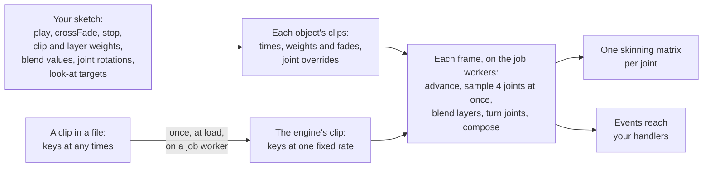

# Animation

> Roadmap step 0.2, first released in null3D 0.1.0. The API is experimental, so it can still change between versions.



Characters animate on the job workers, in the engine's WebAssembly core. Each frame, the job workers advance every animated object's clips, sample them, blend them, and compose the joints into skinning matrices. Your sketch's thread does none of this work, and a crowd spreads across every job worker. Your sketch has no update call to make.

## Models from glTF files

`assets.loadGltf` reads a model's skins, its clips and its morph targets. Each copy that `scene.instantiate` makes gets an animator on its group, which plays the model's clips. `prefab.clips` lists their names. The [character demo](https://github.com/null3d-engine/null3d/tree/main/examples/character) blends a character's clips by its speed, and swings its sword on an upper-body layer.

```ts
const knight = await assets.loadGltf('/models/knight.glb');
const hero = scene.instantiate(knight, { position: [0, 0, 0] });
hero.animator().play('Idle');
```

The engine builds one skeleton for the whole model. Its joints are every node that a skin names or a clip moves, every node below those, and every node above them. These nodes become joints, not objects, so `copy.find` does not find them. So each copy in a crowd costs one object per mesh, and its joints cost no objects.

- A skinned mesh goes in the copy's group, and its joints move its vertices, as glTF asks.
- A mesh without a skin on a node that a clip moves, or below a joint, moves with its node's joint. A sword in a hand, a helmet on a head and a box that a clip spins all follow their joints.
- A node that no clip moves keeps its place. One below a joint goes in the copy's group, where the joints rest.
- A light on a node that a clip moves is left out, and development builds warn about it.

A clip without a name takes the name three.js gives it: `animation_0`, `animation_1` and on, in the file's order. When two clips share a name, the second becomes `Name 2`, the third `Name 3`, and so on.

`scene.clone(copy)` gives the clone an animator of its own, with no clip playing. `scene.createInstances(prefab, count)` draws a model's meshes in their rest pose: instance batches do not animate. Batches do not skin either. A skinned mesh whose rest pose differs from its bind pose draws in its bind pose, and development builds warn.

A model's morph targets load with their default weights, and its clips animate the weights, as [Morph targets](#morph-targets) says. A node's own `weights` replace its mesh's, as three.js reads them.

### Load cost

The engine keeps each clip at one fixed rate of keys. The loader hands every clip to the job workers, which put it at that rate between frames. A track whose keys already sit at the rate is copied, and the job workers resample the others. A model's clips are ready when `loadGltf` resolves. In the single-threaded mode, the sketch's thread does this work a few milliseconds at a time.

Files from `bunx @null3d/cli assets optimize` store every clip at the engine's rate, so they load with copies alone. [The asset pipeline](../guides/assets-pipeline.md#what-it-does-to-clips) says how. On the engine's test page, the KayKit Knight's 76 clips took 16.5 ms on two job workers from its source file. From the command's output they took 8 ms, and the output's binary part is 46% smaller.

## Seeing the skeleton

`debug.skeleton(object)` draws the joints of an animated object, such as a copy's group, in the frame's pose. It draws a line from each joint of a skin to its parent joint. As in three.js's `SkeletonHelper`, a line is blue at the joint and green at its parent. Pass a color to draw every line in that color. Call it in `onUpdate`, as every debug drawing call. Only development builds draw it.

```ts
return {
  onUpdate() {
    debug.skeleton(hero);
  },
};
```

## Playing clips

An object that a model with animations created has an animator. `object.animator()` returns it, and `animator.clips` lists the names of the clips it can play.

```ts
const anim = hero.animator();
anim.play('idle');
anim.onEvent('footstep', () => page.post('sound', 'step'));

return {
  onUpdate() {
    const moving = input.isDown('KeyW');
    if (moving !== wasMoving) anim.crossFade(moving ? 'run' : 'idle', 0.25);
    wasMoving = moving;
  },
};
```

`play(name, options)` starts a clip. It takes these options:

| Option | Default | What it does |
| --- | --- | --- |
| `fade` | 0 | Seconds over which the clip fades in, while the other clips of its layer fade out. With 0, the clip takes over at once. |
| `loop` | `true` | `false` plays the clip once and holds its last frame. |
| `speed` | 1 | The rate of the clip's time. A negative speed plays the clip backward from its end. |
| `layer` | 0 | The layer, from 0 to 3. |
| `additive` | `false` | `true` adds the clip's change on top of the other layers. |
| `time` | the first frame | Seconds into the clip at which it starts. A repeating clip wraps the time into its length. A clip that plays once holds the time within its length. |
| `weight` | 1 | The clip's own weight, 0 or more. A play with a weight joins the other clips of its layer instead of fading them out, as [Clip weights](#clip-weights) shows. |
| `transition` | `'blend'` | How a play with a fade switches what its layer plays. `'blend'` cross-fades the layer's old clips with the new one, and samples both while the fade runs. `'inertial'` samples only the new clip: the pose the layer leaves carries on at its own speed and eases into the new clip, as [Inertial transitions](#inertial-transitions) shows. It needs a fade above 0, no `weight`, a clip to switch from, and a new clip that does not already play on the layer. An additive play always cross-fades. |

`crossFade(name, duration, options)` is `play` with a fade of `duration` seconds, and takes `play`'s other options, such as `layer`, `loop` and `weight`. It always cross-fades, whatever its `transition`, because three.js's `crossFadeTo` shows the mix of two clips. A cross-fade always takes over its layer, with a weight too. A clip that already plays on its layer keeps its time when you play it again, and fades back in from its current weight. So calling `play` with the same clip again does no harm. A clip that played once and reached its end starts again.

A plain play fades out only the plain clips of its layer, and an additive play only the additive clips. So a walk keeps playing when a breath starts on its layer as an additive clip.

Keep the options of the plays that a game repeats in frozen constants. The animator reads a frozen options object once and keeps what it read, so a clip switch allocates nothing. From an object that is not frozen, the animator reads at every play. The browser then makes a new 12-byte number for each fraction it reads. The same holds for the points of `playBlend`.

```ts
const TO_RUN = Object.freeze({ fade: 0.3, weight: 0.75 });
const GAIT = Object.freeze({ walk: 1.4, run: 4 });
const SMOOTH = Object.freeze({ fade: 0.2 });

anim.play('run', TO_RUN);
anim.playBlend(GAIT, SMOOTH);
```

A crowd whose characters all start a clip at once steps in time. Give each character a start time of its own:

```ts
for (const [k, knight] of knights.entries()) {
  knight.animator().play('walk', { time: k * 0.37 });
}
```

`stop(name, { fade })` fades a clip out on every layer. `stop()` with no name stops every clip. A clip that stops at once, or fades out fully, leaves the pose. With no clip playing, the object holds its rest pose.

`setTimeScale(scale)` sets the rate of every clip of the object. Set it to 0 to pause the object's animation.

## Property animation

A clip can move values other than bones and morph weights. A glTF file with `KHR_animation_pointer` moves a material's color or opacity, and where its maps sit on the texture coordinates. It also moves a light's intensity or color, or a node's visibility. These tracks follow the clip's time, speed, fades and weights. A sketch starts the same kind of animation in code with `scene.animateProperty`.

```ts
const pulse = scene.animateProperty(lamp, 'light.intensity', {
  times: [0, 1, 2], values: [0, 5, 0], loop: true,
});

return {
  onUpdate() {
    pulse.setSpeed(2);
  },
};
```

`animateProperty(target, path, keyframes)` takes a light, a camera, a material or an object, and returns the animation that it starts. The path names the value:

| Target | Paths |
| --- | --- |
| Light | `light.intensity`, `light.color`, `light.range`, `light.decay`, `light.angle` and `light.penumbra` |
| Camera | `camera.fov` in degrees, `camera.near`, `camera.far`, and `camera.height` for an orthographic camera |
| Material | The values that `setUniform` takes, such as `material.opacity`, `material.color` or `material.roughness`, and `material.uvOffset` or `material.uvScale` for where its maps sit on the texture coordinates |
| Object | `position`, `rotation` as a quaternion `[x, y, z, w]`, `scale` and `visible` |

The prefix is optional, so `'intensity'` names a light's intensity too. A directional light has no range or cone, and a perspective camera has no view height.

`keyframes` holds the time of each key in seconds, and the value of each key. One key holds one number for an intensity, two for where the maps sit on the texture coordinates, three for a color, a position or a scale, and four for a rotation. The values of the keys follow one another. A cubic key holds three times as many numbers: an in-tangent, the value and an out-tangent.

| Option | Default | What it does |
| --- | --- | --- |
| `interpolation` | `'linear'` | Moves the value between keys along a straight line, holds it with `'step'`, or follows glTF's cubic spline with `'cubic'` |
| `loop` | `true` | `false` plays the animation once and holds its last key |
| `speed` | 1 | The rate of the animation's time. A negative rate plays it backward |
| `time` | the first key | The time at which it starts |
| `paused` | `false` | `true` starts it paused |

The returned animation has these calls and values:

| Call or value | What it does |
| --- | --- |
| `setTime(seconds)` | Places the animation at a time, as three.js's `action.time` does |
| `setSpeed(rate)` | Sets the rate of its time |
| `setPaused(paused)` | Starts or stops its time, and leaves the target as it is |
| `setLoop(loop)` | Repeats the animation, or makes it hold its last key |
| `stop()` | Stops the animation, and leaves the target at its last value |
| `time`, `playing`, `speed`, `loop` | What it holds |

An animation of a material changes every object that uses the material, as a change through `set` does. A value that an animation writes costs nothing per frame. The engine samples the tracks on the sketch's thread, after the job workers advanced the clips, so a sketch has no update call to make. A material has one transform for all its maps, so `uvOffset` and `uvScale` move every map of the material together.

### Files with KHR_animation_pointer

The loader reads a pointer to a node's transform, its morph weights, or its visibility under `KHR_node_visibility`. It also reads a pointer to a material's values, and to a light's intensity, color or range. A base color factor moves the material's color, and its fourth number moves the opacity. The offset and scale of a base color texture's or an emissive texture's `KHR_texture_transform` move the material's maps. Each track joins its clip, so `animator().play(name)` plays it with the clip's other tracks. A clip at less than full weight mixes the value with the value that the file gave the property.

```ts
const copy = scene.instantiate(await assets.loadGltf(url));
copy.animator().play('Cube Animation');
```

A pointer that the engine does not read leaves the value as the file has it. Development builds warn about each one. The names show the kind. A camera's values are left out, because the loader reads no cameras from files. So are a texture's rotation, the transforms of the other textures, and a light's inner cone angle. So are the values of extensions that the engine does not draw. A material keeps one transform for all its maps, so a file that moves two of them apart plays the first.

## Clip weights

Each clip has a weight of its own, as a three.js action has. A play with a `weight` joins the clips that already play on its layer, and the layer blends them by their weights. Where the weights add up to less than 1, the rest pose makes up the remainder, as three.js's mixer does.

```ts
const anim = knight.animator();
anim.play('walk', { weight: 0.7 });
anim.play('run', { weight: 0.3 });

return {
  onUpdate() {
    const run = Math.min(speed / 4, 1);
    anim.setWeight('walk', 1 - run);
    anim.setWeight('run', run);
  },
};
```

`setWeight(name, weight)` sets the weight of a clip that plays, on every layer that plays it. It writes the weight into engine memory, so you can change it every frame at no cost. A clip at weight 0 leaves the pose. It keeps playing, and its time moves on, as in three.js. A fade multiplies the weight: a clip at weight 0.5 that fades in reaches 0.5. In development builds, `setWeight` on a clip that does not play throws E1218.

Clips that blend by weight keep their own times. A walk and a run of different lengths then step at different moments, and the feet slide. A 1D blend keeps their steps together.

## Inertial transitions

A cross-fade from one clip to another samples both clips for the whole fade. It mixes their poses,
so a walk fading into a run passes through half of each gait, where the feet slide. An inertial
transition never mixes them: it samples only the new clip. The pose that the layer leaves carries
on at its own speed, and it eases into the new clip.

```ts
const TO_RUN = Object.freeze({ fade: 0.3, transition: 'inertial' });
const TO_WALK = Object.freeze({ fade: 0.3, transition: 'inertial' });

return {
  onUpdate() {
    const moving = input.isDown('KeyW');
    if (moving !== wasMoving) anim.play(moving ? 'run' : 'walk', moving ? TO_RUN : TO_WALK);
    wasMoving = moving;
  },
};
```

At the switch, the animator records the pose that the layer is leaving. It records the rate at
which that pose moves. The new clip then plays alone. Each frame of the fade, the old pose carries
on at that rate. The layer's pose moves toward the new clip's by the ease `x²(3 - 2x)` of the
fade's share `x`. The pose reaches the new clip exactly when the fade ends.

An inertial transition needs a fade above 0 and no `weight`. The layer must play a clip to switch
from, and the new clip must not already play on that layer.
A play that joins its layer keeps the weighted blend. So do a layer with a 1D blend and an additive
clip. `crossFade` always cross-fades too, so a port of three.js's `crossFadeTo` shows the mix that
three.js shows.

A transition costs one extrapolated pose and its velocity per joint of the layer. A scene that
never uses one pays nothing, and a transition that starts allocates nothing.

## 1D blends

A 1D blend mixes clips by one value, such as the character's speed. `playBlend(points, options)` gives each clip a point on a line. At a clip's point, that clip plays in full. Between two points, the two clips around the value share it. Past the first or the last point, that point's clip plays in full. `setBlend(value, layer)` moves the value. It writes engine memory, so you can call it every frame at no cost.

```ts
const anim = knight.animator();
anim.playBlend({ idle: 0, walk: 1.4, run: 4 }, { fade: 0.2 });

return {
  onUpdate() {
    anim.setBlend(speed);      // 2.7 m/s: walk and run share the pose half and half
  },
};
```

The clips of a blend share one phase, as PlayCanvas's blend trees and Godot's cyclic blend spaces keep them. Each clip's time moves at its length over the length of the blend's clips, averaged by their weights. At 2.7 m/s above, a walk of 1.07 s and a run of 0.73 s each take 0.9 s for a cycle. So both feet land together, whatever the value.

`playBlend` takes these options:

| Option | Default | What it does |
| --- | --- | --- |
| `value` | the layer's value | The blend value to start from. Each layer's value starts at 0. |
| `fade` | 0 | Seconds over which the blend fades in, while the other clips of its layer fade out. |
| `loop` | `true` | `false` plays the clips once and holds their last frames. |
| `speed` | 1 | The rate of the blend: 1 moves it through one cycle in the averaged length. A negative speed plays it backward. |
| `layer` | 0 | The layer, from 0 to 3. |
| `phase` | the layer's phase | The share of the cycle, from 0 to 1, at which the clips start. |

A blend holds 1 to 8 clips, each at a point of its own. Without a `phase`, a blend starts at the phase of the layer's blend. Failing that, it takes the phase of the first of its clips that the layer plays. So a switch from a walk to a blend with the walk keeps the step. `play` or `crossFade` on the layer ends the blend. Each of its clips then keeps the weight and the rate it had, and fades out. A call to `setWeight` on a clip of a blend multiplies its share of the blend.

## Layers and joint masks

Each animator has four layers, numbered 0 to 3. Layer 0 blends its clips with the rest pose. Each layer above replaces the pose of the layers below, by the layer's weight.

`setLayerMask(layer, joints)` limits a layer to some joints: each named joint and every joint below it. Pass the name of a joint, or an array of names. `null` gives the layer every joint again.

```ts
anim.play('walk');
anim.play('wave', { layer: 1, fade: 0.2 });
anim.setLayerMask(1, 'Spine');   // the spine, the arms and the head wave; the legs walk
anim.setLayerWeight(1, 0.8);
```

`setLayerWeight(layer, weight)` takes a weight from 0 to 1, and each layer starts at 1. It writes the weight into engine memory, so you can change it every frame at no cost. A layer whose clips fade in or out replaces less of the pose below while they fade.

## Additive clips

An additive clip adds its change from its first frame to the pose of the layers. A clip that leans the spine forward then leans any pose forward, whether the character walks or stands. Breathing, aiming and flinching are typical additive clips.

```ts
anim.play('walk');
anim.play('breathe', { layer: 2, additive: true });
anim.setLayerWeight(2, 0.5);     // half the breath
```

The engine works out the additive form of a clip the first time you play it as additive. It keeps that form for every later play. The clip's layer weight and joint mask scale the change.

## Joint overrides

Your sketch can turn a character's joints on top of its clips. A soldier then aims its rifle while it walks, and a head turns to follow the player. The job workers apply the turns after they blend the clips, and before they compose the skinning matrices.

`anim.joint(name)` returns a joint's index. The joint calls take an index or a name. Look up the index once in the setup, and keep it.

```ts
const anim = soldier.animator();
anim.play('walk');
const spine = anim.joint('Spine');
const twist = quat.create();

return {
  onUpdate() {
    quat.setAxisAngle(twist, [0, 1, 0], Math.sin(time.now) * 0.4);
    anim.addJointRotation(spine, twist);   // twists on top of the walk
  },
};
```

- `setJointRotation(joint, rotation, weight)` sets the joint's rotation relative to its parent, as a quaternion. The joint turns from its animated rotation toward it by the weight, from 0 to 1. At 1, the default, the joint takes the rotation.
- `addJointRotation(joint, rotation, weight)` turns the joint by the rotation in its own frame, on top of its animated rotation. The weight scales the turn.
- `clearJoint(joint)` removes both kinds of rotation from the joint.

The joints below a turned joint follow it, and so do the meshes that hang on them. A rotation holds in every frame until `clearJoint` removes it, or a new call replaces it. The calls write engine memory, so calling them every frame costs nothing and allocates nothing. An object holds 8 joint rotations at once. A joint with a set rotation and an added one takes two of them.

### Looking at a point

`lookAt(target, options, weight)` turns a chain of joints so that the last one aims at a point in the world. The engine aims again in each frame from the animated pose, until `lookAt(null)` stops it. So a soldier keeps its rifle on a target while its walk sways its body. Call `lookAt` every frame to follow a moving point.

```ts
const AIM = Object.freeze({ joints: ['Spine', 'Chest', 'Neck'], limit: 0.8 });
let aim = 0;

return {
  onUpdate(dt) {
    aim = Math.min(1, aim + dt * 2);          // raise the aim over half a second
    anim.lookAt(enemyPosition, AIM, aim);
  },
};
```

| Option | Default | What it does |
| --- | --- | --- |
| `joints` | none | The joints that turn, parents first, up to 4. Each one must be below the joint before it. The last one aims. |
| `limit` | π / 3 | The most that each joint turns away from its animated pose, in radians. Give one number for every joint, or an array with one per joint. |
| `shares` | equal | How the turn splits between the joints, one number per joint. |
| `forward` | `[0, 0, 1]` | The direction that the last joint aims, in the object's space when the model was bound. |

The first call needs `joints`. Later calls without options keep the chain, so `anim.lookAt(point)` only moves the target. A frozen options object is read once, as with `play`.

Each joint takes its share of the turn that the joints before it left, up to its limit. The last joint then finishes the aim, within its limit. A target far behind the character turns each joint as far as its limit allows. The weight blends each joint between its animated rotation and the turned one, so an eased weight raises and lowers an aim smoothly.

The last joint aims where the model faced when it was bound: +Z, for a glTF model that follows the format's rules. Give `forward` for a joint that aims elsewhere, such as a hand that holds a gun along +X. The engine aims from the object's place in the frame that it draws. So a moving soldier aims without a frame of lag.

### Order and cost

In each frame, the clips blend first, then each joint rotation applies in the order of its slot, then the look-at turns its chain. A look-at therefore aims from a pose that the joint rotations already turned.

A scene that never calls a joint call pays nothing: the engine makes the table of joint overrides at the first call. After that, an object without overrides costs a few reads in each frame. A joint rotation costs one quaternion blend. A look-at costs a few matrix products for each joint between the skeleton's root and the chain's last joint.

The calls allocate nothing, but a weight that changes in each frame can. The browser inlines a small call into the function that makes it. In a large frame step, it may stop doing so, and then it passes each fraction as a new 12-byte number object. One knight per frame does not matter; a crowd of them makes garbage for the collector. The rotation and the target cross in arrays, so they never box. To keep a crowd's weights from boxing, call the joint calls from a small function of its own. Give it only objects and whole numbers, such as the animator and its index, and let it read the frame's fractions from an array:

```ts
const now = new Float64Array(1);
const aimCrowd = (anim: Animator, k: number) => {
  anim.lookAt(enemyPosition, undefined, 0.5 + 0.5 * Math.sin(now[0] + k));
};

return {
  onUpdate() {
    now[0] = time.now;
    for (let k = 0; k < crowd.length; k++) aimCrowd(crowd[k], k);
  },
};
```

The default weight, 1, is a small whole number, which never boxes. The same holds for every engine call that takes a fraction, such as `setPosition` or `setLayerWeight`.

## Events

`onEvent(name, handler)` calls `handler` each time a playing clip reaches an event of that name. It returns a function that removes the handler. The handler gets the event's `name`, its `clip` and its `layer`. The animator passes the same object to every handler, so copy what you keep.

Events come from the clip's data. The animator also reports two events of its own:

- `'loop'` fires each time a repeating clip starts again.
- `'finished'` fires once when a clip that plays once reaches its end.

Each event fires once each time the clip's time passes it, however long the frame was. An event at a clip's last frame fires as the clip loops, as one at its first frame does. Backward clips fire events too, in their order of play.

Handlers run on your sketch's thread at the start of the next frame, before `onFixedUpdate` and `onUpdate`. So your update code sees what the clips reached in the frame before, as three.js code sees events after `mixer.update`. A clip that a handler plays starts in that frame.

## Clips

A clip moves the joints of one skeleton. Each track of a clip moves one joint's translation, rotation or scale.

When the engine loads a clip, it stores the keys at one fixed rate for the whole clip. The key before any time is then a direct index, with no search.

- A clip whose keys all lie on one grid of at most 30 keys per second keeps that grid exactly. Files exported at 24, 25 or 30 frames per second lose nothing.
- Other clips get 30 keys per second, spaced so that the last key falls on the clip's end. A clip exported at 60 keys per second keeps every second key.
- Rotations take 8 bytes per key: four 16-bit integers. Translations and scales take 12 bytes per key.
- A track whose value never changes is stored once. So is a track whose keys move by under a millionth of its largest value, or under a millionth when its values lie within 1. Exporters leave rounding noise of that size in tracks that do not move.

A track moves in a straight line from key to key. A step track jumps instead: it holds each key's value until the next key.

A cubic spline track, as glTF stores one, keeps an in-tangent and an out-tangent with each key. The engine follows the curve through the keys, as three.js's `GLTFLoader` does, and stores it at 30 keys per second. When the file's keys lie on a coarser grid, the engine keeps them and adds keys between them on a finer grid. Keys every half second, for example, get 14 keys between each two.

## Blending

An object blends up to eight clips in a frame, each at its own time and weight. Two layers that each cross-fade between two clips, with an additive clip on top, fit with room to spare. So does a three-clip blend that cross-fades to another while a second layer cross-fades between two clips. When all eight are busy, a new clip takes the place of a clip that fades out, the one that counts least. Only when no clip fades out does it take the place of the clip that counts least at that moment.

Within a layer, the engine blends clips as three.js's `AnimationMixer` does, joint by joint:

- A clip counts only for the joints and channels it has tracks for. A clip that moves only an arm leaves the legs to the other clips.
- Each clip moves the blend so far by its share of the weights so far.
- In layer 0, where the weights add up to less than 1, the joint's rest pose makes up the remainder.

Rotations between keys and rotations in a blend use a corrected form of normalized linear interpolation. It stays within 0.0001 radians of three.js's spherical interpolation for rotations up to 2 radians apart. On the engine's test skeleton, poses match three.js's within 0.00003, and skinning matrices within 0.0002. Fades, masked layers and additive clips match three.js's results within 0.0002. Start times, clip weights and blends match within 0.0004.

Seven glTF sample models play their clips as three.js plays them. Each joint's skinning matrix matches three.js's within 0.0004 in its rotation and scale, and within 0.0004 of the model's size in its position. Fox's run is the exception: its keys follow no single grid, so the engine stores it at 30 keys per second. The joints that turn fastest then cut corners by up to 0.005.

## Skinned meshes

A skinned mesh's vertices follow the joints of an animated object. Each vertex names up to four joints, with a weight for each. Its skinned place is the sum of its joints' skinning matrices applied to it, each times its weight. The mesh's own world matrix then places it, as three.js draws a `SkinnedMesh`.

On both paths, the vertex shader of each pass that draws a skinned mesh skins it, as three.js does. The shadow passes skin it again. On the devices that the engine was measured on, this was as fast as skinning once per frame, or faster. On WebGPU that was a compute pass, and on WebGL2 transform feedback. Each frame uploads the animated objects' skinning matrices to one float texture, 48 bytes per joint. Every material skins in the vertex shader, custom materials included. Skinned meshes that share a mesh and a material draw in one instanced draw in each pass, so a crowd costs few draw calls. On WebGPU, a custom material's skinning builds download the first time the material draws a skinned mesh. A page whose custom materials never draw one never downloads them. The mesh draws once they have arrived, so call `await scene.warmUp()` in the setup to load them before play.

On WebGPU, a compute pass, the skinning pass, skins two kinds of mesh once per frame instead. It runs before the shadow passes and the scene passes. The first kind is morphed meshes, which it morphs first. The second is meshes that a debug view draws, or that a [full shader](../guides/custom-shaders.md#full-shaders) of the sketch's draws. Neither has a skinning build of its vertex shader. The passes then draw the skinned vertices as a plain mesh. Each mesh that the pass skins draws on its own, as it has vertices of its own. The pass skips a mesh that no view draws in a frame, neither the camera nor a shadow cascade. It also skips a mesh whose pose and morph weights did not change since its last skin. The `?skinning=compute` switch makes the pass skin every skinned mesh, to compare the two ways ([Testing](../guides/testing.md#switches-for-tests)).

A skinned mesh culls with a sphere that its pose moves. The engine keeps a sphere for each joint around the vertices it moves. Each frame it moves those spheres with the pose and takes the sphere around them all. So a limb that swings out never leaves the mesh's bounds. The work is one matrix product per joint, however many vertices the mesh has. Skinned meshes cast and receive shadows that follow their poses.

## Crowds

A crowd of copies of one model draws in one instanced draw per part. Its cost is the work of its animation and its vertices. `animator.setUpdateInterval(frames)` sets the frames between two updates of one character's pose. The value 1, the default, updates it in every frame. A larger number, up to 64, samples and composes it once every that many frames. It holds the last pose in between. `animator.updateInterval` reads the value back.

Give a character the camera sees from far more frames between its updates. Hold the ones near the camera at 1, so they never step. The `farAnimationInterval` quality setting, which the [governor](quality.md#the-frame-budget-governor) may raise, gives the interval for far characters:

```ts
return {
  onUpdate() {
    const far = quality.governor.farAnimationInterval;
    for (let k = 0; k < crowd.length; k++)
      crowd[k].animator().setUpdateInterval(distance(k) > NEAR ? far : 1);
  },
};
```

The clips keep their real speed. Each update covers the frames that it skipped, so a slower rate does not slow a character down. Its pose holds between updates, so a far character steps a little. Its events reach your handlers on its next update, up to `frames` frames late. A scene that never calls `setUpdateInterval` updates every character in every frame. A character that stands still is posed again in every frame at 1. At 1 it costs the job workers as much as a moving one. What it saves is the upload of the joint matrices: no frame repeats it while no pose changes. Its skinning work also stays, because the vertex shader of each pass that draws it skins it again, shadows included. Only a mesh that the skinning pass skins skips a pose that did not change. Those are morphed meshes, and meshes that a debug view or a full shader of the sketch draws ([Limits of skinning](#limits-of-skinning)).

### Limits of skinning

- On WebGPU, each copy that the skinning pass skins or morphs keeps its skinned vertices in GPU memory, even when copies share a mesh. Positions take 32-bit floats. Normals and tangents take 8 bits per component, as unit directions, which is as precise as the asset tool's optimized meshes store them. The other attributes keep their types. With `?skinning=compute`, a knight of the S5 benchmark takes 20 bytes per vertex, so its 500 knights of about 5,000 vertices take about 50 MB.
- Those vertices fill at most 8 GPU buffers, each as large as the device lets a shader read. That is 1 GiB in all at WebGPU's default limit of 128 MiB per buffer.
- Skinned meshes fill at most 32 mesh buffers. Each mesh buffer holds meshes with one set of vertex attributes, up to that same size.
- A scene past either limit draws nothing in its frames, and gives [E1501](../errors/E1501.md), which names the limit. The canvas keeps the last whole frame, and the scene draws again once it fits.
- Meshes that the vertex shaders skin count toward neither limit, on WebGPU or on WebGL2.
- The engine's animation table starts with room for 65,536 joints, for every animated object. It grows when it needs more, up to 1,048,576 joints ([Limits of the scene](scene.md#limits)). Each joint takes 96 bytes of the engine's memory and 48 bytes of GPU memory, so 1,048,576 joints take about 100 MB and 50 MB.

## Morph targets

A morph target is another shape of a mesh, such as a smile or a blink. Each object of a mesh with targets blends them in by its own weights. A weight of 0 leaves a target out, 1 adds all of it, and other numbers scale it. The call `setMorphWeight` sets a weight by the target's number or name, as three.js's `morphTargetInfluences[k]` does. The call `getMorphWeight` reads it back. A target can move positions, normals and tangents, and change vertex colors, as a glTF file's `COLOR_0` targets do. A mesh from a glTF file has the file's targets and default weights. A mesh that you build takes its targets from `morphTargets` in [geometry.fromArrays](geometry.md#morph-targets).

```ts
const head = scene.instantiate(face).find('Head') as Mesh;
head.setMorphWeight('Smile', 0.6);
head.setMorphWeight(1, Math.sin(time.now) * 0.5 + 0.5);
```

A clip of a glTF file can animate a mesh's weights. While it plays, it blends its weights with the object's own, as three.js's mixer blends a property with its value from before the clips. A clip at full weight sets the weights, and a fade blends the two. The object's own weights hold when no clip animates them. The call `setMorphWeight` sets the object's own weight, so a weight that you set shows in full only where no clip animates it. Layers and joint masks work on weights too: a layer masked to a node's name takes that node's weights.

On WebGPU, the skinning pass morphs each morphed mesh once per frame, before its joints skin it. On WebGL2, the vertex shader of each pass morphs it, as three.js does. Each object then keeps only its largest weights, by the `morphTargets` quality setting: 8 on Low, 16 on Medium, 32 on High and 64 on Ultra. WebGPU keeps every weight. The first morphed mesh that a WebGL2 page draws loads the morph shaders, about 20 KB after compression, and draws once they arrive. On WebGPU, it loads the skinning pass's shaders. `createEngine`'s `preload` option loads either before the first frame ([Loading screens](../guides/loading-screens.md#loading-everything-up-front)).

A morphed object culls with a sphere that its weights grow: each target's longest move times the size of its weight. On WebGL2, a custom material draws a morphed mesh in its shape at rest.

## How it compares with three.js

| three.js | null3D |
| --- | --- |
| `new AnimationMixer(root)`, then `mixer.update(dt)` each frame | `object.animator()`; the engine advances every animator each frame |
| `mixer.clipAction(clip).play()` | `anim.play('name')` |
| `a.crossFadeTo(b, 0.3)`, `fadeIn`, `fadeOut` | `anim.crossFade('b', 0.3)`, `play` with `fade`, `stop` with `fade` |
| `action.setLoop(LoopOnce)` with `clampWhenFinished` | `play('name', { loop: false })`: it holds its last frame |
| `action.timeScale`, `mixer.timeScale` | `play` with `speed`, `anim.setTimeScale` |
| `action.time = t` before `play()` | `play('name', { time: t })` |
| `action.setEffectiveWeight(w).play()` for clips that play together | `play('name', { weight: w })`, then `anim.setWeight('name', w)` |
| A blend of actions whose weights and time scales your code works out from a speed | `anim.playBlend({ walk: 1.4, run: 4 })` and `anim.setBlend(speed)`, with the clips kept in step |
| `AnimationUtils.makeClipAdditive(clip)` and an additive blend mode | `play('name', { additive: true })` |
| Clips with tracks filtered out, for upper and lower body | Layers with `setLayerMask` |
| `mixer.addEventListener('loop' or 'finished')` | `anim.onEvent('loop' or 'finished', handler)`, and events from the clip's data |
| `gltf.animations` and `new AnimationMixer(gltf.scene)` | `prefab.clips` and `scene.instantiate(prefab).animator()` |
| `SkeletonUtils.clone(gltf.scene)` | `scene.clone(copy)`, whose copy animates on its own |
| `new SkeletonHelper(object)` | `debug.skeleton(object)` in `onUpdate` |
| `skeleton.getBoneByName('Head')` | `anim.joint('Head')`, an index that the joint calls take |
| `bone.quaternion.copy(q)` after `mixer.update(dt)` | `anim.setJointRotation('Head', q)`, which holds until `clearJoint` |
| `bone.quaternion.multiply(q)` after `mixer.update(dt)` | `anim.addJointRotation('Spine', q)` |
| `bone.lookAt(point)`, or a look-at chain that your code works out | `anim.lookAt(point, { joints: ['Spine', 'Neck', 'Head'] })` |
| `AnimationClip` and `NumberKeyframeTrack` built in code, then `mixer.clipAction(clip).play()` | `scene.animateProperty(lamp, 'light.intensity', { times, values })` |
| `KHR_animation_pointer` through a registered GLTFLoader plugin | The loader reads the pointer itself, and the clip's animator plays it |
| `mesh.morphTargetInfluences[k] = w` | `mesh.setMorphWeight(k, w)`, or with the target's name |
| `mesh.morphTargetDictionary['Smile']` | `mesh.setMorphWeight('Smile', w)`; the mesh geometry's `morphTargetNames`, such as `prefab.find('Face')?.mesh?.morphTargetNames`, lists the names in order |
| `geometry.morphAttributes.position`, with `morphTargetsRelative = true` | `geometry.fromArrays({ ..., morphTargets: { positions } })` |
| `geometry.morphAttributes.color` | `geometry.fromArrays({ ..., colors, morphTargets: { colors } })` |
| `SkinnedMesh` skinned in the vertex shader of each pass that draws it | The same on both paths, custom materials included. On WebGPU, the skinning pass skins morphed meshes once per frame instead |

Where three.js and null3D differ:

- A three.js fade out starts from full weight. null3D fades a clip out from the weight it has, so a quick change of mind does not jump.
- three.js makes a bone object for each joint of a glTF skin, which you can find and move. null3D's joints are not objects. To turn a joint from code, use the joint calls of [Joint overrides](#joint-overrides). A three.js bone keeps a rotation that you set only until the next `mixer.update`. A null3D joint rotation holds until `clearJoint`.
- three.js's `bone.lookAt` turns one bone and has no limits. null3D's `lookAt` turns a chain of up to 4 joints, each within its limit.
- A three.js action played backward starts at time 0 and wraps to the end. A null3D clip with a negative speed starts at its end.
- three.js has no layers. null3D's layer 0 blends as three.js's mixer does, and each layer above replaces the pose below.
- A morphed vertex color stays between 0 and 1, as the glTF specification asks. three.js does not clamp it. A glTF target that leaves out `COLOR_0` while another target has it changes no color in null3D, as the specification says. three.js r186 adds the base color there instead. Its WebGPURenderer draws no color targets, and its WebGLRenderer cannot draw them on colors without alpha.
- A three.js `play()` never stops other actions. A null3D `play` without a weight fades out the other clips of its layer. Give each clip that plays beside others a `weight`.
- three.js always cross-fades two actions. A null3D play with a fade can switch with an [inertial transition](#inertial-transitions) instead, which samples only the new clip. `crossFade` keeps the cross-fade.
- three.js's `setEffectiveWeight` stops a fade. null3D's `setWeight` leaves a fade running, which multiplies the weight.
- three.js has no blend by a value. A three.js blend of walk and run keeps each clip's own rate, so their steps drift apart. A null3D blend keeps them in step.
- `action.startAt(time)`, which delays a start, has no counterpart. Call `play` at that time in `onUpdate`.
- three.js reads `KHR_animation_pointer` with a plugin that registers on the loader. null3D's loader reads the pointers of lights, materials, node visibility and the offset and scale of a base color or emissive texture's transform itself. A pointer that it does not read leaves its value as the file has it, and development builds warn.

| | three.js | null3D |
| --- | --- | --- |
| Where clips are sampled | The main thread, one bone at a time | The job workers, four joints per SIMD operation, characters in parallel |
| Finding the keys | A search of each track's key times | A direct index, from the clip's fixed rate |
| Memory per rotation key | 20 bytes: four floats and a time | 8 bytes: four 16-bit integers |
| Blending | `PropertyMixer`, with spherical interpolation | The same rules, with corrected normalized interpolation |

## Errors

| Code | When |
| --- | --- |
| [E1218](../errors/E1218.md) | A clip, layer or joint that the object's animation does not have; an option out of range, such as a negative weight or an update interval outside 1 to 64; a path that `animateProperty` does not take, or keyframes with the wrong number of values for it; `setWeight` on a clip that does not play; a blend of no clips, of more than eight, or with two clips at one point; `animator()` on an object with no clips; a morph target that the mesh does not have; a joint rotation past the 8 that an object holds; a look-at chain of no joints or more than 4, or whose joints are not one chain parents first; a first `lookAt` without options |
| [E1203](../errors/E1203.md) | A fade, speed, start time, weight, blend point, blend value, phase, morph weight, time scale, joint rotation, look-at target, limit or share that is NaN or infinite |
| [E1416](../errors/E1416.md) | A glTF file whose skins or clips break glTF's rules, such as key times that fall back or a skin that names a node twice, or whose skins and clips move more than 1,024 nodes |
| [E1101](../errors/E1101.md) | An animator call after its object was destroyed |
| [E1501](../errors/E1501.md) | A crowd of skinned meshes past WebGPU skinning's limits (see [Limits of skinning](#limits-of-skinning)) |

## API reference

[The API reference](reference/animation.md) lists every export of this page with its type and description. The engine's doc comments make it.
