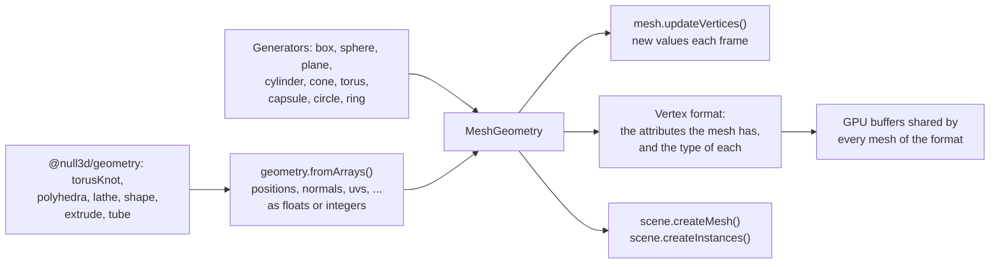

# Geometry

> Roadmap step 0.1, first released in null3D 0.1.0. Step 0.2 adds integer attributes, joints and weights, morph targets, the `@null3d/geometry` package, vertex updates and the levels of detail that meshes made in code plan. The API is experimental, so it can still change between versions. Not built yet: a call that skins a mesh you build. So joints and weights do not move its vertices yet. Coding agents must not use it.



A mesh is the shape that objects draw. `ctx.geometry` makes meshes, and any number of objects and instance batches can share one mesh. The generators make common shapes with three.js's parameters. `geometry.fromArrays` makes a mesh from your own vertex data, as three.js's `BufferGeometry` does.

## Generators

Each generator takes the parameters and defaults of a three.js geometry class, as named options. It builds the same vertices in the same order as three.js, so a scene draws the same triangles in both engines.

```ts
// sketch.ts
const crate = geometry.box({ width: 1, height: 0.5, depth: 1 });
const ball = geometry.sphere({ radius: 0.5, widthSegments: 32, heightSegments: 16 });
const pillar = geometry.cylinder({ radiusTop: 0.3, radiusBottom: 0.4, height: 2 });
scene.createMesh({ mesh: crate, material: materials.standard({ color: '#c8a064' }) });
```

| Generator | three.js class | Shape |
| --- | --- | --- |
| `geometry.box` | `BoxGeometry` | A box |
| `geometry.sphere` | `SphereGeometry` | A sphere with its poles on the Y axis, or a part of one |
| `geometry.plane` | `PlaneGeometry` | A rectangle in the XY plane that faces +Z |
| `geometry.cylinder` | `CylinderGeometry` | A cylinder on the Y axis, closed at each end unless `openEnded` is true |
| `geometry.cone` | `ConeGeometry` | A cone on the Y axis, with its point at the top |
| `geometry.torus` | `TorusGeometry` | A tube bent into a ring around the Z axis |
| `geometry.capsule` | `CapsuleGeometry` | A cylinder on the Y axis with a half sphere on each end |
| `geometry.circle` | `CircleGeometry` | A disc in the XY plane that faces +Z, or a slice of one |
| `geometry.ring` | `RingGeometry` | A disc with a hole, in the XY plane, that faces +Z |

Every shape is centered on its origin. The options have the names of the three.js constructor's arguments, and the API reference below gives each default. Angles are in radians. Segment counts round down to whole numbers. Each count has a least, which the API reference gives, and a smaller count rises to it. A sphere, for example, has at least 3 segments around it.

The generators give each vertex a position, a normal and texture coordinates, with the values that three.js gives them. The [geometry generators demo](https://github.com/null3d-engine/null3d/tree/main/examples/generators) draws all nine shapes.

## Extra shapes

The `@null3d/geometry` package holds the rest of three.js's geometry classes. Install it beside the engine:

```sh
bun add @null3d/geometry
```

Each function takes the parameters and defaults of a three.js class, as named options, and returns arrays for `geometry.fromArrays`. The arrays hold the same numbers as the three.js geometry's attributes: the same vertices in the same order, with the same normals and texture coordinates. The mesh that `fromArrays` makes from them plans its [levels of detail](#levels-of-detail) as any mesh made in code does, and keeps that order.

```ts
// sketch.ts
import { extrude, Shape, torusKnot } from '@null3d/geometry';

const knot = geometry.fromArrays(torusKnot({ radius: 1, tube: 0.3, tubularSegments: 128 }));
const outline = new Shape().moveTo(0, 0).lineTo(1, 0).lineTo(0.5, 1).lineTo(0, 0);
const wedge = geometry.fromArrays(extrude({ shapes: outline, depth: 0.4, bevelEnabled: false }));
```

| Function | three.js class | Shape |
| --- | --- | --- |
| `torusKnot` | `TorusKnotGeometry` | A tube that winds around a torus |
| `tetrahedron`, `octahedron`, `icosahedron`, `dodecahedron` | `TetrahedronGeometry` and the others | A polyhedron, with `detail` that splits its faces toward a sphere |
| `polyhedron` | `PolyhedronGeometry` | A polyhedron from your own corners and faces |
| `lathe` | `LatheGeometry` | A profile of points turned around the Y axis, such as a vase |
| `shape` | `ShapeGeometry` | A flat shape from outlines, with holes, in the XY plane |
| `extrude` | `ExtrudeGeometry` | A shape pushed along +Z or along a curve, with an optional bevel |
| `tube` | `TubeGeometry` | A tube along a 3D curve |

The package also has the classes that these shapes take, with three.js's names and methods. `Shape` and `Path` draw with `moveTo`, `lineTo`, `bezierCurveTo` and the rest. The 2D and 3D curves, such as `CatmullRomCurve3`, and `ShapeUtils` come too. Points are arrays of numbers, `[x, y]` or `[x, y, z]`, not `Vector2` or `Vector3` objects. A method that returns a point returns a new array, or fills the array that you pass last.

A mesh has one material. three.js's `ExtrudeGeometry` puts its caps and its sides in two groups, which can take two materials. Here they form one mesh. To give the caps a material of their own, make them as a second mesh with `shape`, at each end. The [extra shapes demo](https://github.com/null3d-engine/null3d/tree/main/examples/extra-shapes) draws a shape from each function.

## Meshes from arrays

`geometry.fromArrays` takes one array per vertex attribute, laid out as three.js's `BufferGeometry` keeps them: the values of vertex 0, then vertex 1, and so on. Typed arrays and plain arrays of numbers both work. An attribute can also come as 8-bit or 16-bit integers, as [integer attributes](#integer-attributes) shows.

```ts
// sketch.ts: a quad that faces +z, with texture coordinates
const quad = geometry.fromArrays({
  positions: [0, 0, 0, 1, 0, 0, 1, 1, 0, 0, 1, 0],
  normals: [0, 0, 1, 0, 0, 1, 0, 0, 1, 0, 0, 1],
  uvs: [0, 0, 1, 0, 1, 1, 0, 1],
  indices: new Uint16Array([0, 1, 2, 0, 2, 3]),
});
scene.createMesh({ mesh: quad, material: materials.unlit({ color: '#ffffff' }) });
```

| Array | Numbers per vertex | three.js attribute |
| --- | --- | --- |
| `positions` | 3 | `position` |
| `normals` | 3 | `normal` |
| `uvs` | 2 | `uv` |
| `uvs1` | 2, such as a light map's coordinates | `uv1` |
| `colors` | 3, or 4 with alpha, as linear values from 0 to 1 | `color` |
| `tangents` | 4: the direction in which u grows, then 1 or -1 for the direction of v | `tangent` |
| `joints` | 4 joint indices, for skinned meshes | `skinIndex` |
| `weights` | 4: how much each joint moves the vertex, which add up to 1 | `skinWeight` |
| `targets` | 4: the position that the vertex takes at a coarser level of detail, and that level's error, which a generated shape's material reads | None |

The arrays follow these rules:

- `positions` is required. Give `normals`, or set `computeNormals: true`.
- `indices` takes a `Uint16Array`, a `Uint32Array` or an array of numbers, with three indices per triangle. Without indices, each three vertices in a row make one triangle.
- `joints` and `weights` come together. A mesh keeps them for [skinning](animation.md#skinned-meshes). No call skins a mesh that you build yet, so it draws in the pose that its positions give.
- `targets` takes floats only, and a mesh takes it or `morphTargets`, never both: the two share one vertex record.
- A triangle's front face has its vertices in counter-clockwise order.
- Each array's length must fit the vertex count, and its type must be one that its attribute takes. Each index must name a vertex, and each value must be a finite number. Otherwise the call throws [E1206](../errors/E1206.md).
- The engine copies the arrays. You can change or drop them after the call.

## Integer attributes

Each attribute can come as 8-bit or 16-bit integers instead of 32-bit floats, as glTF's `KHR_mesh_quantization` extension allows. The mesh keeps the integers on the GPU, so it takes less memory and uploads faster. A position of 16-bit integers takes 8 bytes, where floats take 12. A normal of 8-bit integers takes 4 bytes, where floats take 12.

Integers read in one of two ways. Normalized integers read as fractions: from 0 to 1 when they are unsigned, and from -1 to 1 when they are signed. Plain integers read as whole numbers. Give an attribute as `{ array, normalized }` to choose, as three.js's `BufferAttribute` does. The default is plain, as in three.js and glTF.

| Array | Takes | Integers read as |
| --- | --- | --- |
| `positions`, `uvs`, `uvs1` | Floats, or any of the four integer arrays | Plain whole numbers, or fractions with `normalized: true` |
| `normals`, `tangents` | Floats, `Int8Array` or `Int16Array` | Fractions from -1 to 1 |
| `colors`, `weights` | Floats, `Uint8Array` or `Uint16Array` | Fractions from 0 to 1 |
| `targets` | Floats | Not integers |
| `joints` | `Uint8Array`, `Uint16Array`, or a plain array of whole numbers from 0 to 65,535 | Whole numbers |

Floats come as a `Float32Array` or a plain array of numbers. The four integer arrays are `Int8Array`, `Uint8Array`, `Int16Array` and `Uint16Array`.

```ts
// sketch.ts: a quad of 16-bit positions from 0 to 1,000, scaled to one meter
const quad = geometry.fromArrays({
  positions: new Uint16Array([0, 0, 0, 1000, 0, 0, 1000, 1000, 0, 0, 1000, 0]),
  normals: new Int8Array([0, 0, 127, 0, 0, 127, 0, 0, 127, 0, 0, 127]),
  uvs: { array: new Uint16Array([0, 0, 65535, 0, 65535, 65535, 0, 65535]), normalized: true },
  indices: [0, 1, 2, 0, 2, 3],
});
scene.createMesh({ mesh: quad, material: materials.standard(), scale: [0.001, 0.001, 0.001] });
```

Integer positions keep their own units. Give the object the scale and the position that turn them into meters, as a glTF node's transform does for a quantized mesh. The engine's bounds and culling then see the object's size in meters. A material's `uvTransform` does the same for integer texture coordinates, as glTF's `KHR_texture_transform` does.

## Computing normals and tangents

`computeNormals: true` computes the normals as three.js's `computeVertexNormals` does. Each vertex gets the average of the normals of its triangles, weighted by their areas. Vertices that triangles share get smooth normals. For hard edges, give each face its own vertices. The [meshes from arrays demo](https://github.com/null3d-engine/null3d/tree/main/examples/mesh-arrays) shows both: a smooth height field, an island with a color at each vertex, and a crystal with hard edges.

`computeTangents: true` computes tangents as three.js's `computeTangents` does, from the positions, the normals and `uvs`. It needs `uvs`, and it works with or without indices. The job workers share the work, so a large mesh takes less time. Both options give the same numbers as three.js, bit for bit. They compute from integer positions, normals and texture coordinates too, as shaders read them, and give 32-bit floats.

## Morph targets

A morph target is another shape of a mesh, such as a smile on a face. The `morphTargets` option gives a mesh its targets, as three.js's `morphAttributes` with `morphTargetsRelative` does. Each target is an array of three numbers per vertex: how far the target moves the vertex at weight 1. The list `positions` moves the vertices, `normals` turns their normals, and `tangents` turns their tangents. The list `colors` changes the mesh's vertex colors, with as many numbers per vertex as `colors` has, three or four. Every list holds the same number of targets, from 1 to 256. The list `names` names the targets.

```ts
const count = positions.length / 3;
const smile = new Float32Array(count * 3);
const blink = new Float32Array(count * 3);
// ... fill in how far each target moves each vertex ...
const face = geometry.fromArrays({
  positions,
  normals,
  indices,
  morphTargets: { positions: [smile, blink], names: ['Smile', 'Blink'] },
});
const head = scene.createMesh({ mesh: face, material });
head.setMorphWeight('Smile', 0.8);
```

Each object of the mesh has weights of its own, which start at 0. `setMorphWeight` sets them, and clips from glTF files animate them ([Morph targets](animation.md#morph-targets)). The [morph targets demo](https://github.com/null3d-engine/null3d/tree/main/examples/morph-flowers) makes tulips with one target, which opens the petals, turns their normals and changes their color. Each tulip has a weight of its own. The engine stores, for each vertex, only the targets that move it. So a face whose targets each move a small part of it takes far less memory than three.js's copy of every vertex for every target. A vertex can take up to 255 targets. The targets of every mesh together can take up to 4,194,304 deltas, 32 MiB of GPU memory. Each of a vertex's positions, normals, tangents and colors counts once. Past those limits, `fromArrays` throws E1206. The GPU keeps each delta in a 16-bit float, which is exact to 1/2048 of the delta's size, and each weight in a 32-bit float. A morphed color stays between 0 and 1, as the glTF specification asks. three.js does not clamp it, so a color that the weights push past 1 or below 0 draws brighter or darker there.

## Vertices that change

`mesh.updateVertices(name, values, start, count)` writes new values into one attribute of a mesh, as three.js's `attribute.needsUpdate = true` does. Keep the arrays that you made the mesh with, change them, and pass them again:

```ts
// sketch.ts: a sheet whose middle rows rise and fall
const sheet = geometry.fromArrays({ positions, normals, indices });
scene.createMesh({ mesh: sheet, material: materials.standard() });

return {
  onUpdate() {
    for (let v = 0; v < count; v++) positions[v * 3 + 1] = Math.sin(time.now + v * 0.1) * 0.2;
    sheet.updateVertices('positions', positions);
  },
};
```

The call follows these rules:

- `name` is `positions`, `normals`, `uvs`, `uvs1`, `colors` or `tangents`, and the mesh must have that attribute. Colors take three or four numbers per vertex. Three keep each vertex's alpha.
- `values` holds the values of every vertex, in the array type that the mesh was made with. That is a `Float32Array` or a plain array for floats, or the same integer array.
- `start` and `count` pick the vertices that change, as three.js's `addUpdateRange` does. By default every vertex changes. The next frame uploads only the bytes of those vertices.
- Values that do not fit the mesh throw [E1206](../errors/E1206.md), and so does a mesh with joints or morph targets.
- The first call takes away the levels of detail that the mesh planned, which measured the old shape, and the mesh plans no levels on its own again. Give a mesh whose vertices change in every frame `levels: false`, so it plans none.
- The call allocates nothing, so a call in every frame makes no garbage. `bun run bench:allocation --calls` checks it.

Change the normals with the positions when the shape changes, because the engine does not compute them again. The [vertex updates demo](https://github.com/null3d-engine/null3d/tree/main/examples/vertex-updates) moves rings over a pool of water this way.

The mesh keeps the bounding sphere of the vertices that it was made with, as three.js keeps a geometry's `boundingSphere` until you compute it again. Culling tests that sphere. When the new vertices reach outside it, give each object that draws the mesh bounds that hold every shape, with [`setBounds`](objects.md#mesh-calls). Raycasts and overlap queries always test the new vertices. The first query after an update builds the mesh's tree again. So a scene that updates a large mesh and raycasts in each frame pays for a build in each frame. Shadows of point and spot lights draw again when a mesh that casts them changes.

The first update of a mesh rebuilds the draw tables once, as `setMesh` does, so make it at setup or behind a loading screen. Later updates cost only the copy and the upload. On WebGL2, a mesh whose positions changed no longer hides the objects behind it from software occlusion culling. For many objects that move as wholes, use [instance batches](../concepts/instances.md) instead: they move each object with one matrix, not each vertex.

## Vertex formats

A mesh keeps the attributes that you give it, each in the type that it came in. Its vertex format is that set of attributes and their types. Every vertex holds its position and its normal, and each other attribute adds to its size. Each attribute takes whole groups of 4 bytes, as glTF lays them out. So three 8-bit values take 4 bytes, and three 16-bit values take 8:

| Attribute | Bytes per vertex as floats | As 16-bit integers | As 8-bit integers |
| --- | --- | --- | --- |
| Position, normal | 12 each | 8 each | 4 each |
| `uvs`, `uvs1` | 8 each | 4 each | 4 each |
| `tangents`, `colors`, `weights` | 16 each | 8 each | 4 each |
| `targets` | 16 | Not taken | Not taken |
| `joints` | Not taken | 8 | 4 |

Meshes of one vertex format share GPU buffers, so the engine draws them with few changes of GPU state. Meshes of different formats draw apart, so keep the meshes of a scene in few formats. Give a mesh only the attributes that its materials use. The generators' meshes all have one format: a position, a normal and `uvs` as floats, 32 bytes per vertex.

## Levels of detail

A mesh made in code plans its own levels of detail the first time the scene draws it, when it holds 4,096 triangles or more, or when its copies hold 65,536 triangles together and it holds at least 256, as a batch of pebbles does. Meshes from `geometry.fromArrays` and from the generators both plan. The plan runs on the job workers, never in a frame. It uses the planner of the asset tool's `--lod`, with the same simplifier, so a mesh made in code gets the levels that the same mesh in a file gets. The mesh draws its full shape until the levels arrive, a few frames later. Then every object and instance batch that draws it picks its level:

```ts
// 32,768 triangles: the first draw plans about six levels, down to a few hundred triangles.
const ground = geometry.fromArrays({ positions, normals, uvs, indices });
scene.createInstances(ground, 400, { material: grass });
// Await the levels when the next step needs them, such as a test of what draws.
const levels = await ground.buildLevels();
```

Each level about halves the triangles of the level above and keeps the largest distance between its surface and the mesh's as its error. So it switches in at once, with no fade, where that distance covers less than the `lodThreshold` setting's pixels. The levels name the mesh's own vertices: a level costs its indices alone, and the mesh keeps its vertices and triangles in their order. A mesh of more than 65,535 vertices, which the engine splits into parts, shares its vertices part by part. Only the few triangles that cross from one part to another copy their vertices. A plan of 130,000 triangles takes about half a second of one job worker, and a plan of a million about six seconds; the frames go on meanwhile. A large mesh spreads its work over frames, so no frame waits for it. The engine reads one part of the mesh in each frame for the plan. It makes one level in each frame when the plan is done. It gives the scene the whole set once, so its draw tables rebuild once. The planner, about 23 KB after Brotli, downloads with the first mesh that plans.

The plan also sorts the mesh and each level of 32,768 triangles or more into 8 to 16 pieces, and each copy skips the pieces that lie outside the view or face away from the camera ([Pieces of a large level](../concepts/lod.md#pieces-of-a-large-level)). A mesh that one object draws gets pieces of its own too, over a sorted copy of its indices that arrives in the frame after the last level, so the mesh keeps its triangles in their order. Copies of a large mesh draw their full mesh only near the camera, so only their levels get pieces. A list that faces mostly one way, such as a ground, splits by space. A smaller list of 1,024 triangles or more that many copies draw gets facing pieces where its triangles face a few ways. A building's walls are such a list: they get one piece for each way, and one for the rest. A mesh whose levels are set by hand plans such pieces of its own list too. They draw only once the scene's copies of the mesh hold 65,536 triangles together.

The `levels` option of `fromArrays` and of every generator controls the plan:

| `levels` | What the mesh plans |
| --- | --- |
| Left out | Levels at the first draw, for a mesh of 4,096 triangles or more (`geometry.automaticLevelTriangles`), or of 256 or more whose copies hold 65,536 (`geometry.automaticDrawnTriangles`). A flat mesh plans none, because a shader may give it its shape. A mesh that no object draws plans nothing |
| `false` | No levels. Give it to a mesh whose shape a shader moves, and to a mesh that you give levels by hand |
| `true` | Levels when the mesh is made, at any size |
| `{ cards: true }` | Levels that thin a mesh of separate quads as leaf cards: each level keeps every second card and grows it, so a crown keeps its cover |
| `'pieces'` | No levels, and pieces by space for a mesh of 32,768 triangles or more, at the first draw by a material that does not blend or let light through. Give it to a large mesh whose levels come from elsewhere, such as a merged far cell |

`mesh.buildLevels(options)` plans the levels of a mesh at any time, and returns a promise of them. Call it to plan a mesh that the default leaves out, to plan again after the vertices change, or to await the levels of a plan that runs: while a plan with the same options runs, it returns that plan's promise.

Some meshes take no levels on their own:

- A mesh with joints, morph targets or `targets` plans none, because its shape poses or moves. `buildLevels` refuses it with [E1221](../errors/E1221.md).
- A mesh that a material with a displacement map or a custom `vertexOffset` draws plans no automatic levels, and drops the ones it has, because the shader draws another shape than the one that the levels simplify.
- A mesh that only blended materials, or materials that let light through, draw plans no automatic levels, because those surfaces draw the base level at every distance. A draw with another material plans them.
- `mesh.updateVertices` takes the planned levels away at its first call, because they measured the old shape. The mesh plans no automatic levels again; call `buildLevels` for the new shape.
- `mesh.setLevels` wins over a plan: it ends a plan that runs, and the planned levels go.
- Separate quads, such as the panels of a wall, plan as any other mesh unless you ask for cards. A level then drops only whole small pieces, where they cover under a pixel.

Lines, points, sprites and vertex draws have no levels. Models from glTF files take their levels from the file, which the asset tool plans.

### Levels by hand

`mesh.setLevels` gives a mesh simpler copies of itself, from the most detailed down, up to 15 of them. Each level gives the distance at which it switches in. That is an `error` in the units of the mesh's positions, a `distance` in meters for an object of scale 1, or a screen `coverage` from 0 to 1. Every object and instance batch that draws the mesh then picks one level per frame:

```ts
const rock = geometry.fromArrays(rockArrays(2000));
rock.setLevels([
	{ mesh: geometry.fromArrays(rockArrays(500)), error: 0.01 },
	{ mesh: geometry.fromArrays(rockArrays(120)), distance: 90 },
]);
```

An `error` level draws while it covers fewer pixels than the `lodThreshold` quality setting. A `distance` level draws while the camera lies farther than that distance. A `coverage` level draws while the bounds cover less than that share of the render's height. A level given by a distance, by a coverage or by a hand-set error fades over a short band. A level with a measured error switches at once. A glTF file marks a measured error with the screen coverage that the asset tool writes beside it. An error alone is hand-set, and it fades. `setLevels(levels, { fade: false })` switches every level at once.

Each level must have the mesh's vertex attributes, as it draws with the same pipelines. A level may name a `material` of its own, so a far level shades more cheaply. A level without one draws with the material of the level before it. The base level draws with the object's or the instance batch's material. An empty list takes the levels away, and destroying a level's mesh takes every level away. `mesh.levels` lists them as you gave them. A mesh whose bound covers fewer pixels than the threshold draws nothing: its last level holds no geometry. Wrong levels throw [E1221](../errors/E1221.md). [Levels of detail](../concepts/lod.md) explains the three measures, the hide distance, the fading bands and the shadows. It also explains how glTF files from the asset tool bring their levels.

## Destroying a mesh

`mesh.destroy()` frees a mesh that the scene no longer draws. Destroy the objects and instance batches that use it first. They can go in the same frame, just before the mesh:

```ts
crate.destroy();
crateMesh.destroy();
```

The engine frees the mesh's data at once. Meshes of one vertex format share GPU buffers, so the engine moves the meshes after it down into its room. The next frame uploads the moved data once. The buffers keep their size, and later meshes take the room. So a game that loads and drops levels keeps the same GPU memory. `geometry.memoryBytes` gives the GPU bytes that all meshes hold.

The move costs an upload of the meshes that follow in the same buffer. So destroy meshes between levels or scenes, not in every frame.

While an object or an instance batch still uses the mesh, `destroy` throws [E1111](../errors/E1111.md) and keeps the mesh. To keep an object and drop its mesh, give the object another mesh with `setMesh` first. Calls on a destroyed mesh, and calls that pass it, throw [E1101](../errors/E1101.md). To free a glTF model with all its meshes, materials and textures, call [`prefab.destroy()`](assets.md#freeing-a-model).

## Large meshes

A mesh can have any number of vertices. The engine uses 16-bit indices. WebGL2 always reads the largest one, 65,535, as the end of a primitive, so one draw reaches 65,535 vertices. A mesh with more vertices splits into parts that draw one after another. Each part holds a copy of the vertices that it shares with the part before it. For the fewest draw calls, keep meshes under 65,535 vertices. A mesh that draws a cluster tree is the exception. Its patches draw in one draw across all its parts, as [cluster levels](../concepts/lod.md#cluster-levels) describes.

## From three.js

| three.js | null3D |
| --- | --- |
| `new BoxGeometry(1, 2, 3)`, and the other eight classes above | `geometry.box({ width: 1, height: 2, depth: 3 })`: the arguments become named options |
| `rotateX`, `translate` or `scale` on a generated shape, such as a plane laid flat | Turn, move or scale the object instead: `floor.setRotationEuler(-Math.PI / 2, 0, 0)` |
| `new BufferGeometry()` with `setAttribute` and `setIndex` | `geometry.fromArrays({ positions, normals, uvs, indices })` |
| `new BufferAttribute(new Int16Array(values), 3, true)` | `{ array: new Int16Array(values), normalized: true }` |
| `geometry.computeVertexNormals()` | `computeNormals: true` |
| `geometry.computeTangents()` | `computeTangents: true` |
| `geometry.computeBoundingSphere()` | Nothing: the engine computes bounds itself |
| `geometry.morphAttributes.position = [...]` with `morphTargetsRelative = true` | `morphTargets: { positions: [...] }` |
| `geometry.morphAttributes.color = [...]` | `morphTargets: { colors: [...] }`, with `colors` on the mesh |
| `mesh.morphTargetDictionary` | The mesh geometry's `morphTargetNames`, a list in target order; `setMorphWeight` takes a name too |
| `geometry.dispose()` | `mesh.destroy()`, once no object or batch uses the mesh |
| `lod.addLevel(object, distance)` | `mesh.setLevels([{ mesh, distance }])` on the base mesh ([Levels of detail](../concepts/lod.md#from-threejs)) |
| `SimplifyModifier.modify(geometry, count)` from three/addons, for a far copy | Nothing: a mesh of 4,096 triangles or more plans its levels on the job workers when it first draws. `mesh.buildLevels()` plans a smaller one |
| `new TorusKnotGeometry(1, 0.4)`, and `Icosahedron`, `Lathe`, `Shape`, `Extrude`, `Tube` and the other geometry classes | `geometry.fromArrays(torusKnot({ radius: 1, tube: 0.4 }))`, with the functions of `@null3d/geometry` |
| `new THREE.Shape()`, `new THREE.CatmullRomCurve3(points)` | The same classes from `@null3d/geometry`, with points as arrays: `new CatmullRomCurve3([[0, 0, 0], [1, 1, 0]])` |
| `attribute.needsUpdate = true`, `setUsage(DynamicDrawUsage)` | `mesh.updateVertices('positions', positions)`. There is no usage hint |
| `attribute.addUpdateRange(start, count)` | `mesh.updateVertices(name, values, startVertex, vertexCount)`, in vertices rather than numbers |

[three.js to null3D](../porting/threejs-mapping.md) lists every mapping.

## API reference

[The API reference](reference/geometry.md) lists every export of this page with its type and description. The engine's doc comments make it.
