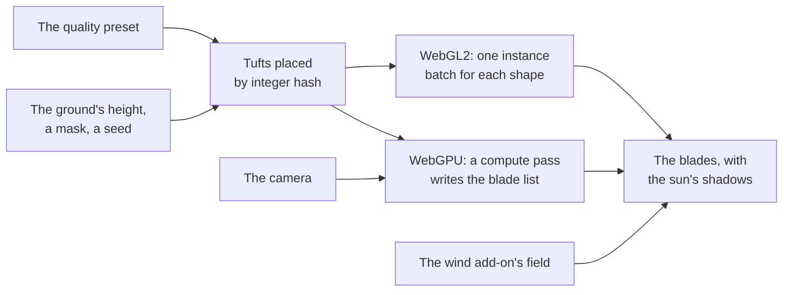
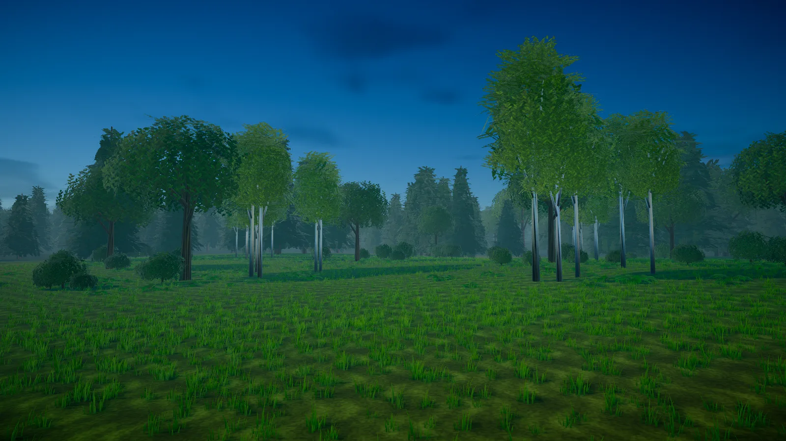
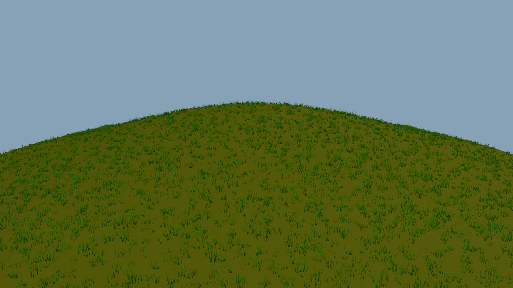
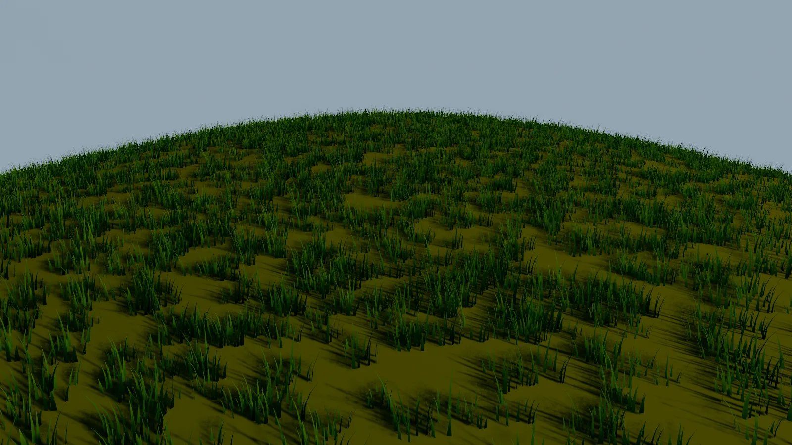

# Grass (@null3d/grass)



`@null3d/grass` draws tufts of bent blades over a square of ground. One seed places the same tufts on every device, and the blades bend in the air of the wind add-on's field. On WebGPU a compute pass builds the blade list each frame, culls it to the view and thins the far tufts. WebGL2 draws the same rows as an instance batch. The grass casts and receives the sun's shadows on both paths.



The plants in wind demo. On feature-instances: the grass add-on places and counts its blades with a compute pass on WebGPU.

The package is built on the engine's public API. Its two shaders ship compiled, so your build does not compile them. It reads the field of `@null3d/wind`, which it lists as a peer dependency.

```sh
bun add @null3d/grass @null3d/wind
```

```ts
// sketch.ts
import { defineSketch } from '@null3d/engine';
import { createGrass, swayDistanceFor } from '@null3d/grass';
import { createWind } from '@null3d/wind';

export default defineSketch(async (ctx) => {
  const { scene, quality, geometry, materials } = ctx;
  const camera = scene.createPerspectiveCamera({ position: [0, 2, 12], target: [0, 0, 0] });
  scene.setActiveCamera(camera);
  scene.createDirectionalLight({ direction: [-0.4, -1, -0.3], intensity: 3, castShadows: true });

  const height = () => 0;
  scene.setBackground('#8fb3cf');
  scene.createMesh({
    mesh: geometry.plane({ width: 40, height: 40 }),
    material: materials.standard({ color: '#4f6b2a' }),
    rotation: [-Math.SQRT1_2, 0, 0, Math.SQRT1_2],
    receiveShadows: true,
  });
  const wind = createWind(ctx, { camera, box: 128 });
  wind.setBase(3, 0.4);
  const grass = await createGrass(ctx, {
    height,
    area: { x: 0, z: 0, size: 40 },
    count: 20000,
    seed: 7,
    wind: wind.field,
    camera,
    swayDistance: swayDistanceFor(quality.preset),
  });
  quality.onChange(() => {
    grass.fit(quality.preset);
    grass.setSwayDistance(swayDistanceFor(quality.preset));
  });

  return {
    onUpdate() {
      wind.update();
      grass.setWindLayer(wind.field);
    },
  };
});
```

## Grass on the ground

`await createGrass(ctx, options)` draws tufts of bent blades over a square of ground. Await the call in the sketch's setup, because WebGPU makes its draw then. The [`GrassOptions` table](reference/grass.md#grassoptions) lists every option with its default.



Grass counts follow the preset.

The tufts stand on `height(x, z)` and skip ground steeper than `maxSlope`. They also skip ground that `mask` refuses, such as water or a footprint, and ground that `where` refuses, such as a road. A tuft grows only where both allow it.

`count` is the tufts at the High preset. Low, Medium and Ultra draw 0.35, 0.6 and 1.25 of it. `createGrass` fits the engine's starting preset, and `grass.fit(preset)` takes a new one.

<details>
<summary>Technical details: how the tufts are placed</summary>

Each tuft's turn and size come from integer hashes, so one seed places the same grass on every device. Each tuft's tint comes from a hash of its root's place, in the shader.

</details>

The blades bend in the wind add-on's field. Give `createGrass` its `wind` field, and call `grass.setWindLayer(field)` in each frame with the field's newest state. A page that gives no field grows grass that stands still.

## The blade shape

Without a shape, each blade narrows to a point from its root. The `blade` option gives every blade one shape. Its `widthAt(t)` is the blade's width in meters at a share `t` of its length, from 0 at the root to 1 at the tip. Its `fold` is the degrees that each half rises from the keel.

A blade with a fold draws a vertex at its keel, so its two halves light apart. Give a plant's own blade with the plant's own `color`, so the cover reads as the same grass where the plant stands.

```ts
const grass = await createGrass(ctx, {
  height,
  area: { x: 0, z: 0, size: 40 },
  count: 20000,
  seed: 7,
  color: '#648e29',
  blade: { widthAt: (t) => 0.008 * Math.sqrt(1 - t * t), fold: 25 },
});
```

## The two GPU paths

On WebGPU and compatibility mode a compute pass builds the blade list. It writes each tuft's row and the count into a draw that the frame culls no further. The engine copies the count into the main view and every drawn shadow view.

Give the pass the drawing `camera`, and it culls the tiles outside the view and thins the far tufts. A far tuft draws the share that its root's hash picks. Its blades widen by the inverse of that share, so the hill's cover stays the same.

The draw shader then culls each view to its own box, from that view's matrix. The camera's view draws its frustum. A light's view draws its cascade, whose box reaches toward the light over the casters. So a shadow view does not draw the whole kept list.

WebGL2 fills one instance batch for each tuft shape on the CPU. Its vertex shader applies the same share and the same per-view cull, so both paths draw the same hill. The rows are built for Ultra's share once. A preset change then changes only how many rows draw, not the memory. A page that drives the rows itself gives `compute: false`, which keeps the instance batch on both paths.

The tuft meshes plan no levels of detail: the wind bends their blades in the shader, and the tufts thin with distance by themselves.

## Shadows and the sway distance

The grass casts and receives the sun's shadows on both paths. Far shadow cascades draw only every few frames, unless a moving caster touches them. Swaying blades count as moving, so by default the far cascades draw in every frame ([Shadows](../concepts/shadows.md#update-rates)).



Near grass shadows.

Give the grass a `swayDistance` to stop the blades past that distance. Then a far cascade that only the grass reaches keeps its turns. The default, 0, sways at every distance. Call `grass.setSwayDistance(distance)` when the preset changes.

`swayDistanceFor(preset)` gives each preset's distance from `PLANT_SWAY_DISTANCE`: 8, 16, 24 and 32 meters from Low to Ultra. Give a swaying plant's material the same distance, so plants and grass stop at one line. The ground's own color and the blades' root colors should meet at the hill's foot.

## The placement hash

`@null3d/grass/hash` holds the integer hash that places the tufts: `pcg(value)`, `hashAt(seed, a, b, c, d)` and `unitAt(seed, a, b, c, d)`, a choice from 0 to 1. It has the same bits as the shaders' `null3d::noise::pcg`, so a page can reproduce a choice in WGSL. The entry imports nothing, so code that runs on the job workers can use it.

## API reference

[The API reference](reference/grass.md) lists every export of this page with its type and description. The engine's doc comments make it.

## Related pages

- [Wind](wind.md): the field of air that the blades bend in.
- [Add-on instance draws](feature-instances.md): the draw whose count the blade list writes.
- [Shadows](../concepts/shadows.md#update-rates): how the far cascades keep their layers.
- [Quality API](quality.md): the preset and the frame-budget governor.
