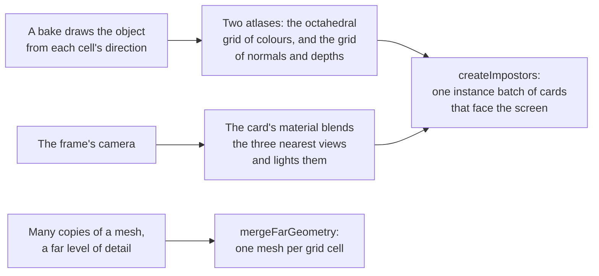

# Impostors

> Roadmap step 0.2, first released in null3D 0.1.0. The API is experimental, so it can still change between versions. Not built yet: a bake helper that draws the views with the engine's scene passes, and an `assets impostor` command. Coding agents must not use these yet.

The demo "Impostors" in `examples/impostors` draws a pine forest three ways by distance. Level-of-detail meshes stand near, one merged mesh stands per grid cell in the middle, and cards of a code-made atlas stand far out. Press L there to draw the far band as meshes instead, and compare.



A far object covers few pixels, so its triangles cost work that no one sees. A level of detail cuts the triangles but keeps one draw per object. An impostor goes further. A bake draws the object from many directions into atlases ahead of time. Far away, the object draws as one card that faces the screen. The card blends the three stored views nearest the camera, and the light falls on it from the normals the bake stored, so a card follows the scene's sun. Many cards draw in one instance batch.

`@null3d/impostors` holds the cards and a second tool for far geometry. `mergeFarGeometry` writes many copies of a mesh into the arrays of one mesh. A whole grid cell of a forest or a skyline then draws in one draw.

## Install

The package is an add-on. Install it beside the engine, and import it where a sketch needs it.

```sh
bun add @null3d/engine @null3d/impostors
```

## Create the cards

`createImpostors` makes one instance batch: one quad per position, drawn by the package's material. Each quad faces the screen, and the material blends the three atlas views nearest the direction from the card toward the eye. The cards cull and draw as any batch does, on WebGPU and WebGL2.

```ts
import { createImpostors, octahedralAtlas } from '@null3d/impostors';
import { defineSketch } from '@null3d/engine';

export default defineSketch(({ scene, materials, geometry, assets }) => {
  const camera = scene.createPerspectiveCamera({ position: [0, 8, 30], target: [0, 3, 0] });
  scene.setActiveCamera(camera);

  // The atlases hold the object's views. A bake makes them, or a tool writes them.
  const atlas = octahedralAtlas(8);
  const color = await assets.loadTexture('forest-tree-impostor.png');
  const surface = await assets.loadTexture('forest-tree-impostor-surface.png');
  const positions = new Float32Array(20_000 * 3);
  for (let i = 0; i < 20_000; i++) {
    positions.set([(i % 100) * 2 - 100, 0, Math.floor(i / 100) * 2 - 100], i * 3);
  }
  const trees = createImpostors(
    { scene, materials, geometry },
    { color, surface, atlas, positions, size: 6, alphaMode: 'mask' },
  );
});
```

The cards need no per-frame call. The material reads the eye from the frame's camera, so a camera that flies through the forest changes what every card shows with nothing written on the CPU. That is also why the cards take world positions: the engine draws everything relative to the camera, so a forest far from the world's origin keeps the precision of 32-bit floats.

The cards are a static batch. After you change cards' positions or sizes through `trees.batch`, call `trees.markDirty(start, count)` for those cards. The batch uploads them, and the next frame draws them where they now stand.

A card's light comes from the scene's lights, as a mesh's does. The surface atlas holds each view's normal, so the sun lights the side of the tree that it would light on the mesh.

## The atlas and its cells

`octahedralAtlas(views)` gives the squarest grid that holds at least `views` views, as `{ columns, rows }`. The cells count from the top left, along each row and then down, as an image's rows do. The rows of the texture run from the bottom up, as `textures.fromData` reads them.

`frameDirection(frame, atlas)` gives the direction a cell's view is drawn from. `impostorFrame(direction, atlas)` gives the cell a direction shows. A bake walks `frameDirection` over every frame. The cards pick their cells as `impostorFrame` does. The two agree on every cell, because they are inverses. `encodeOctahedral` and `decodeOctahedral` fold the directions onto one square. The front half of the sphere fills the square's middle diamond, and the back half fills its four corners. So a grid covers both poles too. The back pole, straight behind, lands on the corner at the bottom right.

A bake needs the direction of each cell and one camera per cell, looking from that direction at a distance that frames the object. The engine's [`render.addPass`](../concepts/render-graph.md) draws a camera's view into a texture. So a sketch can bake the views at run time and copy them into one atlas.

## The surface atlas

The second atlas holds what the card's light needs, in the cells of the first: red and green are the octahedral code of the view's normal, blue is the point's depth from the view's front, 0, to its back, 1, and alpha is its coverage. The normal lies in the view's space, where x and y run across and up the picture and z points at the viewer, so the bake stores the surface itself and never its light.

`encodeImpostorSurface(normal, depth, coverage, out)` writes those four bytes. A bake calls it for each texel of each cell, after `frameDirection` gives the cell's direction. Nothing reads the depth yet: the hand-over from a card to the mesh beside it will use it.

The demo's bake in `examples/impostors/forest.ts` shows the whole loop.

## Merged far geometry

`mergeFarGeometry(parts)` writes copies of a mesh's arrays into the arrays of one mesh, each copy moved by its own transform. It returns `MeshArrays` for `geometry.fromArrays`. Positions and indices are always kept. Attach normals, texture coordinates, colors and tangents when every copy has them. A copy's normals turn by the inverse transpose of its transform, so a stretched copy keeps its shading. Its tangents turn with it, so its normal map lights from the right side. A mirrored copy, such as one scaled by -1 along an axis, gets its triangles' winding reversed and its tangents' sign flipped. So its front faces stay outward.

```ts
import { farCellGroups, mergeFarGeometry } from '@null3d/impostors';

// The arrays that made each mesh's far level, and where each copy sits.
const centers = trees.map((tree) => tree.position);
for (const group of farCellGroups(centers, 64)) {
  const merged = mergeFarGeometry(group.map((i) => ({
    arrays: treeFarArrays,
    transform: place(trees[i]),
  })));
  scene.createMesh({ mesh: geometry.fromArrays(merged), material });
}
```

`farCellGroups(centers, cellSize)` groups copies by the cell of the grid their centers fall in, so each group becomes one mesh. The detailed levels stay for what is near, and the merged far meshes draw as single objects.

## Compared with three.js

three.js has no impostor or merged-far-geometry helper. Its `LOD` picks one whole object by distance, which null3D does with [`mesh.setLevels`](geometry.md). Build the atlases and the merged meshes outside a three.js renderer too, and draw the cards as `InstancedMesh` of one quad with a `ShaderMaterial`, and the merged mesh as a `Mesh`.

## API reference

[The API reference](reference/impostors.md) lists every export of this page with its type and description. The package's doc comments make it.
