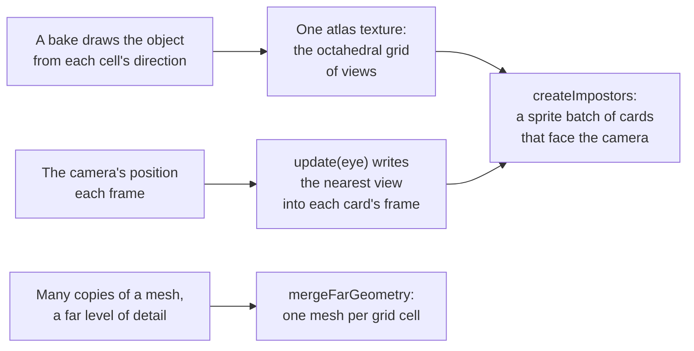

# Impostors

> Roadmap step 0.2, first released in null3D 0.1.0. The API is experimental, so it can still change between versions. Not built yet: a bake helper that draws the views with the engine's scene passes, blending the three nearest views, an `assets impostor` command, and a demo. Coding agents must not use these yet.



A far object covers few pixels, so its triangles cost work that no one sees. A level of detail cuts the triangles but keeps one draw per object. An impostor goes further. A bake draws the object from many directions into one atlas ahead of time. Far away, the object draws as one card that faces the camera. The card shows the stored view nearest the camera. Many cards draw in one sprite batch.

`@null3d/impostors` holds the cards and a second tool for far geometry. `mergeFarGeometry` writes many copies of a mesh into the arrays of one mesh. A whole grid cell of a forest or a skyline then draws in one draw.

## Install

The package is an add-on. Install it beside the engine, and import it where a sketch needs it.

```sh
bun add @null3d/engine @null3d/impostors
```

## Create the cards

`createImpostors` makes one sprite batch: one card per position, each showing a cell of the atlas. The cards face the camera, cull and sort as every sprite does, on WebGPU and WebGL2.

```ts
import { createImpostors, octahedralAtlas } from '@null3d/impostors';
import { defineSketch } from '@null3d/engine';

export default defineSketch(async ({ scene, assets }) => {
  const camera = scene.createPerspectiveCamera({ position: [0, 8, 30], target: [0, 3, 0] });
  scene.setActiveCamera(camera);

  // The atlas holds the object's views. A bake makes it, or a tool writes it.
  const atlas = octahedralAtlas(8);
  const texture = await assets.loadTexture('forest-tree-impostor.png');
  const positions = new Float32Array(20_000 * 3);
  for (let i = 0; i < 20_000; i++) {
    positions.set([(i % 100) * 2 - 100, 0, Math.floor(i / 100) * 2 - 100], i * 3);
  }
  const trees = await createImpostors(scene, {
    texture,
    atlas,
    positions,
    size: 6,
    center: [0.5, 0],
    alphaMode: 'mask',
  });

  return {
    onUpdate() {
      trees.update(camera.position);
    },
  };
});
```

`update(eye)` writes into each card the cell nearest the direction from the card toward the eye. Call it once a frame with the camera's position. It writes only the frame numbers, so it allocates nothing. A card shows one view: three-way blending is a later step.

## The atlas and its cells

`octahedralAtlas(views)` gives the squarest grid that holds at least `views` views, as `{ columns, rows }`. The cells count from the top left, along each row and then down, as a sprite atlas does.

`frameDirection(frame, atlas)` gives the direction a cell's view is drawn from. `impostorFrame(direction, atlas)` gives the cell a direction shows. A bake walks `frameDirection` over every frame. The cards call `impostorFrame`. The two agree on every cell, because they are inverses. `encodeOctahedral` and `decodeOctahedral` fold the directions onto one square. So a grid covers the poles too.

A bake needs the direction of each cell and one camera per cell, looking from that direction at a distance that frames the object. The engine's [`render.addPass`](../concepts/render-graph.md) draws a camera's view into a texture. So a sketch can bake the views at run time and copy them into one atlas.

## Merged far geometry

`mergeFarGeometry(parts)` writes copies of a mesh's arrays into the arrays of one mesh, each copy moved by its own transform. It returns `MeshArrays` for `geometry.fromArrays`. Positions and indices are always kept. Attach normals, texture coordinates, colors and tangents when every copy has them. A copy's normals turn by the inverse transpose of its transform, so a stretched copy keeps its shading.

```ts
import { farCellGroups, mergeFarGeometry } from '@null3d/impostors';

// The arrays that made each mesh's far level, and where each copy sits.
const centers = trees.map((tree) => tree.position);
for (const group of farCellGroups(centers, 64)) {
  const merged = mergeFarGeometry(group.map((i) => ({
    arrays: treeFarArrays,
    transform: place(trees[i]),
  })));
  scene.createMesh({ mesh: geometry.fromArrays(merged), material });
}
```

`farCellGroups(centers, cellSize)` groups copies by the cell of the grid their centers fall in, so each group becomes one mesh. The detailed levels stay for what is near, and the merged far meshes draw as single objects.

## Compared with three.js

three.js has no impostor or merged-far-geometry helper. Its `LOD` picks one whole object by distance, which null3D does with [`mesh.setLevels`](geometry.md). Build the impostor atlas and the merged meshes outside a three.js renderer too, and draw the cards as `Sprite`s and the merged mesh as a `Mesh`.

## API reference

[The API reference](reference/impostors.md) lists every export of this page with its type and description. The package's doc comments make it.
