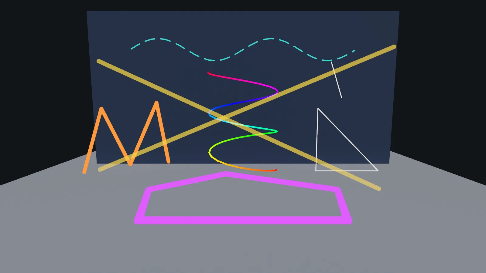
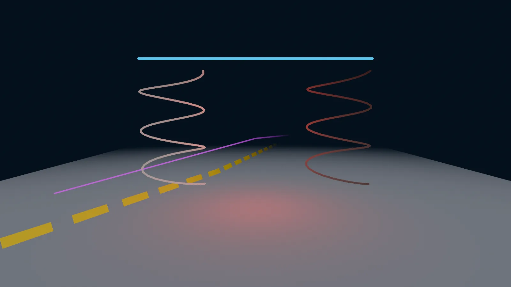

# Lines


A line batch draws line segments of any width between points, such as paths, outlines, graphs, trails, laser beams and the edges of a map. Each segment is a quad with round ends that faces the camera, so lines look the same on WebGPU and WebGL2 at every width. Where two segments meet, their round ends overlap and make a round join.

Each point is a row in the batch's typed arrays, with its own position and color. Sketch code writes the points straight into engine memory, with no call per point, as it does for [instance batches](../concepts/instances.md). A batch is one draw for the GPU, whatever its size. The engine culls each segment and sorts blended segments back to front, as it does for instance rows. The [sprites and lines demo](https://github.com/null3d-engine/null3d/tree/main/examples/sprites-lines) draws a lit helix in world units and a ring of moving dashes.

```ts
import { color, defineSketch } from '@null3d/engine';

export default defineSketch(async ({ scene, time }) => {
  scene.setActiveCamera(scene.createPerspectiveCamera({ position: [0, 2, 8], target: [0, 1, 0] }));

  // A spiral of 200 points, each with a color from red at the bottom to blue at the top.
  const count = 200;
  const positions = new Float32Array(count * 3);
  const colors = new Float32Array(count * 3);
  const red = color.fromHex([0, 0, 0], '#ff4040');
  const blue = color.fromHex([0, 0, 0], '#4080ff');
  for (let i = 0; i < count; i++) {
    const t = i / (count - 1);
    positions.set([Math.cos(t * 30) * 1.5, t * 3, Math.sin(t * 30) * 1.5], i * 3);
    for (let k = 0; k < 3; k++) colors[i * 3 + k] = (red[k] ?? 0) * (1 - t) + (blue[k] ?? 0) * t;
  }
  const spiral = await scene.createLines({ positions, colors, width: 4, dynamic: true });

  // A dashed square on the ground, 0.05 world units wide, whose dashes march along it.
  const square = await scene.createLines({
    positions: [-2, 0, -2, 2, 0, -2, 2, 0, 2, -2, 0, 2],
    mode: 'loop',
    width: 0.05,
    worldUnits: true,
    dashed: true,
    dashSize: 0.3,
    gapSize: 0.2,
  });
  const dashes = { dashOffset: 0 }; // one object, changed in place

  return {
    onUpdate() {
      const points = spiral.positions; // read the views in each frame
      for (let i = 0; i < count; i++) {
        const t = i / (count - 1);
        points[i * 3] = Math.cos(t * 30 + time.now) * 1.5;
        points[i * 3 + 2] = Math.sin(t * 30 + time.now) * 1.5;
      }
      dashes.dashOffset = -time.now;
      square.material.set(dashes);
    },
  };
});
```

## Create a batch

`scene.createLines(options)` returns a promise of the batch. The first call downloads the line code, so a page without lines never downloads it. Await the call in the setup function, as the example does. If the line code does not download, the promise rejects with [E1406](../errors/E1406.md).

`scene.createLines` takes these options:

| Option | Default | What it does |
| --- | --- | --- |
| `positions` | None: it is required | The points, 3 numbers each. Their number is the batch's capacity, which never changes |
| `colors` | White | Linear RGB colors, 3 numbers per point, which multiply `color` |
| `mode` | `'strip'` | Which points each segment joins: `'strip'` joins each point to the next, `'loop'` also joins the last point to the first, and `'segments'` joins the points in pairs |
| `width` | 1 | The width in CSS pixels, or in world units with `worldUnits` |
| `worldUnits` | `false` | `true` gives the width in world units, so far lines look thinner |
| `dashed` | `false` | `true` draws dashes and gaps along the lines |
| `dashSize` | 1 | The length of each dash along the line. At `dashScale` 1 it is in world units |
| `gapSize` | 1 | The length of each gap between dashes |
| `dashScale` | 1 | A factor that divides the dash and gap sizes, so a larger value makes shorter dashes |
| `dashOffset` | 0 | How far along the line the dashes start |
| `lit` | `false` | `true` lights the lines as a standard material lights a surface that faces the camera |
| `color` | White | A color that multiplies every point's color |
| `opacity` | 1 | An opacity that multiplies every segment's alpha |
| `metalness`, `roughness` | 0, 1 | With `lit`, how metallic and how rough the lines' surface is |
| `emissive`, `emissiveIntensity` | Black, 1 | With `lit`, the light that the lines give off |
| `alphaMode` | `'opaque'` | `'blend'` blends each segment over what lies behind it, with `opacity`. `'opaque'` ignores the opacity |
| `blending` | `'normal'` | With the `blend` mode: `'normal'`, `'additive'` for glows and lasers, or `'multiply'`. Lines do not take `'weighted'`, which throws E1217 |
| `fog` | `true` | `false` keeps the lines out of the scene's fog |
| `depthWrite` | `true` | `false` writes no depth, so a line hides nothing behind it |
| `depthTest` | `true` | `false` draws the lines in front of everything |
| `depthBias` | None | Moves the lines' depth, as for any [material](materials.md) |
| `dynamic` | `false` | `true` updates and uploads every segment in use, in every frame. A static batch updates only the segments of the points that you mark |
| `layers` | `1`, layer 0 | The [layers](../concepts/render-layers.md) of every segment, as a 32-bit mask |
| `origin` | `[0, 0, 0]` | The point that every point's position is relative to, kept at full precision: [Batch origins](../concepts/large-worlds.md#batch-origins) |

A strip or a loop needs at least 2 points, and `segments` an even number of points.

| Input | Error |
| --- | --- |
| Positions not a multiple of 3, fewer than 2 points, an odd count for `segments`, or `colors` of another length | E1206 |
| A number in `positions` or `colors` that is not finite | E1206, in development builds |
| An unknown mode | E1217 |
| A width not above 0, or a negative dash size, gap size or dash scale | E1108, in development builds |
| A width or dash value that is not finite | E1203, in development builds |

`lines.material.set` changes the look of every segment at any time. It takes `color`, `opacity` and the four dash values, and for lit lines `metalness`, `roughness`, `emissive` and `emissiveIntensity`. `lines.setWidth(width)` changes the width and updates every segment once. The other options are fixed when the batch is created.

<details>
<summary>Technical details: the cost of a change in every frame</summary>

A change of the dashes alone converts nothing, and the line keeps them in the engine's own memory. The call reads the options object that you pass. Where the same call has seen objects of a few shapes, the browser boxes each number, so a change in every frame costs a few bytes a frame.

</details>

## The point arrays

| Array | Values per point | What each point holds | A new point holds |
| --- | --- | --- | --- |
| `positions` | 3 | Its position in the world (x, y, z), relative to the batch's `origin` | The value from `positions` |
| `colors` | 3 | A linear color (r, g, b) | The value from `colors`, or 1, 1, 1 |

Point `i` starts at index `i * 3` in both arrays. Both are `Float32Array` views of engine memory, and the rules of [instance batches](../concepts/instances.md#the-row-arrays) apply. Read the arrays from the batch each time you use them, such as at the start of `onUpdate`. A view from before the engine's memory grew can be empty.

A segment blends from the color of its first point to the color of its second. The engine stores each point's color with 8 bits for each channel, in sRGB. So colors from 0 to 1 draw, and colors given as sRGB hex strings come back exactly. A `color` on the material takes components from 0 to 1, as every color does. Convert an sRGB color, such as a hex string, with `color.fromHex` from the [math helpers](math.md).

For a line brighter than 1, for [bloom](post.md), use a lit line with `emissive` and an `emissiveIntensity` above 1. Give it a black `color`, so the scene's lights add nothing.

## Static and dynamic batches

A static batch, the default, updates only the segments of the points that you mark with `markDirty(start, count)`. On a dashed line, the segments after them update too, because their distance along the line changes. A dynamic batch updates every segment in use in every frame, and needs no marks. Use a dynamic batch for trails and lines that move every frame, and a static batch for paths and outlines that rarely change.

- `setActiveCount(n)` draws only the segments between the first `n` points. A loop then closes from point `n - 1` back to point 0. Use it for a trail or a graph that grows.
- `setLayers(mask)` moves every segment to other layers.
- `destroy()` removes the batch and frees its points. After it, stop using the batch and its arrays.

## Widths in pixels and in the world

With `worldUnits: false`, the default, the width is in CSS pixels, at every distance and on every screen. A line 4 pixels wide shows 4 CSS pixels wide, and the engine scales it by the device's pixel ratio. Use it for outlines, paths and graphs that must stay readable.



Line widths in world units. Use this picture here and lines-lit under Lit lines, so no picture shows twice.

With `worldUnits: true`, the width is in world units. A line 0.1 units wide is as wide as a rod 0.1 units thick at the same distance, so far lines look thinner. Use it for roads, cables and beams that belong to the world.

The engine culls each segment by a sphere around it. With a width in world units, the sphere holds the whole width. A width in pixels has no size in the world, so the sphere holds the segment's center line alone. A segment whose center line lies just outside the view can then lose the part of its width that reaches into it.

## Dashes

A dashed line draws `dashSize` along the line, then leaves a gap of `gapSize`, from the start of its first segment. The line divides its world distance by `dashScale` before it compares, so a dash is `dashSize / dashScale` world units long. `dashOffset` moves the dashes along the line. Dashed lines have flat ends with no round caps.

The engine keeps each segment's distance along the line. When a point of a static dashed batch moves, the update finds the distances again from that point to the end, one segment after another. A long dashed line that changes every frame costs more than one without dashes.

## Lit lines

`lit: true` shades the lines as a [standard material](materials.md) shades a surface that faces the camera, with the line's color as its base color. The sun, the point and spot lights near each segment and the ambient and hemisphere lights light it, and `emissive` adds light of its own. Lines without `lit` draw their color as it is, whatever the lights. Both kinds take the scene's fog.



Lit and unlit lines.

## Blending, sorting and depth

Blended lines draw after the opaque objects, farthest first, in the same transparent pass as other blended objects. The engine sorts each segment by the depth of its middle in the camera's view. Where two segments of one blended line meet, their round ends overlap and blend twice. A line that blends with `blending: 'additive'` and `depthWrite: false` needs no exact order to look right. Lines do not cast or receive shadows, and overlap queries do not find them.

## Debug lines

`debug.line` and the other [debug](debug.md) calls draw lines one pixel wide in development builds only, with no culling and no batch to manage. Use them while you build a scene, and line batches for lines that ship with it.

## Clicks and raycasts

A raycast hits a segment when the ray passes within half the line's width of it. The width counts in pixels on the screen or in world units, as the line draws. The `lineThreshold` option changes the test: a ray then hits a segment within that many meters, whatever the line's width. A ray hits a dashed line in its gaps too.

The hit's `object` is the batch, and its `instance` is the segment. A line batch takes `lines.on('click', handler)` and the other [pointer events on objects](input.md#pointer-events-on-objects), as an instance batch does. [Raycasting](raycast.md#sprites-points-and-lines) has the details.

## Speed

A segment costs about as much as an instance row on the GPU and in culling. The engine packs each segment into the data that it keeps for an instance row. So segments share the culling, sorting and drawing of instance batches. One batch of 100,000 segments draws in one draw on WebGPU and WebGL2.

Every segment counts toward the device's limit of objects and instance rows, as an instance row does ([Instances and batching](../concepts/instances.md#limits)). Each point takes about 170 bytes of engine memory. Line batches count toward the limit of 512 instance batches.

## API reference

[The API reference](reference/lines.md) lists every export of this page with its type and description. The engine's doc comments make it.
