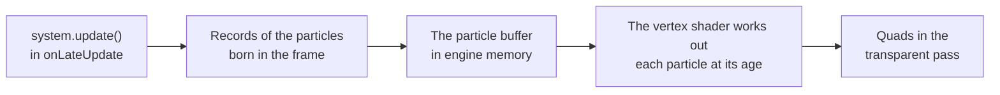

# Particles (@null3d/particles)

> Roadmap step 0.2, first released in null3D 0.1.0. The API is experimental, so it can still change between versions. Particles do not cast shadows, lights do not light them, and a system does not sort its own particles back to front. Coding agents must not use these parts.



The `@null3d/particles` package makes particle systems: sparks, fire, smoke, dust, rain, falling leaves, fireflies and magic. A system is an emitter and a buffer of particles. The emitter decides where and when particles are born. The GPU moves each particle, turns it and changes its color and size over its life.

The GPU works out each particle in closed form, from its birth and its age. The CPU writes a particle's record once, when the particle is born, and no pass simulates the particles. So a system of a million particles costs the CPU only its births, and it draws the same on WebGPU and WebGL2. A held frame at a given time is the same whatever frames came before it.

```sh
bun add @null3d/particles
```

```ts
// sketch.ts
import { defineSketch } from '@null3d/engine';
import { createParticles, particleTextures } from '@null3d/particles';

export default defineSketch(async (ctx) => {
  const { scene, textures } = ctx;
  scene.setActiveCamera(scene.createPerspectiveCamera({ position: [0, 2, 6], target: [0, 1, 0] }));
  const sparks = await createParticles(ctx, {
    ...particleTextures.spark(textures),
    position: [0, 0.5, 0],
    rate: 200,
    lifetime: [0.6, 1],
    shape: { type: 'sphere', radius: 0.05 },
    speed: [2, 4],
    gravity: [0, -9.8, 0],
    facing: 'velocity',
    stretch: 0.04,
    size: [0.03, 0.05],
    colors: ['#ffb060', '#ffd090'],
    intensity: 4,
    colorOverLife: ['#ffffff', '#ff7030'],
    alphaOverLife: [1, 0],
  });
  return {
    onLateUpdate() {
      sparks.update();
    },
  };
});
```

Pass the whole sketch context, `ctx`, as the first argument: the system reads its scene, and the frame's step from its clock. Call `update()` once per frame in `onLateUpdate`. There, objects' world places are the frame's, so an emitter that follows a moving object starts its particles where the object is now. `update` allocates nothing, once the table of a system with sub-emitters has grown. `update(dt)` steps by `dt` seconds in place of the frame's step.

## Emitters

An emitter gives birth to particles at a steady `rate` per second, in `bursts`, or both. Births fall at even times through each frame, so a stream looks the same at 30 and 120 frames per second.

| Option | What it does | Default |
| --- | --- | --- |
| `rate` | Particles born per second. Change `system.rate` at any time. | 0 |
| `bursts` | `{ time, count, interval?, cycles? }`: `count` particles at `time` seconds, then every `interval` seconds. | none |
| `lifetime` | Seconds that each particle lives, a number or `[min, max]`. | 1 |
| `shape` | Where particles are born: `point`, `sphere`, `cone`, `box` or `disc`. | `point` |
| `speed` | The start speed in meters per second, a number or `[min, max]`. | 1 |
| `direction`, `spread` | The way particles set off from a point, box or disc, and a random angle around it. | up, 0 |
| `velocity` | A velocity that every particle adds at birth. | none |
| `duration`, `loop` | Seconds of emission, and whether to start again after them. | no end, true |
| `prewarm` | Starts as if the system had run for its longest lifetime. | false |
| `capacity` | The most particles alive at once. The default fits the rate and bursts. | |
| `seed` | The seed of the random numbers. | 1 |

A `sphere` sends particles outward from its center. A `cone` sends them up within its `angle`, as a fountain or a flame does. Call `system.burst(count)` to add a burst at any time. Set `system.emitting = false` to stop the emitter, and live particles live out their lives.

### Where particles live

By default, particles live in the space of the system's object. Moving the object, or its `parent`, moves every particle with it, as the flame of a torch that a character carries does.

With `follow: object`, the system emits from that object's place and turn, and particles stay in the world where they were born. A moving emitter then leaves a trail, as smoke from a torch or a jet's exhaust does. Births between two frames fall between the object's two places, so fast trails stay smooth.

### Sub-emitters

A sub-emitter is another system that bursts where a particle of this system dies or first meets the ground. A firework's rocket bursts into sparks, and a raindrop splashes.

```ts
const sparkle = await createParticles(ctx, { lifetime: 1.2, speed: [3, 5], shape: { type: 'sphere', radius: 0.1 } });
const rockets = await createParticles(ctx, {
  rate: 0.8,
  lifetime: 1.4,
  speed: 14,
  gravity: [0, -9.8, 0],
  subEmitters: [{ system: sparkle, on: 'death', count: 120, inheritVelocity: 0.3 }],
});
```

Update the sub-emitter's system after its parent's in each frame, so its bursts start in the same frame.

## Motion

The GPU moves each particle in closed form. Every vector is in the space of the system's object.

| Option | What it does |
| --- | --- |
| `gravity` | An acceleration, in meters per second squared. |
| `drag`, `wind` | How fast, per second, particles take on the wind's velocity. Smoke and leaves drift with it. |
| `turbulence` | How far simplex noise moves each particle from its path, in meters. `turbulenceScale` sets the swirls' size, and `turbulenceSpeed` how fast they change. |
| `groundHeight`, `groundMode` | A ground plane where particles `bounce` (up to twice, with `restitution` and `friction`), `stick` or `kill`. |

## Look

| Option | What it does |
| --- | --- |
| `size`, `sizeOverLife` | The start size in meters, `[min, max]`, and a curve that scales it over life. |
| `colors` | The color at birth, or two colors that each particle mixes at random. Colors take a hex string or number in sRGB, or three linear components. |
| `colorOverLife`, `alphaOverLife` | A tint over life that multiplies the birth color, and the alpha over life. |
| `intensity`, `opacity` | Factors on the color and the alpha. An intensity above 1 makes light that blooms, as fire and sparks need. |
| `rotation`, `spin` | The start turn in radians and the spin in radians per second, each `[min, max]`. |
| `facing` | `camera`, `velocity` (stretched by `stretch`, for sparks and rain), `ground` (flat, for ripples) or `tumble` (for leaves). |
| `blending` | `additive` for fire, sparks and glows, or `normal` for smoke and leaves. |
| `map`, `flipbook` | A texture, or a grid of frames that each particle plays through. |
| `softness` | Fades particles where they near the surfaces behind them, over this distance in meters. |
| `nearFade` | Fades particles within this distance of the camera, so none fills the view. |

Curves over life give values at even steps from birth to death, and the GPU blends between steps. Each curve keeps up to 16 steps.

Without a map, each particle is a soft round dot. `particleTextures` makes textures in code, so a page downloads no image for them. Each function takes the sketch's `textures`, and returns a map with its flipbook to spread into the options.

| Texture | Use |
| --- | --- |
| `particleTextures.glow` | Fireflies, embers and magic: a soft glow with a bright core. |
| `particleTextures.spark` | Sparks and tracers, with the `velocity` facing. |
| `particleTextures.smoke` | Smoke, dust and steam: sixteen frames of a puff that billows and thins. |
| `particleTextures.flame` | Fires and torches: sixteen frames of a flame tongue. |
| `particleTextures.rain` | Rain, with the `velocity` facing. |
| `particleTextures.leaves` | Falling leaves and petals: four leaf shapes, one per particle. |

### Soft particles

A particle that crosses the ground or a wall shows a hard line where it cuts into it. With `softness`, the particle fades out as it nears the surface behind it. The camera's view then copies its opaque depth once per frame, after its opaque objects, and the copy costs one full-screen pass. Frames without a soft system copy nothing. Views other than the camera's draw particles without the fade. The Low preset turns the `softParticles` quality setting off, so phones keep one render pass and draw particles with hard edges.

## Drawing

A system is one scene object, with one draw of all its particles. It sorts among the other blended objects by its bounds. Its own particles draw in the order they were born, so `additive` blending, which needs no order, suits most effects. With `normal` blending, keep particles soft and faint, as smoke is.

The system keeps its object's culling sphere around its live particles, from where they were born and how far they can move. Particles do not cast shadows, and lights do not light them. Fog fades them as it fades other surfaces. Additive particles fade out in fog, and others take on its color.

`system.set(values)` changes the motion and the look at any time. `system.destroy()` removes the system and its particles.

## Speed

Each live particle costs the GPU one quad, whose vertex shader works out its state. The CPU writes 32 bytes per birth, and uploads only the records born in the frame. A system with a large capacity costs vertex work for every record, live or not, so size `capacity` for the particles you need.

The GPU keeps birth times as 32-bit floats. So every 1,024 seconds, a system moves the time that its birth times count from. It rewrites the records' birth times 16,384 at a time, one share per frame, so even a system of a million particles adds no long frame. A system with sub-emitters keeps a table of the events to come, 80 bytes per event. It starts small and doubles while the system warms up, up to one event per sub-emitter for each particle.

## Compared with three.js

three.js has no particle system of its own. Projects build one from `THREE.Points` or `InstancedMesh` with a custom shader, and move the particles on the CPU each frame. Others use a library such as three.quarks or three-nebula.

| three.js | null3D |
| --- | --- |
| `THREE.Points` with a `PointsMaterial`, moved on the CPU | `createParticles`, moved on the GPU |
| A sprite atlas in `PointsMaterial.map` | `map` with `flipbook` |
| `blending: THREE.AdditiveBlending`, `depthWrite: false` | `blending: 'additive'`; particles never write depth |
| Velocity and gravity updated in the loop | `speed`, `gravity`, `drag`, `wind` and `turbulence` |
| three.quarks's `ParticleSystem` and `BatchedRenderer` | `createParticles`, with `system.update()` in `onLateUpdate` |

## Related pages

- [Sprites](sprites.md): quads that the sketch moves itself, one per row.
- [Points](points.md): squares of one size.
- [Materials](materials.md): blending and depth writes.
- [The three.js mapping](../porting/threejs-mapping.md): particles beside three.js's ways of making them.

## API reference

[The API reference](reference/particles.md) lists every export of this page with its type and description. The engine's doc comments make it.
