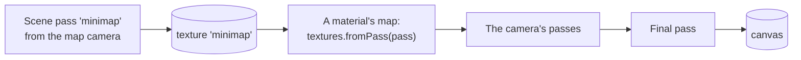
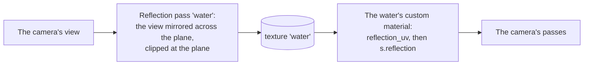
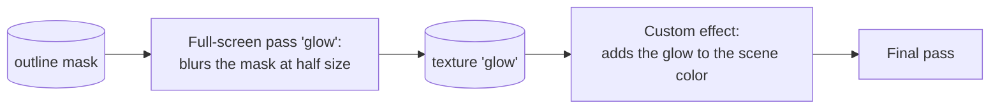

# Render graph API

> Roadmap step 0.2, first released in null3D 0.1.0. The API is experimental, so it can still change between versions.



`ctx.render` adds passes of your own to the engine's [render graph](../concepts/render-graph.md). A scene pass draws the scene from a second camera into a texture. `textures.fromPass` gives that texture to materials and sprites, so a minimap, a security camera's screen or a portal shows it. A reflection pass draws the camera's view mirrored across a plane, for water and polished floors ([Reflection passes](#reflection-passes)). A full-screen pass runs WGSL of your own over a texture, such as a blur step or a texture that the GPU paints ([Full-screen passes](#full-screen-passes)). The render graph orders the passes, plans their memory and checks them as one.

## A minimap

```ts
import { defineSketch } from '@null3d/engine';

export default defineSketch(({ scene, materials, geometry, textures, render }) => {
  const mapCamera = scene.createOrthographicCamera({ height: 40, near: 1, far: 100, position: [0, 50, 0] });
  mapCamera.setRotationEuler(-Math.PI / 2, 0, 0);
  const map = render.addPass({ kind: 'scene', camera: mapCamera, writes: 'minimap', size: [256, 256] });
  const screen = materials.unlit({ map: textures.fromPass(map) });
  scene.createMesh({ mesh: geometry.plane({ width: 2, height: 2 }), material: screen, position: [0, 1, -4] });
  return {};
});
```

## Scene passes

`render.addPass({ kind: 'scene', ... })` adds a pass from the next frame on and returns a `RenderPass`.

| Option | Meaning | Default |
| --- | --- | --- |
| `kind` | `'scene'`: the pass draws the scene's objects from `camera`. | Required |
| `camera` | The camera that the pass draws from. Its lens takes the texture's shape, so a perspective camera's aspect ratio follows `size`. | Required |
| `writes` | The name of the pass's texture. Other passes name it in `reads`, and `render.dumpGraph()` and errors show it. | Required |
| `size` | The texture's size in pixels, as `[width, height]`, from 1 to `textures.maxSize`. | Give `size` or `scale` |
| `scale` | The texture's size as a share of the render size each way: `1`, `0.5` or `0.25`. The camera's aspect ratio follows the canvas. | Give `size` or `scale` |
| `name` | The pass's name in `render.dumpGraph()` and errors. | `writes` |
| `layers` | The layers of the objects that the pass draws, as a 32-bit mask. | The camera's layers |
| `every` | The pass draws in one frame of every `every`, from the first, and the texture keeps its last image between. | 1: every frame |
| `reads` | The textures of other passes that the objects of this pass may show, by their `writes` names. | None |
| `clearColor` | The color that the texture clears to before the pass draws. With it, the pass draws no background. | The scene's background, drawn |
| `clearAlpha` | The alpha that the texture clears to with `clearColor`, from 0 to 1. | 1 |

- A pass runs only while something shows its texture: a texture from `textures.fromPass`, or another running pass that names it in `reads`. A pass that nothing shows costs nothing, not even its texture's memory.
- The texture holds linear color, after the exposure and before the tone curve. On most devices it holds high dynamic range color. A material that shows it, such as an unlit material, gives the camera the same light that the pass saw. The final pass then maps it as it maps the rest of the scene.
- Devices that draw 8-bit color tone map in each material's shader: compatibility mode with MSAA, and WebGL2 devices without float targets ([Color management](../concepts/color-management.md)). In compatibility mode the engine turns the pass's colors back to linear as it fills the texture. But they stay tone mapped, so the material that shows the texture applies the tone curve a second time. With the default curve the image then looks a little lighter in the middle tones. On WebGL2 devices without float targets the texture holds display color, so the image looks brighter and flatter.
- The image stands upright on a plane, with v = 0 at its bottom row, as three.js's render targets do.
- Each pass texture has the scene's anti-aliasing: with MSAA the pass draws with the same samples, then resolves.
- A pass never draws an object whose material shows the texture of a pass that it does not read, or its own texture. So a mirror does not show itself, and a minimap's screen does not appear in the minimap. To show a mirror in a mirror, add a second pass for it.
- A pass with a `scale` fills its whole texture at any render scale, so a material samples it from 0 to 1 across. Its texture follows the render size: when the engine lowers the render scale to keep up, the texture shrinks with it, and the pass costs less too.
- A sketch can add at most 31 passes of all kinds at once.

### What a scene pass draws

A scene pass draws the scene's objects with their materials, the sun and its shadows where the camera's shadow cascades reach. It draws the ambient and hemisphere lights, the environment's light and the fog. It also draws the point, spot and area lights that its camera sees. Such a light casts its shadow in the pass when the camera's view gives it one. A light that only the pass sees casts no shadow there. It draws the scene's background behind the objects, the sky included, as a three.js render target shows `scene.background`. With a `clearColor`, the texture clears to that color and shows no background, which suits a minimap. It culls each frame in one pass, without occlusion culling.

A pass draws no ambient occlusion. three.js draws ambient occlusion as a post pass over the canvas, so its render targets have none either.

## Reflection passes



`render.addPass({ kind: 'reflection', ... })` draws what a mirror on a plane shows. It draws the camera's view, mirrored across the plane, into a texture of the render size or a part of it. Everything below the plane is clipped, so a riverbed or the floor's underside never shows in the reflection. A custom material reads the texture where its surface shows on the screen. It gives the color to the engine's lighting as the surface's `reflection` ([Surface functions](../shaders/surface-functions.md#reflections)).

```ts
import { defineSketch } from '@null3d/engine';

const mirrorFloor = /* wgsl */ `
#import null3d::reflection::{reflection_uv}

var mirror: texture_2d<f32>;

fn surface(input: SurfaceInput) -> Surface {
    var s = defaultSurface(input);
    let clip = camera.viewProjection * vec4f(input.relativePosition, 1.0);
    let uv = reflection_uv(clip, vec2f(0.0));
    s.reflection = vec4f(textureSampleLevel(mirror, mirrorSampler, uv, 0.0).rgb, 1.0);
    return s;
}
`;

export default defineSketch(({ scene, materials, geometry, textures, render }) => {
  scene.setBackground({ sky: { sunPosition: [0.4, 0.35, -0.85] } });
  const camera = scene.createPerspectiveCamera({ position: [0, 2.5, 8], target: [0, 0.5, 0] });
  scene.setActiveCamera(camera);
  scene.createDirectionalLight({ direction: [-0.4, -1, -0.5], intensity: 2.5 });
  scene.createMesh({
    mesh: geometry.box(),
    material: materials.standard({ color: '#e03030' }),
    position: [0, 0.5, 0],
  });
  const reflection = render.addPass({ kind: 'reflection', writes: 'floor', plane: { point: [0, 0, 0] } });
  const floor = materials.shader({
    wgsl: mirrorFloor,
    color: '#20242a',
    roughness: 0.05,
    textures: { mirror: textures.fromPass(reflection) },
  });
  const ground = scene.createMesh({ mesh: geometry.plane({ width: 20, height: 20 }), material: floor });
  ground.setRotationEuler(-Math.PI / 2, 0, 0);
  return {};
});
```

| Option | Meaning | Default |
| --- | --- | --- |
| `kind` | `'reflection'`: the pass draws the camera's view mirrored across `plane`. | Required |
| `plane` | The plane: `point`, a point on it in the world, and `normal`, toward the side that the reflection shows. The normal need not have length 1. | Required; `normal` is up, `[0, 1, 0]` |
| `writes` | The name of the pass's texture, as for a scene pass. | Required |
| `scale` | The texture's size as a share of the render size each way: `1`, `0.5` or `0.25`. | The quality preset's `reflectionScale` |
| `every` | The pass draws in one frame of every `every`, from the first, and the texture keeps its last image between. | 1: every frame |
| `name` | The pass's name in `render.dumpGraph()` and errors. | `writes` |
| `layers` | The layers of the objects that the pass draws, as a 32-bit mask. | The camera's layers, which it follows |
| `reads` | The textures of other passes that the objects of this pass may show, as for a scene pass. | None |
| `clearColor` | The color that the texture clears to, behind the scene's background. | The scene's background color |
| `clearAlpha` | The alpha that the texture clears to with `clearColor`, from 0 to 1. | 1 |

- The pass follows the active camera, its lens and the canvas's shape, so it needs no camera of its own. Its texture follows the render size: `RenderPass.width` and `height` are 0.
- The texture holds the mirrored image, turned around across x and upright. `reflection_uv` from `null3d::reflection` finds where a surface point lies in it. It takes the point's clip position, and an offset that moves the place. A normal that ripples then bends the reflection.
- The pass clips the scene at the plane with the projection's near plane, so the clip costs nothing in any shader. An object that crosses the plane shows only its part above the plane.
- When the camera stands on the plane or below it, the pass draws nothing, and its texture keeps its last image.
- A material that shows the pass's texture never draws in the pass, so the water does not reflect itself.
- With `every` above 1, the reflection lags a moving camera in the frames between draws. Use it where the camera moves slowly.
- The pass culls the scene once more, with the plane as its near plane, and without occlusion culling.

### What a reflection draws

A reflection draws the scene's objects with their materials, and the scene's background: the color, texture, environment, cube map or sky that `scene.setBackground` sets. It draws the sun, its shadows where the camera's shadow cascades reach, the ambient and hemisphere lights, the environment's light and the fog. It draws the point, spot and area lights that the mirrored view sees, as a scene pass does. A light casts its shadow in the reflection when the camera's view gives it one. A reflection draws no ambient occlusion, as scene passes do not.

Devices that draw 8-bit color apply the tone curve twice to a reflection, as to a scene pass's texture. The reflected sky looks a little grayer there.

### Cost of a reflection

A reflection draws the scene a second time. Its cost follows its pixels and the part of the scene that it sees. At half the render size each way it shades a quarter of the pixels. Each quality preset gives it a share of the render size. Low takes a quarter, Medium and High take half, and Ultra takes the whole size. When the engine lowers the render scale to keep up, the reflection's texture shrinks with it, so the reflection costs less too. Take S1, the swarm benchmark, with water under 100,000 boxes. On a MacBook Pro on WebGPU, the reflection added about 0.6 ms of GPU time per frame at half size, and 0.7 ms at full size. On WebGL2 it added 0.2 to 0.4 ms. Small objects such as S1's boxes cost the reflection their vertices at any size, so its size matters most where large surfaces fill its pixels.

## Full-screen passes



`render.addPass({ kind: 'fullscreen', ... })` runs WGSL of your own for each pixel of a texture. The WGSL is a [custom effect's](post.md#custom-effects): it declares `fn effect(input: EffectInput) -> vec4f`, and one compiled WGSL serves both. A pass reads an input image of the camera's view, the scene's depth and textures of its own, and writes its texture, which materials, effects and other passes read.

```ts
import { defineSketch } from '@null3d/engine';

const glowFromMask = /* wgsl */ `
fn effect(input: EffectInput) -> vec4f {
    let texel = 1.0 / effectInputSize();
    var sum = 0.0;
    for (var y = -3; y <= 3; y++) {
        for (var x = -3; x <= 3; x++) {
            sum += effectColor(input.uv + vec2f(f32(x), f32(y)) * 3.0 * texel).r;
        }
    }
    return vec4f(vec3f(2.0, 1.1, 0.3) * sum / 49.0, 1.0);
}
`;

const addGlow = /* wgsl */ `
var glow: texture_2d<f32>;

fn effect(input: EffectInput) -> vec4f {
    let light = textureSampleLevel(glow, glowSampler, effectPassUv(input.uv), 0.0).rgb;
    return vec4f(input.color.rgb + light * input.color.a, input.color.a);
}
`;

export default defineSketch(({ scene, materials, geometry, textures, render, post }) => {
  // ... a camera, lights and objects ...
  const ball = scene.createMesh({ mesh: geometry.sphere(), material: materials.standard({ color: '#d0d4dc' }) });
  ball.setOutlined(true);
  // Width 0 draws the outline mask without the engine's line.
  post.set({ outline: { width: 0 } });
  const glow = render.addPass({ kind: 'fullscreen', wgsl: glowFromMask, writes: 'glow', scale: 0.5, input: 'outlineMask' });
  post.addEffect({ wgsl: addGlow, textures: { glow: textures.fromPass(glow) } });
  return {};
});
```

| Option | Meaning | Default |
| --- | --- | --- |
| `kind` | `'fullscreen'`: the pass runs `wgsl` for each pixel of its texture. | Required |
| `wgsl` | WGSL that the null3D Vite plugin compiled, which declares `fn effect(input: EffectInput) -> vec4f`. | Required |
| `writes` | The name of the pass's texture, as for a scene pass. | Required |
| `size` | The texture's size in pixels, as `[width, height]`. | Give `size` or `scale` |
| `scale` | The texture's size as a share of the render size each way: `1`, `0.5` or `0.25`. The texture shrinks and grows with the render scale. | 1, without `size` |
| `input` | The image that the pass reads: `'sceneColor'`, the scene's color as the camera's passes leave it, before custom effects and bloom, or `'outlineMask'`, the [outline](post.md#outlines)'s mask. | None: transparent black |
| `textures` | The texture of each `var name: texture_2d<f32>;` that the WGSL declares, by name, or a texture of several layers for a `var name: texture_2d_array<f32>;` declaration: textures from files or data, or other passes' textures from `textures.fromPass`. | None: white |
| `uniforms` | The first value of each field of the WGSL's `struct Uniforms`, by name. | 0 for each field |
| `every` | The pass draws in one frame of every `every`, and the texture keeps its last image between. | 1: every frame |
| `name` | The pass's name in `render.dumpGraph()` and errors. | `writes` |

- `input.uv` and `input.pixel` place the pixel on the pass's own texture, from the top left. `input.size` is that texture's size. `input.color` is the input image at the same place, read with a linear filter.
- `effectColor(uv)` and `effectPixel(pixel)` read the input image at other places, as an effect reads its image. `effectInputSize()` gives the input image's size in pixels, which a pass at half size needs to step one pixel of its input. The depth functions, such as `effectDistance(uv)`, read the scene's depth.
- A pass texture holds its image's bottom row first, as materials sample it. To read another pass's texture at the place `input.uv`, sample it at `effectPassUv(input.uv)`, as the glow effect above does.
- `render.setPassUniform(pass, name, value)` changes a uniform from the next frame on. It allocates nothing. The textures are fixed when the pass is added.
- A pass runs only while something shows or reads its texture: a material, a custom effect, another pass's `textures`, or a scene pass's `reads`.
- A pass with an `input`, or whose WGSL reads the depth, runs after the camera's passes. A custom effect that reads its texture sees the pass's image of the same frame. A material that shows it shows the image of the frame before.
- With `input: 'outlineMask'`, red holds the outlined objects' coverage and green the parts that nothing hides. The mask draws only while outlines are on and an object is outlined. `width: 0` draws the mask without the engine's line.
- The pass texture holds high dynamic range color where the device draws it, as a scene pass's texture does. On devices that draw 8-bit color, values above 1 clip, and the `'sceneColor'` input holds display color, after the tone curve.

### Switching and removing passes

- `render.setPassEnabled(pass, false)` stops a pass from the next frame on. Its texture keeps the last image that it drew. A sketch can draw a costly pass every few frames this way. The call allocates nothing.
- `render.removePass(pass)` removes a pass and destroys the textures that `textures.fromPass` made of it.
- `pass.live` is false after `removePass`, and `pass.enabled` gives the switch.

## The graph as text

`render.dumpGraph()` returns the whole render graph as Graphviz DOT text: the engine's passes and yours, in the order they run, grouped into the GPU's render passes. Each texture shows its format, size and memory. Passes that are switched off show dashed, and so do passes that nothing reads, with the words "culled: nothing uses its output". Paste the text into a Graphviz viewer to see it as a picture.

```ts
console.log(render.dumpGraph());
```

## Cost

- A scene pass culls the scene and draws it again, at its own size. A 256 by 256 minimap costs far less than the main view. A pass at the canvas's size costs about as much as the main view.
- On WebGPU, a full-screen copy turns each scene pass's and reflection's image upright, at one texel read per texel of the texture. WebGL2 draws it upright directly, and a full-screen pass writes its image upright on both paths.
- A full-screen pass costs one triangle over its texture, plus what its WGSL reads, as an effect's pass does: about 0.05 ms of GPU time over the whole canvas on a MacBook Pro ([custom effects](../guides/custom-passes.md#cost)). At half the size each way it shades a quarter of the pixels.
- Each pass texture takes memory for its texels, and for its samples with MSAA, while something shows it.
- To save time, switch a pass off in frames where its image need not change.

## Errors

| Code | Cause |
| --- | --- |
| E1220 | Options that `render.addPass` does not take, a `writes` or `name` that another pass has, or a 32nd pass. Both a `size` and a `scale`, or a scene pass with neither. A reflection's plane without a point, a normal of no length, or a `scale` or `every` that it does not take. An `input` other than `'sceneColor'` or `'outlineMask'`. Or something that is not a render pass, given to `render.setPassEnabled`, `render.removePass`, `render.setPassUniform` or `textures.fromPass`, or a pass of another kind given to `render.setPassUniform`. |
| E1215 | A full-screen pass's WGSL that the null3D Vite plugin did not compile as an effect. |
| E1216 | A uniform or a texture that the full-screen pass's WGSL does not declare, or a value of the wrong kind. |
| E1502 | A name in `reads` that no pass writes. Or `render.removePass` on a pass whose texture another pass reads. |
| E1503 | A `writes` name that the engine's own passes write, such as `sceneColor`. |
| E1504 | A pass that reads its own texture, or passes that read each other's textures. |
| E1505 | A pass whose targets one GPU render pass cannot hold together, such as a target of another size. |
| E1101 | A call on a pass that `render.removePass` removed. |

The core checks the whole graph when `render.addPass`, `render.removePass` or `textures.fromPass` changes it, so the call that breaks the graph throws.

## Related pages

- [Custom passes and render targets](../guides/custom-passes.md): render-to-texture with examples, reflections, a water recipe, full-screen passes and custom effects.
- [Multiple views](../guides/multiple-views.md): a second camera drawn into a rectangle of the canvas, for split screens and picture in picture.
- [Scene](../api/scene.md#multiple-views): `scene.createView`.
- [Surface functions](../shaders/surface-functions.md#reflections): the surface's `reflection`.
- [The render graph](../concepts/render-graph.md): how the graph orders passes and plans their memory.
- [Textures](textures.md): `textures.fromPass`.
- [Cameras](cameras.md): perspective and orthographic cameras.
- [The security camera demo](https://github.com/null3d-engine/null3d/tree/main/examples/security-camera): a camera on a pole sweeps a yard behind a wall, and a monitor shows what it sees.

## API reference

[The API reference](reference/render.md) lists every export of this page with its type and description. The engine's doc comments make it.
