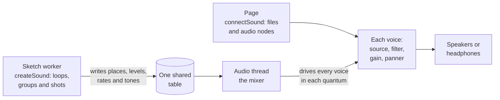

# Sound (@null3d/sound)

> Roadmap step 0.3, first released in null3D 0.1.0. The API is experimental, so it can still change between versions.



`@null3d/sound` plays sound that follows the scene. A sketch makes its sounds and moves them as it moves its objects. The page plays them with the browser's audio, through the add-on's page half. A sound can come from a place, such as a waterfall or a car. It can also play in both ears alike, such as wind or rain.

The browser offers its audio only on the page's main thread, and the sketch runs in a worker. The add-on bridges the two. The sketch writes each sound's place, level, playback rate and tone into a table that the page shares. A mixer on the browser's audio thread, compiled from Rust to WebAssembly, reads that table and drives every voice. Where the page shares its memory with its workers, no frame sends a message, and the page's thread does no work while the sounds play. Only a shot sends one, once for each play.

```sh
bun add @null3d/sound
```

```ts
// sketch.ts
import { defineSketch } from '@null3d/engine';
import { createSound } from '@null3d/sound';

export default defineSketch((ctx) => {
  const { scene } = ctx;
  const camera = scene.createPerspectiveCamera({ position: [0, 1.6, 6], target: [0, 1, 0] });
  scene.setActiveCamera(camera);

  const sound = createSound(ctx, { listener: camera });
  // A waterfall at a place, full within 4 m and gone by 120 m.
  const fall = sound.loop({ file: '/sounds/waterfall.mp3', near: 4, far: 120 });
  fall.setPosition(-20, 2, -30);
  // Wind in both ears, whose level the sketch sets each frame.
  const wind = sound.loop({ file: '/sounds/wind.mp3', positional: false, level: 0.5 });

  return {
    onUpdate() {
      wind.setLevel(0.4 + 0.2 * Math.sin(ctx.time.now * 0.3));
    },
    onLateUpdate() {
      sound.update();
    },
  };
});
```

```ts
// page.ts
import { createEngine } from '@null3d/engine';
import { connectSound } from '@null3d/sound/page';

const engine = await createEngine({
  canvas: document.querySelector('canvas')!,
  sketch: new URL('./sketch.ts', import.meta.url),
});
const sound = connectSound(engine);
document.querySelector('#sound')!.addEventListener('click', () => void sound.start());
```

Call `sound.update()` once a frame, in `onLateUpdate`. It reads the listener's place and turn in the world, which by then holds every move of the frame's `onUpdate`. A camera that moves in `onLateUpdate` itself is heard one frame later, which no ear can tell. A browser starts a page's audio only in answer to the user. So the page calls `start` from a click, a tap or a key. `connectSound(engine, { startOnInput: true })` starts it on the user's first input instead.

## The sketch's calls

| Call | What it does |
| --- | --- |
| `createSound(ctx, options)` | Makes the sketch's sounds. `listener` is required: the camera, or another object that hears. `capacity` is the emitters that the sounds hold together, 256 by default and 4,096 at most. `volume` sets every sound's volume, from 0 to 1. A sketch has one sound system at a time: a second call while the first lives throws error 2504. |
| `loop(options)` | A sound that plays its file over and over. `positional: false` makes a bed that plays in both ears. `level`, `rate`, `tone` and `position` give its first values. |
| `group(options)` | `count` sounds that play one file, of which the loudest `voices` sound at once. Use it for the cars in a street or the bees of a swarm. |
| `shot(options)` | A sound that plays its file once for each call of its `play`, such as thunder. `voices` plays that many at once, 2 by default. A play past that count fades the oldest out quickly. Each play starts about 20 ms after the call, at its own level, place and pitch, or about 80 ms after it when it replaces a play that still sounds. |
| `setVolume(volume)` | The volume of every sound, from 0 to 1. |
| `update()` | Reads the listener's place and turn, and counts the frame. Call it once a frame. |
| `destroy()` | Stops every sound and closes the link to the page. The page then waits for the sketch's next sound system. |
| `connected` | True once the page's half has opened its link. |

A loop has `setLevel`, `setRate`, `setTone`, `setPosition` and `destroy`. A group has the same setters with a member's index first, such as `setPosition(index, x, y, z)`. A group also has the arrays `positions`, `levels`, `rates` and `tones`, which are views of the table. A sketch that keeps its places in one array copies them in one call, as in `cars.positions.set(places)`. A shot has `play(x, y, z, level, rate)` and `destroy`. A destroyed sound's setters do nothing. Its arrays may then serve another sound, so a sketch drops them with the group.

The setters write numbers into the table and make no object, so a sketch may call them in every frame. `update` makes no object either. A sound made before the page connects plays once it does, and a sketch may make sounds at any time.

## The values of a sound

| Value | Range | What it does |
| --- | --- | --- |
| level | 0 and up, 1 by default | The sound's loudness. 0 silences it. |
| rate | 1 by default | The playback rate. 2 plays the file twice as fast and an octave higher. Tie it to a car's speed for its engine. |
| tone | 0 to 1, 1 by default | A low-pass filter. 1 plays the file as it is, and 0 keeps only its lows, from about 120 Hz down. Strong wind sounds brighter than a breeze, so raise its tone with its speed. |
| place | world units | Where the sound comes from. A bed that plays in both ears has no place. |

Each value eases toward the one that the sketch writes, so a change never clicks. The level eases in about 50 ms, and the tone and the rate in about 80 ms. A level or a place that is not a finite number silences the sound until the sketch writes one that is. A rate or a tone that is not one plays the file at its own pitch and brightness.

## Distance

A sound's options take a placement:

| Option | What it does |
| --- | --- |
| `near` | The distance within which the sound plays at its full level. Beyond it the level falls with distance: at twice `near` it is half, at four times a quarter. |
| `far` | The distance at which the sound has faded out. The fade starts at 60% of it. |
| `muffle` | Whether the sound loses its highs as it nears `far`, as distant sounds do. It is on by default when `far` is given. |

A sound with neither distance keeps the level that the sketch gives it wherever the listener stands. Use that for a bed whose level the sketch works out itself, such as the sea, which grows louder as the camera nears the shore.

## Groups and their voices

A browser mixes a few dozen voices well, and a scene may have hundreds of sources of one kind. A group gives its members a few voices. The mixer ranks the members by their loudness where the listener stands, from their level and distance. It gives each voice to one of the loudest. A voice keeps its member while that member stays close to the cut. So a voice does not flap between two members at the same distance. A voice that moves to another member fades out first, so its sound never jumps across the scene. It takes the new member's pitch before it fades in.

The page plays 32 voices at most. A loop takes one voice, a group takes its `voices`, and a shot takes its `voices`, wherever free voices sit. A sketch that asks for more than 32 at once gets error 2501, which names the count. While other voices are free, a destroyed sound's voices rest for a third of a second before another sound takes them. So their fade ends first.

## The page's calls

| Call | What it does |
| --- | --- |
| `connectSound(engine, options)` | Connects the page to the sketch's sounds. Call it once on a page, after `createEngine` resolves. `startOnInput` starts the audio on the user's first click, tap or key other than Escape, which are the inputs that let a browser start a page's audio. `muted` starts muted. |
| `start()` | Starts the audio. Call it in the handler of a click, a tap or a key. Called so, it resolves once the audio runs, and each sound fades in as its file arrives. Called outside an input, as a page that plays its sound by default does, it loads the files, and the browser holds the audio until the user's first click, tap or key. The sounds then start at once. |
| `setMuted(muted)` | Mutes or unmutes every sound. |
| `state` | `off` before `start`, then `starting` until the audio runs, `on`, `paused` while the engine is paused or the page is hidden, `interrupted` while the browser holds the audio until the user's next input, and `stopped` after the engine stops. |
| `onState(handler)` | Calls the handler at each change of the state, such as to label a sound button. Returns a function that removes the handler. |
| `stop()` | Stops the audio for good. The engine's stop does the same. |

The page loads nothing until `start` runs: no file, no audio and no mixer. The mixer's module is about 18 KB. Each file loads once, however many sounds play it. A file that fails to load leaves its sounds silent, and the console names the file. A mixer that fails on the audio thread stops the sound with a warning. So does a mixer module that the host answers with something else, such as its own page for a missing file.

While the browser holds the audio, the page starts no file. So the browser warns once, as the page makes the audio, and not for each voice. A shot that plays in that time is dropped. It would otherwise sound late, after the user's first input, long after the event that played it.

The [sound demo](https://github.com/null3d-engine/null3d/tree/main/examples/sound) shows a storm. Each strike's thunder plays from where the bolt struck, once sound could have reached the camera. A brook in it is a group of points.

## Pauses and hidden pages

When the sketch's frames stop, every sound fades out within about a second, and the page suspends the audio soon after. That happens when `engine.setPaused(true)` pauses the engine, when the browser hides the page, and when a sketch stops calling `update`. It also happens when the engine was paused before the sound started. The audio resumes, and the sounds fade back in, when the frames move again.

A browser can also take the audio away, as an iPhone does during a call. The state is then `interrupted`, and the page resumes the audio at the user's next input, or when the page shows again. A sound button calls `start` in that state rather than muting.

## Panning and the quality presets

A sound that comes from a place plays through the browser's panner. The High and Ultra presets use its HRTF model, which places a sound around the head on headphones. Low and Medium use equal-power panning, which places it between the speakers and costs less on the audio thread. A change of preset changes every voice's panning.

## Files

A relative address resolves against the page's address, as the engine's loaders do ([Assets](assets.md)). So `'sounds/sea.mp3'` on `https://example.com/game/` loads `https://example.com/game/sounds/sea.mp3`. An address from `new URL('./sea.mp3', import.meta.url)` resolves against the sketch module instead. MP3 decodes in every browser. An MP3 encoder adds samples at each end of a file, and records how many in a header in the file's first frame. Some browsers keep them as they decode. Safari kept 576 at each end of a mono loop, which would dip at every join. The add-on reads the header and drops what the browser kept, so a loop joins with no gap. A file without that header loses only the silence at its ends, up to 2,048 samples. A file made to loop joins its end to its start, as the sample loops do.

## Browsers

- Firefox's audio listener has no place parameters. The mixer turns each sound's place into the listener's frame, so the listener stays still in every browser.
- An iPhone's silent switch mutes a page's audio unless the page plays media. The add-on sets the page's audio session to playback where Safari offers it.
- A page without cross-origin isolation runs the sketch on its own thread ([Hosting and cross-origin isolation](../getting-started/hosting.md)). There the page hands the mixer a copy of the table once per display frame. That costs the page's thread a copy of a few kilobytes, a message and a small view of the returned buffer in each frame.

## Costs and limits

- The mixer runs on the audio thread. Its work grows with the voices and with the members of each group, which it ranks every fourth render quantum. With 32 voices and a group of 200 moving members, it takes about 3 ms of work per second of audio. That figure comes from the mixer's module in Bun on a desktop computer.
- Each voice is a source, a filter, a gain and a panner. The panner's HRTF model costs the most of them, which is why the lighter presets drop it.
- A limiter on the page's output holds the mix under full scale. So sounds that sum, or a stereo sound panned to one side, never clip. It adds about 2 dB to quiet passages.
- The table holds 12 numbers for the listener and 6 for each emitter: 6 KB at the default capacity.
- The page plays 32 voices at once and the table holds 4,096 emitters at most.

[The API reference](reference/sound.md) lists every export of this page with its type and
description. The add-on's doc comments make it.
