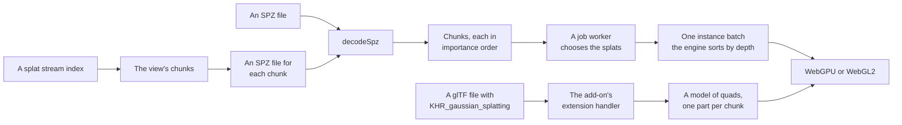

# Gaussian splats

> Roadmap step 0.3, first released in null3D 0.1.0. The API is experimental, so it can still change between versions.



`@null3d/splats` draws Gaussian splats: clouds of soft, colored ellipsoids that a scan or a
training run produces. A splat has a center, three principal spreads and a rotation, which make its
shape, and a color and an opacity. The add-on draws each one as a camera-facing card that covers
the splat's projected ellipse and fades as a Gaussian, so overlapping splats read as one surface.

The add-on reads three kinds of file:

- **SPZ**, Niantic's packed form, in its gzip and zstd containers.
- **A splat stream**, an index of chunk files that lets a large cloud start before its whole file
  has downloaded.
- **glTF** models that carry `KHR_gaussian_splatting`. Importing the add-on registers the reader for
  every sketch of the thread, so `assets.loadGltf` loads such a model with no other call.

```ts
import { defineSketch } from '@null3d/engine';
import { createSplats } from '@null3d/splats';

export default defineSketch(async (ctx) => {
  const { scene } = ctx;
  const camera = scene.createPerspectiveCamera({ position: [0, 1.5, 4], target: [0, 0, 0] });
  scene.setActiveCamera(camera);
  const splats = await createSplats(ctx, { url: '/scans/garden.spz' });
  await splats.ready;
  const eye = [0, 0, 0];
  return {
    onUpdate() {
      camera.getPosition(eye);
      splats.update(eye); // choose the splats that draw from where the camera stands
    },
  };
});
```

## A glTF model of splats

```ts
import { defineSketch } from '@null3d/engine';
import '@null3d/splats'; // registers KHR_gaussian_splatting

export default defineSketch(async ({ scene, assets }) => {
  const cloud = await assets.loadGltf('/scans/room.glb');
  scene.instantiate(cloud, { position: [0, 0, 0] });
});
```

The handler turns each splat into four vertices of one mesh, and cuts the model into up to 64 parts
in space, so the transparent pass sorts the parts by depth. The splats inside a part draw in the
file's order.

## What it draws

A splat's shader computes the covariance that its spreads and rotation make, projects it to the
screen, and sizes a camera-facing card to the ellipse. A fragment fades with the same ellipse, so
the card is a Gaussian, not a disc. The card tests the scene's depth, so a splat behind a mesh
disappears, and it fades over the last meters before a mesh, so an intersection is soft rather than
a cut. Give `softness` to change that distance; 0 keeps a hard edge.

The splats of a cloud that `createSplats` draws live in one instance batch. The engine culls the
rows and sorts them back to front in each view, on its job workers, on both GPU paths. The add-on
writes only the rows that its budget keeps.

## Detail levels, streaming and the budget

`createSplats` cuts a cloud into chunks of nearby splats, each ordered so that its first splats
cover the most surface. A prefix of a chunk is a coarser level of it: all of it, a half, a quarter
and an eighth.

`update` writes the camera's position and asks a job worker, through `runTask`, which prefix each
chunk draws. Every chunk the budget reaches keeps an eighth of itself first. The budget then
gives the nearest chunks a finer prefix, up to the level that their distance asks for. So a budget
too small for every level thins the whole cloud. A chunk nearer the camera still keeps more of its
splats than a far one. The budget stops the total. The task sorts the chunks by distance in the
worker, so a large scene costs the sketch's thread nothing. A change of the camera or of the budget
starts a new selection; the sketch packs the chosen rows once the answer arrives, between two
frames.

The budget follows the quality preset. On each preset the add-on draws at most:

| Preset | WebGPU | WebGL2 |
| --- | --- | --- |
| Low | 100,000 splats | 50,000 |
| Medium | 250,000 | 120,000 |
| High | 500,000 | 250,000 |
| Ultra | 800,000 | 400,000 |

The frame-budget governor lowers the count when frames take too long, and the stats overlay shows
the feature's memory beside the engine's own figures. `setBudget(count)` caps the count below the
preset's value, and `capacity` sets the rows that the batch holds.

A whole file appears as its chunks are cut: the first chunks draw while the rest are cut, and a
large file never holds up a frame. `ready` resolves when every chunk of a file is ready. For a
stream, it resolves once the nearest chunks have arrived, which takes about a megabyte of files, or
the nearest chunk alone: the first view draws from those, and the cloud fills in as the rest
arrive. Call `update` once before you await it. `settle()` resolves once the chosen splats are
packed, which a still picture waits for.

## A splat stream

A stream lets a large cloud draw before its whole file has downloaded. The page reads a small
index, and the add-on then downloads only the chunks that the view needs, nearest first. A chunk
that arrives after the camera moved away stays in memory but takes no row, so it never draws in
the wrong place.

The index is a JSON file:

```json
{
  "format": "null3d.splats.stream",
  "version": 1,
  "count": 400000,
  "chunks": [
    { "url": "chunk-0.spz", "count": 42000, "center": [1.5, 0, -2], "radius": 1.8, "bytes": 820000 }
  ]
}
```

Each chunk is an SPZ file. The add-on orders its splats by importance as it reads them, so a
converter may write them in any order. A chunk's `url` resolves against the index's address.

Give each chunk its `count`, its `center` and its `radius`. The selection needs them before the
file arrives. `bytes` is optional, and the add-on reports a size that it does not know as zero. The
chunks' counts must add up to `count`.

`chunkSplats` and `encodeSpz` make the pieces:

```ts
import { chunkSplats, encodeSpz } from '@null3d/splats';

const { chunks } = await chunkSplats(cloud, { splatsPerChunk: 25_000 });
for (const [i, chunk] of chunks.entries()) {
  const file = await encodeSpz(chunk); // write it as chunk-<i>.spz
}
```

An index that this reader cannot take throws E2112, and a chunk that does not match its index
throws E2113. A chunk that stays unreachable after two retries is reported in the console, and
`splats.failed` counts it. The rest of the cloud keeps drawing. `splats.bytes` gives the cloud's
total size and `splats.loadedBytes` gives the part that has arrived.

## The calls

| Call | Gives |
| --- | --- |
| `createSplats(ctx, options)` | A cloud that draws, from `data`, from the `url` of an SPZ file, or from the `url` of a stream index |
| `decodeSpz(bytes)` | The cloud of an SPZ file, as `SplatData` |
| `encodeSpz(data)` | The SPZ file of a cloud, as the bytes of a gzip stream |
| `chunkSplats(data, options)` | The chunks that `createSplats` draws, if you want them yourself |
| `parseStreamIndex(text, base)` | The chunks that a stream index names |
| `colorOfSh(dc, encoded?)` | The linear color of a first-band spherical-harmonic coefficient |

`Splats` gives `update(eye)`, `setBudget(count)`, `settle()`, `ready`, `total`, `drawn`, `chunks`,
`loaded`, `failed`, `bytes`, `loadedBytes`, `feature` and `draw`, and `destroy()` frees it.

## Costs and limits

- One draw for the whole cloud, whose rows the engine culls and sorts. A splat's cost is its card
  and the ellipse's math per pixel, so a large budget suits a fast GPU; the WebGL2 presets are lower
  for that reason.
- The batch holds `capacity` rows of 56 bytes each, which is the cloud's memory. Without `capacity`, it holds the splats that the preset and the GPU path may draw, so a phone allocates less than a desktop.
- The add-on reads the first band of each splat's spherical harmonics, which is its base color.
  Higher bands make a color change with the view; the add-on ignores them, which the extension
  allows.
- A glTF model's splats draw in the file's order inside each part. For a large cloud, use an SPZ
  file or a splat stream, whose rows the engine sorts one by one.
- A splat casts no shadow and receives none.
- The cards need the scene's depth copy, which a material that reads the scene's depth makes. It
  costs one full-screen pass and one texture of four bytes for each pixel.
- A stream spends one request for each chunk that the view needs. Keep the chunks large enough that
  the requests do not dominate, and small enough that the first view arrives quickly: before that
  view draws, the add-on waits for the nearest chunks whose files fit in a megabyte, and for the
  nearest chunk at least. The rest keep loading behind the frames that draw.

## Errors

| Code | Cause |
| --- | --- |
| E2101 | A cloud whose arrays do not hold the number of splats that it names |
| E2102 | An SPZ file with more splats than the reader takes |
| E2103 | A file that is not an SPZ file, a header that is cut short, or a version the reader does not know |
| E2104 | An SPZ file whose arrays are shorter than its header says |
| E2105 | A browser that cannot decompress the file's stream |
| E2106 | A glTF kernel that the add-on does not draw |
| E2107 | A glTF color space that the add-on does not read |
| E2108 | A glTF splat primitive that lacks one of its attributes |
| E2109 | A splat file that the page cannot download |
| E2110 | `createSplats` without data or an address |
| E2111 | A batch without the row colors that the draw needs |
| E2112 | Text that is not a stream index of this version, or chunks that do not hold its count |
| E2113 | A chunk file that does not hold the splats that its index names |
| E2114 | A chunk file that its server cannot answer |

## Related pages

- [Add-on feature draws](feature-draws.md): the draw that the cloud uses, and its many-copies form.
- [Tasks on the job workers](tasks.md): the hook that chooses the splats.
- [Add-on feature descriptions](features.md): the settings, budget and figures that the cloud
  declares.
- [Assets](assets.md#extensions-that-add-ons-read): how an add-on reads a glTF extension.

## API reference

[The API reference](reference/splats.md) lists every export of this page with its type and
description. The package's doc comments make it.
