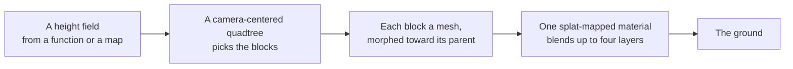

# Terrain (@null3d/terrain)

> Roadmap step 0.2, first released in null3D 0.1.0. The API is experimental, so it can still change between versions. The ground carries no collision. A block morphs toward its parent block's surface before it gives way to it, and a skirt closes the seam between neighbours that differ by more than one level. Coding agents must not use these parts.



The `@null3d/terrain` package draws a height field as terrain. It divides the ground into a quadtree of blocks. A block near the camera draws a fine grid, and a block far away draws a coarse grid over more ground. The ground near the camera then keeps its detail, and the far hills stay cheap. Every pixel takes its normal from a map baked over the whole ground, so a coarse block still shows the relief of the hills. One material blends up to four tiled color layers over every block by a splat map, and each layer's own height shows it through its neighbours where two layers meet.

The package is built on the engine's public API. Its surface function ships compiled, so your build does not compile it, and the package needs no extra setup for it.

```sh
bun add @null3d/terrain
```

```ts
// sketch.ts
import { defineSketch } from '@null3d/engine';
import { createTerrain, terrainTextures } from '@null3d/terrain';

const ground = (x: number, z: number) => 20 * Math.sin(x * 0.02) * Math.cos(z * 0.02);

export default defineSketch((ctx) => {
  const { scene, textures } = ctx;
  const camera = scene.createPerspectiveCamera({ fov: 55, position: [0, 40, 120], target: [0, 0, 0] });
  scene.setActiveCamera(camera);
  scene.createDirectionalLight({ direction: [-0.4, -1, -0.3], intensity: 3, castShadows: true });
  scene.createAmbientLight({ intensity: 0.5 });

  const layers = terrainTextures(textures, { seed: 1 });
  const terrain = createTerrain(ctx, {
    size: 800,
    height: ground,
    camera,
    layers: [
      { map: layers.grass, tile: 6, roughness: 1, heightFrom: 'alpha' },
      { map: layers.soil, tile: 10, roughness: 1, heightFrom: 'alpha' },
      { map: layers.rock, tile: 7, roughness: 0.85, heightFrom: 'alpha' },
      { map: layers.snow, tile: 12, roughness: 0.7, heightFrom: 'alpha' },
    ],
    maxLevel: 6,
  });

  // Made once, outside onUpdate, so a frame allocates nothing.
  const at = [0, 0, 0];
  return {
    onUpdate() {
      camera.getWorldPosition(at);
      terrain.update(at);
    },
  };
});
```

## How it works

`createTerrain` samples a height field once, into a flat array of heights. The height comes from a function or from a height map held as a `Float32Array`. Later reads, such as `heightAt`, interpolate between the four samples around the point.

The ground is a quadtree. The root block covers the whole ground with a coarse grid. A block splits into four while one of its cells would show more screen error than the ground allows.

The error is the size of that cell projected through the camera's field of view. A narrow view therefore keeps detail farther out. A camera high above the ground draws the ground under it coarser. The camera's distance to each block's own height box sets that projection too.

The `error` option sets the allowed error in pixels. The default follows the quality preset's `lodThreshold`, so Low draws coarser blocks and Ultra draws finer ones. `maxLevel` sets the finest level. The default of 6 puts the camera's own block at about a meter of detail over a 1,200 meter ground.

Each block is one mesh whose vertices carry the heights. The height field never changes shape after `createTerrain`. Once a block is made, the engine reuses it. The terrain picks its blocks again when the camera crosses a cell of the finest level, rises by one such cell, or draws through a different lens or buffer size. A still camera therefore costs no work at all.

Every pixel lights from a normal map that `createTerrain` bakes from the height field's slopes. A far block covers ground in cells larger than the height samples, so its own vertices cannot show the small hills. The normal map keeps that relief at every distance. Set `bakedNormals: false` to light from the mesh's own normals instead.

Each block morphs toward its parent block's surface as the camera pulls away. A block hands over to its parent at the distance where the parent's own cell would no longer show the allowed error. Over the last part of the approach, the block's vertices move to the parent grid's heights, so the two surfaces match when the switch comes and the ground does not pop. The parent grid is triangulated the same way, so a block whose morph is complete has exactly the parent's surface. The morph adds no draw and no work in a frame: each block carries the parent's height at each vertex in its own vertex record, written when the block is built or reused. `morph: false` switches each block at once instead.

A skirt hangs from the edge of each block, a little below the ground. The selection does not restrict neighbours, so two blocks that meet can differ by more than one level. The morph ends on a block's own parent, which cannot match a neighbour two levels coarser, so the skirt still covers that seam. On a very steep seam a thin sliver of skirt can still show.

## Layers and the splat map

The ground's material blends up to four layers. Each layer is a tiled color map with its own repeat distance and roughness. A splat map, one channel per layer, gives the weight of each layer at each point.

A layer also carries a height at each texel. Its map's brightness gives that height by default, or its alpha channel where `heightFrom` says `'alpha'`. The four maps that `terrainTextures` makes keep a height in their alpha channel, so give their layers `heightFrom: 'alpha'`. At a boundary between two layers, the heights push one through the other. Rock then shows through the grass in ragged patches rather than in a smooth cross-fade. `contrast` sets how strongly a layer's height scales its weight, from 0 to 1. The default is 1, and 0 blends by the splat map's weights alone.

The default splat map comes from the ground itself. Grass takes the low, gentle ground, soil the higher dry ground, rock the steep slopes, and snow the ground above. Give `splat` to paint the weights yourself. `terrainTextures` makes the four layer maps in code, or give any `Texture` from `textures.fromData` or `assets`.

## Placing things on the ground

The terrain carries no collision. Read `heightAt(x, z)` and `normalAt(x, z, out)` to place anything that stands on the ground, and to set its upright direction. Both allocate nothing, so a frame may call them freely.

## Speed

A terrain draws one mesh per visible block. The blocks near the camera are the most and the finest, and the few coarse blocks cover the rest. A 1,200 meter ground at the default settings draws about 200 blocks, near 130,000 triangles, from a camera near the ground. That figure is for a picture 1,080 pixels tall. A taller picture draws more and finer blocks, and a shorter one draws fewer. A higher camera or a wider field of view draws fewer and coarser blocks, and the Low preset draws coarser blocks than High. A block splits or merges only when the camera moves far enough to need other blocks. A crossing can need tens of new blocks, so each `update` builds at most `blocksPerUpdate` of them, 16 by default. The ground draws its last complete selection until the new one is built, and `terrain.building` is true meanwhile. The first update builds its whole selection, so call it in the setup if that frame matters. A block that the view leaves gives up its mesh to the next block that the ground needs. A terrain that follows a moving camera therefore builds meshes only until it holds `maxBlocks` of them, and its frame path allocates nothing. `terrain.setVisible(false)` hides the ground, and `setVisible(true)` shows the current selection again.

A sketch that never imports `@null3d/terrain` ships no terrain code and starts no terrain work. The package follows the engine's add-on rules: its surface function ships compiled, and its builds load when a terrain first draws.

## Compared with three.js

three.js has no terrain class. Projects displace a `PlaneGeometry` on the CPU, shape the ground with three.js's `ImprovedNoise` and a height map, or add a library such as three-mesh-bvh for large ground.

| three.js | null3D |
| --- | --- |
| A `PlaneGeometry` with displaced vertices | `createTerrain` with a height function or height map |
| A quadtree or a library for levels of detail | The add-on's own camera-centered quadtree |
| A hand-painted ground or per-vertex colors | A splat map that blends four tiled layers |
| A physics collider or a height lookup on the mesh | `heightAt` and `normalAt` |
| A vertex morph between levels | A block morphs toward its parent, and a skirt covers a neighbour more than one level away |

## Related pages

- [Geometry](geometry.md): meshes from arrays, and the generators.
- [Textures](textures.md): `textures.fromData`, wraps and mipmaps.
- [Materials](materials.md): the standard material and custom surfaces.
- [Particles](particles.md): the other add-on of the same kind.
- [The three.js mapping](../porting/threejs-mapping.md): terrain beside three.js's ways of making ground.

## API reference

[The API reference](reference/terrain.md) lists every export of this page with its type and description. The engine's doc comments make it.
