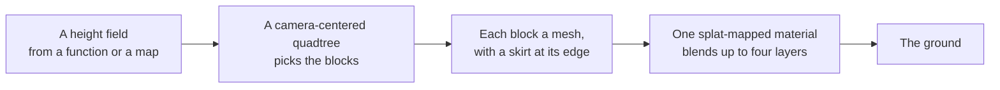

# Terrain (@null3d/terrain)

> Roadmap step 0.2, first released in null3D 0.1.0. The API is experimental, so it can still change between versions. The ground carries no collision, and it closes the seam between two levels with a skirt rather than a vertex morph. Coding agents must not use these parts.



The `@null3d/terrain` package draws a height field as terrain. It divides the ground into a quadtree of blocks. A block near the camera draws a fine grid, and a block far away draws a coarse grid over more ground. The ground near the camera then keeps its detail, and the far hills stay cheap. One material blends up to four tiled color layers over every block by a splat map.

The package is built on the engine's public API. It ships `.wgsl` for its surface function, which the null3D Vite plugin compiles with the rest of a project's shaders.

```sh
bun add @null3d/terrain
```

```ts
// sketch.ts
import { defineSketch } from '@null3d/engine';
import { createTerrain, terrainTextures } from '@null3d/terrain';

const ground = (x: number, z: number) => 20 * Math.sin(x * 0.02) * Math.cos(z * 0.02);

export default defineSketch((ctx) => {
  const { scene, textures } = ctx;
  const camera = scene.createPerspectiveCamera({ fov: 55, position: [0, 40, 120], target: [0, 0, 0] });
  scene.setActiveCamera(camera);
  scene.createDirectionalLight({ direction: [-0.4, -1, -0.3], intensity: 3, castShadows: true });
  scene.createAmbientLight({ intensity: 0.5 });

  const layers = terrainTextures(textures, { seed: 1 });
  const terrain = createTerrain(ctx, {
    size: 800,
    height: ground,
    layers: [
      { map: layers.grass, tile: 6, roughness: 1 },
      { map: layers.soil, tile: 10, roughness: 1 },
      { map: layers.rock, tile: 7, roughness: 0.85 },
      { map: layers.snow, tile: 12, roughness: 0.7 },
    ],
    maxLevel: 6,
  });

  return {
    onUpdate() {
      const at = [0, 0, 0];
      camera.getWorldPosition(at);
      terrain.update(at[0], at[2]);
    },
  };
});
```

## How it works

`createTerrain` samples a height field once, into a flat array of heights. The height comes from a function or from a height map held as a `Float32Array`. Later reads, such as `heightAt`, interpolate between the four samples around the point.

The ground is a quadtree. The root block covers the whole ground with a coarse grid. A block splits into four when the camera comes close to its edge. Its `maxLevel` sets the finest level, and its `split` sets the distance at which a block splits. The default of 6 puts the camera's own block at about a meter of detail over a 1,200 meter ground.

Each block is one mesh whose vertices carry the heights. The height field never changes shape after `createTerrain`. Once a block is made, the engine reuses it. The terrain rebuilds a block only when the camera moves into a new cell of the finest level. A still camera therefore costs no work at all.

A skirt hangs from the edge of each block, a little below the ground. Where a fine block meets a coarse one, the two edges do not match, and the skirt covers the gap. The skirt hides the seam without a vertex morph, which is the main difference from Strugar's CDLOD. On a very steep seam a thin sliver of skirt can still show.

## Layers and the splat map

The ground's material blends up to four layers. Each layer is a tiled color map with its own repeat distance and roughness. A splat map, one channel per layer, gives the weight of each layer at each point.

The default splat map comes from the ground itself. Grass takes the low, gentle ground, soil the higher dry ground, rock the steep slopes, and snow the ground above. Give `splat` to paint the weights yourself. `terrainTextures` makes the four layer maps in code, or give any `Texture` from `textures.fromData` or `assets`.

## Placing things on the ground

The terrain carries no collision. Read `heightAt(x, z)` and `normalAt(x, z, out)` to place anything that stands on the ground, and to set its upright direction. Both allocate nothing, so a frame may call them freely.

## Speed

A terrain draws one mesh per visible block. The blocks near the camera are the most and the finest, and the few coarse blocks cover the rest. A 1,200 meter ground at the default settings draws about 200 blocks, near 130,000 triangles, whatever the camera does. A block splits or merges only when the camera crosses a cell. A block that the view leaves is destroyed only when the count passes `maxBlocks`.

A sketch that never imports `@null3d/terrain` ships no terrain code and starts no terrain work. The package follows the engine's add-on rules, so its surface function compiles into the project's shaders and loads with them.

## Compared with three.js

three.js has no terrain class. Projects displace a `PlaneGeometry` on the CPU, use three.js's `TerrainGenerator`, or add a library such as three-mesh-bvh for large ground.

| three.js | null3D |
| --- | --- |
| A `PlaneGeometry` with displaced vertices | `createTerrain` with a height function or height map |
| A quadtree or a library for levels of detail | The add-on's own camera-centered quadtree |
| A hand-painted ground or per-vertex colors | A splat map that blends four tiled layers |
| A physics collider or a height lookup on the mesh | `heightAt` and `normalAt` |
| A vertex morph between levels | A skirt around each block |

## Related pages

- [Geometry](geometry.md): meshes from arrays, and the generators.
- [Textures](textures.md): `textures.fromData`, wraps and mipmaps.
- [Materials](materials.md): the standard material and custom surfaces.
- [Particles](particles.md): the other add-on of the same kind.
- [The three.js mapping](../porting/threejs-mapping.md): terrain beside three.js's ways of making ground.

## API reference

[The API reference](reference/terrain.md) lists every export of this page with its type and description. The engine's doc comments make it.
