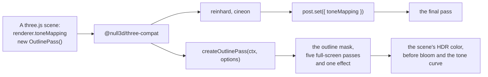

# three.js compatibility (@null3d/three-compat)

> Roadmap step 0.3, first released in null3D 0.1.0. The API is experimental, so it can still change between versions.



The engine's core holds the looks that most scenes use. This add-on holds the few three.js looks that a port asks for. They are Reinhard's and Cineon's tone curves, and the soft outline of three.js's `OutlinePass`, with its glow, its pulse and its blurred edge. It uses only the engine's public API.

Install it beside the engine:

```sh
bun add @null3d/three-compat
```

## Tone curves

`post.set({ toneMapping })` takes a built-in curve's name or a custom curve. The add-on gives three.js's two curves as custom curves:

```ts
import { cineon, reinhard } from '@null3d/three-compat';

post.set({ toneMapping: reinhard });
// A scene that sets renderer.toneMapping = THREE.CineonToneMapping:
post.set({ toneMapping: cineon });
```

| three.js | null3D |
| --- | --- |
| `ReinhardToneMapping` | `post.set({ toneMapping: reinhard })` |
| `CineonToneMapping` | `post.set({ toneMapping: cineon })` |
| `ACESFilmicToneMapping` | `post.set({ toneMapping: 'aces' })`, in the core |

Both curves use three.js's formulas. A custom curve takes the exposed color, so leave out the exposure that three.js's curve multiplies in. The exposure is still `post.set({ exposure })`.

A custom curve needs HDR color, as bloom does. Compatibility mode therefore draws in HDR color with FXAA while a custom curve is set. On a device without an HDR target, the engine keeps its built-in curve.

## The outline

`createOutlinePass(ctx, options)` draws a soft edge around the meshes that `mesh.setOutlined(true)` marks, as `OutlinePass.selectedObjects` selects them:

```ts
import { createOutlinePass } from '@null3d/three-compat';

const outline = createOutlinePass(ctx, {
  color: '#ffd060',       // visibleEdgeColor
  hiddenColor: '#3070ff', // hiddenEdgeColor
  strength: 3,            // edgeStrength
  thickness: 1,           // edgeThickness
  glow: 1,                // edgeGlow
  pulsePeriod: 1.5,       // seconds, or 0 for no pulse
});
mesh.setOutlined(true);
// Later, from a click or a key, from the next frame on:
outline.set({ strength: 5 });
```

| `OutlinePass` setting | `OutlinePassOptions` | Default |
| --- | --- | --- |
| `visibleEdgeColor` | `color` | White |
| `hiddenEdgeColor` | `hiddenColor` | `[0.1, 0.04, 0.02]`, its dark brown, in linear color |
| `edgeStrength` | `strength` | 3 |
| `edgeThickness` | `thickness` | 1 |
| `edgeGlow` | `glow` | 0 |
| `pulsePeriod` | `pulsePeriod` | 0, no pulse |

The core draws the outline's mask for the marked meshes, and the add-on turns the mask into the edge. A full-screen pass finds the mask's gradient at half the render size. Two gaussian blurs soften it at the radius that `thickness` gives, and two wider blurs at a quarter of the render size make the glow. An effect adds the edge and the glow to the scene's color.

The add-on sets the core's outline width to 0, so the crisp line stays off. A scene that also wants the crisp line sets `post.set({ outline: { width } })` after the call. One style covers every outlined mesh.

### What it costs

- The add-on adds five full-screen passes. Three draw at half the render size and two at a quarter, so together they shade about 0.88 of the canvas's pixels.
- They read about nine texels for each screen pixel, and the effect that adds the edge reads two more. A wider `thickness` spreads the same four taps each way, so it reads no more.
- The core draws each outlined mesh twice more, into the mask.
- The pulse is a cosine in the effect, so it costs nothing beyond that.
- The edge joins the scene's color before bloom and the tone curve, as `OutlinePass` adds its edge before its output pass. A bright edge can bloom.

### What differs from three.js

- The edge reads the mask at half the render size, where `OutlinePass` reads its full-size mask in the last step. A pixel at a soft edge can differ by one texel.
- `patternTexture` and `usePatternTexture` have no setting.
- `downSampleRatio` is fixed at 2, its default.
- three.js draws one `OutlinePass` for each style. The add-on draws one style for every outlined mesh, as the core's outline does.

## API reference

[The API reference](reference/three-compat.md) lists every export of this page with its type and description. The engine's doc comments make it.
