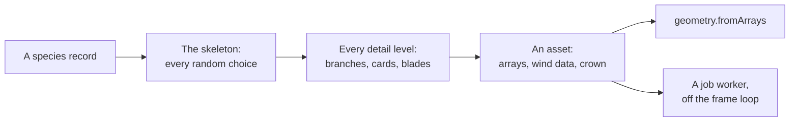

# Vegetation (@null3d/vegetation)

> Roadmap step 0.3, first released in null3D 0.1.0. The API is experimental, so it can still change between versions. Not built yet: the bark and leaf textures, the leaf and bark materials, the scatter, the grass and the far-tree impostors. This page covers the species generator, which draws plants with materials of your own.



The `@null3d/vegetation` package grows plants from a short record of numbers and a seed. A record describes a tree, a conifer, a shrub, a fern, a hosta or a grass clump. The generator makes the plant's skeleton first, then every detail level from that skeleton, so a crown keeps its shape as it thins. A plant ships no model and no texture: a page grows it at first use.

```sh
bun add @null3d/vegetation
```

```ts
// sketch.ts
import { defineSketch } from '@null3d/engine';
import { builtInSpecies, generateVariantSet } from '@null3d/vegetation';

export default defineSketch((ctx) => {
  const { scene, geometry, materials } = ctx;
  const camera = scene.createPerspectiveCamera({ fov: 50, position: [14, 6, 18], target: [0, 4, 0] });
  scene.setActiveCamera(camera);
  scene.createDirectionalLight({ direction: [-0.4, -1, -0.3], intensity: 3 });
  scene.createAmbientLight({ intensity: 0.4 });

  const oak = builtInSpecies('oak');
  if (!oak) return {};
  const bark = materials.standard({ color: oak.color.bark, roughness: 0.9 });
  const leaves = materials.standard({ color: oak.color.leaf, doubleSided: true });

  for (const [index, asset] of generateVariantSet(oak, { seed: 7 }).entries()) {
    for (const part of asset.levels[0]?.parts ?? []) {
      scene.createMesh({
        mesh: geometry.fromArrays(part.arrays),
        material: part.name === 'wood' ? bark : leaves,
        position: [index * 6 - 15, 0, 0],
      });
    }
  }
  return {};
});
```

The first level draws the plant in full detail. Pass a lower level's arrays to a mesh for a cheaper copy. Set the levels on the mesh, and the engine picks one by distance.

## How a plant grows

The generator makes every random choice in the skeleton. The meshing step reads the skeleton and chooses nothing, so two levels of the same plant share its branches, its card places and its crown.

1. The skeleton grows from the record. Each branch level names its child count, length, angle, curve and taper, and the crown's outline scales a branch by its height.
2. Radii follow the pipe model: a branch's cross section carries the tip and every child beyond it. A trunk flares where it meets the ground.
3. Leaves become cards. A broadleaf carries folded cluster cards that face up and out, and a conifer carries narrow needle cards. A plant with no branch system grows a rosette of blades, fronds or broad leaves.
4. Each coarser level keeps fewer rings on every branch and a share of the cards. Every kept card grows about its middle, so the crown keeps its coverage. See [Detail levels](#detail-levels).

All choices come from a 32-bit integer hash of the seed, the species' salt, the variant, the branch and the card. The hash matches the shaders' `pcg`, so a page can reproduce a choice in WGSL. The same record and seed grow the same plant on every device and both GPU paths.

## The species record

A record holds only numbers and short strings. This table shows the parts that a record uses most.

| Field | Holds |
| --- | --- |
| `id`, `kind` | A name, and `tree`, `conifer`, `shrub`, `fern`, `rosette` or `grass` |
| `branchLevels` | One entry per level: `children`, `prune`, `length`, `lengthVariance`, `angle`, `angleVariance`, `curve`, `curveVariance`, `taper`, `start`, `end`, `sides`, `segments` and `twist` |
| `crown` | A `shape` from the nine outlines, the `start` height, a `spread`, and the vertical `pull` |
| `leaf` | `kind` (`cluster`, `needle`, `frond` or `blade`), `cards`, `width`, `height`, `perCard`, `up`, `out`, `start` and `end` |
| `rosette` | For a plant without branches: `blades`, `length`, `width`, `arch`, `segments`, `shape`, `pinnae`, `upright` and `flowers` |
| `wind` | `stiffness` for each branch level, the flutter's `flutter` distance and its `frequency` |
| `color` | `bark`, `leaf`, `tint` and `transmission` |
| `height`, `trunks` | The plant's height and the trunks that rise from one base |
| `heightVariance`, `size` | How much a variant's height and a copy's scale vary |
| `flare`, `levels`, `variants` | The root flare, the detail levels, and the variants that a scene makes |
| `seedSalt` | A number that changes this species alone when the scene's seed changes |

`speciesProblems(record)` lists every field that cannot grow, and `checkSpecies` throws one message with all of them. A themed species pack is a list of these records. It needs no code.

## Detail levels

A plant gets one to three whole levels, most detailed first. Each level holds the plant's parts and the largest distance that its surface lies from the base level's, in meters. Pass the lower levels to `mesh.setLevels`. The engine then picks one by distance. [Levels of detail](../concepts/lod.md) explains the rule that the engine applies.

A coarser level keeps every second or fourth card in a space-filling order through the crown. It grows each kept card about its middle by the square root of that step. The same rule thins trees that the asset tool converts from files, so a generated tree and a converted one switch alike. A plant keeps whole levels, never cluster levels, because every card is a separate piece with open edges.

A rosette thins its leaves the same way, and widens each kept leaf instead of lengthening it, so the clump keeps its size and never grows past its bounds.

## Wind data and the crown

Every vertex's color carries four bytes: the branch's index, the leaf's flutter phase, the branch's stiffness and the crown's occlusion. `asset.wind.pivots` holds one record for each branch, sixteen floats each: the pivot, the axis, the parent's index, the stiffness, the flutter, the branch level and the branch's length. Upload it as a data texture and read it in a material's vertex offset. A plant keeps at most 255 branches, because the index takes eight bits.

`asset.crown` holds the outline, the bounds, the center and the radius. The bounds hold every level, so a switch never moves them. `asset.impostorSource` names the level, the bounds, the pivot and the tint that a far card bakes from.

The generator does not draw anything by itself. The leaf and bark materials that read this data arrive in a later step.

## Generating in a worker

`generatePlant` runs on the calling thread. `generatePlantInTask` runs the same work in one of the engine's job workers, beside the frames, through [Tasks](tasks.md). A scene that grows many species and variants should await the task form, so the page's first frames do not wait.

```ts
const asset = await generatePlantInTask(oak, { seed: 7, variant: 2 });
```

A worker task's input and output are plain data and typed arrays, so an asset crosses without a copy. The task takes the seed, the variant and the levels, and gives back the asset.

## Speed and memory

The built-in set holds thirteen species and six variants each. Grown in one call, the whole set takes about 50 ms on an Apple M5 Max laptop. The measured budgets are 60 ms for the iPhone and the iPad, and 200 ms for the slowest tablet. A tree takes about 3,000 to 5,500 triangles at full detail, and all of its levels together take about 0.3 to 0.5 MB. The whole set of 78 variants takes about 18 MB of vertex arrays.

Growth is linear in the branch count and the card count. A species whose record raises `children` at several levels grows many more branches and costs more to generate. Keep a plant under 255 branches, and let a species with more rely on a coarser record instead.

## Compared with three.js

| three.js | null3D |
| --- | --- |
| A tree modeled in Blender or generated by an add-on such as Sapling, loaded as a glTF file | A species record and a seed, grown at first use with no file |
| `InstancedMesh` with a separate mesh for each species | Add the add-on's arrays with `geometry.fromArrays`, then draw copies with `scene.createInstances` |
| A custom shader that bends vertices for wind | Wind data in the vertex color, which a custom material's vertex offset reads |
| `LOD` chooses a child object by distance | `mesh.setLevels` with a level for each detail |

## Related pages

- [Levels of detail](../concepts/lod.md) for the error and distance rule that picks a level.
- [Instances](../concepts/instances.md) for the copies of one plant.
- [Tasks](tasks.md) for work that runs in a job worker.
- [Custom materials](materials.md) for a vertex offset that reads the wind data.

## API reference

[The API reference](reference/vegetation.md) lists every export, with its signature and its doc comment.
