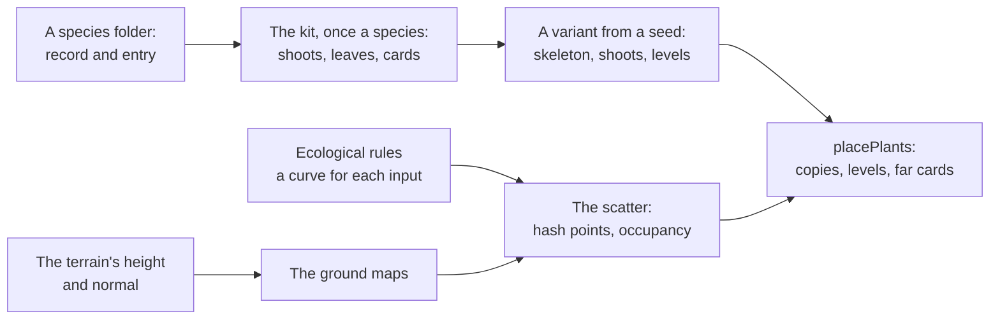

# Vegetation (@null3d/vegetation)

> Roadmap step 0.3, first released in null3D 0.1.0. The API is experimental, so it can still change between versions. The species are being rebuilt: no species ships yet, so a page draws stand-ins in their place. Built: the self-organizing growth that broadleaves, pines, shrubs and hedges use, and the leaves and shoots: leaf meshes from each species' texture outline, compound leaves, needles and fascicles, shoot prototypes with their buds, their places on the plant, the seasons and extras, and the shoot cards baked from them. Built too: the wood and the plant material. Not built yet: the other growth models, near pool and far cards. The grass's compute-built blades and near shadows are not built yet either. This page covers the plant core's records and stages, the stand-ins, the scatter, the grass's CPU path and the floating leaves that ride the wind.



The `@null3d/vegetation` package grows plants from a record of numbers and a seed, and places them by ecological rules. Each species lives in a folder of its own, with its record, its entry and its textures. A page loads only the species that it places, and grows them in the engine's job workers at first use.

The species are being rebuilt on the plant core. Until a species ships, a page names it by its id and gives the size and colors of a stand-in. The stand-in draws in its place, through the same calls that the species will take. So a scene keeps its scatter, placement, wind and far cards, and draws the real species as soon as it ships.

```sh
bun add @null3d/vegetation
```

```ts
// sketch.ts
import { defineSketch } from '@null3d/engine';
import {
  growPlant,
  loadSpeciesOrStandIn,
  placePlants,
  plantMaterials,
  prepareSpecies,
} from '@null3d/vegetation';

export default defineSketch(async (ctx) => {
  const { scene } = ctx;
  const camera = scene.createPerspectiveCamera({ fov: 50, position: [14, 6, 18], target: [0, 4, 0] });
  scene.setActiveCamera(camera);
  scene.createDirectionalLight({ direction: [-0.4, -1, -0.3], intensity: 3 });
  scene.createAmbientLight({ intensity: 0.4 });

  const oak = await loadSpeciesOrStandIn('pedunculate-oak', {
    height: 13,
    leaf: [0.09, 0.19, 0.045],
    bark: [0.18, 0.15, 0.12],
  });
  const kit = await prepareSpecies(ctx, oak, { placeholders: true });
  const assets = await Promise.all(
    [0, 1, 2].map((variant) => growPlant(kit, { seed: 7, variant, near: true })),
  );
  placePlants(
    ctx,
    kit,
    assets,
    {
      count: 3,
      position: new Float32Array([-6, 0, 0, 0, 0, 0, 6, 0, 0]),
      turn: new Float32Array([0, 1, 2]),
      scale: new Float32Array([1, 0.9, 1.1]),
      variant: new Uint8Array([0, 1, 2]),
    },
    { materials: plantMaterials(ctx, kit), view: { height: 1080, fov: 50 } },
  );
});
```

## The plant core

A species is a folder of its own with a record and an entry. The record is a `Species`. It names one of eight growth models and that model's numbers. It also gives the outline that the plant fills, its shoots, leaves, bark, seasons, wind and detail levels, and its own budget. The registry lists the folders, and [Vegetation species](vegetation-species.md) lists every species from its record.

```ts
import { checkSpecies, isSpeciesId, loadSpecies, speciesIds } from '@null3d/vegetation';

console.log(speciesIds());
const id = 'pedunculate-oak';
if (isSpeciesId(id)) {
  const oak = await loadSpecies(id);
  checkSpecies(oak.record);
}
```

`loadSpecies(id)` loads one species as a chunk of its own, so a page fetches only the species it places. Its textures load later, when the page prepares it. `checkSpecies(record)` names every problem with a record at once. `capsFor(record)` gives the limits that the record's budget must stay under. The limits depend on the growth model.

The stages run in order. First, `prepareSpecies` builds the kit once for each species: its leaf meshes, shoot prototypes, card atlas and records. Each variant then grows its skeleton, shoot rows, crown light, wind records and three detail levels. Then `bakeFarPlant` bakes its far cards. The job workers run `growPlant` and `bakeFarPlant`, and the calling thread runs `growPlantNow` and `bakeFarNow`. Last, `placePlants` draws a species' copies with their levels and far cards. A near pool from `createNearPool` keeps the real shoots near the camera within the preset's limits.

Every value that reaches geometry comes from an integer hash and the core's own trigonometry. So a variant has the same bytes in every browser. `plantAssetDigest(asset)` hashes those bytes to compare two growths.

A stage that is not built yet throws a `NotBuiltError`. A kit built with `placeholders: true` grows a simple stand-in at every stage, built or not, so a stand-in species draws the same while the real stages land. No shipped species draws a stand-in.

### Keeping results

`kitKey` and `variantKey` name a kit and a grown variant by everything they grow from. A new record or a new version of the core gives a new key, so a kept result is never stale. The page keeps each kit, variant and far bake by its key for the visit. A second call with the same inputs grows nothing. `memoryCache(limit)` makes such a cache for code of your own.

To keep results across visits, give `prepareSpecies` a store of bytes as its `cache` option. A store answers `get(key)` with the bytes or `undefined`, and takes `put(key, bytes)`. The plant core encodes each result for it and reads it when its memory has no copy. It writes each new result without waiting. A store that fails costs a new growth, never an error.

### The plant material

`plantMaterials(ctx, kit, options)` makes one material for each part of a species: `wood`, `shoots`, `cards`, `foliage` (merged fronds, blades and rosette leaves) and `extras` (cones, fruit, flowers, catkins, thorns). They are five roles of one shader, which reads the species' textures and a small data texture of its constants and wind records.

- **Leaves show their record's colors.** A leaf lit from the front shows its record's `reflectance`, its lower face its `reflectanceBack`, and a leaf with the sun behind it shows its `transmittance`. Each face draws its own texture layer, divided by that layer's mean and scaled by the record's color, so the picture keeps its veins and spots and the record sets its average. Change a species' color in its record, not in its textures.
- **The sky's light reaches a leaf through its crown.** A shoot's sky visibility and bent normal from its crown light the sky's light alone, and its visibility joins screen-space ambient occlusion by the smaller of the two, so a crown darkens once ([Surface functions](../shaders/surface-functions.md#occlusion-counted-once)).
- **Edges cut solid.** A leaf's or card's coverage is sharpened to a one-pixel edge at the cutoff, so a blade draws whole to its cut edge.
- **Bark relief follows the branch.** The bark's tangent frame comes from its own texture coordinates, so its ridges run along every limb, whichever way the limb points.
- **Wind.** Give `options.wind` the wind add-on's field, and call `setWindLayer(materials, field)` in each frame. Every part sways, and leaves and cards flutter. `options.swayDistance` stops the sway past that distance, so far shadows stay cached.
- **A matte.** `options.matte: true` draws the plant black, with its outline, its cut-outs and its sway, for an exact silhouette.

`prepareSpecies` loads the textures of the preset's set, the half set on Low, the first time a page prepares the species. A page fetches no texture file of a species it does not prepare.

## Stand-in species

`standInSpecies(id, options)` makes a species module for an id that has no folder yet. Its record is a small broadleaf of the size and colors that the options give: `height`, `aspect` (crown width over height), `dbh`, `leaf`, `bark` and `variants`. `loadSpeciesOrStandIn(id, options)` loads the real species once its folder exists, and makes the stand-in until then.

Prepare a stand-in with `placeholders: true`. The page then draws it with the standard material in its leaf and bark colors, as instance batches with levels by distance. Its far bake gives it far cards. It does not move in the wind yet: `setWindLayer` passes over a stand-in's materials.

## Placing plants

`scatterVegetation` places every species where its rules allow. It reads the ground once, places the layers in order and returns the points as one flat array. A page then grows each species' variants and draws a copy at each point.

```ts
import { type EcoRule, groundMaps, scatterVegetation } from '@null3d/vegetation';

const rules: EcoRule[] = [
  {
    species: 'common-alder',
    layer: 'canopy',
    radius: 4.1,
    spacing: 8,
    tolerances: [
      { input: 'heightAboveWater', min: 0.15, best: 0.5, worst: 2.2, max: 5 },
      { input: 'distanceToWater', min: 1.5, best: 4, worst: 10, max: 18 },
    ],
  },
];
const ground = groundMaps({ size: 160, water: 0, height: terrain });
const points = scatterVegetation({ seed: 7, ground, rules });

for (let i = 0; i < points.count; i++) {
  const at = i * points.stride;
  const x = points.data[at] as number;
  const y = points.data[at + 1] as number;
  const z = points.data[at + 2] as number;
  const rule = points.rules[points.data[at + 3] as number];
  // Draw a copy of rule.species at the point.
}
```

### The ground maps

`groundMaps` reads the terrain once into flat grids. It takes a terrain, which answers `heightAt` and `normalAt`, or a plain height function. A grid holds:

- how high the ground stands above the water, and how far it lies from the water;
- the slope, the aspect in degrees clockwise from north, and how far the slope faces north and east;
- the curvature, positive in a hollow;
- the wetness that gathers from the water's flow and from the hollows;
- the shares that paths, rocks and cave mouths cover.

Pass `paths`, `rocks` and `caves` as a function or as a list of discs and strips. No plant grows where one of them covers the ground.

The maps hold `resolution` samples along each side, which is one a meter by default. A valley of 160 m therefore reads 161 samples each way. Read a grid at any point with `sampleAt`, which interpolates and allocates nothing.

### Ecological rules

A rule names a species, a layer, the room that the plant keeps and a tolerance curve for each input. A curve holds four numbers, `min`, `best`, `worst` and `max`. Its score is 0 outside the curve, 1 between `best` and `worst`, and a straight ramp between them. A place's score for a rule is the lowest of its curves, so a plant grows only where every need holds. The chance that a candidate grows is its score.

The inputs are `heightAboveWater`, `distanceToWater`, `slope`, `northness`, `eastness`, `wetness` and `curvature`, then `canopy`, `edge` and `openness`, which the scatter works out from the trees that it has already placed.

The layers are placed in this order: `canopy`, `young`, `understory`, `shrub`, `ground` and `deadwood`. A `young` rule gathers its saplings around the adults that its `cluster` names. A rule's `overlaps` names the layers whose plants it must not stand inside. Its default is every layer, so a rule that grows under a crown names only its own layer. A rule's `clump` picks the share of a clump field that the species grows in, from 0 to 1. That leaves gaps that another species fills. `clumpScale` sets the size of those clumps in meters.

A species record may hold its own rule as its `ecology`, without the id, the variants and the radius that the record already gives. `speciesRule(record)` makes the scatter's rule from it, with the crown's radius unless the ecology names another.

### Points from an integer hash

A candidate point comes from a grid of cells. The cell's size is the rule's `spacing`, and the hash of the seed, the rule, the row and the column picks the point inside it. The same hash picks the rotation and the scale, and the same hash decides whether the candidate grows. No choice reads a floating-point noise or a clock, so one seed places the same plants on every device and on both GPU paths.

A shared occupancy grid stops two plants overlapping. A plant takes a place when no plant that it must avoid holds it. The first plant to claim a place keeps it. The layers run in a fixed order, so nothing depends on the order of the calls.

`scatterChecksum` hashes a point list into one number, from the exact bytes of each float. Two runs that place the same plants give the same number, and any difference at all gives another. A page compares its own placement against a reference that another device recorded, which is how the same placement is checked across devices. The ground maps hold 32-bit floats, and every other choice comes from integer arithmetic. One seed therefore places one point list on every engine. A height function that answers other samples on another engine moves the points it places, and the checksum with them.

### Tiles

A large scene need not place every plant at once. `EcoScatter` takes tiles with `addTile`, and `build` places the plants of the tiles added. A point's cell belongs to one tile. The cells run in one row-by-row order over the whole square, so neither the order nor the size of the tiles changes the result. A page can therefore place the tiles beside the frames.

### Variance maps

`varianceMaps` holds three patches at one to two meters. The type picks a species' variant, the color shifts a plant's tint, and the lichen covers a plant or a stone. Each point carries the values at its place in its `tint` and `lichen` fields. Neighboring plants therefore differ a little, and the ground gains patches.

## Grass on the ground

`createGrass(ctx, { height, area, count, seed, mask, wind })` draws tufts of bent blades over a square of ground. The tufts stand on `height(x, z)`, skip ground steeper than `maxSlope`, and skip the ground that `mask` refuses, such as water, a stone or a footprint. Their turn, size and tint come from integer hashes, so one seed places the same grass on every device. Each tuft's row values carry its tint, which its shader reads. `count` is the tufts at the High preset; Low, Medium and Ultra draw 0.35, 0.6 and 1.25 of it. `createGrass` fits the engine's starting preset, and `grass.fit(preset)` takes a new one.

The blades bend in the wind add-on's field. Give `createGrass` its `wind` field, and call `grass.setWindLayer(field)` in each frame with the field's newest state, as the plant materials take it. A page that gives no field grows grass that stands still.

The CPU tile path draws on WebGPU and WebGL2, with one instance batch for each tuft shape. The rows are built for Ultra's share once, so a preset change only changes how many rows each batch draws, not the memory. The compute path, which builds and culls blades on the GPU for the denser presets, is not built yet.

The blades receive the sun's shadows. The ground's own color and the blades' root colors should meet at the hill's foot.

## Floating and falling leaves

`createFloatingLeaves(ctx, { wind, camera, count, area, ride })` draws leaves that ride the wind add-on's one field. A leaf falls from the top of `area` to its ground and starts again, and the air moves it across the fall. The box follows the camera, so the leaves fill the part of the scene that the view shows.

```ts
import { createFloatingLeaves } from '@null3d/vegetation';
import { createWind } from '@null3d/wind';

const wind = createWind(ctx, { camera, box: 128 });
const leaves = createFloatingLeaves(ctx, {
  wind: wind.field,
  camera,
  count: 2000,
  area: { x: 0, z: 0, size: 40, high: 12, low: 0 },
  ride: 'state',
});

return {
  onUpdate(dt) {
    wind.update();
    leaves.update(dt);
  },
};
```

Two forms ride the air. `ride: 'offset'` gives each leaf a closed-form fall and pushes it by the air where it passes. It reads the field once for each leaf, and keeps no state between frames. A gust therefore moves a leaf only while the leaf stands in it. `ride: 'state'` keeps a place and a speed for each leaf in a compute pass. The pass steps them through the field, so a gust carries a leaf along its path. The state form is the default. On WebGL2 the pass runs as a fragment form, and the leaf moves the same way.

The state form costs one pass and a texture of four numbers for each leaf. The offset form costs one texture read for each leaf and no pass. `leaves.update(dt)` steps the state and gives the shader the field's newest layer. `leaves.setColor` tints the leaves for a mood. `leaves.destroy()` removes them and their pass.

On WebGL2 the state form's pass costs the frame a large upload for each frame when the scene also draws a reflection, so a scene that reflects its water or its sky rides the offset form on that path. Read the tier with `ctx.engine.capabilities.tier` and pick the form there. D-283 and D-286 hold the figures.

## Speed and memory

Each species has a budget in its record: its kit's bytes, a variant's bytes, the triangles of each level, its download and its growth time. `capsFor(record)` gives the limits for its growth model, and the record check refuses a budget over them. A species' own test holds its growth to its budget.

Reading Creek's 160 m valley into the ground maps and placing its species takes about 55 ms on an Apple M5 Max laptop, for about a thousand points. Ground cover is the most of it. A species at one meter of spacing offers tens of thousands of candidates.

## Far cards and the hand-over

`placePlants` draws a species' far cards past the distance where a plant spans a few pixels, when the page passes the variants' far bakes as its `far` option. `bakeFarPlant(kit, asset)` bakes a variant's two impostor atlases in a job worker, for the cards of the [impostors add-on](impostors.md).

`handOverToCards(meshes, cards, switchDistance)` sets the distance bands of a batch of near meshes and the batch of their cards. The meshes draw up to the switch. Over the last 8 per cent of that range the engine dithers their pixels out. The cards start earlier, by as much as the largest card's size and both edges need, so write the cards' sizes first. Their own dithered edge then finishes before the mesh's edge begins to thin. Each pixel that a mesh's dither drops shows its card, and no pixel ever drops out of both. The mesh and the card are different sources, so their dither phases differ, and the two edges must not fall on the same pixels.

## Compared with three.js

| three.js | null3D |
| --- | --- |
| A tree modeled in Blender or generated by an add-on such as Sapling, loaded as a glTF file | A species record and a seed, grown at first use in a job worker |
| `InstancedMesh` with a separate mesh for each species | `placePlants` draws a species' copies as instance batches with their levels |
| A custom shader that bends vertices for wind | The plant materials read the wind add-on's field |
| A scatter tool that places plants with floating-point noise, so two devices place them differently | `scatterVegetation` places them from an integer hash and the ground's maps, so every device places the same plants |
| `LOD` chooses a child object by distance | The plant core's levels, then far cards from `bakeFarPlant` |

## Related pages

- [Levels of detail](../concepts/lod.md) for the error and distance rule that picks a level.
- [Instances](../concepts/instances.md) for the copies of one plant.
- [Terrain](terrain.md) for the height field that the ground maps read.
- [Tasks](tasks.md) for work that runs in a job worker.
- [Impostors](impostors.md) for the far cards.

## API reference

[The API reference](reference/vegetation.md) lists every export, with its signature and its doc comment.
