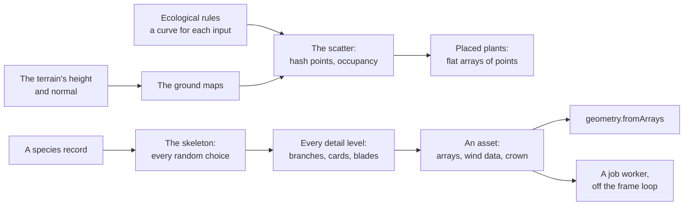

# Vegetation (@null3d/vegetation)

> Roadmap step 0.3, first released in null3D 0.1.0. The API is experimental, so it can still change between versions. Not built yet: the grass. This page covers the species generator, the scatter, the bark and leaf atlases that the browser paints at first use, the material that draws a plant from them, and the far tree that a card draws.



The `@null3d/vegetation` package grows plants from a short record of numbers and a seed. A record describes a tree, a conifer, a shrub, a fern, a hosta or a grass clump. The generator makes the plant's skeleton first, then every detail level from that skeleton, so a crown keeps its shape as it thins. A plant ships no model and no texture: a page grows it at first use.

```sh
bun add @null3d/vegetation
```

```ts
// sketch.ts
import { defineSketch } from '@null3d/engine';
import {
  bakePlantAtlases,
  builtInSpecies,
  generateVariantSet,
  leafCellFor,
  plantMaterial,
} from '@null3d/vegetation';

export default defineSketch((ctx) => {
  const { scene, geometry } = ctx;
  const camera = scene.createPerspectiveCamera({ fov: 50, position: [14, 6, 18], target: [0, 4, 0] });
  scene.setActiveCamera(camera);
  scene.createDirectionalLight({ direction: [-0.4, -1, -0.3], intensity: 3 });
  scene.createAmbientLight({ intensity: 0.4 });

  const oak = builtInSpecies('oak');
  if (!oak) return {};
  const atlases = bakePlantAtlases(ctx);
  const bark = plantMaterial(ctx, { atlases, part: 'wood', color: oak.color.bark });
  const leaves = plantMaterial(ctx, {
    atlases,
    part: 'leaves',
    cell: leafCellFor(oak),
    color: oak.color.leaf,
  });

  for (const [index, asset] of generateVariantSet(oak, { seed: 7 }).entries()) {
    for (const part of asset.levels[0]?.parts ?? []) {
      scene.createMesh({
        mesh: geometry.fromArrays(part.arrays),
        material: part.name === 'wood' ? bark : leaves,
        position: [index * 6 - 15, 0, 0],
      });
    }
  }
  return {};
});
```

The first level draws the plant in full detail. Pass a lower level's arrays to a mesh for a cheaper copy. Set the levels on the mesh, and the engine picks one by distance.

## How a plant grows

The generator makes every random choice in the skeleton. The meshing step reads the skeleton and chooses nothing, so two levels of the same plant share its branches, its card places and its crown.

1. The skeleton grows from the record. Each branch level names its child count, length, angle, curve and taper, and the crown's outline scales a branch by its height.
2. Radii follow the pipe model: a branch's cross section carries the tip and every child beyond it. A trunk flares where it meets the ground.
3. Leaves become cards. A broadleaf carries folded cluster cards that face up and out, and a conifer carries narrow needle cards. A plant with no branch system grows a rosette of blades, fronds or broad leaves.
4. Each coarser level keeps fewer rings on every branch and a share of the cards. Every kept card grows about its middle, so the crown keeps its coverage. See [Detail levels](#detail-levels).

All choices come from a 32-bit integer hash of the seed, the species' salt, the variant, the branch and the card. The hash matches the shaders' `pcg`, so a page can reproduce a choice in WGSL. The same record and seed grow the same plant on every device and both GPU paths.

## The species record

A record holds only numbers and short strings. This table shows the parts that a record uses most.

| Field | Holds |
| --- | --- |
| `id`, `kind` | A name, and `tree`, `conifer`, `shrub`, `fern`, `rosette` or `grass` |
| `branchLevels` | One entry per level: `children`, `prune`, `length`, `lengthVariance`, `angle`, `angleVariance`, `curve`, `curveVariance`, `taper`, `start`, `end`, `sides`, `segments`, `twist` and the optional `whorls` |
| `crown` | A `shape` from the nine outlines, the `start` height, a `spread`, the vertical `pull`, and the optional `floor` that a crown keeps at its narrowest |
| `leaf` | `kind` (`cluster`, `needle`, `frond` or `blade`), `cards`, `width`, `height`, `perCard`, `up`, `out`, `start` and `end` |
| `rosette` | For a plant without branches: `blades`, `length`, `width`, `arch`, `segments`, `shape`, `pinnae`, `upright` and `flowers` |
| `wind` | `stiffness` for each branch level, the flutter's `flutter` distance and its `frequency` |
| `color` | `bark`, `leaf`, `tint` and `transmission` |
| `height`, `trunks` | The plant's height and the trunks that rise from one base |
| `heightVariance`, `size` | How much a variant's height and a copy's scale vary |
| `flare`, `levels`, `variants` | The root flare, the detail levels, and the variants that a scene makes |
| `seedSalt` | A number that changes this species alone when the scene's seed changes |

`speciesProblems(record)` lists every field that cannot grow, and `checkSpecies` throws one message with all of them. A themed species pack is a list of these records. It needs no code.

**A level's `start` and `end` place its children, not itself.** The trunk's record says where its boughs attach, and a bough's record says where its branchlets attach. So a conifer whose bough level asks for 0.1 grows boughs from a tenth of the trunk and its crown reaches the ground, while 0.48 leaves the lower trunk bare. A trunk level's own `start` is never read, because a trunk has no parent.

**A whorled level makes shelves, not one mass.** A branch level whose record gives `whorls` places its children in rings at the same height along the parent, and a conifer grows its boughs that way. Each ring then carries its boughs as one shelf, and a crown of rings reads as layered plates with air between them, which is the shape a spruce or a pine has and an even spread of boughs cannot make. Zero, the default, spreads the children evenly, as a broadleaf's limbs grow. The crown's `floor` sets how much of a bough the outline keeps at its narrowest: the default 0.2 holds a rounded crown's top open, and a conifer that tapers to a point asks for less.

**A leaf's `width` and `height` are half a card.** A card draws two of each. Many cards cost vertex memory and a few large ones do not, so a crown closes by making its cards larger rather than more numerous: a leaf cell carries sixty small leaves, and a bigger card shows more of them at the same size on the screen. The generated arrays of the whole built-in set are measured against the memory budget that D-241 records.

## Detail levels

A plant gets one to three whole levels, most detailed first. Each level holds the plant's parts and the largest distance that its surface lies from the base level's, in meters. Pass the lower levels to `mesh.setLevels`. The engine then picks one by distance. [Levels of detail](../concepts/lod.md) explains the rule that the engine applies.

A tree's leaf cards morph before the switch, as SpeedTree's do. Each leaf vertex carries its place at the next level, and the leaf material's vertex offset moves it there over the last part of the approach: a card that the next level keeps grows, and one that it drops shrinks to its middle. At the switch the two levels show the same crown, so no card pops. The coarser level's cards grow by the square root of the step, so the crown keeps the ground it covers.

Give the leaf material `morph: { crownRadius }` to turn the morph on, and give the same radius to the object or batch that draws the plant:

```ts
const crownRadius = Math.hypot(...asset.crown.center) + asset.crown.radius;
const leaves = plantMaterial(ctx, {
  atlases,
  part: 'leaves',
  cell: leafCellFor(oak),
  color: oak.color.leaf,
  morph: { crownRadius, threshold: ctx.quality.settings.lodThreshold },
});
const leafPart = asset.levels[0]?.parts.find((part) => part.name === 'leaves');
const mesh = geometry.fromArrays(leafPart.arrays);
const tree = scene.createMesh({ mesh, material: leaves });
tree.setBounds([0, 0, 0], crownRadius);
```

The radius may hold every vertex rather than fit the crown tightly: the engine measures the distance to the sphere, and the morph ends at the same distance when both read the same sphere. One material serves plants of one crown size, and a variant with a larger crown needs its own material or the largest radius of the set. The morph reads the level's switch distance from the error that the generator measured, the plant's world scale, the render height, the projection and the threshold that the material holds. The frame-budget governor raises the level threshold in private when frames run long: under its pressure the engine switches before the mix ends, so a card can pop, and `material.set({ lodThreshold })` with the raised value is the way to follow it. Hold mode takes no governor step, so a capture or a picture draws the mix as set. A level bias on the plant moves the engine's switches but not the material's mix, so leave the bias at 1 on a tree that morphs. A plant whose level the engine marks `fade: false`, as a measured error should, then changes only through the morph.

A coarser level keeps every second or fourth card in a space-filling order through the crown. It grows each kept card about its middle by the square root of that step. The same rule thins trees that the asset tool converts from files, so a generated tree and a converted one switch alike. A plant keeps whole levels, never cluster levels, because every card is a separate piece with open edges.

A rosette thins its leaves the same way, and widens each kept leaf instead of lengthening it, so the clump keeps its size and never grows past its bounds.

## Wind data and the crown

Every vertex's color carries four bytes: the branch's index, the leaf's flutter phase, the branch's stiffness and the crown's occlusion. `asset.wind.pivots` holds one record for each branch, sixteen floats each: the pivot, the axis, the parent's index, the stiffness, the flutter, the branch level, the branch's length and the branch's sway phase. Upload it as a data texture and read it in a material's vertex offset. A plant keeps at most 255 branches, because the index takes eight bits.

`asset.crown` holds the outline, the bounds, the center and the radius. The bounds hold every level, so a switch never moves them. `asset.impostorSource` names the level, the bounds, the pivot and the tint that a far card bakes from.

`plantWind` turns this data into what a plant's materials read: the branch records in one data texture of half floats, four texels for each branch, with the wind field's steady settings in the texture's second row, and the crown, height and transmission of the plant. Give one `plantWind` to a variant's leaf and bark materials, so both parts read the same table.

```ts
import { createWind } from '@null3d/wind';

const wind = createWind(ctx, { camera, box: 128 });
const field = plantWind(ctx, asset, wind.field, { swayDistance: 60 });
const leaves = plantMaterial(ctx, { atlases, part: 'leaves', wind: field, cell: leafCellFor(oak) });
```

The offset has three layers. The trunk bends as a cantilever, most at its top. Every branch turns about its pivot, and the turns carry the branches above them, so a twig follows its limb. The leaves flutter across the air from their stored phases. One sampling of the wind field at the vertex's place drives them all, and the shading of the shadow uses the same offset in every pass.

`swayDistance` is the distance from the camera out to which the plant moves. The offset fades to nothing over the last fifth of it, and the engine counts the plant as moving only within it, so the far shadow cascades that only a still plant reaches keep the layers they hold. A plant past it stands still with the shadow its layer holds. Leave the distance out, or give 0, for a plant that moves at every distance.

A page takes the distance from the quality preset rather than choosing one: `swayDistanceFor(preset)` reads `PLANT_SWAY_DISTANCE`, which gives 8, 16, 24 and 32 meters from Low to Ultra, so a heavier preset moves more of the grove and a governor step that lowers the preset shortens the distance with it. The field keeps two states, and its texture names the one that its last run wrote, so call `setWindLayer(materials, wind.field)` in each frame with the leaf and bark materials that read the field; a material that reads the other layer sways by a frame of stale air.

`treeValues(x, z, seed, autumn)` gives a copy's four row values: a tint from an integer hash of the copy's whole-meter place, and the autumn value. Give them to the batch that draws the copies, with `values: true`, so each tree differs and the same place gives the same tree on every device.

## Generating in a worker

`generatePlant` runs on the calling thread. `generatePlantInTask` runs the same work in one of the engine's job workers, beside the frames, through [Tasks](tasks.md). A scene that grows many species and variants should await the task form, so the page's first frames do not wait.

```ts
const asset = await generatePlantInTask(oak, { seed: 7, variant: 2 });
```

A worker task's input and output are plain data and typed arrays, so an asset crosses without a copy. The task takes the seed, the variant and the levels, and gives back the asset.

## Placing plants

`scatterVegetation` places every species where its rules allow. It reads the ground once, places the layers in order and returns the points as one flat array. A page then grows one asset for each variant and draws a copy at each point.

```ts
import { builtinRules, CREEK_SPECIES, groundMaps, scatterVegetation } from '@null3d/vegetation';

const ground = groundMaps({ size: 160, water: 0, height: terrain });
const rules = builtinRules(CREEK_SPECIES);
const points = scatterVegetation({ seed: 7, ground, rules });

for (let i = 0; i < points.count; i++) {
  const at = i * points.stride;
  const x = points.data[at] as number;
  const y = points.data[at + 1] as number;
  const z = points.data[at + 2] as number;
  const rule = points.rules[points.data[at + 3] as number];
  // Draw a copy of rule.species at the point.
}
```

### The ground maps

`groundMaps` reads the terrain once into flat grids. It takes a terrain, which answers `heightAt` and `normalAt`, or a plain height function. A grid holds:

- how high the ground stands above the water, and how far it lies from the water;
- the slope, the aspect in degrees clockwise from north, and how far the slope faces north and east;
- the curvature, positive in a hollow;
- the wetness that gathers from the water's flow and from the hollows;
- the shares that paths, rocks and cave mouths cover.

Pass `paths`, `rocks` and `caves` as a function or as a list of discs and strips. No plant grows where one of them covers the ground.

The maps hold `resolution` samples along each side, which is one a meter by default. A valley of 160 m therefore reads 161 samples each way. Read a grid at any point with `sampleAt`, which interpolates and allocates nothing.

### Ecological rules

A rule names a species, a layer, the room that the plant keeps and a tolerance curve for each input. A curve holds four numbers, `min`, `best`, `worst` and `max`. Its score is 0 outside the curve, 1 between `best` and `worst`, and a straight ramp between them. A place's score for a rule is the lowest of its curves, so a plant grows only where every need holds. The chance that a candidate grows is its score.

The inputs are `heightAboveWater`, `distanceToWater`, `slope`, `northness`, `eastness`, `wetness` and `curvature`, then `canopy`, `edge` and `openness`, which the scatter works out from the trees that it has already placed.

The layers are placed in this order: `canopy`, `young`, `understory`, `shrub`, `ground` and `deadwood`. A `young` rule gathers its saplings around the adults that its `cluster` names. A rule's `overlaps` names the layers whose plants it must not stand inside. Its default is every layer, so a rule that grows under a crown names only its own layer. A rule's `clump` picks the share of a clump field that the species grows in, from 0 to 1. That leaves gaps that another species fills. `clumpScale` sets the size of those clumps in meters.

`builtinRules` gives a rule for each built-in species that the page passes. The curves suit a valley that has water at zero, so a scene with other terrain changes the numbers that differ.

### Points from an integer hash

A candidate point comes from a grid of cells. The cell's size is the rule's `spacing`, and the hash of the seed, the rule, the row and the column picks the point inside it. The same hash picks the rotation and the scale, and the same hash decides whether the candidate grows. No choice reads a floating-point noise or a clock, so one seed places the same plants on every device and on both GPU paths.

A shared occupancy grid stops two plants overlapping. A plant takes a place when no plant that it must avoid holds it. The first plant to claim a place keeps it. The layers run in a fixed order, so nothing depends on the order of the calls.

`scatterChecksum` hashes a point list into one number. A page compares its own placement against a reference that another device recorded, which is how the same placement is checked across devices.

### Tiles

A large scene need not place every plant at once. `EcoScatter` takes tiles with `addTile`, and `build` places the plants of the tiles added. A point's cell belongs to one tile. The cells run in one row-by-row order over the whole square, so neither the order nor the size of the tiles changes the result. A page can therefore place the tiles beside the frames.

### Variance maps

`varianceMaps` holds three patches at one to two meters. The type picks a species' variant, the color shifts a plant's tint, and the lichen covers a plant or a stone. Each point carries the values at its place in its `tint` and `lichen` fields. Neighboring plants therefore differ a little, and the ground gains patches.

## Speed and memory

The built-in set holds thirteen species and six variants each. Grown in one call, the whole set takes about 50 ms on an Apple M5 Max laptop. The measured budgets are 60 ms for the iPhone and the iPad, and 200 ms for the slowest tablet. A tree takes about 3,000 to 5,500 triangles at full detail, and all of its levels together take about 0.3 to 0.5 MB. The whole set of 78 variants takes about 18 MB of vertex arrays.

Growth is linear in the branch count and the card count. A species whose record raises `children` at several levels grows many more branches and costs more to generate. Keep a plant under 255 branches, and let a species with more rely on a coarser record instead.

Reading Creek's 160 m valley into the ground maps and placing its eight species takes about 55 ms on an Apple M5 Max laptop, for about a thousand points. Ground cover is the most of it. A species at one meter of spacing offers tens of thousands of candidates.
## Bark and leaf textures

A plant ships no image file, so its bark and leaves come from two atlases that the browser paints the first time a page asks for them. `bakePlantAtlases` paints them, and `plantMaterial` draws a plant part from them.


```ts
const atlases = bakePlantAtlases(ctx);
const bark = plantMaterial(ctx, { atlases, part: 'wood', color: oak.color.bark });
const leaves = plantMaterial(ctx, {
  atlases,
  part: 'leaves',
  cell: leafCellFor(oak),
  color: oak.color.leaf,
});
```

- **Bark** comes from stretched cells warped by noise, with cracks between them and fibres up the trunk. It tiles around and along a branch.
- **Leaves** come from outlines cut with teeth or lobes, and veins written into a height field, which the surface map's normal follows. Its blue channel holds the leaf's coverage, and its alpha its thickness.
- **A leaf cell holds more than one leaf.** The leaves differ in outline, colour and veins, and a few have a piece bitten out of an edge. A crown therefore does not read as one leaf shape tiled over and over.
- **The leaf's shading follows measured leaves.** Its gloss is a dielectric's, with a reflectance at normal incidence of about 0.035 and a perceptual roughness of 0.35 to 0.6. About a third of its diffuse light passes through to its other side, tinted by the leaf: the measured share is 0.25 to 0.45, and the species record gives it. The leaf sets `s.diffuseNormal` to the crown's outward normal, so the crown lights as the volume it stands for, and keeps its own normal map for the gloss and the light through it.
- **Each tree differs.** The four row values that `treeValues` gives a batch carry the copy's tint and its autumn value. The tint shifts the leaf's hue by a few per cent. Autumn turns the leaf toward yellow, brightens it, roughens it and lifts the light that passes through it.
- **The floor of the crown is darker.** The generator's crown occlusion, in the vertex colour's alpha, cuts the sky and sun that reach a leaf inside the crown.
- **The leaf block holds eight cells**: four leaf clusters, a needle spray, a frond, a blade and a broad leaf. `leafCellFor` picks one from a species record.
- **The colour map multiplies the species' colour.** It holds the veins, the shade of each leaf and the lift of its ridges, so two species that share a cell still differ.
- **The engine makes each texture's mip levels.** A masked material fades its cut edges with alpha to coverage, so a leaf card that shrinks keeps the share of the picture that its leaves cover, and a crown far away stays as dense as it is up close.
- **The card material morphs, and the plain one does not.** `plantMaterial` takes `morph` only for a plant's leaves: its WGSL adds a vertex offset that reads each leaf vertex's target record. A trunk, a frond or a flower drawn with the plain material needs no record.
- **A plant material draws a mesh with the plant vertex format.** Its wind offset reads each vertex's branch index and leaf phase from the vertex color. A still material reads neither, but its mesh must still carry the color attribute. Without it the pair draws nothing.
- **The four textures take about 4.6 MB of texture memory.** They are painted once, in the setup, and kept for the visit. A plant's branch records take one more small texture, eight bytes for each branch.


## Far trees

A tree past the distance where its triangles matter draws as one card. `bakeFarTree` bakes the plant's most detailed level into the two atlases that an impostor card draws, at its first use. The bake reads the same leaf and bark atlases and the same colours as the near material: the bark colour tints the wood, and the leaf colour the leaves, in both. So the card's color matches the mesh at the hand-over. It runs on the CPU, so every device gets the same atlases.

```ts
import { createImpostors } from '@null3d/impostors';
import { bakeFarTree, handOverToCards } from '@null3d/vegetation';

const atlases = bakePlantAtlases(ctx);
const far = bakeFarTree(ctx, { asset, atlases, views: 25, texels: 64 });
const cards = createImpostors(
  { scene, materials, geometry },
  {
    color: far.color,
    surface: far.surface,
    atlas: far.atlas,
    positions: farTrees.flatMap((tree) => [tree.position[0], tree.position[1] + far.base, tree.position[2]]),
    turn: farTrees.map((tree) => tree.turn),
    size: far.size,
    depth: far.depth,
    alphaMode: 'mask',
    receiveShadows: true,
  },
);
handOverToCards(nearTrees, cards.batch, 240);
```

`bakeFarTree` returns the two textures, the grid, the card's `size` and the plant's `depth`, which scales the stored depth that places a card's own shadow lookup. A far card casts the crown's shape through a second batch with `castShadows: true`, on a layer that the sun draws and no camera does, and takes the shadows of other objects with `receiveShadows: true` ([Impostors](impostors.md)). The bake draws level 0, or the level that the plant's `impostorSource` names. The bark colour tints the wood and the leaf colour the leaves, as the plant's materials do. A second call for the same plant, grid and cell size reuses the baked pixels.

`handOverToCards(meshes, cards, switchDistance)` sets the distance bands. The meshes draw up to the switch. Over the last 8 per cent of that range the engine dithers their pixels out. The cards start a fifth of the switch earlier. Their own dithered edge then finishes before the mesh's edge begins to thin. They stand at full coverage behind the meshes, each pixel that a mesh's dither drops shows its card, and no pixel ever drops out of both. A custom material fades at a range edge as the engine's own materials do. The mesh and the card are different sources, so their dither phases differ, and the two edges must not fall on the same pixels. The meshes and the cards stand at the same trees, so a tree draws as its mesh near the camera and as its card far from it.

A card's rows need their turn, so a turned tree's crown matches its card. The plant's `impostorSource.bounds` gives the largest bound over its levels, which the bake uses for the card's size and for its lowest point.

## Compared with three.js

| three.js | null3D |
| --- | --- |
| A tree modeled in Blender or generated by an add-on such as Sapling, loaded as a glTF file | A species record and a seed, grown at first use with no file |
| `InstancedMesh` with a separate mesh for each species | Add the add-on's arrays with `geometry.fromArrays`, then draw copies with `scene.createInstances` |
| A custom shader that bends vertices for wind | Wind data in the vertex color, which a custom material's vertex offset reads |
| A scatter tool that places plants with floating-point noise, so two devices place them differently | `scatterVegetation` places them from an integer hash and the ground's maps, so every device places the same plants |
| `LOD` chooses a child object by distance | `mesh.setLevels` with a level for each detail |

## Related pages

- [Levels of detail](../concepts/lod.md) for the error and distance rule that picks a level.
- [Instances](../concepts/instances.md) for the copies of one plant.
- [Terrain](terrain.md) for the height field that the ground maps read.
- [Tasks](tasks.md) for work that runs in a job worker.
- [Custom materials](materials.md) for a vertex offset that reads the wind data.

## API reference

[The API reference](reference/vegetation.md) lists every export, with its signature and its doc comment.
