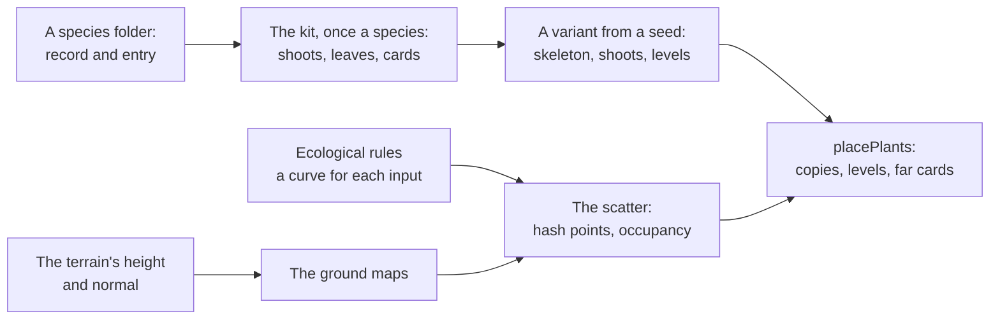

# Vegetation (@null3d/vegetation)

> Roadmap step 0.3, first released in null3D 0.1.0. The API is experimental, so it can still change between versions. Twelve species ship, each grown from its own record, and a page draws a stand-in for any species id it names that has none. Built: the self-organizing growth that broadleaves, pines, shrubs and hedges use, and the leaves and shoots: leaf meshes from each species' texture outline, compound leaves, needles and fascicles, shoot prototypes with their buds, their places on the plant, the seasons and extras, and the shoot cards baked from them. Built too: the wood, the plant material, the wind records that sway each branch and leaf, the placement of a species' copies at fixed places with real shoots near the camera, the coarseness options that grow a simpler plant, bracken's fronds (the frond builder and the frond colony that grows them), the crown rosette that palms and tree ferns use (one stem crowned by a spiral of pinnate fronds, drawn as separate leaflets along each rachis), and the ground plants' growth: rosettes of broad ribbed leaves on long stalks, and tufts of grass and sedge blades with their flowering stems, panicles and hanging spikes. Built too: the near pool, the scene's budget of real pieces. Not built yet: the other growth models and the level distances; the far cards are built, and the page documents them below. This page covers the plant core's records and stages, the stand-ins, the scatter, the grass's two GPU paths and its near shadows, and the floating leaves that ride the wind.



The `@null3d/vegetation` package grows plants from a record of numbers and a seed, and places them by ecological rules. Each species lives in a folder of its own, with its record, its entry and its textures. A page loads only the species that it places, and grows them in the engine's job workers at first use.

Twelve species ship on the plant core, each grown from its own record. For an id that has no record, a page gives the size and colors of a stand-in, which draws in its place through the same calls that a record-grown species takes. So a scene keeps its scatter, placement, wind and far cards, and draws the real species once it ships.

```sh
bun add @null3d/vegetation
```

```ts
// sketch.ts
import { defineSketch } from '@null3d/engine';
import {
  growPlant,
  loadSpeciesOrStandIn,
  placePlants,
  plantMaterials,
  prepareSpecies,
} from '@null3d/vegetation';

export default defineSketch(async (ctx) => {
  const { scene } = ctx;
  const camera = scene.createPerspectiveCamera({ fov: 50, position: [14, 6, 18], target: [0, 4, 0] });
  scene.setActiveCamera(camera);
  scene.createDirectionalLight({ direction: [-0.4, -1, -0.3], intensity: 3 });
  scene.createAmbientLight({ intensity: 0.4 });

  const oak = await loadSpeciesOrStandIn('pedunculate-oak', {
    height: 13,
    leaf: [0.09, 0.19, 0.045],
    bark: [0.18, 0.15, 0.12],
  });
  const kit = await prepareSpecies(ctx, oak, { placeholders: true });
  const assets = await Promise.all(
    [0, 1, 2].map((variant) => growPlant(kit, { seed: 7, variant, near: true })),
  );
  placePlants(
    ctx,
    kit,
    assets,
    {
      count: 3,
      position: new Float32Array([-6, 0, 0, 0, 0, 0, 6, 0, 0]),
      turn: new Float32Array([0, 1, 2]),
      scale: new Float32Array([1, 0.9, 1.1]),
      variant: new Uint8Array([0, 1, 2]),
    },
    { materials: plantMaterials(ctx, kit), view: { height: 1080, fov: 50 } },
  );
});
```

## The plant core

A species is a folder of its own with a record and an entry. The record is a `Species`. It names a growth model and that model's numbers. It also gives the outline that the plant fills, its shoots, leaves, bark, seasons, wind and detail levels, and its own budget. The registry lists the folders, and [Vegetation species](vegetation-species.md) lists every species from its record.

```ts
import { checkSpecies, isSpeciesId, loadSpecies, speciesIds } from '@null3d/vegetation';

console.log(speciesIds());
const id = 'pedunculate-oak';
if (isSpeciesId(id)) {
  const oak = await loadSpecies(id);
  checkSpecies(oak.record);
}
```

`loadSpecies(id)` loads one species as a chunk of its own, so a page fetches only the species it places. Its textures load later, when the page prepares it. `checkSpecies(record)` names every problem with a record at once. `capsFor(record)` gives the limits that the record's budget must stay under. The limits depend on the growth model.

The stages run in order. First, `prepareSpecies` builds the kit once for each species: its leaf meshes, shoot prototypes, card atlas and records. Each variant then grows its skeleton, shoot rows, crown light, wind records and three detail levels. Then `bakeFarPlant` bakes its far cards. The job workers run `growPlant` and `bakeFarPlant`, and the calling thread runs `growPlantNow` and `bakeFarNow`. Last, `placePlants` draws a species' copies with their levels and far cards. Without a near pool, it draws the first 16 copies of a species with real shoots near the camera. It composes them once at setup, which suits a hero tree or a small garden. Past the distance where the longest shoot spans the record's first switch pixels, each copy shows its shoot cards instead, pixel by pixel. The asset's own first card level starts at the same distance. A copy's level is chosen by the distance to the nearest point of a sphere about its foot that holds all of its plant. So a camera inside or beside a crown draws the nearest level. A near pool from `createNearPool(ctx, { camera })` is the scene's budget of real pieces. Its triangles and copies default to the preset's near caps, and `{ triangles, copies }` sets a scene's own. Give it to each `placePlants` call as `near` and call its `update()` once a frame. When the camera has moved half a metre, the pool hands its budget out again, nearest copy first. Each copy draws its pieces to its switch while the budget lasts, and what is left lets the nearest draw them on to where their first card level's cells draw at their own texels. The first copy that does not fit, and every copy past it, keeps its cards. A copy's cost is its own count drawn at once, so whether it draws pieces changes once as the camera nears it and once as the camera leaves. The pool's `copies` and `triangles` say what it grants now. Until the plant shader fades a change of grant, a copy's pieces and cards switch at once when the pool moves its grant.

The three detail levels are one plant in size. The nearest level draws each shoot as its leaves. The first card level draws each shoot as its leaf cards, at the size of the shoot. The second card level keeps every second card, and each card at the rim of the plant. A card level draws less of the fine wood, so its cards grow to give the cover that the wood gave. A card grows only inside the outline of the leaves, and a card at the rim moves inward as it grows. So each card level stands as tall, as wide and as deep as the leaves that it pictures. A species record has no value that makes a card larger than its shoot.

Every value that reaches geometry comes from an integer hash and the core's own trigonometry. So a variant has the same bytes in every browser. `plantAssetDigest(asset)` hashes those bytes to compare two growths.

A stage that is not built yet throws a `NotBuiltError`. A kit built with `placeholders: true` grows a simple stand-in at every stage, built or not, so a stand-in species draws the same while the real stages land. A kit built with `placeholders: 'missing'` runs every built stage and grows a stand-in only where a stage is not built yet, so a species can grow through its own stages before the rest exist. Prepare the oak that way until its level distances and far cards are built. It then loads its own textures and grows its own skeleton, shoots, leaves, wood, wind records and cards.

### Keeping results

`kitKey` and `variantKey` name a kit and a grown variant by everything they grow from. A new record or a new version of the core gives a new key, so a kept result is never stale. The page keeps each kit, variant and far bake by its key for the visit. A second call with the same inputs grows nothing. `memoryCache(limit)` makes such a cache for code of your own.

To keep results across visits, give `prepareSpecies` a store of bytes as its `cache` option. A store answers `get(key)` with the bytes or `undefined`, and takes `put(key, bytes)`. The plant core encodes each result for it and reads it when its memory has no copy. It writes each new result without waiting. A store that fails costs a new growth, never an error.

### The plant material

`plantMaterials(ctx, kit, options)` makes one material for each part of a species: `wood`, `shoots`, `cards`, `foliage` (merged fronds, blades and rosette leaves) and `extras` (cones, fruit, flowers, catkins, thorns). They are five roles of one shader, which reads the species' textures and a small data texture of its constants and wind records.

- **Leaves show their record's colors.** A leaf lit from the front shows its record's `reflectance`, its lower face its `reflectanceBack`, and a leaf with the sun behind it shows its `transmittance`. Each face draws its own texture layer, divided by that layer's mean and scaled by the record's color, so the picture keeps its veins and spots and the record sets its average. Change a species' color in its record, not in its textures.
- **The sky's light reaches a leaf through its crown.** A shoot's sky visibility and bent normal from its crown light the sky's light alone, and its visibility joins screen-space ambient occlusion by the smaller of the two, so a crown darkens once ([Surface functions](../shaders/surface-functions.md#occlusion-counted-once)).
- **Edges cut solid.** A leaf's or card's coverage is sharpened to a one-pixel edge at the cutoff, so a blade draws whole to its cut edge. A card drawn smaller than its texels cuts lower. The card bake measures how fast each card's cover thins as the texture's mip levels average it, so a far card keeps the cover of its leaves.
- **Bark relief follows the branch.** The bark's tangent frame comes from its own texture coordinates, so its ridges run along every limb, whichever way the limb points.
- **Wind.** Give `options.wind` the wind add-on's field, and call `setWindLayer(materials, field)` in each frame. Every part sways, and leaves and cards flutter. `options.swayDistance` stops the sway past that distance, so far shadows stay cached.
- **A matte.** `options.matte: true` draws the plant black, with its outline, its cut-outs and its sway, for an exact silhouette. `options.matte: 'parts'` draws each part in a flat color of its own instead, cut and layered as the color picture is: wood red with its radius in the blue channel, foliage green, extras green and blue.

`prepareSpecies` loads the textures of the preset's set, the half set on Low, the first time a page prepares the species. A page fetches no texture file of a species it does not prepare.

### Simpler plants

The `detail` tier sets how finely the same branches and leaves are meshed. The `coarseness` option meshes the wood more simply still. It runs from 0, the plant as grown, to 1, the coarsest: the wood takes longer edges, so fewer rings and fewer sides. The twigs, the shoots and the leaves stay as grown, so the crown and the plant's drawn top do not move.

```ts
const kit = await prepareSpecies(ctx, oak, { coarseness: 0.5 });
const hero = await growPlant(kit, { seed: 7, variant: 0, coarseness: 0 });
const crowd = await growPlant(kit, { seed: 7, variant: 1, triangles: 2_000_000 });
console.log(crowd.coarseness, nearTriangles(kit, crowd));
```

Give `triangles` in place of `coarseness` to set a target for one copy's nearest level: its wood, its shoots at the variant's tier and its extras. The variant grows at the coarseness that comes nearest, and the asset's `coarseness` says which one. The core finds it by counting the shoots and the wood at a few values of coarseness, before it builds any mesh. A target above the plant as grown gives the plant as grown, and a target below the coarsest wood mesh gives the coarsest. Give one of the two options, not both.

Options given to `prepareSpecies` apply to every variant that grows from its kit, and a variant's own options replace them. A coarseness of 0 grows the same bytes as no coarseness. Stand-ins grow the same at every coarseness. On a grown oak at the high tier, coarseness 1 cuts the nearest level's wood from 761,551 triangles to 576,720, while its 3,771 shoot rows and its cards stay as grown.

### Sparser plants

The `sparse` option takes foliage out of a plant, and the branches that carried it. It runs from 0, the plant as grown, to 1, the sparsest. The default is 0, where the foliage is as dense as the species' reference shows.

```ts
const full = await growPlant(kit, { seed: 7, variant: 0 });
const thin = await growPlant(kit, { seed: 7, variant: 0, sparse: 0.6 });
console.log(full.shoots.count, thin.shoots.count);
```

- **The same plant.** The plant grows once, at its full density. A sparser plant is that plant with shoots and branches removed. Nothing moves, and no leaf is scaled. Every shoot and branch of a sparser plant is also in every denser one.
- **One body.** A branch goes only when all its foliage has gone, so no branch ends bare and no piece hangs free. Each branch that stays keeps its whole length and its outermost shoot, so the crown keeps its outline and its height.
- **Even.** Every limb, branch and twig keeps the plant's share of its own foliage. The crown thins evenly round the plant and through its height.
- **The sparsest plant.** At 1, the plant keeps its trunk, its great limbs and the share of its foliage that its record's `sparse.foliage` names, 0.1 when the record names none. A great limb is a limb that leaves the trunk with at least half the radius of the thickest one, or the share that `sparse.limbs` names.
- **Every level.** The card levels and the far cards draw the same sparse plant. A card level keeps every card it holds. Where a card would hang free, the level draws the branch under it.

A plant with no shoots, such as a hosta, loses whole leaves in the same way. A plant whose foliage stands at sockets, such as a sedge of pieces, loses whole sockets: each piece stays whole or goes whole. Such a plant thins its branches first. Each kept branch keeps at least half its pieces, spread along it, and past that whole branches go. Each axis ends at its last kept piece. A stand-in species and a cut piece grow as they are at every sparseness. A change of sparseness alone does not grow the plant again while the thread that grew it still keeps it. `sparse` changes what the plant holds, and `coarseness` changes how finely that is drawn: neither moves the other.

### A triangle maximum

The `maxTriangles` option sets the most triangles that one copy of a plant may draw at any of its levels. The nearest level counts its shoots at the tier they draw at. Without the option, each level draws what its best look needs: the wood at the variant's tier, every shoot at that tier, and the extras at their nearest form.

```ts
const far = await growPlant(kit, { seed: 7, variant: 0, maxTriangles: 10_000 });
console.log(far.stats.parts[0], far.stats.allowed?.[0], far.shootDetail);
```

- **Shares.** The maximum is shared out across the trunk, the great limbs, the branches, the shoots and the extras. Each part first takes a floor: the trunk and each great limb as one straight run, and one leaf card. The rest is shared in proportion to what each part holds at the plant's best look. What a part cannot use goes round the other parts, the trunk and the leaves first.
- **Wood.** Each part of the wood steps down by itself: longer edges, then thinner sections, down to one straight run of three sides for each branch. Below that, only the thickest limbs and branches draw.
- **Shoots.** The shoots draw at the kit's tier, then at each tier below it. Below the lowest tier, each shoot draws as its leaf cards, and `shootDetail` is `none`. Below that, each run of neighboring shoots draws as one larger card set. Every card set touches the drawn wood or another joined card set, or takes a thin stalk to the wood.
- **Extras.** The extras draw on every site, then on a share of the sites, then in the coarser forms of the far levels, then not at all.
- **Ground plants.** A plant whose leaves are one mesh, such as a hosta or a sedge, steps down its tiers, then draws the forms of its far levels. Below those it draws fewer leaves, taken out evenly.
- **Never more.** No level draws more than the maximum. `stats.triangles` gives each level's whole count, with the nearest level's shoots and pieces at the tier they draw at. `stats.parts` gives the same triangles part by part, and `stats.allowed` gives each part's allowance.

The maximum acts at any sparseness, on what the sparseness left. A stand-in species and a cut piece grow as they are. The far cards are two triangles each whatever they show, so they show the plant at its best look. On a grown oak at the low tier, the nearest level holds 1,389,818 triangles. At a maximum of 10,000 it draws 9,931: 3,073 of wood and 6,858 of leaf cards.

A page can also move the level switches of all its species at once. Give `switchBias` in the view that every `placePlants` call takes. It counts in stops: each switch distance is multiplied by two to the power of minus the bias. A bias of 1 switches every level at half its distance, and a bias of -1 at twice its distance. `switchScale(bias)` gives that factor. `drawnLevel(kit, asset, view, distance, far)` names the level a placed copy draws at a distance from the camera, with the distance each level starts at: the leaf form, the first or second card level, or the far card. A page that measures a picture uses it to say which level the picture shows.

### Other forms

A species can grow in other forms, such as young or grown in a wood. Its record names each form in `forms`. A form gives its words, and only the fields that differ from the record: `size`, `growth`, `envelope`, `shoots`, `foliage`, `bark`, `base`, `extras`, `wind`, `roundBand`, `lopsided` and `cuttings`. An object in a form changes the record's object field by field. A number, a word, a curve or a list replaces the record's value whole, and `null` removes an optional field. A form keeps the species' growth model, kind of foliage, budget and textures.

```ts
const sapling = await prepareSpecies(ctx, oak, { form: 'young' });
const young = await growPlant(sapling, { seed: 7, variant: 0 });
```

`prepareSpecies` and `buildKit` take `form`, and every variant of that kit grows in the form. Each form has a kit of its own, under a key of its own, so a change to one form leaves the kits of the others as they are. Without `form`, the kit grows from the record as it stands. `formRecord(record, form)` gives the record that a form grows from. `checkSpecies` checks each form as that record, and names the form in each problem. The pedunculate oak has two forms: `woodland`, a tall oak with a long clean bole under a small high crown, and `young`, a sapling of about four meters with one slim stem and thin limbs.

The plant core's meshes take `levels: false`, so the engine plans no levels of its own for them. The core grows its own levels, tiers and far cards, and the plant shader sways every vertex.

## Stand-in species

`standInSpecies(id, options)` makes a species module for an id that has no folder yet. Its record is a small broadleaf of the size and colors that the options give: `height`, `aspect` (crown width over height), `dbh`, `leaf`, `bark` and `variants`. `loadSpeciesOrStandIn(id, options)` loads the real species once its folder exists, and makes the stand-in until then.

Prepare a stand-in with `placeholders: true`. The page then draws it with the standard material in its leaf and bark colors, as instance batches with levels by distance. Its far bake gives it far cards. It does not move in the wind yet: `setWindLayer` passes over a stand-in's materials.

## Placing plants

`scatterVegetation` places every species where its rules allow. It reads the ground once, places the layers in order and returns the points as one flat array. A page then grows each species' variants and draws a copy at each point.

```ts
import { type EcoRule, groundMaps, scatterVegetation } from '@null3d/vegetation';

const rules: EcoRule[] = [
  {
    species: 'common-alder',
    layer: 'canopy',
    radius: 4.1,
    spacing: 8,
    tolerances: [
      { input: 'heightAboveWater', min: 0.15, best: 0.5, worst: 2.2, max: 5 },
      { input: 'distanceToWater', min: 1.5, best: 4, worst: 10, max: 18 },
    ],
  },
];
const ground = groundMaps({ size: 160, water: 0, height: terrain });
const points = scatterVegetation({ seed: 7, ground, rules });

for (let i = 0; i < points.count; i++) {
  const at = i * points.stride;
  const x = points.data[at] as number;
  const y = points.data[at + 1] as number;
  const z = points.data[at + 2] as number;
  const rule = points.rules[points.data[at + 3] as number];
  // Draw a copy of rule.species at the point.
}
```

### The ground maps

`groundMaps` reads the terrain once into flat grids. It takes a terrain, which answers `heightAt` and `normalAt`, or a plain height function. A grid holds:

- how high the ground stands above the water, and how far it lies from the water;
- the slope, the aspect in degrees clockwise from north, and how far the slope faces north and east;
- the curvature, positive in a hollow;
- the wetness that gathers from the water's flow and from the hollows;
- the shares that paths, rocks and cave mouths cover.

Pass `paths`, `rocks` and `caves` as a function or as a list of discs and strips. No plant grows where one of them covers the ground.

The maps hold `resolution` samples along each side, which is one a meter by default. A valley of 160 m therefore reads 161 samples each way. Read a grid at any point with `sampleAt`, which interpolates and allocates nothing.

### Ecological rules

A rule names a species, a layer, the room that the plant keeps and a tolerance curve for each input. A curve holds four numbers, `min`, `best`, `worst` and `max`. Its score is 0 outside the curve, 1 between `best` and `worst`, and a straight ramp between them. A place's score for a rule is the lowest of its curves, so a plant grows only where every need holds. The chance that a candidate grows is its score.

The inputs are `heightAboveWater`, `distanceToWater`, `slope`, `northness`, `eastness`, `wetness` and `curvature`, then `canopy`, `edge` and `openness`, which the scatter works out from the trees that it has already placed.

The layers are placed in this order: `canopy`, `young`, `understory`, `shrub`, `ground` and `deadwood`. A `young` rule gathers its saplings around the adults that its `cluster` names. A rule's `overlaps` names the layers whose plants it must not stand inside. Its default is every layer, so a rule that grows under a crown names only its own layer. A rule's `clump` picks the share of a clump field that the species grows in, from 0 to 1. That leaves gaps that another species fills. `clumpScale` sets the size of those clumps in meters.

A species record may hold its own rule as its `ecology`, without the id, the variants and the radius that the record already gives. `speciesRule(record)` makes the scatter's rule from it, with the crown's radius unless the ecology names another.

### Points from an integer hash

A candidate point comes from a grid of cells. The cell's size is the rule's `spacing`, and the hash of the seed, the rule, the row and the column picks the point inside it. The same hash picks the rotation and the scale, and the same hash decides whether the candidate grows. No choice reads a floating-point noise or a clock, so one seed places the same plants on every device and on both GPU paths.

A shared occupancy grid stops two plants overlapping. A plant takes a place when no plant that it must avoid holds it. The first plant to claim a place keeps it. The layers run in a fixed order, so nothing depends on the order of the calls.

`scatterChecksum` hashes a point list into one number, from the exact bytes of each float. Two runs that place the same plants give the same number, and any difference at all gives another. A page compares its own placement against a reference that another device recorded, which is how the same placement is checked across devices. The ground maps hold 32-bit floats, and every other choice comes from integer arithmetic. One seed therefore places one point list on every engine. A height function that answers other samples on another engine moves the points it places, and the checksum with them.

### Tiles

A large scene need not place every plant at once. `EcoScatter` takes tiles with `addTile`, and `build` places the plants of the tiles added. A point's cell belongs to one tile. The cells run in one row-by-row order over the whole square, so neither the order nor the size of the tiles changes the result. A page can therefore place the tiles beside the frames.

### Variance maps

`varianceMaps` holds three patches at one to two meters. The type picks a species' variant, the color shifts a plant's tint, and the lichen covers a plant or a stone. Each point carries the values at its place in its `tint` and `lichen` fields. Neighboring plants therefore differ a little, and the ground gains patches.

## Grass on the ground

`await createGrass(ctx, { height, area, count, seed, mask, wind })` draws tufts of bent blades over a square of ground. The tufts stand on `height(x, z)`, skip ground steeper than `maxSlope`, and skip the ground that `mask` refuses, such as water, a stone or a footprint. Their turn and size come from integer hashes, so one seed places the same grass on every device, and each tuft's tint comes from a hash of its root's place in the shader. `count` is the tufts at the High preset; Low, Medium and Ultra draw 0.35, 0.6 and 1.25 of it. `createGrass` fits the engine's starting preset, and `grass.fit(preset)` takes a new one. Await the call in the sketch's setup, because WebGPU makes its draw then.

The blades bend in the wind add-on's field. Give `createGrass` its `wind` field, and call `grass.setWindLayer(field)` in each frame with the field's newest state, as the plant materials take it. A page that gives no field grows grass that stands still.

On WebGPU and compatibility mode a compute pass builds the blade list: it writes each tuft's row and the count into a draw that the frame culls no further, and the engine copies the count into the main view and every drawn shadow view. Give it the drawing `camera` and the pass culls the tiles outside the view and thins the far tufts: a far tuft draws the share that its root's hash picks, and its blades widen by the inverse of that share, so the hill's cover stays the same. The draw shader then culls each view to its own box, from that view's matrix: the camera's view draws its frustum, and a light's view draws its cascade, whose box reaches toward the light over the casters. So a shadow view does not draw the whole kept list. WebGL2 fills one instance batch for each tuft shape on the CPU, and its vertex shader applies the same share and the same per-view cull, so both paths draw the same hill. The rows are built for Ultra's share once, so a preset change only changes how many rows draw, not the memory. A page that drives the rows itself gives `compute: false`, which keeps the instance batch on both paths.

The tuft meshes plan no levels of detail: the wind bends their blades in the shader, and the tufts thin with distance by themselves.

The grass casts and receives the sun's shadows on both paths. Give it a `swayDistance` to stop the blades past that distance, so a far cascade that only the grass reaches keeps its cached layer, and call `grass.setSwayDistance(distance)` when the preset changes. `swayDistanceFor(preset)` gives each preset's distance from `PLANT_SWAY_DISTANCE`: 8, 16, 24 and 32 meters from Low to Ultra. The plant materials take the same distance. The ground's own color and the blades' root colors should meet at the hill's foot.

## Floating and falling leaves

`createFloatingLeaves(ctx, { wind, camera, count, area, ride })` draws leaves that ride the wind add-on's one field. A leaf falls from the top of `area` to its ground and starts again, and the air moves it across the fall. The box follows the camera, so the leaves fill the part of the scene that the view shows.

```ts
import { createFloatingLeaves } from '@null3d/vegetation';
import { createWind } from '@null3d/wind';

const wind = createWind(ctx, { camera, box: 128 });
const leaves = createFloatingLeaves(ctx, {
  wind: wind.field,
  camera,
  count: 2000,
  area: { x: 0, z: 0, size: 40, high: 12, low: 0 },
  ride: 'state',
});

return {
  onUpdate(dt) {
    wind.update();
    leaves.update(dt);
  },
};
```

Two forms ride the air. `ride: 'offset'` gives each leaf a closed-form fall and pushes it by the air where it passes. It reads the field once for each leaf, and keeps no state between frames. A gust therefore moves a leaf only while the leaf stands in it. `ride: 'state'` keeps a place and a speed for each leaf in a compute pass. The pass steps them through the field, so a gust carries a leaf along its path. The state form is the default. On WebGL2 the pass runs as a fragment form, and the leaf moves the same way.

The leaf quad takes `levels: false`, because the shader places and turns each leaf.

The state form costs one pass and a texture of four numbers for each leaf. The offset form costs one texture read for each leaf and no pass. `leaves.update(dt)` steps the state and gives the shader the field's newest layer. `leaves.setColor` tints the leaves for a mood. `leaves.destroy()` removes them and their pass.

## Speed and memory

Each species has a budget in its record: its kit's bytes, a variant's bytes, the triangles of each level, its download and its growth time. `capsFor(record)` gives the limits for its growth model, and the record check refuses a budget over them. A species' own test holds its growth to its budget.

Reading Creek's 160 m valley into the ground maps and placing its species takes about 55 ms for each thousand points on an Apple M5 Max laptop. Ground cover is the most of it. A species at one meter of spacing offers tens of thousands of candidates.

## Far cards and the hand-over

`placePlants` draws a species' far cards past the distance where a plant spans a few pixels, when the page passes the variants' far bakes as its `far` option. `bakeFarPlant(kit, asset)` bakes a variant's two impostor atlases in a job worker, for the cards of the [impostors add-on](impostors.md).

`handOverToCards(meshes, cards, switchDistance, start)` sets the distance bands of a batch of near meshes and the batch of their cards. The meshes draw from `start`, 0 by default, up to the switch: a coarser level's batch starts where its own band starts. Over the last 8 per cent of that range the engine dithers their pixels out. The cards start earlier, by as much as the largest card's size and both edges need, so write the cards' sizes first. Their own dithered edge then finishes before the mesh's edge begins to thin. Each pixel that a mesh's dither drops shows its card, and no pixel ever drops out of both. The mesh and the card are different sources, so their dither phases differ, and the two edges must not fall on the same pixels. Within one plant, `placePlants` hands the levels over in the same way. Each level draws on past the next level's start until the next stands at full coverage, and only then thins out.

## Compared with three.js

| three.js | null3D |
| --- | --- |
| A tree modeled in Blender or generated by an add-on such as Sapling, loaded as a glTF file | A species record and a seed, grown at first use in a job worker |
| `InstancedMesh` with a separate mesh for each species | `placePlants` draws a species' copies as instance batches with their levels |
| A custom shader that bends vertices for wind | The plant materials read the wind add-on's field |
| A scatter tool that places plants with floating-point noise, so two devices place them differently | `scatterVegetation` places them from an integer hash and the ground's maps, so every device places the same plants |
| `LOD` chooses a child object by distance | The plant core's levels, then far cards from `bakeFarPlant` |

## Related pages

- [Levels of detail](../concepts/lod.md) for the error and distance rule that picks a level.
- [Instances](../concepts/instances.md) for the copies of one plant.
- [Terrain](terrain.md) for the height field that the ground maps read.
- [Tasks](tasks.md) for work that runs in a job worker.
- [Impostors](impostors.md) for the far cards.

## API reference

[The API reference](reference/vegetation.md) lists every export, with its signature and its doc comment.
