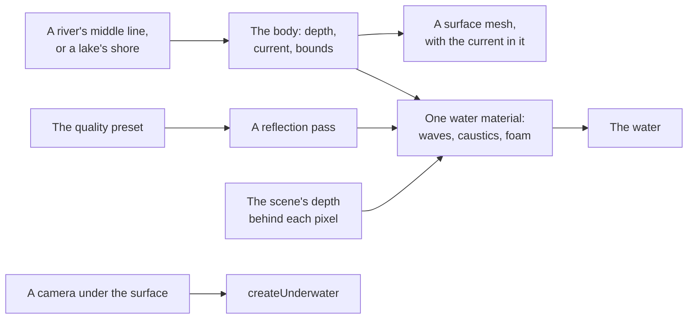

# Water (@null3d/water)

> Roadmap step 0.3, first released in null3D 0.1.0. The API is experimental, so it can still change between versions.



`@null3d/water` draws the water in a scene. A river follows a line, and a lake fills an outline, and both come from one description. The surface has long waves that the current carries downstream, and finer ripples in its normal. It draws caustics on the bed, foam around what breaks the surface, and a shore that fades where the bed rises to meet it. A reflection pass mirrors the banks and the sky, and redraws as often as the quality preset affords. The same surface draws from below, and `createUnderwater` gives the view from under the water its color, its bend and its caustics.

The package is built on the engine's public API. Its surface and underwater shaders ship compiled, so your build does not compile them, and the package needs no extra setup for them.

```sh
bun add @null3d/water
```

```ts
// sketch.ts
import { defineSketch } from '@null3d/engine';
import { createUnderwater, createWater } from '@null3d/water';

export default defineSketch((ctx) => {
  const { scene } = ctx;
  const camera = scene.createPerspectiveCamera({ position: [0, 3, 12], target: [0, 0, 0] });
  scene.setActiveCamera(camera);
  scene.createDirectionalLight({ direction: [-0.4, -1, -0.3], intensity: 3 });
  scene.setEnvironment(await ctx.assets.skyEnvironment());

  const water = createWater(ctx, {
    shapes: {
      kind: 'river',
      middle: [[-60, 0], [-30, 3], [0, 0], [30, -2]],
      halfWidth: 3,
      depth: 1.2,
      speed: 0.5,
    },
  });
  const underwater = createUnderwater(ctx, camera, water);
  const caustics: [number, number, number] = [0.6, 0.55, 0.4];
  water.setCaustics(caustics);

  return {
    onUpdate() {
      underwater.update(ctx.time.now, [0.7, 0.85, 1], caustics);
      water.update();
    },
  };
});
```

## The shape

`shapes` takes one shape or a list of them. The list shares one material and one reflection, so a river that runs into a lake costs one surface and one mirror.

### A river

| Field | Takes | Default | What it sets |
| --- | --- | --- | --- |
| `kind` | `'river'` | Required | The kind of body |
| `middle` | At least two points as `[x, z]` in meters | Required | The middle line, from the source to the mouth. The current runs in the direction that the points give |
| `halfWidth` | A number, or one for each middle point, above 0 | Required | The half width at each point, in meters. The bed rises to the surface a third of the half width beyond it |
| `depth` | A number, one for each point, or a function of the point and the distance along the river | 1 | The depth under the middle line, in meters below the surface |
| `speed` | A number from 0, in meters a second | 0.35 | How fast the current runs downstream. 0 stills the water |

### A lake

| Field | Takes | Default | What it sets |
| --- | --- | --- | --- |
| `kind` | `'lake'` | Required | The kind of body |
| `shore` | At least three points as `[x, z]` in meters, in order around the lake | Required | The shore's outline |
| `depth` | A number from 0, or a function of the point and its distance from the shore | 2 | The depth of the deepest point, in meters below the surface |
| `shoreWidth` | A number above 0, in meters | 2 | How far from the shore a lake with one depth reaches it |

A lake holds still water. Both kinds answer the same questions through `waterBody(shape)`: where
the water reaches, the depth of the bed at a point, and the current there.

## The options

| Option | Takes | Default | What it sets |
| --- | --- | --- | --- |
| `shapes` | A shape or a list of shapes | Required | The bodies of water that the surface draws |
| `level` | A number, in meters | 0 | The height of the water's surface |
| `foam` | A `FoamMap` | None | The map of the foam around what breaks the surface. `foamMap(ctx, obstacles, { origin, size })` makes one |
| `ripple` | A number from 0 | 1 | The height of the ripples, as a factor of their base height |
| `softness` | A number above 0, in meters | 0.12 | The gap to the bed over which the water fades at a shore |
| `reflectionEvery` | A frame count from 1 for each preset | 2 on Low and Medium, 1 on High and Ultra | The frames between two draws of the reflection |
| `layers` | A 32-bit mask | The camera's layers | The layers that the reflection draws. Leave out what lies on or under the water |
| `reflectionScale` | `1`, `0.5` or `0.25` | 1 | The reflection's size as a share of the render size each way |
| `mesh` | `{ step, across, cell }` | 2, 8 and 2 | The meters between two cross sections along a river, the sections across it, and a lake's grid cell |
| `material` | The standard material values | None | The surface's material, such as its volume's tint and its thickness |

## The water object

`createWater` returns an object:

| Member | What it does |
| --- | --- |
| `update()` | Draws the reflection in its turn. Call it once in each frame, after the camera moves |
| `reflectionEvery` | The frames between two draws of the reflection now |
| `surfaceHeight(x, z, t)` | The height of the surface at a point and a sketch time, in meters, from its long waves |
| `currentAt(x, z, out)` | The current at a point, as a direction and a speed in meters a second, written into `out` |
| `setCaustics(light)` | Sets the light that the ripples focus on the bed, as a linear color |
| `bodies` | The resolved bodies: their bounds, `depthAt`, `contains` and `currentAt` |
| `destroy()` | Removes the surface, its reflection pass and its material |

`surfaceHeight` and `currentAt` use the body that the point lies over, so a boat, a leaf or a
swimmer floats and drifts with the water under it.

## The view from under the water

`createUnderwater(ctx, camera, water, options)` adds an effect while the camera is near or under the
water's surface, and removes it when the camera rises. The effect reads each pixel's line of sight
from the camera's near plane. A camera half under the water then splits the picture at the
waterline.
It bends the light with the current's slow wobble, plays caustics over the bed, and swallows the
light with distance into the water's own color.

| Option | Takes | Default | What it sets |
| --- | --- | --- | --- |
| `density` | A number from 0 | 0.07 | How much of the light the water swallows for each meter along the view |
| `color` | Three numbers from 0 to 1 | `[0.22, 0.42, 0.4]` | The water's own color, as a share of the air's color at the horizon |
| `ready` | A number, in meters | 0.6 | How near above the surface the camera comes before the effect is added |
| `release` | A number, in meters | 1 | How far above the surface the camera goes before the effect is removed |

Call `update(t, air, caustics)` in each frame with the sketch's time, the light of the air at the
horizon, and the light of the caustics. The surface seen from below shows the world above through a
window overhead, and turns the light back past that window's edge.

## Costs and limits

- **The scene's depth.** The surface declares `sceneInputs: ['sceneDepth']` and two textures. The
  engine gives a depth-reading material room for its own maps; an engine that refuses the pair stops
  the call with E1217. The depth gives the water its depth behind each pixel, so a shore fades
  against the bank.
- **The reflection.** The pass draws the scene a second time. Its cadence follows the preset, and
  `reflectionEvery` replaces it. The pass costs no pipeline of its own, and its texture goes with
  `destroy`.
- **Transmission.** The surface lets light through, so the engine copies the scene's colors in the
  frame that the water draws. The water draws both faces.
- **Nothing before its first use.** A page that never creates water downloads none of the add-on.
- **One place per feature.** This package owns all water. A scene makes water with it, not with a
  hand-written custom material, so there is one way to make water.

[The API reference](reference/water.md) lists every export of this page with its type and
description. The engine's doc comments make it.

## Related pages

- [Custom passes and render targets](../guides/custom-passes.md): the reflection pass, the custom
  material and the underwater effect that this add-on builds on.
- [Surface functions](../shaders/surface-functions.md#the-scenes-depth): the scene's depth in a
  custom material.
- [Quality API](quality.md): the preset and the frame-budget governor.
