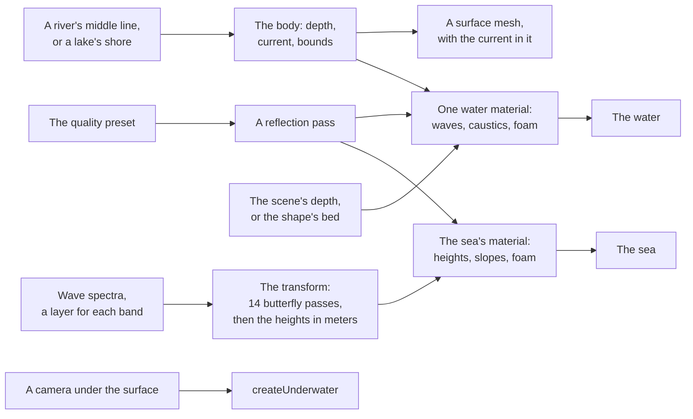

# Water (@null3d/water)

> Roadmap step 0.3, first released in null3D 0.1.0. The API is experimental, so it can still change between versions.



`@null3d/water` draws the water in a scene. A river follows a line, and a lake fills an outline, and both come from one description. The surface has long waves that the current carries downstream, and finer ripples in its normal. It draws caustics on the bed, foam around what breaks the surface, and a shore that fades where the bed rises to meet it. A reflection pass mirrors the banks and the sky, and redraws as often as the quality preset affords. The same surface draws from below, and `createUnderwater` gives the view from under the water its color, its bend and its caustics.

`createOcean` draws an open sea instead. Its waves come from wave spectra, and the GPU transforms them into heights in every frame. The bands of swell and chop then move on their own, and the surface reads the slopes that the transform writes.

The package is built on the engine's public API. Its surface and underwater shaders ship compiled, so your build does not compile them, and the package needs no extra setup for them.

```sh
bun add @null3d/water
```

```ts
// sketch.ts
import { defineSketch } from '@null3d/engine';
import { createUnderwater, createWater } from '@null3d/water';

export default defineSketch(async (ctx) => {
  const { scene } = ctx;
  const camera = scene.createPerspectiveCamera({ position: [0, 3, 12], target: [0, 0, 0] });
  scene.setActiveCamera(camera);
  scene.createDirectionalLight({ direction: [-0.4, -1, -0.3], intensity: 3 });
  scene.setEnvironment(await ctx.assets.skyEnvironment());

  const water = createWater(ctx, {
    shapes: {
      kind: 'river',
      middle: [[-60, 0], [-30, 3], [0, 0], [30, -2]],
      halfWidth: 3,
      depth: 1.2,
      speed: 0.5,
    },
  });
  const underwater = createUnderwater(ctx, camera, water);
  const caustics: [number, number, number] = [0.6, 0.55, 0.4];
  water.setCaustics(caustics);

  return {
    onUpdate() {
      underwater.update(ctx.time.now, [0.7, 0.85, 1], caustics);
      water.update();
    },
  };
});
```

## The shape

`shapes` takes one shape or a list of them. The list shares one material and one reflection, so a river that runs into a lake costs one surface and one mirror.

### Where bodies meet

Each body has a mesh of its own, so where a river runs into a lake the two meshes overlap. There
each point of the surface belongs to one body. A lake owns the water inside its shore, and a river
the water outside every lake. The other mesh skips the point, so the water never draws twice there.
The river's waves give way to the lake's still water over about 3 m on each side of the meeting.
The surface lies flat within a few meters of it. Both meshes carry the river's current there, so
their waves agree on every pixel and leave no seam. A small map over each meeting
holds these values. The add-on makes it once, when it builds the meshes.

### A river

| Field | Takes | Default | What it sets |
| --- | --- | --- | --- |
| `kind` | `'river'` | Required | The kind of body |
| `middle` | At least two points as `[x, z]` in meters | Required | The middle line, from the source to the mouth. The current runs in the direction that the points give |
| `halfWidth` | A number, or one for each middle point, above 0 | Required | The half width at each point, in meters. The bed rises to the surface a third of the half width beyond it |
| `depth` | A number, one for each point, or a function of the point and the distance along the river | 1 | The depth under the middle line, in meters below the surface |
| `speed` | A number from 0, in meters a second | 0.35 | How fast the current runs downstream. 0 stills the water. A `current` function replaces it |
| `current` | A function of `x` and `z` that returns a velocity `[x, z]` in meters a second | None | The current at any point, where it does not follow the middle line. The surface carries its waves with it |
| `bed` | A function of `x` and `z` that returns a depth in meters | None | The depth of the bed at any point, where it does not follow the width and the depth. The surface reads it when the call is given `bed: 'shape'` |
| `mesh` | `{ step, across, reach }` | The call's `mesh` | This body's mesh detail, in place of the call's |

### A lake

| Field | Takes | Default | What it sets |
| --- | --- | --- | --- |
| `kind` | `'lake'` | Required | The kind of body |
| `shore` | At least three points as `[x, z]` in meters, in order around the lake | Required | The shore's outline |
| `depth` | A number from 0, or a function of the point and its distance from the shore | 2 | The depth of the deepest point, in meters below the surface |
| `shoreWidth` | A number above 0, in meters | 2 | How far from the shore a lake with one depth reaches it |
| `bed` | A function of `x` and `z` that returns a depth in meters | None | The depth of the bed at any point, where it does not follow the shore and the shore width. The surface reads it when the call is given `bed: 'shape'` |
| `mesh` | `{ cell }` | The call's `mesh` | This body's mesh detail, in place of the call's |

A lake holds still water. Its mesh reaches two grid cells past the shore. So the water fades
against the scene's own ground where that ground meets it, even a little past the outline. Both
kinds answer the same questions through `waterBody(shape)`: where the water reaches, the depth of
the bed at a point, and the current there.

## The options

| Option | Takes | Default | What it sets |
| --- | --- | --- | --- |
| `shapes` | A shape or a list of shapes | Required | The bodies of water that the surface draws |
| `level` | A number, in meters | 0 | The height of the water's surface |
| `foam` | A `FoamMap` | None | The map of the foam around what breaks the surface. `foamMap(ctx, obstacles, { origin, size })` makes one |
| `ripple` | A number from 0 | 1 | The height of the ripples, as a factor of their base height |
| `waveAmplitude` | A number from 0 | 1 | The height of the long waves and of the wind's lift, as a factor of their base height. The fine ripples keep the strength that `ripple` gives them, so a small value gives a nearly flat surface that still ripples |
| `softness` | A number above 0, in meters | 0.12 | The gap to the bed over which the water fades at a shore |
| `colorAlongView` | A number from 0 to 1 | 0 | The share of the water's color at a low view that reads the whole way the view runs through the water, not its depth. A view from above keeps the depth. A wide sea takes a little, so a low view shows no sharp outline of the bed in the distance |
| `reflectionEvery` | A frame count from 1 to 16 for each preset | 2 on Low and Medium, 1 on High and Ultra | The frames between two draws of the reflection. The frame-budget governor doubles it while frames take too long |
| `reflectionFollowsBudget` | `true` or `false` | `true` | Whether the frame-budget governor may raise `reflectionEvery`. Between draws the water shows the reflection of an older camera, so on a moving camera a raised count reads as a lag. `false` keeps the count |
| `layers` | A 32-bit mask | The camera's layers | The layers that the reflection draws. Leave out what lies on or under the water |
| `reflectionScale` | `1`, `0.5` or `0.25` | 1 | The reflection's size as a share of the render size each way |
| `mesh` | `{ step, across, cell, reach }` | 2, 16, 2 and 1.36 | The meters between two cross sections along a river, the sections across it, a lake's grid cell, and how far past a river's half width its mesh reaches as a factor |
| `bed` | `'scene'` or `'shape'` | `'scene'` | Where the surface reads the depth of the bed: the copy of the scene's depth behind each pixel, or the depth that each shape describes |
| `material` | The standard material values | None | The surface's material, such as its volume's tint and its thickness |
| `wind` | A wind field's `texture`, `size` and `air` | None | The wind that lifts the surface's short waves and carries their crests. The surface reads it once for each vertex |

## Wind on the surface

Give `createWater` the field that `createWind` makes, and the surface lifts a short wave under the air and carries its crest with the gust. The surface reads the field once for each vertex, and the field's own pass runs before the water draws.

```ts
import { createWind } from '@null3d/wind';

const wind = createWind(ctx, { camera, box: 128 });
const water = createWater(ctx, { shapes, wind: wind.field });

return {
  onUpdate() {
    wind.update();
    water.update();
  },
};
```

`createWater` takes a plain texture and its box, so the water package does not import the wind add-on. A page can connect any field that gives a texture with the same layout. A surface that names no field still declares the field's textures, which it never reads.

`waveAmplitude` scales the lift that the wind gives the surface, along with the long waves. A slow stream can therefore keep a nearly flat surface, with fine ripples. Its wind field still moves the plants and the leaves around it.

## The water object

`createWater` returns an object:

| Member | What it does |
| --- | --- |
| `update()` | Keeps the sketch's frame loop. The reflection pass carries its own cadence now, so the call changes nothing |
| `reflectionEvery` | The frames between two draws of the reflection now |
| `waveAmplitude` | The height of the long waves and of the wind's lift, as a factor of their base height |
| `surfaceHeight(x, z, t)` | The height of the surface at a point and a sketch time, in meters, from its long waves |
| `currentAt(x, z, out)` | The current at a point, as a velocity in meters a second, written into `out` |
| `setCaustics(light)` | Sets the light that the ripples focus on the bed, as a linear color |
| `bodies` | The resolved bodies: their bounds, `depthAt`, `contains` and `currentAt` |
| `destroy()` | Removes the surface, its reflection pass and its material |

`surfaceHeight` and `currentAt` use the body that the point lies over, so a boat, a leaf or a
swimmer floats and drifts with the water under it. Where a river meets a lake, `currentAt` gives the
current of the body that owns the point, and `surfaceHeight` follows the flat, mixed surface there.

## The view from under the water

`createUnderwater(ctx, camera, water, options)` adds an effect while the camera is near or under the
water's surface, and removes it when the camera rises. The effect reads each pixel's line of sight
from the camera's near plane. A camera half under the water then splits the picture at the
waterline.
It bends the light with the current's slow wobble, plays caustics over the bed, and swallows the
light with distance into the water's own color.

| Option | Takes | Default | What it sets |
| --- | --- | --- | --- |
| `density` | A number from 0 | 0.07 | How much of the light the water swallows for each meter along the view |
| `color` | Three numbers from 0 to 1 | `[0.22, 0.42, 0.4]` | The water's own color, as a share of the air's color at the horizon |
| `ready` | A number, in meters | 0.6 | How near above the surface the camera comes before the effect is added |
| `release` | A number, in meters | 1 | How far above the surface the camera goes before the effect is removed |

Call `update(t, air, caustics)` in each frame with the sketch's time, the light of the air at the
horizon, and the light of the caustics. The surface seen from below shows the world above through a
window overhead, and turns the light back past that window's edge.

## The ocean

`createOcean(ctx, { camera })` makes an open sea. Its waves come from two or three bands of wave
spectra. A band is a square tile of the sea whose waves are a sum of plane waves. A spectrum gives
each wave an amplitude from the wind, and a seeded random number gives its phase.

The add-on transforms each band's spectrum into the height of the sea every frame, with compute
passes that a material reads in the same frame. Each axis takes seven radix-2 butterfly stages, and
the transform runs on the GPU, not the page's thread. On WebGL2 the same chain draws as fragment
passes. One material sums the bands at their own scales, so a long swell, a wind sea and chop move
together.

```ts
// sketch.ts
import { defineSketch } from '@null3d/engine';
import { createOcean } from '@null3d/water';

export default defineSketch(async (ctx) => {
  const { scene } = ctx;
  const camera = scene.createPerspectiveCamera({ position: [0, 12, 40], target: [0, 2, 0] });
  scene.setActiveCamera(camera);
  scene.createDirectionalLight({ direction: [-0.4, -1, -0.3], intensity: 3 });
  scene.setEnvironment(await ctx.assets.skyEnvironment());
  const ocean = createOcean(ctx, { camera });
  return {
    onUpdate() {
      ocean.update();
    },
  };
});
```

### The options

| Option | Takes | Default | What it sets |
| --- | --- | --- | --- |
| `camera` | A camera | Required | The camera that the sea's mesh follows |
| `level` | A number, in meters | 0 | The height of the sea's surface |
| `bands` | Two or three `OceanBand` values | A swell, a wind sea and chop | Each band's tile in meters, its significant wave height, its wind's speed and heading, and its seed |
| `reach` | A number above 0, in meters | 3000 | How far past the camera the mesh reaches |
| `segments` | A whole number above 0 | 256 | The mesh's segments each way. The cells grow with distance, so the camera keeps fine waves |
| `foam` | A number above 0, in meters | 1.1 | The height at which foam breaks on a crest |
| `softness` | A number above 0, in meters | 0.12 | The gap to the bed over which the water fades at a shore |
| `reflectionEvery` | A frame count from 1 to 16 for each preset | 2 on Low and Medium, 1 on High and Ultra | The frames between two draws of the reflection |
| `layers` | A 32-bit mask | The camera's layers | The layers that the reflection draws |
| `reflectionScale` | `1`, `0.5` or `0.25` | 1 | The reflection's size as a share of the render size each way |
| `material` | The standard material values | None | The surface's material, such as the water's tint and its thickness |

`OCEAN_BANDS` holds the default bands. Give a band of your own to change the sea: a wider tile
holds longer waves, and a taller significant height lifts them further.

### The ocean object

`createOcean` returns an object:

| Member | What it does |
| --- | --- |
| `update()` | Moves the mesh about the camera. The reflection pass carries its own cadence. Call it once in each frame, after the camera moves |
| `reflectionEvery` | The frames between two draws of the reflection now |
| `heightAt(x, z)` | The height of the sea at a world place, in meters, at the sketch time. It runs the bands' transforms on this thread, and transforms again only when the sketch time moves, so several reads in a frame share one |
| `bands` | The bands, in the order that they sum |
| `level` | The height of the sea's surface |
| `destroy()` | Remove the surface, the transform's passes, the reflection and the material |

A boat or a camera floats by reading `heightAt`. A mesh that follows the camera keeps fine waves
near the eye and spends its vertices far away.

## Costs and limits

- **The scene's depth.** The surface declares `sceneInputs: ['sceneDepth']` and its textures. The
  engine gives a depth-reading material room for its own maps; an engine that refuses them stops
  the call with E1217. The depth gives the water its depth behind each pixel, so a shore fades
  against the bank. With `bed: 'shape'`, the mesh carries each vertex's bed depth in its vertex
  colors and the surface reads that instead, for a bed that the scene states rather than draws.
- **The reflection.** The pass draws the scene a second time. It draws every other frame on Low and
  Medium, so it costs half as much on average there, and every frame on High and Ultra. When frames
  take too long, the frame-budget governor doubles the wait, up to every 16th frame. The stats
  overlay shows the cadence as `reflectionEvery`. It shows the pass's GPU time and its share of a
  frame as the water row's budget. It also shows the memory of the mesh arrays, the map of where bodies
  meet, and the foam texture that the add-on made. The reflection target is the render graph's. `reflectionEvery` replaces the
  preset's cadence. The pass costs no pipeline of its own, and its texture goes with `destroy`.
- **Levels of detail.** The river, lake and ocean meshes take `levels: false`, because the waves
  move their vertices in the shader. The engine plans no levels for them.
- **Transmission.** The surface lets light through, so the engine copies the scene's colors in the
  frame that the water draws. The water draws both faces.
- **Nothing before its first use.** A page that never creates water downloads none of the add-on.
- **One way to make water.** Use this package rather than a hand-written custom material, so a
  scene's water has one owner.
- **One water a page.** The add-on registers one water feature, so a page makes its water with one
  `createWater` call. Give that call every body that shares the surface and the reflection. An
  ocean is a feature of its own, so a page may draw a river and a sea.
- **The ocean's transform.** A sea of three bands adds 14 butterfly passes and one pass that puts
  the heights in meters. Those 15 passes take 15 of the 31 passes that a sketch may add, so leave
  room for the sketch's own. Each pass runs on a 128 by 128 grid, with a band to a layer. The stats
  overlay names the add-on's ocean row and its budget, and the frame's GPU time holds the
  transform's share.

[The API reference](reference/water.md) lists every export of this page with its type and
description. The engine's doc comments make it.

## Related pages

- [Custom passes and render targets](../guides/custom-passes.md): the reflection pass, the custom
  material and the underwater effect that this add-on builds on.
- [Surface functions](../shaders/surface-functions.md#the-scenes-depth): the scene's depth in a
  custom material.
- [Quality API](quality.md): the preset and the frame-budget governor.
