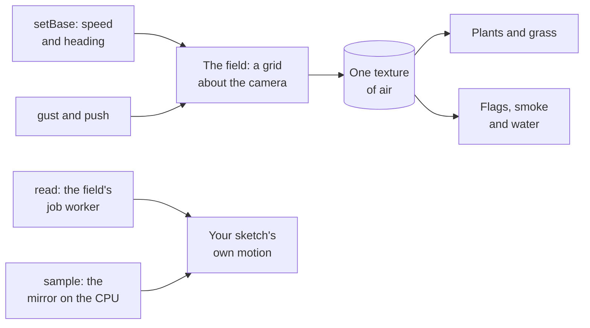

# Wind (@null3d/wind)

> Roadmap step 0.3, first released in null3D 0.1.0. The API is experimental, so it can still change between versions.



`@null3d/wind` makes the air in a scene. One field moves every plant, flag and smoke card that reads it, so a gust that crosses a field reaches all of them together. The air is solved: a grid that follows the camera carries it from frame to frame. A gust therefore bends through the scene, and a body leaves a wake that outlives it. A steady wind slows near the ground, and swirls turn without piling up. A page can also shove the air at a point, as a body moving through it does.

```sh
bun add @null3d/wind
```

```ts
// sketch.ts
import { defineSketch } from '@null3d/engine';
import { createWind } from '@null3d/wind';

export default defineSketch((ctx) => {
  const { scene } = ctx;
  const camera = scene.createPerspectiveCamera({ position: [0, 6, 18], target: [0, 1, 0] });
  scene.setActiveCamera(camera);

  const wind = createWind(ctx, { camera, box: 128 });
  wind.setBase(4, 0.4);

  let nextGust = 0;
  return {
    onUpdate() {
      // A gust every four seconds, sent where the air enters the scene.
      if (ctx.time.now > nextGust) {
        wind.gust([-40, 6], 6);
        nextGust = ctx.time.now + 4;
      }
      wind.update();
    },
  };
});
```

Call `update` once in each frame. It places the box about the camera and sends the field's values to the GPU. The add-on's calls make no object of their own, so a sketch may make them in every frame. A `read` in each frame also takes the task's promise, which the engine makes. Until the browser has optimized the add-on's functions, a fraction that crosses one of its calls becomes an object, as in the engine's own steps. A sketch that pushes in every frame keeps one two-number array for the place, rather than a new one each time.

## The calls

| Call | What it does |
| --- | --- |
| `createWind(ctx, options)` | Makes the field and the pass that fills it. `camera` is required: the box follows its ground place. `box` is the box's width in meters, and `grid` its texels across each way. |
| `setBase(speed, heading)` | The steady wind in meters a second, and the heading it blows toward in radians. |
| `gust(at, strength)` | Sends a gust from a ground place `[x, z]`. Its wave then travels along the heading, turning the air as it passes. |
| `push(at, strength)` | Shoves the air about a ground place, as a body moving through it does. A negative strength turns the other way. |
| `sample(x, y, z, out)` | The analytic air at a world place, in meters a second: the field that the solver pulls toward, with the pushes and the gust it injects. It writes `[x, y, z]` into `out`. The solved air is on the GPU. This call works in TypeScript: use it in a test, or for a read outside a frame. |
| `read(points, out)` | The air at many places, worked out in a job worker. `points` holds three numbers a place across the ground, and `out` takes three numbers a place. The answer lands before the next frame's update. Use it in a frame, which is what moves a sketch's own objects with the air. |
| `update()` | Places the box about the camera, runs the steps that the sketch time owes and sends the values. Call it once in each frame. |
| `destroy()` | Removes the pass and its texture. |
| `settings` | The feature's settings as the preset and the governor resolve them now: `windStepMs`, `windPressureSteps`, `windSpringTrees` and `windGrid`. The object stays the same, so read it in a frame without allocating. |
| `budget` | The field's budget as the preset and the governor leave it: `ms` at full quality, the governor's `scale` from its floor to 1, and `allowedMs` now. The object stays the same, so read it in a frame without allocating. |
| `field` | The texture, its box and the steady settings that a reader works the air out from beyond the box. |

The ring holds the three newest pushes, and each fades over three seconds. A page that pushes often therefore keeps a wake behind the body it moves. The newest gust has a slot of its own, so a page's pushes never push its gust out. A gust's wave travels for as long as its reach holds it.

`read` asks the air at places the way a page's own motion needs it. The field's walk over the pushes runs in the add-on's WebAssembly, on the engine's job workers. One call takes up to about five thousand places. A call that arrives while an answer is still on its way sends one more ask when that answer comes. A third call that arrives before either answer replaces the queued one: the newest ask wins, the one it replaces is dropped, and its array keeps the numbers it held. A page that asks in every frame therefore queues about one ask a frame, and the add-on reports a dropped ask once. The answer gives the air at the frame's own time, and lands before the next frame's update.

## Reading the field in your own WGSL

A material reads the field with one texture. `field.texture` holds the air over `field.origin` and `field.size`. The shader build resolves only the engine's library. So your WGSL holds copies of the add-on's two blocks: the steady field, which every reader shares, and the sampling function. Copy both from `shaders/field.wgsl` in the package, or from the blocks below.

```wgsl
#import null3d::noise::{value3}

var wind: texture_2d_array<f32>;

// <wind-steady>
/// The height over which the air slows to the ground, in meters.
const WIND_GROUND_HEIGHT: f32 = 2.0;
/// The distance over which the noise's curl is measured, in noise cells.
const WIND_CURL_STEP: f32 = 0.02;
/// How long a gust that a page sends keeps its strength, in seconds, before the air is steady again.
const WIND_SENT_LIFE: f32 = 8.0;
/// The height that the grid samples at, where the air moves at its full speed. The grid stores the
/// air at this height, and a reader outside the grid's box works it out at the same height, so the
/// two meet at the box's edge.
const WIND_FULL_HEIGHT: f32 = 100.0;

/// The air's settings: its rule of place and time, the preset's gust and the swirl, and the gust
/// that a page sends. The grid's pass takes the first three vectors from its values and solves a
/// sent gust itself; a reader takes all four from its own settings.
struct WindAir {
    /// The time in seconds, the wind's speed and its heading in radians, and how much slower the
    /// air is at the ground.
    time: f32,
    speed: f32,
    heading: f32,
    ground: f32,
    /// The gust's strength, its radius in meters, its wave number and how fast it travels.
    gustStrength: f32,
    gustRadius: f32,
    gustWave: f32,
    gustSpeed: f32,
    /// The swirl's strength, its size, how fast its pattern drifts and its seed.
    swirl: f32,
    swirlScale: f32,
    swirlDrift: f32,
    seed: f32,
    /// The gust a page sent: its ground place in x and z, its strength in meters a second, and the
    /// time it was sent. Its strength is zero until a page sends one, and after it fades.
    sentX: f32,
    sentZ: f32,
    sentStrength: f32,
    sentBorn: f32,
}

/// The field's settings read from three value vectors: the air, the gust and the swirl.
fn wind_air(v0: vec4f, v1: vec4f, v2: vec4f) -> WindAir {
    var air: WindAir;
    air.time = v0.x;
    air.speed = v0.y;
    air.heading = v0.z;
    air.ground = v0.w;
    air.gustStrength = v1.x;
    air.gustRadius = v1.y;
    air.gustWave = v1.z;
    air.gustSpeed = v1.w;
    air.swirl = v2.x;
    air.swirlScale = v2.y;
    air.swirlDrift = v2.z;
    air.seed = v2.w;
    // The grid solves a gust that a page sends itself, from the ring of pushes and gusts, so its
    // readers hold no sent gust here.
    air.sentX = 0.0;
    air.sentZ = 0.0;
    air.sentStrength = 0.0;
    air.sentBorn = 0.0;
    return air;
}

/// The height's factor of the wind: one at the top, and one less the ground's share at the ground.
fn wind_profile(air: WindAir, y: f32) -> f32 {
    return 1.0 - air.ground * exp(-max(y, 0.0) / WIND_GROUND_HEIGHT);
}

/// The stream function of the swirl, in noise cells, at a place and a time.
fn wind_stream(air: WindAir, p: vec3f) -> f32 {
    let drift = air.swirlDrift * air.time;
    let q = vec3f(
        p.x * air.swirlScale + drift + air.seed,
        p.y * air.swirlScale,
        p.z * air.swirlScale + drift * 0.5,
    );
    return value3(q);
}

/// The turn that one gust gives the air at a place, in meters a second: a wave of turns that travels
/// along the heading. The turns are rings about the gust's center and depend only on the distance to
/// it, so a ring of air turns without piling up.
fn wind_gust_wave(air: WindAir, center: vec2f, strength: f32, p: vec3f, height: f32) -> vec3f {
    let g = vec2f(p.x - center.x, p.z - center.y);
    let distance = length(g) / air.gustRadius;
    let reach = distance * distance;
    if (reach >= 9.0) {
        return vec3f(0.0);
    }
    let envelope = exp(-reach) * cos(distance * air.gustWave) * strength * height;
    return vec3f((g.y / air.gustRadius) * envelope, 0.0, -(g.x / air.gustRadius) * envelope);
}

/// The wind's steady velocity at a world place, in meters a second: the base wind, the gust that
/// travels through it, the swirl, and the gust that a page sent, which travels from its own place.
/// A page's pushes reach readers only through the grid.
fn wind_steady(air: WindAir, p: vec3f) -> vec3f {
    let height = wind_profile(air, p.y);
    let cosHeading = cos(air.heading);
    let sinHeading = sin(air.heading);
    var v = vec3f(cosHeading * air.speed * height, 0.0, sinHeading * air.speed * height);

    let travel = air.gustSpeed * air.time;
    v += wind_gust_wave(air, vec2f(cosHeading * travel, sinHeading * travel), air.gustStrength, p, height);

    // The gust that a page sent: the same wave, from the place it was sent, carried along the
    // heading and fading over its life so the air comes back to its steady state.
    if (air.sentStrength != 0.0) {
        let age = air.time - air.sentBorn;
        if (age >= 0.0 && age < WIND_SENT_LIFE) {
            let sentTravel = air.gustSpeed * age;
            let wane = 1.0 - age / WIND_SENT_LIFE;
            v += wind_gust_wave(
                air,
                vec2f(air.sentX + cosHeading * sentTravel, air.sentZ + sinHeading * sentTravel),
                air.sentStrength * wane,
                p,
                height,
            );
        }
    }

    // The swirl: the curl of one stream function in the ground plane. The function varies slowly,
    // so a short step measures the slope.
    let step = WIND_CURL_STEP / air.swirlScale;
    let front = wind_stream(air, p + vec3f(0.0, 0.0, step));
    let back = wind_stream(air, p - vec3f(0.0, 0.0, step));
    let right = wind_stream(air, p + vec3f(step, 0.0, 0.0));
    let left = wind_stream(air, p - vec3f(step, 0.0, 0.0));
    let scale = air.swirl * height / (2.0 * step);
    v.x += (front - back) * scale;
    v.z -= (right - left) * scale;
    return v;
}
// </wind-steady>
```

```wgsl
// <wind-sample>
/// The air's steady settings as a reader holds them: the base wind in the first vector, the gust in
/// the second, the swirl in the third and the gust that a page sent in the fourth, with the time
/// that the reader's own frame gives.
fn wind_reading(base: vec4f, gust: vec4f, swirl: vec4f, sent: vec4f, time: f32) -> WindAir {
    var air: WindAir;
    air.time = time;
    air.speed = base.x;
    air.heading = base.y;
    air.ground = base.z;
    air.seed = base.w;
    air.gustStrength = gust.x;
    air.gustRadius = gust.y;
    air.gustWave = gust.z;
    air.gustSpeed = gust.w;
    air.swirl = swirl.x;
    air.swirlScale = swirl.y;
    air.swirlDrift = swirl.z;
    air.sentX = sent.x;
    air.sentZ = sent.y;
    air.sentStrength = sent.z;
    air.sentBorn = sent.w;
    return air;
}

/// The air at a world place: the wind across the ground in red and blue, the wind's rise in green,
/// and its speed in alpha, at the height the field's texture holds it. Inside the box the grid's
/// state gives it, with one read. Outside the box, and on a device that keeps no grid, the steady
/// field gives it, so the air carries on past the box instead of holding the box's edge.
fn wind_sample(world: vec3f, origin: vec2f, size: f32, layer: i32, air: WindAir) -> vec4f {
    if (size > 0.0) {
        let uv = (vec2f(world.x, world.z) - origin) / size;
        if (uv.x >= 0.0 && uv.x <= 1.0 && uv.y >= 0.0 && uv.y <= 1.0) {
            // The grid keeps the air across the ground in red and green, the pressure in blue and
            // the step of its cycle in alpha.
            let state = textureSampleLevel(wind, windSampler, uv, layer, 0.0);
            return vec4f(state.r, 0.0, state.g, length(state.rg));
        }
    }
    let v = wind_steady(air, vec3f(world.x, WIND_FULL_HEIGHT, world.z));
    return vec4f(v, length(v));
}
// </wind-sample>
```

Inside the box, the sampling function gives the air with one texture read. Outside it, it works the air out from the steady field, at the height that the grid samples at. So the two meet at the box's edge, and a plant past the box moves with the air at its own place. A page's pushes and a gust that the page sends turn the air inside the box, so a plant past the box does not see them. A device that keeps no grid works the air out everywhere.

```ts
const leaf = ctx.materials.shader({
  wgsl: leafShader,
  textures: { wind: wind.field.texture },
  uniforms: {
    origin: wind.field.origin,
    size: wind.field.size,
    layer: wind.field.texture.layer,
    base: wind.field.air.base,
    gust: wind.field.air.gust,
    swirl: wind.field.air.swirl,
  },
});
```

The three vectors hold the air's steady settings. They hold the base wind's speed, heading, ground sink and seed, the gust's strength, radius, wave number and speed, and the swirl's shape. A material takes them once, and again after `setBase` or a change to the air.

The pass keeps two states, so the texture is an array. `layer` names the first layer of the newest state, which `field.texture.layer` gives. Give it to the material once and again in each frame, through `setUniform`. That call takes one number and allocates nothing.

A vertex offset reads the air at the vertex's own place and moves the vertex with it:

```wgsl
fn vertexOffset(input: VertexInput) -> vec3f {
    let place = object.position + input.position;
    // The settings come from the material's three vectors, and the time from the engine's frame.
    let air = wind_reading(material.base, material.gust, material.swirl, frame.time);
    let air_at_place = wind_sample(place, material.origin, material.size, material.layer, air);
    // A plant's top leans more than its foot. The share is meters of lean for each meter a second
    // of air: a steady wind of 4 leans the top of a 1 meter plant by about 0.3 meters.
    return vec3f(air_at_place.r, 0.0, air_at_place.b) * (0.08 * input.uv.y);
}
```

The box follows the camera, so update the material's `origin` values in each frame with the field's. `field.origin` holds the box's near corner across the ground.

A vertex offset that reads the field orders the pass before every pass that draws the material. The shadows and the motion vectors therefore move with the plant.

The vegetation add-on reads this field for its plants and its grass. `plantMaterials(ctx, kit, { wind: wind.field, swayDistance })` gives a species' materials the field, and their vertex offset samples this field's block at each vertex. Their sway fades to nothing at the materials' `swayDistance`, so a plant past it stands still and its far shadow cascades keep their layers. `swayDistanceFor(preset)` gives each quality preset's distance. The plant materials take the box's near corner from the camera's own place, since the box follows the camera, so their box uniforms do not change in a frame. A page's controls change the base wind, which the materials take as uniforms that `setWindLayer` sets in each frame.

Other readers take the field as a plain texture and its box, so they need no code from this add-on. The vegetation add-on's `createFloatingLeaves` moves floating and falling leaves, and the water add-on's `wind` option lifts a water surface. Both read the same sampling block, and each copy costs the reader one of its material's six texture slots. The readers' blocks are held equal to this page's by tests.

## What the field is

The field keeps its state between frames. One pass holds two states and steps the air forward by a fixed sixtieth of a second at a time. It runs as many steps as the sketch time owes.

Each cycle pulls the air toward an analytic field of place and time. It injects the pushes and the gust, and keeps the eddies with vorticity confinement. It solves the pressure, and takes the pressure's slope out of the air, so the air never piles up. A wake therefore lasts after the body that made it has gone, and a gust sent upwind crosses the scene.

The air starts when a page makes the wind, so a field made late in a sketch runs no air from before it.

A held page steps its sketch's updates up to the held time. The pass runs with each step, so a held picture carries the air that the hold built. Two held pages at two times therefore differ by the air that moved between them.

Beyond its box the field carries on. The box sets the detail, not the field's extent. So a plant past the box reads the air at its own place.

The far field is the steady field: the base wind, the swirl and the field's own traveling gust, at the height that the grid samples at. The box's edge takes that field, so the grid and the far field meet there instead of stepping where a push reached the edge. A cell beside the edge carries advected air, which lags a push. A page's pushes and a gust that the page sends turn the air inside the box only, so a place outside the box reads the steady field alone.

The preset gives the field's step interval, its pressure count and its grid. A frame runs the cycles that the sketch time owes at that interval, so the air keeps the sketch's pace however slow the frame is. One frame runs at most ten seconds of air, and a longer stall in a page skips the air that it missed.

## Presets and the governor

The add-on declares its work to the engine as one feature. The preset gives its settings, and the frame-budget governor lightens them when frames take too long.

| Setting | Low | Medium | High | Ultra | Governor |
| --- | --- | --- | --- | --- | --- |
| `windStepMs`, the time between field steps | 0 | 33 | 33 | 16 | `double`, up to 133 ms |
| `windPressureSteps`, the pressure iterations of a cycle | 0 | 16 | 24 | 40 | `scale` |
| `windSpringTrees`, the trees that keep branch springs | 0 | 8 | 32 | 64 | `scale` |
| `windGrid`, the grid's texels across each way | 0, no grid | 64 | 128 | 256 | `none` |

Low keeps no grid: every reader works the air out from the steady field. A page that gives `grid` keeps it, whatever the preset says. At Low, that page still gets a field, at the add-on's own step and pressure count. WebGL2 takes its own step row, 100 ms at Medium and above, because a step costs far more there. The governor doubles the interval from that row, up to 133 ms.

The grid is one flat slice at the crown's height. The layered and volume grids that the wind cost study measured are not built yet, so High and Ultra use the flat 128 and 256 grids.

The field's own budget is 0.5, 1.2, 4.9 and 6.25 ms a frame from Low to Ultra. That budget is its own, and it is smaller than the room that D-241 leaves beside the plants' own budget in each preset's frame. A frame that spends both grows by the field's share, and the governor is what holds it. The governor lowers the field's share by a quarter at each of its steps, down to a quarter of the budget. The field still moves at the lowest step: the step interval reaches at most 133 ms, and the pressure count stays above zero. The overlay row reads the field's cost in a frame, which grows when a slow display owes the field more than one cycle in that frame. The stats overlay shows one line for the add-on. This example is the Medium row, with an example GPU time: `wind  gpu 0.62 ms  windStepMs 33 · windPressureSteps 16 · windSpringTrees 8 · windGrid 64 · budget 1.2 of 1.2 ms · memory 0.1 MiB`.

A preset change that changes the grid makes the grid again at the new size. The air starts empty on the new grid. A reader takes `field.texture` again after that, because the texture is a new one.

## Costs and limits

- The pass fills one `rgba16float` texture of `grid` by `grid` texels, and holds two states of it. A reader spends one texture slot on it.
- One cycle takes the preset's pressure steps and two more runs, the advection and the projection. The add-on runs one cycle for each step interval that the sketch time owes, so a page at sixty frames a second runs one cycle a frame at a 16 ms step.
- A vertex inside the box costs one texture read. A vertex outside it costs the steady field's arithmetic instead: four reads of the engine's value noise, with a few trigonometric and exponential calls.
- A WebGL2 device whose float targets fail the engine's probe cannot hold the grid, so it keeps no pass. There `field.size` is zero and a reader's samples are the steady field worked out, so a plant still moves. The texture it declares holds a single black texel that it never reaches.
- With no grid, every reader works the steady field out: the base wind, the swirl, the preset's own traveling gust and the gust that a page sends. A reader takes that gust in the fourth vector of its settings, so the surface, the leaves or the blades it draws answer it. The sent gust travels from the place it was sent and fades over 8 s. A push reaches readers only through the grid, so a point with no grid, or beyond the box, reads no push.
- The add-on makes no object of its own in a frame, and its texture exists only while something reads it. `read` sends one request to a job worker and takes the task's promise. Where the page shares its memory, the worker writes the answer in place; otherwise the answer comes back as one buffer. The add-on's WebAssembly holds the walk over the pushes and the places, so a page's own motion costs the sketch's thread one message and one copy of the answer. Each fraction that the add-on works out reaches a call in an array that the add-on made once, so a call the browser does not inline boxes none of them. Run `bun run bench:allocation --wind` to see the bytes that the add-on's code allocates in a frame.

[The API reference](reference/wind.md) lists every export of this page with its type and
description. The engine's doc comments make it.
