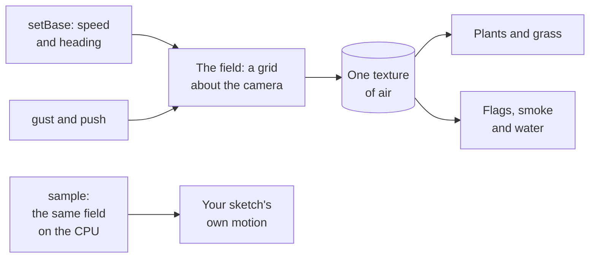

# Wind (@null3d/wind)

> Roadmap step 0.3, first released in null3D 0.1.0. The API is experimental, so it can still change between versions.



`@null3d/wind` makes the air in a scene. One field moves every plant, flag and smoke card that reads it, so a gust that crosses a field reaches all of them together. The air is solved: a grid that follows the camera carries it from frame to frame. A gust therefore bends through the scene, and a body leaves a wake that outlives it. A steady wind slows near the ground, and swirls turn without piling up. A page can also shove the air at a point, as a body moving through it does.

```sh
bun add @null3d/wind
```

```ts
// sketch.ts
import { defineSketch } from '@null3d/engine';
import { createWind } from '@null3d/wind';

export default defineSketch((ctx) => {
  const { scene } = ctx;
  const camera = scene.createPerspectiveCamera({ position: [0, 6, 18], target: [0, 1, 0] });
  scene.setActiveCamera(camera);

  const wind = createWind(ctx, { camera, box: 128, grid: 64 });
  wind.setBase(4, 0.4);

  let nextGust = 0;
  return {
    onUpdate() {
      // A gust every four seconds, sent where the air enters the scene.
      if (ctx.time.now > nextGust) {
        wind.gust([-40, 6], 6);
        nextGust = ctx.time.now + 4;
      }
      wind.update();
    },
  };
});
```

Call `update` once in each frame. It places the box about the camera and sends the field's values to the GPU. The add-on's calls allocate nothing, so a sketch may make them in every frame. A sketch that pushes in every frame keeps one two-number array for the place, rather than a new one each time.

## The calls

| Call | What it does |
| --- | --- |
| `createWind(ctx, options)` | Makes the field and the pass that fills it. `camera` is required: the box follows its ground place. `box` is the box's width in meters, and `grid` its texels across each way. |
| `setBase(speed, heading)` | The steady wind in meters a second, and the heading it blows toward in radians. |
| `gust(at, strength)` | Sends a gust from a ground place `[x, z]`. Its wave then travels along the heading, turning the air as it passes. |
| `push(at, strength)` | Shoves the air about a ground place, as a body moving through it does. A negative strength turns the other way. |
| `sample(x, y, z, out)` | The analytic air at a world place, in meters a second: the field that the solver pulls toward, with the pushes and the gust it injects. It writes `[x, y, z]` into `out`. The solved air is on the GPU. |
| `update()` | Places the box about the camera, runs the steps that the sketch time owes and sends the values. Call it once in each frame. |
| `destroy()` | Removes the pass and its texture. |
| `field` | The texture, its box and the steady settings that a reader works the air out from beyond the box. |

The ring holds the three newest pushes, and each fades over three seconds. A page that pushes often therefore keeps a wake behind the body it moves. The newest gust has a slot of its own, so a page's pushes never push its gust out. A gust's wave travels for as long as its reach holds it.

## Reading the field in your own WGSL

A material reads the field with one texture. `field.texture` holds the air over `field.origin` and `field.size`. The shader build resolves only the engine's library. So your WGSL holds copies of the add-on's two blocks: the steady field, which every reader shares, and the sampling function. Copy both from `shaders/field.wgsl` in the package, or from the blocks below.

```wgsl
#import null3d::noise::{value3}

var wind: texture_2d_array<f32>;

// <wind-steady>
/// The height over which the air slows to the ground, in meters.
const WIND_GROUND_HEIGHT: f32 = 2.0;
/// The distance over which the noise's curl is measured, in noise cells.
const WIND_CURL_STEP: f32 = 0.02;
/// The height that the grid samples at, where the air moves at its full speed. The grid stores the
/// air at this height, and a reader outside the grid's box works it out at the same height, so the
/// two meet at the box's edge.
const WIND_FULL_HEIGHT: f32 = 100.0;

/// The air's steady settings: its rule of place and time, without the pushes and gusts that a page
/// sends. The grid takes them from a pass's first three value vectors, and a reader from its own
/// uniforms.
struct WindAir {
    /// The time in seconds, the wind's speed and its heading in radians, and how much slower the
    /// air is at the ground.
    time: f32,
    speed: f32,
    heading: f32,
    ground: f32,
    /// The gust's strength, its radius in meters, its wave number and how fast it travels.
    gustStrength: f32,
    gustRadius: f32,
    gustWave: f32,
    gustSpeed: f32,
    /// The swirl's strength, its size, how fast its pattern drifts and its seed.
    swirl: f32,
    swirlScale: f32,
    swirlDrift: f32,
    seed: f32,
}

/// The field's settings read from three value vectors: the air, the gust and the swirl.
fn wind_air(v0: vec4f, v1: vec4f, v2: vec4f) -> WindAir {
    var air: WindAir;
    air.time = v0.x;
    air.speed = v0.y;
    air.heading = v0.z;
    air.ground = v0.w;
    air.gustStrength = v1.x;
    air.gustRadius = v1.y;
    air.gustWave = v1.z;
    air.gustSpeed = v1.w;
    air.swirl = v2.x;
    air.swirlScale = v2.y;
    air.swirlDrift = v2.z;
    air.seed = v2.w;
    return air;
}

/// The height's factor of the wind: one at the top, and one less the ground's share at the ground.
fn wind_profile(air: WindAir, y: f32) -> f32 {
    return 1.0 - air.ground * exp(-max(y, 0.0) / WIND_GROUND_HEIGHT);
}

/// The stream function of the swirl, in noise cells, at a place and a time.
fn wind_stream(air: WindAir, p: vec3f) -> f32 {
    let drift = air.swirlDrift * air.time;
    let q = vec3f(
        p.x * air.swirlScale + drift + air.seed,
        p.y * air.swirlScale,
        p.z * air.swirlScale + drift * 0.5,
    );
    return value3(q);
}

/// The wind's steady velocity at a world place, in meters a second: the base wind, the gust that
/// travels through it and the swirl, without the pushes and gusts that a page sends.
fn wind_steady(air: WindAir, p: vec3f) -> vec3f {
    let height = wind_profile(air, p.y);
    let cosHeading = cos(air.heading);
    let sinHeading = sin(air.heading);
    var v = vec3f(cosHeading * air.speed * height, 0.0, sinHeading * air.speed * height);

    // The gust: a wave of turns that travels along the heading. The turns are rings about the
    // gust's center and depend only on the distance to it, so a ring of air turns without piling up.
    let travel = air.gustSpeed * air.time;
    let g = vec2f(p.x - cosHeading * travel, p.z - sinHeading * travel);
    let distance = length(g) / air.gustRadius;
    let reach = distance * distance;
    if (reach < 9.0) {
        let envelope = exp(-reach) * cos(distance * air.gustWave) * air.gustStrength * height;
        v.x += (g.y / air.gustRadius) * envelope;
        v.z -= (g.x / air.gustRadius) * envelope;
    }

    // The swirl: the curl of one stream function in the ground plane. The function varies slowly,
    // so a short step measures the slope.
    let step = WIND_CURL_STEP / air.swirlScale;
    let front = wind_stream(air, p + vec3f(0.0, 0.0, step));
    let back = wind_stream(air, p - vec3f(0.0, 0.0, step));
    let right = wind_stream(air, p + vec3f(step, 0.0, 0.0));
    let left = wind_stream(air, p - vec3f(step, 0.0, 0.0));
    let scale = air.swirl * height / (2.0 * step);
    v.x += (front - back) * scale;
    v.z -= (right - left) * scale;
    return v;
}
// </wind-steady>
```

```wgsl
// <wind-sample>
/// The air's steady settings as a reader holds them: the base wind in the first vector, the gust in
/// the second and the swirl in the third, with the time that the reader's own frame gives.
fn wind_reading(base: vec4f, gust: vec4f, swirl: vec4f, time: f32) -> WindAir {
    var air: WindAir;
    air.time = time;
    air.speed = base.x;
    air.heading = base.y;
    air.ground = base.z;
    air.seed = base.w;
    air.gustStrength = gust.x;
    air.gustRadius = gust.y;
    air.gustWave = gust.z;
    air.gustSpeed = gust.w;
    air.swirl = swirl.x;
    air.swirlScale = swirl.y;
    air.swirlDrift = swirl.z;
    return air;
}

/// The air at a world place: the wind across the ground in red and blue, the wind's rise in green,
/// and its speed in alpha, at the height the field's texture holds it. Inside the box the grid's
/// state gives it, with one read. Outside the box, and on a device that keeps no grid, the steady
/// field gives it, so the air carries on past the box instead of holding the box's edge.
fn wind_sample(world: vec3f, origin: vec2f, size: f32, layer: i32, air: WindAir) -> vec4f {
    if (size > 0.0) {
        let uv = (vec2f(world.x, world.z) - origin) / size;
        if (uv.x >= 0.0 && uv.x <= 1.0 && uv.y >= 0.0 && uv.y <= 1.0) {
            // The grid keeps the air across the ground in red and green, the pressure in blue and
            // the step of its cycle in alpha.
            let state = textureSampleLevel(wind, windSampler, uv, layer, 0.0);
            return vec4f(state.r, 0.0, state.g, length(state.rg));
        }
    }
    let v = wind_steady(air, vec3f(world.x, WIND_FULL_HEIGHT, world.z));
    return vec4f(v, length(v));
}
// </wind-sample>
```

Inside the box, the sampling function gives the air with one texture read. Outside it, it works the air out from the steady field, at the height that the grid samples at. So the two meet at the box's edge, and a plant past the box moves with the air at its own place. A device that keeps no grid works the air out everywhere.

```ts
const leaf = ctx.materials.shader({
  wgsl: leafShader,
  textures: { wind: wind.field.texture },
  uniforms: {
    origin: wind.field.origin,
    size: wind.field.size,
    layer: wind.field.texture.layer,
    base: wind.field.air.base,
    gust: wind.field.air.gust,
    swirl: wind.field.air.swirl,
  },
});
```

The three vectors hold the air's steady settings. They hold the base wind's speed, heading, ground sink and seed, the gust's strength, radius, wave number and speed, and the swirl's shape. A material takes them once, and again after `setBase` or a change to the air.

The pass keeps two states, so the texture is an array. `layer` names the first layer of the newest state, which `field.texture.layer` gives. Give it to the material once and again in each frame, through `setUniform`. That call takes one number and allocates nothing.

A vertex offset reads the air at the vertex's own place and moves the vertex with it:

```wgsl
fn vertexOffset(input: VertexInput) -> vec3f {
    let place = object.position + input.position;
    // The settings come from the material's three vectors, and the time from the engine's frame.
    let air = wind_reading(material.base, material.gust, material.swirl, frame.time);
    let air_at_place = wind_sample(place, material.origin, material.size, material.layer, air);
    // A plant's top leans more than its foot. The share is meters of lean for each meter a second
    // of air: a steady wind of 4 leans the top of a 1 meter plant by about 0.3 meters.
    return vec3f(air_at_place.r, 0.0, air_at_place.b) * (0.08 * input.uv.y);
}
```

The box follows the camera, so update the material's `origin` values in each frame with the field's. `field.origin` holds the box's near corner across the ground.

A vertex offset that reads the field orders the pass before every pass that draws the material. The shadows and the motion vectors therefore move with the plant.

## What the field is

The field keeps its state between frames. One pass holds two states and steps the air forward by a fixed sixtieth of a second at a time. It runs as many steps as the sketch time owes.

Each cycle pulls the air toward an analytic field of place and time. It injects the pushes and the gust, and keeps the eddies with vorticity confinement. It solves the pressure, and takes the pressure's slope out of the air, so the air never piles up. A wake therefore lasts after the body that made it has gone, and a gust sent upwind crosses the scene.

The add-on warms the field up by a second of cycles when it makes it, so the first frame draws developed air. A held frame runs that same warm-up in the one frame it draws, and a picture of the field is therefore the same on every run and on every GPU.

Beyond its box the field carries on. The box sets the detail, not the field's extent. So a plant past the box reads the air at its own place.

The far field is the analytic field, at the height that the grid samples at, so the two meet at the box's edge.

The field cannot yet take a preset's settings without a reseed. A frame runs one cycle however slow it is. On a device that holds fewer than sixty frames a second, the field therefore runs slower than the sketch's clock.

## Costs and limits

- The pass fills one `rgba16float` texture of `grid` by `grid` texels, and holds two states of it. A reader spends one texture slot on it.
- One cycle takes 22 runs of the pass, and the add-on runs one cycle for each sixtieth of a second of sketch time. A page at sixty frames a second therefore runs one cycle a frame.
- A vertex inside the box costs one texture read. A vertex outside it costs the steady field's arithmetic instead: four reads of the engine's value noise, with a few trigonometric and exponential calls.
- A device without float render targets cannot hold the grid, so it keeps no pass. There `field.size` is zero and a reader's samples are the steady field worked out, so a plant still moves. The texture it declares holds a single black texel that it never reaches.
- A point far from the camera loses the grid's detail and reads the steady wind alone. That is the base wind, the swirl and the field's own traveling gust. A body's pushes and a sent gust are gone there.
- The add-on makes no object of its own in a frame, and its texture exists only while something reads it. Until the browser has optimized the add-on's functions, a fraction that crosses one of its calls becomes an object. The engine's own steps carry the same cost, which `bun run bench:allocation --wind` measures.

[The API reference](reference/wind.md) lists every export of this page with its type and
description. The engine's doc comments make it.
