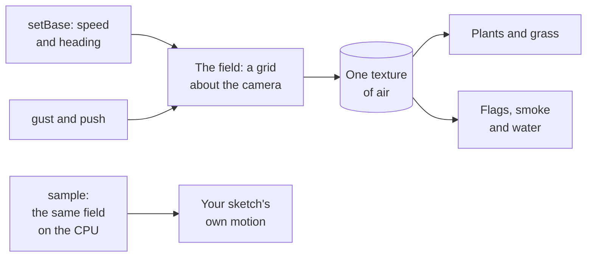

# Wind (@null3d/wind)

> Roadmap step 0.3, first released in null3D 0.1.0. The API is experimental, so it can still change between versions.



`@null3d/wind` makes the air in a scene. One field moves every plant, flag and smoke card that reads it. A gust that crosses a field therefore reaches all of them together. The air is a rule of place and time. A steady wind slows near the ground. A gust travels through it. Swirls turn without piling up. A page can also shove the air at a point, as a body moving through it does.

```sh
bun add @null3d/wind
```

```ts
// sketch.ts
import { defineSketch } from '@null3d/engine';
import { createWind } from '@null3d/wind';

export default defineSketch((ctx) => {
  const { scene } = ctx;
  const camera = scene.createPerspectiveCamera({ position: [0, 6, 18], target: [0, 1, 0] });
  scene.setActiveCamera(camera);

  const wind = createWind(ctx, { camera, box: 128, grid: 64 });
  wind.setBase(4, 0.4);

  let nextGust = 0;
  return {
    onUpdate() {
      // A gust every four seconds, sent where the air enters the scene.
      if (ctx.time.now > nextGust) {
        wind.gust([-40, 6], 6);
        nextGust = ctx.time.now + 4;
      }
      wind.update();
    },
  };
});
```

Call `update` once in each frame. It places the box about the camera and sends the field's values to the GPU. The add-on's calls allocate nothing, so a sketch may make them in every frame. A sketch that pushes in every frame keeps one two-number array for the place, rather than a new one each time.

## The calls

| Call | What it does |
| --- | --- |
| `createWind(ctx, options)` | Makes the field and the pass that fills it. `camera` is required: the box follows its ground place. `box` is the box's width in meters, and `grid` its texels across each way. |
| `setBase(speed, heading)` | The steady wind in meters a second, and the heading it blows toward in radians. |
| `gust(at, strength)` | Turns the air about a ground place `[x, z]`, more slowly as it fades. |
| `push(at, strength)` | Shoves the air about a ground place, as a body moving through it does. A negative strength turns the other way. |
| `sample(x, y, z, out)` | The air at a world place, in meters a second, from the same rule that the GPU draws. It writes `[x, y, z]` into `out`. |
| `update()` | Places the box about the camera and sends the values. Call it once in each frame. |
| `destroy()` | Removes the pass and its texture. |
| `field` | The texture and its box, for a reader. |

The pushes ring holds the four newest, and each fades over three seconds. A page that pushes more often than that keeps a wake behind the body it moves.

## Reading the field in your own WGSL

A material reads the field with one texture: `field.texture` holds the air over `field.origin` and `field.size`. The shader build resolves only the engine's library, so your WGSL holds a copy of the sampling function. Copy this one:

```wgsl
var wind: texture_2d_array<f32>;

/// The air at a world place, as the texture holds it: the wind across the ground in red and blue,
/// the wind's rise in green, and its speed in alpha. The box's near corner and width place the
/// world. A place outside the box reads the box's edge.
fn wind_sample(world: vec3f, origin: vec2f, size: f32) -> vec4f {
    let uv = clamp((vec2f(world.x, world.z) - origin) / size, vec2f(0.0), vec2f(1.0));
    return textureSampleLevel(wind, windSampler, uv, 0, 0.0);
}
```

```ts
const leaf = ctx.materials.shader({
  wgsl: leafShader,
  textures: { wind: wind.field.texture },
  uniforms: { origin: wind.field.origin, size: wind.field.size },
});
```

A vertex offset reads the air at the vertex's own place and moves the vertex with it:

```wgsl
fn vertexOffset(input: VertexInput) -> vec3f {
    let place = object.position + input.position;
    let air = wind_sample(place, material.origin, material.size);
    // A plant's top leans more than its foot. The share is metres of lean for each metre a second
    // of air: a steady wind of 4 leans the top of a 1 meter plant by about 0.3 meters.
    return vec3f(air.r, 0.0, air.b) * (0.08 * input.uv.y);
}
```

The box follows the camera, so update the material's `origin` values in each frame with the field's. `field.origin` holds the box's near corner across the ground.

A vertex offset that reads the field orders the pass before every pass that draws the material. The shadows and the motion vectors therefore move with the plant.

The vegetation add-on reads this field for its plants. `plantWind(ctx, asset, wind.field, { swayDistance })` builds the branch records that a plant's leaf and bark materials read, and their vertex offset samples this field's block at each vertex. Their sway fades to nothing at the material's `swayDistance`, so a plant past it stands still and its far shadow cascades keep their layers. The plant materials take the box's near corner from the camera's own place, since the box follows the camera, so their uniforms do not change in a frame.

## What the field is, and what it cannot do yet

The air is a rule of place and time, so a held frame draws the same picture on every run and GPU. It keeps no state between frames. A gust therefore does not spread by itself, and a wake lasts only as long as the pushes that made it. The engine's pass history arrives with a later task, and the field then gains both.

The field is incompressible: its swirl is the curl of one stream function, and a push is a vortex. So the air never piles up at a point.

## Costs and limits

- The pass fills one `rgba16float` texture of `grid` by `grid` texels, once in each frame. A reader spends one texture slot on it, and its vertex offset costs one texture read at each vertex.
- A device without float render targets cannot hold the field. There the add-on draws nothing, and a reader that samples the texture reads its neutral black.
- A place outside the box reads the box's edge. Keep the box wide enough for every plant and smoke card that reads it. Otherwise the air is smooth rather than exact at the scene's edge.
- The add-on allocates nothing in a frame, and its texture exists only while something reads it.

[The API reference](reference/wind.md) lists every export of this page with its type and
description. The engine's doc comments make it.
