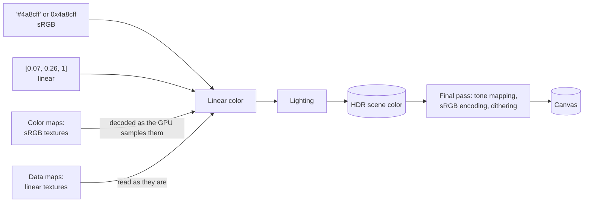
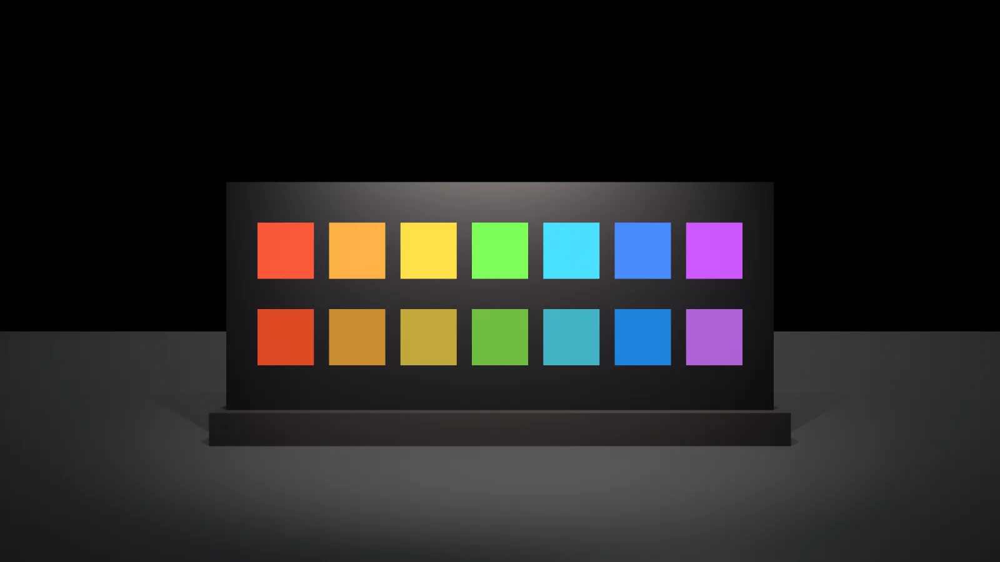

# Color management



null3D works in linear color. A color that you give as a hex string or a number is sRGB, the way CSS writes colors. The engine converts it to linear once, when the call receives it. A color that you give as three numbers is linear already.

Lighting adds and scales light in linear color, so a lit surface can be brighter than white. The scene therefore draws into a high dynamic range (HDR) target. Where the device cannot draw a float target in the anti-aliasing mode, the scene takes an 8-bit path. Each shader then tone maps its own color ([The 8-bit path](#the-8-bit-path)).

Each light and each color of the scene comes in scaled by the exposure. At the end of each frame, a tone mapping curve maps it into the display's range. The final pass then encodes it as sRGB for the canvas.

## Colors in the API

Every call that takes a color takes one of three forms:

| Form | Example | Color space |
| --- | --- | --- |
| Hex string | `'#4a8cff'` or `'#48f'` | sRGB |
| Number | `0x4a8cff` | sRGB |
| Three numbers from 0 to 1 | `[0.07, 0.26, 1]` | Linear |

```ts
const blue = materials.standard({ color: '#4a8cff' });
const same = materials.standard({ color: [0.07, 0.26, 1] }); // the same color, as linear values
scene.createDirectionalLight({ color: '#fff4e0', intensity: 3 });
```

Three numbers are linear. The color helpers give linear numbers too: `color.fromSrgb` converts sRGB components, and `color.fromHsl` reads a hue, a saturation and a lightness as linear RGB ([Math helpers](../api/math.md#colors)). A light's intensity multiplies its linear color. A color in any other form throws [E1204](../errors/E1204.md).

## Texture color spaces

A texture stores its image in one of two ways:

| Kind | Examples | How the GPU reads it |
| --- | --- | --- |
| Color | Base color, emissive color | The texture has an sRGB format, so the GPU decodes each texel to linear values as it samples it. Filtering and mip levels average in linear color too. |
| Data | Normals, roughness, metalness, occlusion | The texture has a linear format, so the GPU reads each texel as it is. |

The `colorSpace` option of the texture calls chooses: `'srgb'`, the default for images, or `'linear'`, the default for data. A data map stored as a color map comes out wrong: its values shrink toward 0. A color map stored as data comes out too bright and washed out. [Textures](../api/textures.md) covers how the engine keeps textures on the GPU.

## HDR color and the final pass

A strong light can make a surface many times brighter than white. The scene keeps those values in a float target, the scene color:

- `rgba16float` on WebGPU. Where the device can draw into `rg11b10ufloat` and the canvas is opaque, the scene color takes that format instead, which needs half the memory.
- `RGBA16F` on WebGL2, where the device can draw float targets in the anti-aliasing mode.

The final pass reads each pixel of the scene color. In the order the shader runs them:

1. In the FXAA mode, smooth the edges.
2. Darken the edges by the vignette, when the sketch sets one.
3. Apply the tone mapping to the exposed color (with automatic exposure, the adapted exposure first).
4. Encode as sRGB.
5. Apply any color grading table.
6. Add the dither, so smooth gradients show no bands.

The final pass is one triangle over the canvas, with no scene work in it. Below the whole canvas's render scale it runs in two steps, while the render scale can drop ([The post-processing chain](post-processing.md#below-the-whole-canvass-render-scale)).

### The 8-bit path

Some devices cannot draw a float target in the anti-aliasing mode. These are WebGPU in compatibility mode with MSAA, and WebGL2 devices whose float targets fail the engine's test. There, each shader applies the tone mapping itself, and writes into an 8-bit target. With MSAA that target can resolve straight into the canvas, with no final pass. That holds while the render scale cannot drop below 1 and no effect needs the final pass. These effects need it:

- color grading
- sharpening
- outlines
- transmission
- screen-space reflections
- bounce light
- soft particles
- a material that reads the scene's depth
- the moment transparency layer
- a full-screen pass that reads the scene color

The scene's shaders apply the vignette themselves there. Low and Medium let the render scale drop below 1, so there the final pass usually runs. With FXAA or no anti-aliasing, the final pass reads the target and keeps its colors.

Effects that need HDR color, such as bloom, move compatibility mode to HDR color with FXAA when a sketch turns them on. On a WebGL2 device with no float target they stay off. [The post-processing chain](post-processing.md#effects-on-devices-without-hdr-color) explains both.

`engine.capabilities.hdr` says which path the engine started on. Both paths show the same colors, and differ only at the edges of objects. With MSAA, the 8-bit path averages the samples of an edge after tone mapping, and the HDR path before it. [GPU tiers and backends](backends.md#color-and-anti-aliasing-on-each-tier) lists the path of each tier and anti-aliasing mode.

### Materials that keep their display color

A material with `toneMapped: false` keeps its color as the display shows it. Use it for a panel, a sign or another object whose colors are set for the screen, such as a heads-up display in the world.



toneMapped: false on the top row.

The 8-bit path honors it in each material's own shader. The HDR path honors it in its final pass, for surfaces that do not blend. A blended surface still takes the tone curve on the HDR path. If it needs the exact color, use the 8-bit path with `createEngine({ hdr: false })` ([The post-processing chain](post-processing.md) explains what else that path changes).

<details>
<summary>Technical details: how each path keeps the display color</summary>

On the 8-bit path the shader encodes the color without the curve. The HDR path's final pass reads a mask of the marked surfaces and skips the curve there. A blended pixel mixes two surfaces, so the mask cannot say which one owns it.

</details>

The vignette and the sRGB encoding still apply to such a material. The exposure scales its colors before them, as it scales every other color.

[The tone mapping opt-out demo](https://github.com/null3d-engine/null3d/tree/main/examples/tone-mapped) draws the same seven bright colors twice, with the flag and without, on the 8-bit path.

## Exposure and tone mapping

Set both from the sketch with [`post.set`](../api/post.md):

```ts
export default defineSketch(({ post }) => {
  post.set({ toneMapping: 'neutral', exposure: 1.5 });
  return {};
});
```

| `toneMapping` | Look |
| --- | --- |
| `'agx-punchy'` (the default) | AgX with Filament's punchy look: more contrast and more color, with AgX's hues. |
| `'agx'` | Softer contrast. Bright colors fade toward white and keep their hue. |
| `'aces'` | Strong contrast, and the color is scaled by 1 / 0.6 first. Bright saturated colors change hue on their way to white: red turns orange, then yellow, and blue turns purple. |
| `'neutral'` | Base colors keep their values until they near white. Khronos made it for product images. |
| `'none'` | The exposed color, clipped at white. A bright color loses detail once a channel reaches white. |

Punchy AgX suits most scenes: bright lights and colors keep their hue, and the picture keeps its contrast. Plain AgX looks flatter. For a product view, where a material's color must show as its maker gave it, use `'neutral'`, as model-viewer does.

The exposure multiplies the scene's color before the tone mapping. An exposure of 2 is one stop brighter, and 0.5 is one stop darker. The engine applies it to each light and each color as they enter the scene. That gives the same picture as scaling the finished color, and keeps scenes in real units inside the range of the HDR target. [Lighting and environment](lighting.md#units-and-exposure) explains it.

Automatic exposure adapts the picture to the scene's brightness over time, as an eye does. The scene still draws at the exposure that `exposure` and `ev100` set. A meter on the GPU then reads each frame, and the final pass multiplies the HDR color by the adapted exposure before the tone mapping. [The post-processing chain](post-processing.md#automatic-exposure) explains the meter.

## The background

The background color and a [background texture](../api/scene.md#the-camera-and-the-background) are part of the scene. Exposure and tone mapping change them as they change the objects, so the curves, for example, make dark colors a little darker. To show either one with its own colors, use `toneMapping: 'none'` at an exposure of 1. A transparent canvas over a CSS background gives an exact page color behind the scene instead.

## Transparent canvases

`createEngine({ transparent: true })` makes a see-through canvas. The page shows through wherever no object draws, until the sketch calls `scene.setBackground`. The canvas holds premultiplied alpha, the form that browsers composite, so a partly covered edge pixel keeps its color scaled by its coverage.

```ts
const engine = await createEngine({
  canvas: document.querySelector('canvas')!,
  sketch: new URL('./sketch.ts', import.meta.url),
  transparent: true,
});
```

## Related pages

- [Post-processing API](../api/post.md): `post.set` and each setting.
- [Page API: createEngine](../api/engine.md): the `transparent` option, and `engine.capabilities.hdr`.
- [The render graph](render-graph.md): the final pass, and the resolve pass that takes its place on the 8-bit path.
- [GPU tiers and backends](backends.md): which devices draw HDR color.
- [Math helpers](../api/math.md#colors): the color helpers, which give linear RGB.
- [Textures](../api/textures.md): how the engine keeps textures on the GPU.
- [three.js to null3D mapping](../porting/threejs-mapping.md): tone mapping, color output and background entries.
