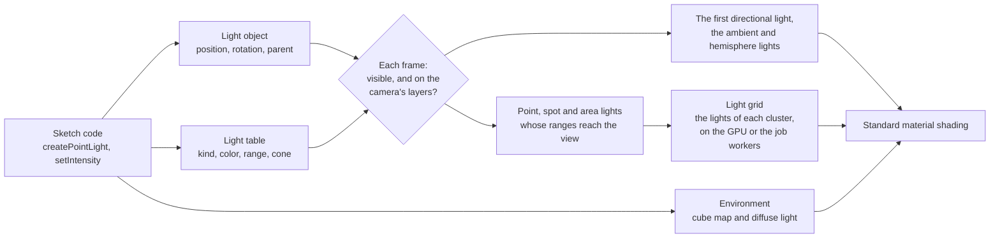
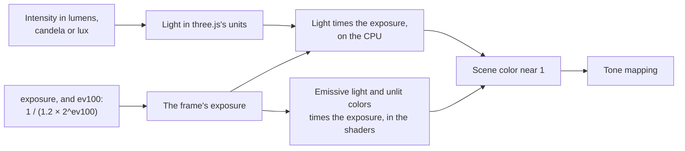
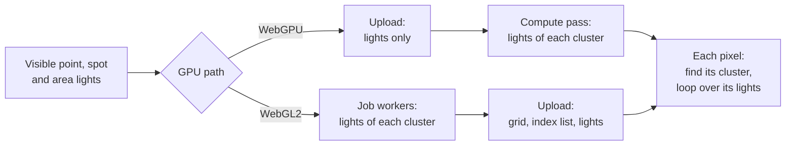
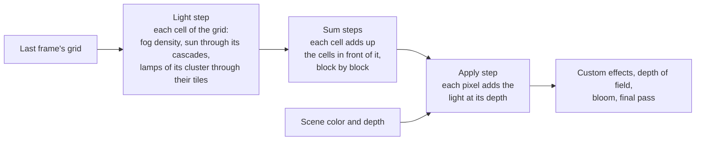
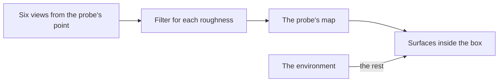
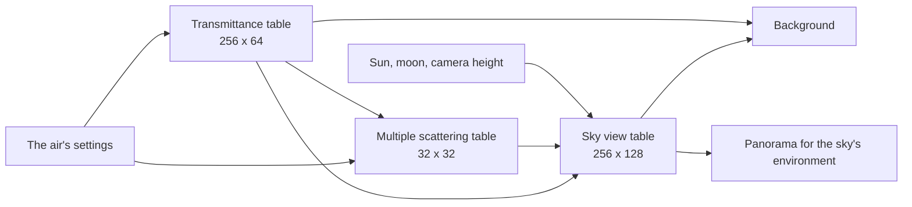

# Lighting and environment

> Roadmap step 0.1, first released in null3D 0.1.0. Step 0.2 adds environment maps, backgrounds, fog, volumetric fog, light units, hemisphere lights' light, and rectangle and tube lights. It also adds the light probe grid, the sky's light and time of day. The API is experimental, so it can still change between versions. Surfaces show one directional light. The quality presets cap area lights, but not yet the other light limits. Coding agents must not rely on these parts.



Every light is a scene object with a row in the engine's light table. The object holds what every object holds: where the light is, which way it faces, its parent, whether it is visible, and its layers. The light table holds the rest: the light's kind, its colors and its intensity. It also holds a point or spot light's range, decay and cone, and an area light's range and size.

Setters change the engine's memory at once. They write their numbers into a block of the engine's memory, and they call the core with whole numbers only. So a setter allocates nothing, a color included. Call a per-frame setter from a small function of its own, so the browser inlines it. Each frame, after the engine updates transforms, it reads every light:

1. It skips a light that is hidden by itself or a parent, or whose layer mask shares no bit with the camera's.
2. Standard materials reflect the first directional light created that remains, the sum of the ambient and hemisphere lights, and the scene's environment.
3. It tests the sphere of each point, spot and area light's range against the camera's view, and lists the lights whose spheres reach into it.
4. Each listed light goes into the clusters of the view that its sphere reaches. On WebGPU the GPU does this work, and on WebGL2 the job workers do it, as [Clustered forward shading](#clustered-forward-shading) explains.

A scene pass ([Custom passes](../guides/custom-passes.md)) does steps 3 and 4 again for its own camera and layers, with a light grid of its own. It lists the point, spot and area lights that its camera sees. Its point and spot lights cast shadows where the camera's view gives them shadows.

## Kinds of light and their units

Units follow three.js since r155, which dropped its legacy light mode. A scene tuned for three.js's current units needs the same intensities in null3D.

| Light | What it models | Intensity | `intensityUnit` |
| --- | --- | --- | --- |
| Directional | The sun or the moon: parallel light from one direction | Lux: the light that reaches a surface facing it | `'lux'` |
| Point | A bulb: light from a point in every direction | Candela | `'lumen'`: divided by 4π |
| Spot | A torch or a stage light: light from a point in a cone | Candela | `'lumen'`: divided by π at any cone angle |
| Hemisphere | Sky and ground: light that fades from one color to the other with the way a surface faces | Lux, on both colors | `'lux'` |
| Ambient | Light that bounces everywhere, from no direction | Lux | `'lux'` |
| Rectangle | A window, a screen or a soft box: light from a glowing rectangle | Nits: the brightness of its surface | None |
| Tube | A neon or fluorescent tube: light from a glowing tube | Nits: the brightness of its surface | None |

A standard material reflects light with the formulas of three.js's `MeshStandardMaterial`. A rough surface that is not a metal reflects close to its color divided by π, times the light that reaches it. A white directional light with an intensity of π therefore shows a white, rough surface that faces it as nearly white.

Three defaults keep shiny surfaces clean. They are always on, and they have no settings:

- The smoothest surface has a roughness of 0.045, as in three.js and Filament. A roughness of 0 still shows a small highlight, and reads the sharpest level of an environment.
- Highlights flicker less on curved shapes. A highlight narrower than a pixel comes and goes as the camera moves. So where a mesh's normal turns fast between pixels, the highlight widens by the spread of the normals within the pixel. This is Filament's specular anti-aliasing. The widening has a limit, so edges stay glossy, and flat surfaces get none. three.js widens highlights by a cruder rule that has no limit. So on small curved shapes, the engine's highlights are a little brighter and narrower than three.js's.
- Reflections never come from inside an object. A normal map can tilt a surface so far that its reflection points below the mesh's own surface. There the environment's reflection fades out, as in Unity and Godot. three.js has no such fade, so grazing reflections on strong normal maps are darker than three.js's.

A rectangle or tube light's light follows from its size and brightness: the engine integrates it over the light's area, with three.js's linearly transformed cosines. A larger light of the same intensity therefore gives more light, and a shiny surface shows its shape. [Area lights](../api/lights.md#area-lights) gives the details.

Point and spot lights fade with distance by their `decay`. A decay of 2, the default, fades light with the square of the distance, as real light fades. Each also ends at its `range`, because the engine finds the lights near each surface by their ranges. three.js's `distance` of 0, a light with no end, has no equivalent.

```ts
import { defineSketch } from '@null3d/engine';

export default defineSketch(({ scene }) => {
  // A late-afternoon sun, a blue sky over brown ground, and a warm lamp.
  scene.createDirectionalLight({ direction: [-1, -0.6, -0.4], color: '#ffd9a8', intensity: 2.5 });
  scene.createHemisphereLight({ skyColor: '#9ec5ff', groundColor: '#5a4632', intensity: 0.8 });
  scene.createPointLight({ position: [2, 1.5, 0], color: '#ffb46b', intensity: 12, range: 6 });
});
```

## Units and exposure



A scene can keep three.js's units, as most scenes and ports do, or use real units. A real sun gives about 100,000 lux, an 800-lumen bulb lights a room, and a camera's exposure brings that light to the screen. In null3D, `intensityUnit` gives a light its real unit, and `post.set({ ev100 })` sets the camera's exposure value at ISO 100, as in Filament and Bevy. The exposure is 1 / (1.2 × 2^ev100): about 1 / 39,000 at 15, a sunny day.

The engine multiplies the exposure into each light at its source, as Filament does, not into the finished picture. On the CPU it scales each light, the background color and the fog color. In the shaders it scales emissive light, light maps, unlit colors and background textures. Everything before the tone mapping is linear, so the picture is the same as with the exposure at the end. But the scene's colors stay near 1, so a 16-bit float holds them. With the exposure at the end, a sun of 100,000 lux gives a smooth metal a highlight above 65,504. That is the largest 16-bit float, so the highlight loses its color.

```ts
import { defineSketch } from '@null3d/engine';

export default defineSketch(({ scene, post }) => {
  // A sunny day in real units: the sun in lux, a lamp in lumens, and a camera at EV100 15.
  post.set({ ev100: 15 });
  scene.createDirectionalLight({ direction: [-1, -2, -1], intensity: 100_000, intensityUnit: 'lux' });
  scene.createAmbientLight({ intensity: 20_000, intensityUnit: 'lux' });
  scene.createPointLight({ position: [0, 1, 0], range: 10, intensity: 1_000_000, intensityUnit: 'lumen' });
});
```

Colors that you set in the scene's units take the exposure too: a background color, an unlit material's color and an emissive color. At EV100 15 a background color of white draws black, as it does in three.js at the same exposure. Give emissive light in nits instead, through `emissiveIntensity`, such as 40,000 for about white at EV100 15. [Post-processing API](../api/post.md#lights-in-real-units) gives the settings.

## Clustered forward shading

A scene can hold hundreds of point, spot and area lights, but a surface only needs the few whose ranges reach it. The engine therefore cuts the camera's view into clusters. The screen splits into 16 tiles across and 9 up, and the depth splits into 24 slices. Slices grow with distance. Near the camera, where each meter covers more of the screen, slices are thin.

On WebGPU at Medium and above, the slices fit the depth that the surfaces in view span. A small compute pass after the opaque pass samples the depth sparsely and keeps the nearest and farthest surface. The next frame fits its slices to that range, so a slice covers a shorter part of the view and lists fewer lights. The first slice still starts at the near plane. The last still ends where the farthest light ends. A surface outside the measured range therefore keeps every light that reaches it. Low keeps the CPU's slicing, from the near plane to the farthest light's end. WebGL2 keeps that slicing at every preset.

Each frame the engine lists, for each cluster, the lights whose range spheres reach it. Each pixel of a standard material then finds its cluster and loops over that cluster's lights alone. The test is conservative: a cluster may list a light that ends just before it, but never misses a light that reaches it. Each light fades smoothly to nothing at its range, so a listed light that does not reach a pixel adds nothing.



Where the lists come from depends on the GPU path:

- On WebGPU at Medium and above, a compute pass on the GPU fits the slices to the measured depth range and lists each cluster's lights, before the scene draws. At Low the pass lists the lights with the CPU's slicing and reads no measured depth. The CPU only picks the frame's lights, records a slicing and uploads the light list. Its work per frame stays small with hundreds of lights.
- On WebGL2, which has no compute shaders, the job workers list them on the CPU, and the frame uploads the lists as data textures.

Both paths use the same tests in the same order. At Low the two paths list the same lights. A fitted slice at Medium and above lists fewer lights, because it covers a shorter depth. A light that a pixel does not reach adds nothing, so the pictures match.

The engine shades each surface in the pass that draws it. A deferred renderer would light the whole screen in a later pass instead. Forward shading favors phones and tablets:

- A deferred renderer writes several full-screen buffers in every frame, and on the tile-based GPUs of phones that memory traffic is the main cost.
- Forward shading works with MSAA directly, where deferred shading needs extra passes.
- Transparent surfaces use the same lighting code as opaque ones.

Both GPU paths light a scene the same way. WebGPU reads the lists from storage buffers, and WebGL2 from small data textures. In this version the camera lists up to 1,024 lights in a frame, the ones nearest to it. Each cluster lists up to 128. Of those, the quality preset's `areaLights` caps the rectangle and tube lights, which cost more per pixel. [Performance guide](../guides/performance.md#point-and-spot-lights) gives the cost of lights.

## Lights as objects

Because each light is an object, it moves, turns, hides and has a parent the way a mesh does. A lamp that is the child of a car moves with the car. Directional, spot and rectangle lights send their light along their -Z axis, as a camera looks, so `lookAt` aims them. A tube light runs along its -Z axis. A hemisphere light's sky lies along its +Y axis.

Point and spot lights that move in most frames should be dynamic, with `dynamic: true`, as any object that moves in most frames should be. [Static and dynamic objects](static-dynamic.md) explains the choice.

A glTF file's lights (`KHR_lights_punctual`) become directional, point and spot lights in each copy of the model, in the same units. A light on a node that a clip moves is left out ([Animation](../api/animation.md#models-from-gltf-files)).

## Ambient and hemisphere lights

An ambient light gives every surface the same light. A hemisphere light blends from its ground color to its sky color as a surface's normal turns toward its +Y axis, as three.js's `HemisphereLight` does. That blend is half the sum of the two colors, plus a term that grows with the cosine between the normal and the sky's direction. Each frame, the engine sums every ambient and hemisphere light on the CPU. The sum is one color from every direction and one color along each world axis. Each pixel of a standard material adds them up with three multiply-adds, whatever the number of lights.

Both lights are diffuse only, as in three.js: they light a surface's color and give no highlights. An environment's light adds to theirs. The environment's `intensity` and a material's `envIntensity` scale only the environment's own light. The occlusion map and ambient occlusion darken the light of all of them.

## Lights far from the origin

The engine keeps each object's position relative to a grid cell, a cube of space about 1 km wide. Scenes far from the origin then stay precise. Lights take part too. Each frame the engine finds every point and spot light's position relative to the camera, with the offset between their cells in 64-bit floats. A lamp 1,000 km from the origin is then as precise, next to the camera, as a lamp at the origin.

## Fog

Fog fades objects toward one color with their distance from the camera, as air does over a landscape. A sketch sets it with `scene.setFog`, and [Scene](../api/scene.md#fog) lists the options. The distance is the straight line from the camera to each point. A point therefore keeps its fog as the camera turns, and fog at the screen's edges does not shift. In three.js, fog follows the depth along the camera's view instead. Its fog thins toward the screen's edges and moves as the camera turns.

A curve sets how the fog thickens. The default, exponential fog, follows light through an even haze: each unit of distance hides the same share of what is left. Exponential squared fog and linear fog give three.js's `FogExp2` and `Fog` curves.

Real mist lies low and thins with height. With a `heightFalloff`, the fog's density falls by a factor of e every 1 / `heightFalloff` units up. The engine sums that density along each line of sight with an exact formula, as Filament does. A view down into the mist then sees thick fog, and a view across its top sees thin fog. With a `sunGlow`, the fog toward the main directional light takes some of that light's color, as haze around a low sun does. The glow follows the light and its intensity. Shadows do not block it.

The engine mixes the fog into each pixel's color as it shades the pixel, after lighting and before the tone mapping. Fog therefore needs no pass and no texture. It costs about 15 arithmetic operations and one or two exponentials per pixel, and nothing in a scene without fog. The mix happens in linear color, as in three.js's WebGPURenderer and in WebGLRenderer with a half-float target. The background takes no fog, so scenes with fog usually give the background the fog's color. A material created with `fog: false` keeps its color at every distance.

### Volumetric fog

With the fog's `volumetric` option, the lights light the fog itself, through their shadows. A low sun shines through the gaps between trees in rays, and the trees' shadows cut dark lanes through the haze. A street lamp or a car's headlight casts a glowing cone, with the shadows of what stands in it. [Scene](../api/scene.md#volumetric-fog) lists the options.



The engine lights a grid of cells that follow the camera's view, a technique called froxels, which Frostbite and Unreal Engine use too. The grid's columns and rows cover the view, and its slices run away from the camera, thin near it and thicker far away. Each frame runs three stages:

1. The light step lights each cell once. It finds how dense the fog is there, from the fog's `density` and `heightFalloff`. It adds the sun's light where the sun's shadow map sees the cell, and the light of each point and spot light of the cell's cluster, through its shadow. A phase function sets how much of each light the fog sends toward the camera. It sends most when the camera looks into the light, as `anisotropy` sets.
2. The sum adds up, for each cell, the light of the cells in front of it, dimmed by the fog between them. It runs in two steps: the first sums each block of 8 slices, and the second joins the blocks. So its cost grows with the slices, not with their square.
3. The apply step adds the summed light at each pixel's depth to the scene's color, after the transparent objects and before the custom effects. It reads the grid through a smooth cubic filter over the 16 nearest cells, so the cells' edges never show, even on Medium's coarse grid.

Each frame moves the cells' sample points a little, and blends each cell's light with the last frame's light at the same place in the world. Over about ten frames that settles the light in each cell, so rays show steady, smooth edges. The grid's cost follows its cells, not the screen's pixels, and each cell loops over the lights of its own cluster alone.

The fog of the section above stays as it is: it dims each surface and mixes in the fog's color. The grid only adds the light that the sun and the lamps scatter toward the camera, and while it draws it replaces the sun glow. Past the grid's `distance`, the fog scatters the sun's light without shadows, in a closed formula, so no edge shows where the grid ends.

The quality setting `fogSlices` sets the grid: 32 slices with 64 cells on the canvas's short side on Medium, 64 slices with 96 on High, and 96 slices with 128 on Ultra. On Low it is 0, and the fog keeps its sun glow, at no cost. The frame-budget governor's last step halves the slices that each frame draws. While the fog is not volumetric, nothing of it runs or downloads.

Surfaces that blend or let light through, such as water and glass, draw before the apply step. They take the lit fog of the whole line of sight to the opaque surface behind them.

## Environment maps

An environment map holds the light that reaches a point from every direction, such as a sky, a street or a room. Metal and glossy surfaces reflect it, and every surface takes some of it as diffuse light. Metals need it most, since they have almost no diffuse color and show only what they reflect.

```ts
import { defineSketch } from '@null3d/engine';

export default defineSketch(async ({ scene, assets, materials, geometry }) => {
  // The room of three.js's RoomEnvironment: soft, neutral light, with no file of your own.
  scene.setEnvironment(await assets.builtinEnvironment('room'));
  // Or a file that `bunx @null3d/cli assets env` made from an HDR image, turned and dimmed:
  // scene.setEnvironment(await assets.loadEnvironment('/env/sunset.ktx2'), { intensity: 0.8, rotation: [0, Math.PI / 2, 0] });
  // Or the HDR image itself, which the GPU filters at load:
  // scene.setEnvironment(await assets.loadEnvironment('/hdri/sunset_2k.hdr'));
  // Or the sky that `scene.setBackground({ sky })` draws, which follows its sun:
  // scene.setEnvironment(await assets.skyEnvironment());
  const chrome = materials.standard({ color: '#d8d8d8', metalness: 1, roughness: 0.1 });
  scene.createMesh({ mesh: geometry.sphere(), material: chrome });
  return {};
});
```

The fast path is one KTX2 file, which `bunx @null3d/cli assets env` makes from an HDR image before you publish:

- A cube map with one level for each step of roughness. Level 0 holds the light itself, for mirrors. Each smaller level holds the light blurred as a rougher surface reflects it, with the GGX distribution of the standard material.
- Nine spherical harmonics coefficients, the diffuse light from each direction in a few numbers, as three.js's `LightProbe` holds it.

three.js builds the same data in the browser on every visit with `PMREMGenerator`. The engine reads the finished file, so a page does no prefiltering before it draws. [The asset pipeline](../guides/assets-pipeline.md#environment-maps) gives the command's options and the file's sizes.

The engine also reads the HDR image itself, a Radiance (`.hdr`) or OpenEXR (`.exr`) file, as three.js's `HDRLoader` and `EXRLoader` do with `PMREMGenerator`. A worker reads the file, and the GPU filters it at load with the asset tool's steps. On every GPU path, the map lies on average within a tenth of a step of 255 of the tool's map of the same file. As in the tool's map, light past the 16-bit float limit, such as an unclipped sun, keeps its share of the rough levels.

The built-in room needs no file. The GPU draws three.js's room into a cube map and filters it for each roughness when a sketch first asks for it, as three.js's `PMREMGenerator.fromScene` does. It follows the asset tool's steps, so it gives the same map as `bunx @null3d/cli assets env --builtin room`.

The sky's environment needs no file either. The GPU draws the sky that `scene.setBackground({ sky })` shows into a cube map, and filters it for each roughness. three.js makes the same light with `PMREMGenerator.fromScene` on a scene that holds its `Sky`. It makes it again with another call after each change. The engine's map follows the sky by itself: when the sun moves, the map refreshes over the next frames. [Sky and backgrounds](#sky-and-backgrounds) says how.

### How an environment lights a surface

The standard material takes the environment's light as three.js's `MeshStandardMaterial` takes it from `scene.environment`:

- Specular light comes from the cube map, along the view's reflection about the surface's normal. A rough surface reads a smaller, blurrier level.
- Diffuse light comes from the nine coefficients, along the surface's normal.
- The split-sum terms of three.js's table weigh the two by the view's angle, the roughness and the metalness, with three.js's energy compensation.
- The occlusion map darkens the diffuse light, and darkens the specular light as three.js's `computeSpecularOcclusion` does.
- The specular light fades where a normal map tilts the reflection below the mesh's own surface.

three.js's PMREM blurs its levels a little less than the GGX distribution of its own materials. The engine therefore reads each roughness from the level that matches three.js's light best, from a table that compares the two. A port keeps its look: the spheres of the engine's parity scenes match three.js under three.js's own image rule.

`scene.setEnvironment(environment, { intensity, rotation })` sets the scene's environment, and `scene.setEnvironment(null)` removes it. `intensity` scales the light, as three.js's `scene.environmentIntensity` does. `rotation` turns the environment by Euler angles in radians, as `scene.environmentRotation` does. The call allocates nothing, so a sketch can turn the environment in every frame. A material's `envIntensity` scales the environment's light on that material alone.

| Call | Gives |
| --- | --- |
| `assets.loadEnvironment(url)` | An environment from a file of `bunx @null3d/cli assets env`, or from a Radiance or OpenEXR file that the GPU filters at load |
| `assets.builtinEnvironment('room')` | The room that three.js's `RoomEnvironment` builds: a white room with six boxes and glowing panels. It is blurred as three.js's examples blur it, with `fromScene(room, 0.04)`. The GPU makes it, so no file downloads |
| `assets.skyEnvironment()` | The light of the scene's sky, which follows the sky background. The GPU makes it, so no file downloads |
| `scene.setEnvironment(environment, options)` | Nothing: it lights the scene with the environment from the next frame |
| `environment.destroy()` | Nothing: it frees the cube map's GPU memory |

### Cost

- A page downloads the file reader, under 1 KB after Brotli, with its first environment file.
- An HDR file loads the HDR reader and its worker, about 6.5 KB after Brotli, and the code and shaders that make the room. They load while the file downloads. The worker reads a 2K file in about 100 ms on a MacBook Pro, outside the sketch's frames. The GPU then filters the map in the next frame, before that frame draws, in about the room's time. So no frame shows the scene without the file's light. Load HDR files while the scene loads, as you would ask for the room.
- An HDR map keeps its panorama on the thread that draws, up to 8 MB for an image of 2,048 x 1,024 texels or more. A new GPU device makes the map again from it. `environment.destroy()` frees both.
- The built-in room downloads no file. Its first use loads the code and the shaders that make it, about 12 KB after Brotli. The shaders compile in the background while the scene loads, and `builtinEnvironment` resolves once they are ready. The GPU then makes the whole map in the next frame, before that frame draws. So no frame shows the scene without the room's light. That frame takes longer by the map's GPU time, which the table below gives.
- Ask for the room while the scene loads. A call during play makes one long frame: on a phone, the time of 3 to 7 frames at 60 frames per second.
- The sky's environment loads the same code and shaders as the room. The GPU makes its whole map in the next frame, in about 14 ms on a MacBook Pro. After a change of the sky that shows, it makes the map again in 20 stages, one a frame. A sun that turns less than half a degree leaves the map as it is, and so does a color value that drifts by less than 2%. Slowly drifting clouds wait too, and their changes add up. One last refresh captures the sky exactly once it stops changing. Each stage takes about 1 ms of GPU time on a MacBook Pro. The scene draws with the old map until the last stage, so no frame waits for a whole map. A sun that turns in every frame pays a stage only while it crosses those steps.
- A map of the default size takes 2 MB of GPU memory. The sky's environment keeps about 9 MB more for its steps. A file's map uploads in the frames after the load, within the frame's upload budget. The scene draws without an environment until its map is on the GPU.
- The environment is a value of each frame, not a build of the shaders. So setting one builds no pipeline, and each pixel of a standard material pays one branch while the scene has none.
- With an environment, each pixel of a standard material reads the cube map once and adds up the nine coefficients.
- On WebGL2 a fragment shader may use at least 16 texture units, as many as the device reports. The standard material uses at most 13 of them, the cube map, the area lights' tables and the reflection probes' maps, which share one array, and the copy of the opaque colors that screen-space reflections read included, so three stay free on a device with 16. A material's maps share six units. A material with more maps than that leaves out its specular intensity map first, then its specular color map, then its light map. A custom material's own textures take the units that the lighting leaves, and the engine refuses one that would pass the stage's units with E1209 before the device fails to link its shader. WebGPU has no such limit.

The tests of the room's generator measured these times in Chrome. The phones ran in a device cloud, on a page with no shader cache. On WebGPU the map's time is the GPU's own. On WebGL2 it runs from the call until the GPU has finished.

| Device | Shaders, in the background | The whole map, in one frame |
| --- | --- | --- |
| MacBook Pro (Apple M5 Max), WebGPU | 8 to 14 ms, once 300 ms | 20 to 21 ms, then about 9 ms for each later map |
| MacBook Pro (Apple M5 Max), WebGL2 | 9 to 15 ms | 20 to 27 ms, of which 16 to 17 ms on the GPU |
| Galaxy S25, Pixel 9, Pixel 10 and Pixel 11, WebGPU | 93 to 129 ms | 48 to 100 ms |
| The same phones, WebGL2 | 100 to 226 ms | 58 to 107 ms |

### Differences from three.js

- three.js takes `scene.environmentIntensity` in place of a material's `envMapIntensity` when the material has no map of its own. The engine multiplies the two, so `envIntensity` keeps its meaning with a scene environment.
- Each material can have its own `envMap` in three.js. The engine has one environment per scene. For the light of one place in the scene, use a [reflection probe](#reflection-probes).

## Reflection probes

An environment map holds light from infinitely far away. In a room, a polished floor then reflects the sky, not the walls. A reflection probe holds the light around one point of the scene, and lights the surfaces inside its box in place of the environment:



```ts
import { defineSketch } from '@null3d/engine';

export default defineSketch(async ({ scene, assets }) => {
  scene.setEnvironment(await assets.skyEnvironment());
  // A room 8 m wide, 3 m tall and 10 m deep. Its floor reflects its walls where they stand.
  scene.createReflectionProbe({ box: { min: [-4, 0, -5], max: [4, 3, 5] }, position: [0, 1.5, 0] });
  return {};
});
```

The engine captures the scene from the probe's point on the GPU, through six square views, and filters it for each roughness as it filters an environment's map. A probe captures in a frame soon after you make it. Frames before that draw with the environment.

- **Box projection.** A reflection ray meets the box's sides, and the probe reads its light in the direction from its point to that place. So a wall reflects in the floor at its own distance, and a reflection moves right as the camera moves. `boxProjection: false` reads the probe as light from far away, for open ground.
- **Blending.** A probe lights its whole box, a floor on its bottom side included, and fades out over `blend` meters beyond its sides. So make each box the shape of its room or street. Where boxes overlap, the probe with the higher `priority` lights the surface, or the smaller box at the same priority, and the next probe takes the rest. A surface takes light from at most two probes. The environment lights what the probes leave.
- **Diffuse light.** A probe also gives the diffuse light of its surfaces, from its roughest level, as three.js reads an environment map's.
- **Refresh.** `refresh: 'once'` captures when the probe is made or moved, and when `probe.capture()` asks. `refresh: 'always'` captures again and again, so moving objects show. One probe captures per frame, in turns. A capture whose pipelines are still building keeps its request, so that probe takes the next frame's turn too.
- **What a capture sees.** Objects on the probe's `layers`, the sun and its shadows, the ambient, hemisphere and environment light, fog and the background. A probe sees the environment, not other probes.

Mirror reflections win over probes: a [reflection pass](../api/render.md#reflection-passes) lights the surfaces that read it, and probes and the environment light the rest.

### Cost of probes

- A captured probe costs only its surfaces' shading: each pixel inside a box reads two levels of the probe's map, and one more for the diffuse light. A scene without probes pays one test per pixel.
- A capture draws the scene six times, at half the map's size, and its filter draws about 50 small passes in the same frame, before the camera's view draws. A probe that refreshes always pays this in turns with the other such probes.
- Each probe's map takes 0.7 MB of GPU memory at 256 x 256, the size from Medium up, and 0.2 MB at 128 x 128 on Low. The six views and the filter's chain take about 1.5 MB more while the scene has a probe. The quality setting `probeSize` sets the size.
- Probes need half-float render targets. WebGPU always has them. WebGL2 devices without them keep the environment's light, and development builds warn once.
- On the 8-bit path, which compatibility mode with antialiasing takes, the captures hold display color, so reflections in probes look a little grayer.

## Light probe grid

An environment map lights every surface the same way. A light probe grid varies the light by place. Its probes hold the light that arrives at each point, so light bounced from a red wall or blocked by a corner reaches the surfaces near it. `scene.setLightProbeGrid` sets one. [Scene](../api/scene.md#the-light-probe-grid) gives its options, and the calls that make a grid.

Each probe holds L1 spherical harmonics of the light that arrives there: four RGB coefficients, 12 numbers. Standard materials read the grid per pixel, with three filtered reads. The grid's light takes the place of the environment's diffuse light, and the environment keeps its reflections. `environmentWeight` sets the share of the diffuse light that the grid takes over.

`bakeProbes` bakes a grid in the browser. Each probe casts directions with `scene.raycastBatch`. A direction that reaches the sky takes the environment's light. A direction that hits a surface takes that surface's colour once, as a matte bounce. The bake counts no lamps, so the grid holds the sky's light, the scene's occlusion of it, and one coloured bounce. `step` bakes a few probes a frame, so a loading screen can show progress. `finish` bakes the rest at once.

### What takes the grid's light

A mesh draws with the grid's light unless it uses one of these features, which the grid's shaders leave out to keep the download small:

- a custom material
- area lights
- transmission
- weighted blending
- clear coat or sheen
- level-of-detail fades

Such a mesh keeps the environment's diffuse light, and takes no light from the grid.

### Limits and cost

- The grid's texture is a 3D texture of half floats, at most 256 texels along each side on every device. `LightProbeGridData.toTexture()` makes it.
- A grid holds at most 256 probes along x, 256 along y and 83 along z. The z side is smaller because the texture is cut into sub-volumes that hold the coefficients, and each sub-volume has a padding slice at either end.
- `counts` takes whole numbers of 2 or more, and `spacing` must be above 0. Development builds throw E1108 for a grid too large for the texture, and the error names the limit. Use a larger spacing, or a smaller box.
- The grid takes 24 bytes of GPU memory for each probe, the 12 half floats of its coefficients, plus two padding slices along z. A grid of 24 x 8 x 24 probes (4,608 probes, one per metre over a 24 m hall) takes about 117 KiB.
- Each lit pixel of a standard material reads the grid three times.
- The grid's shaders load on first use, so a page that sets no grid downloads none of it. To load them before the first frame, list `'probe_grid'` in `createEngine`'s `preload` option: [Loading screens](../guides/loading-screens.md#loading-everything-up-front).

## Sky and backgrounds

The background is what the camera shows behind every object. `scene.setBackground` takes a color, a texture, an environment, a cube map, three.js's analytic sky, or the physical sky. [Scene](../api/scene.md#environments-cube-maps-and-the-sky) gives the options.

```ts
import { defineSketch } from '@null3d/engine';

export default defineSketch(async ({ scene, assets }) => {
  // A low sun over a hazy sky, as three.js's sky example draws it.
  scene.setBackground({ sky: { sunPosition: [0, 0.07, -1], turbidity: 10, rayleigh: 3 } });
  // Light from an environment, which the sky does not give.
  scene.setEnvironment(await assets.builtinEnvironment('room'));
  return {};
});
```

The engine draws a background after the opaque objects, at the far plane, with the depth test. So it shades only the pixels that no object covers, and transparent objects draw over it. While an opaque material has `depthWrite: false` or `depthTest: false`, the background draws before the objects instead, without the depth test, as three.js draws `scene.background`. That material then still shows over the background. A texture fills the view as one triangle. An environment, a cube map and the sky draw as a box around the camera, as three.js draws them. So each pixel takes its color from its own direction. Their light goes into the scene's color like an object's, so exposure and tone mapping change them too.

- An environment's background reads the environment's cube map at the level of the blur's roughness, as three.js reads its PMREM texture with `backgroundBlurriness`. The levels hold the blur already, so a blurred background costs no more than a sharp one.
- A cube map reads its six images as three.js's `CubeTextureLoader` maps them: seen from inside the cube, mirrored across x.
- The sky is three.js's `Sky`, the Preetham daylight model, with its sun disc and its clouds. Its formulas and constants are three.js's, in their order. The engine's parity scenes compare the sky, a blurred environment background and a cube map with three.js. Each matches under three.js's own image rule, on every GPU path.

The sky lights nothing by itself, as in three.js. For light that matches it, add a directional light along the sun, and light the scene with the sky's environment:

```ts
import { defineSketch } from '@null3d/engine';

export default defineSketch(async ({ scene, assets, time }) => {
  const sunPosition: [number, number, number] = [0, 0.3, -1];
  const settings = { sunPosition, turbidity: 3 };
  const background = { sky: settings };
  scene.setBackground(background);
  scene.setEnvironment(await assets.skyEnvironment(), { intensity: 0.2 });
  const sun = scene.createDirectionalLight({ direction: [0, -0.3, 1], intensity: 3 });
  return {
    onUpdate() {
      // The sun sinks and rises. The environment's light follows with no call.
      sunPosition[1] = 0.2 + 0.15 * Math.sin(time.now * 0.1);
      sun.setDirection(-sunPosition[0], -sunPosition[1], -sunPosition[2]);
      scene.setBackground(background);
    },
  };
});
```

`assets.skyEnvironment()` resolves once the code and the shaders that make the map are ready. The next frame makes the whole map before it draws. From then on the map shows the sky of the last `setBackground({ sky })` call, or the sky's defaults before the first.

- The map shows the same sun, air and clouds as the background. It leaves out the sun's disc: the directional light gives the sun's own light, and a disc in the map would light every surface twice.
- After a change of the sky that shows, the engine makes the map again in 20 short steps, one a frame. The first six draw the sky, one face of the cube each. The next thirteen filter the levels, one level or part of one each. The last step puts every new level into the map. The scene draws with the old map until then. The diffuse light changes in the same frame as the reflections.
- So the light follows a sun that turned half a degree 19 frames later, about 320 ms at 60 frames per second. A smaller turn waits, and the map captures the sun exactly once it stops. A change during a refresh waits until it ends: then it takes up to 39 frames.
- The steps are short so that a phone keeps its frame rate. On a software GPU, the longest step takes under 6 ms.
- The engine works out the diffuse light on the CPU, from the same sky model, in about 0.1 ms on a MacBook Pro.
- three.js's sky is about 5 at the horizon by day, while a sun light of about 3 is bright. Lit by the sky at full intensity, a scene looks brighter than three.js's examples with their exposure of 0.5. Lower the environment's `intensity`, or the exposure. [Time of day](#time-of-day) gives values that match each other.

### Where the land ends

The background takes no fog. So where an outdoor scene's land ends, the camera sees the plain background below the horizon, with no haze to blend it in. Fog cannot hide that edge. Hide it with geometry, and keep the camera where the geometry hides it:

- Put a ring of hills or mountains around the land. Make its lowest crest stand above the highest point that the camera can reach. Then every line of sight below the horizon meets ground.
- Limit the camera. With [orbit controls](../api/controls.md), set `maxDistance` and `maxPolarAngle`, and keep `controls.target` inside the land.
- Keep the camera above the ground. Lift it along its orbit, at the same distance from the target, so a push against the ground does not pull it closer.
- Where a valley must run out of the scene, fade its far end into haze. Stand a row of thin sheets across the valley, each unlit and blended in the air's color, such as the fog's. Each sheet hides a little more than the one before, and the last hides everything.

This keeps the camera above the ground after the controls move it:

```ts
const eye = vec3.create();

// In onUpdate, after controls.update(dt):
camera.getPosition(eye);
const tx = controls.target[0];
const ty = controls.target[1];
const tz = controls.target[2];
const floor = groundHeight(eye[0], eye[2]) + 1.5;
if (eye[1] < floor) {
  // Rise along the orbit: keep the distance to the target and the bearing around it.
  const distance = vec3.distance(eye, controls.target);
  const rise = Math.min(distance, floor - ty);
  const out = Math.sqrt(distance * distance - rise * rise);
  const across = Math.hypot(eye[0] - tx, eye[2] - tz) || 1;
  camera.setPosition(tx + ((eye[0] - tx) / across) * out, ty + rise, tz + ((eye[2] - tz) / across) * out);
  camera.lookAt(tx, ty, tz);
}
```

A haze sheet thins over its upper half, so the sky shows above the haze with no hard line. Its WGSL gives the air's color as emitted light and hides what lies behind by its share:

```ts
const haze = /* wgsl */ `
struct Uniforms { air: vec3f, share: f32, top: f32 }

fn surface(input: SurfaceInput) -> Surface {
    var s = defaultSurface(input);
    s.baseColor = vec3f(0.0);
    s.roughness = 1.0;
    s.emissive = material.air;
    s.alpha = material.share * (1.0 - smoothstep(0.5 * material.top, material.top, input.worldPosition.y));
    return s;
}
`;

// Sheets across a valley that runs out along -z, from 300 m to 500 m away.
const sheet = geometry.plane({ width: 200, height: 40 });
const SHEETS = 6;
for (let k = 0; k < SHEETS; k++) {
  const t = k / (SHEETS - 1);
  const material = materials.shader({
    wgsl: haze, fog: false, doubleSided: true, alphaMode: 'blend', depthWrite: false,
    uniforms: { air: '#b8c4d0', share: k === SHEETS - 1 ? 1 : 0.06 + 0.22 * t * t, top: 40 },
  });
  scene.createMesh({ mesh: sheet, material, position: [0, 20, -(300 + 200 * t)] });
}
```

Give the sheets the fog's color, and change it with `material.set({ air })` when the sky's color changes, such as at each hour of a day cycle.

### The physical sky

The physical sky models the earth's air: a layer 100 km deep over a planet of the earth's size. Its molecules scatter blue light more than red (Rayleigh scattering), its haze scatters every color and mostly forward (Mie scattering), and its ozone absorbs some orange. The engine follows Hillaire's method of 2020, which Unreal Engine and Bevy use. Three small tables hold what each pixel would otherwise work out along its ray:



- The transmittance table holds the share of light that passes from each height to the top of the air, along each angle. The sun's light reaches each point through it, and it reddens the sun as it sets.
- The multiple scattering table holds the light that scatters more than once. Without it the sky would be too dark and too saturated, most of all at twilight.
- The sky view table holds the whole sky's light, seen from the camera's height. Its rows crowd near the horizon, where the sky changes fastest.

The engine draws the first two tables when the air's settings change, and the sky view when the air, the sun, the moon or the camera's height changes. A still sky draws none of them. The background then reads one texel of the sky view per pixel, and adds the sun's disc, the moon, the stars and the clouds.

The aerial perspective needs no table. Over a scene's distances, the air's density falls with height as height fog's does, and the sun's light along the way barely changes. So each surface's shader integrates Rayleigh's and Mie's scattering along its ray exactly, from a few values that the engine works out each frame. It costs about what fog costs. Past a few tens of kilometers, the earth's curve, which this leaves out, would show.

At night the moon is a second light of the air: it lights the sky as the sun does, a little bluer at the scene's exposure. The moon's disc shows its phase, lit from the sun's side. The stars add their light to the sky's, so they show only where the sky is dark enough, and the air dims them toward the horizon.

The sky's environment shows the physical sky too. When a refresh starts, the engine draws the sky with its clouds into a panorama, and the map's steps read it. So every face of the map shows the same sky while the sun moves. The diffuse light comes from a CPU copy of the same model.

### Background cost

- Each background is one draw of at most 12 triangles. The analytic sky reads no texture. The physical sky reads its sky view table once a pixel, and its transmittance table for the sun's disc and the clouds.
- A background costs only the pixels that no object covers. An opaque material with `depthWrite: false` or `depthTest: false` makes the background draw first, and then every pixel of the view pays for it.
- An environment or a cube map reads one texel of its cube map per pixel. The sky computes its light in each pixel, and does more work above the horizon while it draws clouds. `cloudCoverage: 0` skips the clouds.
- The shaders download with the first background of their kind: `'background'` for a texture, an environment or a cube map, `'sky'` for the analytic sky, and `'physical_sky'` for the physical sky. A page with none of them downloads none of them.
- The physical sky's tables and panorama take 1.4 MB of GPU memory. A frame draws a table only when what it holds changes: the sky view, about 33,000 texels, when the sun moves. Without a physical sky, nothing runs, and the shaders' haze step stops at one value of the frame.
- The settings are a small block of values that the GPU reads, and the engine writes them again only when they change. Setting or moving a background builds no pipeline. The first background of each kind builds one.
- A cube map's six images upload in the frames after the load, within the frame's upload budget. Its faces have one level, so large faces seen small can shimmer.

### Backgrounds beside three.js

- three.js's `Sky` and `SkyMesh` are meshes in the scene. The engine's sky is the scene's background, so it draws behind every object, whatever the camera's far plane.
- three.js's `SkyMesh` moves its clouds by the renderer's clock. The engine's sky moves them by its `time` setting, as three.js's `Sky` does, so a still frame shows the same clouds.
- Only environments blur. three.js blurs a cube texture by turning it into a PMREM texture first. For a background that blurs, load an environment with `assets.loadEnvironment`.
- `WebGLRenderer` draws an sRGB cube texture without exposure and tone mapping. The engine changes every background with them, as three.js's `WebGPURenderer` does.
- three.js has no physical sky of its own. Ports of its `Sky` keep `{ sky }`, which matches three.js. `{ atmosphere }` is the engine's best sky, which a port can move to.

## Time of day

`timeOfDay` works out the settings that change together through a day, from one value: an hour from 0 to 24, or a preset. They are the sky's sun and air, the main light, the fog's color and glow, an ambient light, the sky's intensity and the exposure. Each comes from the same sky model as the sky background. The fog takes the sky's mean light at every hour, the same light that the exposure follows, so it stays as dim as the sky around it. A fog of the sky's horizon instead carries the sky's brightest band over the whole scene and washes out its shaded surfaces, and a low sun makes that band its own glow.

```ts
import { defineSketch, timeOfDay } from '@null3d/engine';

export default defineSketch(async ({ scene, assets, post }) => {
  const day = timeOfDay('goldenHour');
  scene.setBackground({ sky: day.sky }, { intensity: day.skyIntensity });
  scene.setEnvironment(await assets.skyEnvironment(), { intensity: day.skyIntensity });
  scene.createDirectionalLight({ ...day.light, castShadows: true });
  scene.setFog({ color: day.fog.color, density: 0.01, sunGlow: day.fog.sunGlow });
  post.set({ exposure: day.exposure });
  return {};
});
```

| Preset | Hour | The sun | The light |
| --- | --- | --- | --- |
| `'afternoon'` | 15:00 | 38 degrees up | A white sun and a blue sky |
| `'goldenHour'` | 17:36 | 5 degrees up | A low orange sun |
| `'blueHour'` | 18:24 | 5 degrees under the horizon | A deep blue sky with the sunset's glow, and the moon |
| `'night'` | 23:00 | Far under the horizon | A navy sky lit from the moon, and the moon |

The sun rises toward +X at 6, stands toward -Z at noon, 60 degrees up, and sets toward -X at 18. The option `heading` turns that path about +Y, in radians, and `noonElevation` sets the noon sun's height.

The result holds plain values. Apply them to your own objects, as above:

| Value | Apply it to |
| --- | --- |
| `sky` | `scene.setBackground({ sky })`. Add the clouds and their `time` of your own: `{ ...day.sky, cloudCoverage: 0.3 }` |
| `skyIntensity` | The sky background's and the sky environment's `intensity` |
| `light` | The main directional light: `direction`, a linear `color` and `intensity`. By day it is the sun. After sunset it is the moon, a cool light that rises from the horizon as night falls |
| `fog` | `scene.setFog`: the `color` of the sky's horizon and the `sunGlow`. Choose the curve and the density for your scene |
| `ambient` | An ambient light's `color` and `intensity`, for a scene without the sky's environment. A scene lit by the sky's environment needs none |
| `exposure` | `post.set({ exposure })`: 1 by day, up to 3.5 at night |

With `{ model: 'physical' }`, the values match the physical sky instead, from a table of its light by the sun's height:

| Value | With the physical model |
| --- | --- |
| `atmosphere` | `scene.setBackground({ atmosphere })`: the real sun, its light above the air, and at night the moon and the stars. Add your scene's clouds and haze: `{ ...day.atmosphere, aerialPerspective: 2 }` |
| `skyIntensity` | 1: the physical sky dims by itself after sunset |
| `light` | The sun through the air, which reddens as it sets. Its light goes out as its disc sets, and the glowing sky lights the scene through the ambient light and the sky's environment. The light turns to the moon's place while it gives none, then the moon's light rises as night falls: no light sweeps across the scene. The moon stands opposite the sun, so it is highest at midnight. Its light and its sky are brightest then, and fade as it sinks toward dawn |
| `fog` | The color of the sky's horizon, with no glow: the aerial perspective already glows toward the sun |
| `exposure` | Follows the sky's mean light, as an eye adapts: about 0.55 by day, up to 4 through dusk, and 1.1 once night has fallen. It holds at 1.1 until dawn, so the night is brightest under the midnight moon |

The helper gives values and leaves them to the sketch. A scene keeps its own light, fog curve and density, and post settings, which a call that applied them would overwrite.

- three.js's sky is far brighter than the lights' usual range. By day `skyIntensity` is 0.15, so the sun outshines the sky's diffuse light about two to one, and the fog's color can match the horizon.
- three.js's sky gives no light once its sun is about 2.3 degrees under the horizon, and the tone curve maps what is left to black. So after sunset the helper keeps the sky's own sun just under the horizon, and `skyIntensity` dims the sky to a deep blue.
- At night the sky's own sun stands at the moon's place, and `skyIntensity` dims it: the "day for night" sky of film. The sky is a navy blue with a lighter horizon and a faint glow around the moon. Its sun's disc draws a small moon, and the sky's environment lights the scene a dim blue. `showSunDisc: false` hides the moon's disc.
- As the sun sinks from 6 to 12 degrees under the horizon, the sunset's sky fades straight into the moon's sky. No frame goes dark between them. The sky draws both at once: `sky.secondSunPosition` is the moon's place, and `sky.secondSkyWeight` is the moon sky's share. At other times the weight is 0, so pass the whole `sky` each time.
- Each call returns a new object, unless you pass one for it to fill. `timeOfDay(hour, {}, day)` writes into `day`, so a day cycle that moves the time in every frame makes no settings object of its own. `setColor` converts a color. A day that changes a few times a second is enough for a still scene: the sky's environment takes about 20 frames to follow anyway.

## Lights in scene passes

A [scene pass](../api/render.md) draws the scene from another camera into a texture. In this version it lights its objects with the sun, the ambient and hemisphere lights, the environment and the fog. It draws the sun's shadows where the camera's cascades reach, and the point, spot and area lights that its camera sees. It draws the scene's background behind them, the sky included, unless the pass has a `clearColor`, which its texture then clears to.

## Related pages

- [Lights](../api/lights.md): the calls and options of each kind of light.
- [Shadows](shadows.md): shadow cascades, the shadow atlas of spot and point lights, and cut-out shadows.
- [Scene](../api/scene.md#fog): the fog's options.
- [Objects and transforms](../api/objects.md): the calls that lights share with every object.
- [Render layers](render-layers.md): which cameras a light lights.
- [Materials](../api/materials.md): the standard material, which lights shade.
- [The asset pipeline](../guides/assets-pipeline.md#environment-maps): the command that makes environment maps.
- [Assets](../api/assets.md#environments): the calls that load environments and cube maps.
- [The environment light demo](https://github.com/null3d-engine/null3d/tree/main/examples/environment): rough and smooth spheres in an HDR file's light, an EXR file's light and the built-in room.
- [The time of day demo](https://github.com/null3d-engine/null3d/tree/main/examples/time-of-day): a day passes over a lighthouse in 40 seconds. The sketch calls `timeOfDay` each time the hour moves on by three minutes, and the sky's light follows the sun.
