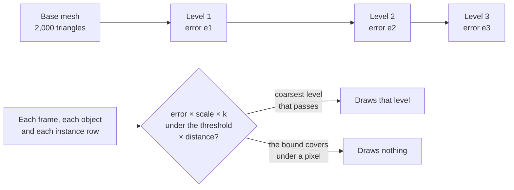

# Levels of detail

> Roadmap step 0.2, first released in null3D 0.1.0. The API is experimental, so it can still change between versions. Skinned and morphed objects, and materials that blend or let light through, draw their base mesh at every distance. Custom materials, and masks with the `'hash'` alpha mode, switch levels at once, with no fading band.



An object far from the camera covers few pixels. Its full mesh then costs vertex work that no one sees. A level of detail is a simpler copy of the mesh with fewer triangles. The copy differs from the full mesh by a small distance, its error. Where that distance covers less than about a pixel on the screen, the copy looks the same as the full mesh.

A mesh with levels draws one of them per frame in every object and every instance row that uses it. The engine picks the level on the GPU on WebGPU, and on its job workers on WebGL2. Both use the same rule, so a level switches in at the same distance on every GPU path.

## Give a mesh its levels

`mesh.setLevels` takes the lower levels, from the most detailed down. Each level is another mesh with the base mesh's vertex attributes. Each has an error: the largest distance between its surface and the base mesh's. The error is in the units of the base mesh's positions.

```ts
const tree = geometry.fromArrays(treeArrays(64));
tree.setLevels([
	{ mesh: geometry.fromArrays(treeArrays(24)), error: 0.02 },
	{ mesh: geometry.fromArrays(treeArrays(8)), error: 0.1 },
]);
// Every object and instance batch that draws the tree picks its level.
scene.createInstances(tree, 20_000, { material: bark });
```

Errors grow from level to level. The asset tool works out each level's error for you, as the next section shows.

## Levels from the asset tool

`bunx @null3d/cli assets optimize --lod` adds levels to each mesh of 64 triangles or more, as [the asset pipeline](../guides/assets-pipeline.md#levels-of-detail) explains:

```sh
bunx @null3d/cli assets optimize models/ public/models/ --lod
```

Each level has about half the triangles of the level above, and shares the mesh's vertices. Each level stores its error in the units of the mesh's own positions. The tool stores the levels with the `MSFT_lod` glTF extension. Each node with levels keeps their errors in its extras, as `NULL3D_lod_error`. `assets.loadGltf` gives each mesh its levels. So a model's copies and its instance batches pick their levels with no code. Other glTF loaders draw the full mesh. Another tool may store screen coverage alone, in `MSFT_screencoverage`. The loader then works out each error from the coverage, for a screen 1,080 pixels high. A file may bring its own levels, such as levels made in Blender, with errors in the units of the mesh's positions. `assets optimize` keeps them. It stores each level's positions in its base mesh's integer steps and converts the errors to those steps.

## Cluster levels

A level covers the whole mesh at one detail. A mesh that is close at one end and far at the other picks one detail for all of it. A cluster tree splits the mesh into patches of about 128 triangles instead. Each patch has its own error and its own bounds. One mesh can then draw fine triangles near the camera and coarse ones far from it. Its near and far parts switch detail separately.

The asset tool builds the tree with `--clusters`, as [the asset pipeline](../guides/assets-pipeline.md#cluster-levels) explains. It splits a large static mesh into patches, then simplifies groups of patches into the patches above them. Every patch's indices name the mesh's own vertices, so the tree adds no vertex. It costs about twice the mesh's indices.

A view draws a patch while the patch's own error passes its threshold and the error of the patch above it does not. A patch that fails the threshold is too coarse for that distance, so the walk descends into its children. The patches that draw then cover the mesh once, and the patches of one group switch together, so no gap opens.

The engine draws a tree's patches on WebGPU. A compute pass picks the patches that a view draws, copies their indices into a list of the view's own, and the view draws them in one draw. A view that sees none of a mesh's patches draws none of it. The pass costs one dispatch over the patches and one copy of the indices that draw, and the list takes about four bytes an index.

On WebGL2 the mesh still draws its whole triangle list, and the shadow maps draw it whole on both paths. Whole levels remain the fallback for those views. Meshes that a skin or a morph target bends, meshes whose material blends or masks, and meshes with many copies keep whole levels.

## How the engine picks a level

A level's error in pixels follows from the object's scale and distance, the camera's field of view and the height that the scene draws at:

```text
pixels = error × scale × render height / (2 × distance × tan(field of view / 2))
```

Each object and each instance row draws the coarsest level whose error covers fewer pixels than the `lodThreshold` quality setting. The setting is 1 pixel from Medium up, and 2 on Low. The render height includes the render scale. So on a taller screen, or at a higher render scale, each level switches in farther away. When the frame-budget governor lowers the render scale, coarser levels draw. When frames still take too long, the governor doubles the threshold, twice at most. An orthographic camera's pixels do not shrink with distance. So its levels follow the object's scale and the camera's zoom alone.

The distance runs from the camera to the nearest point of the object's bounding sphere. A large object therefore switches by its near side, so it does not turn coarse too early. Turning the camera never changes a level. A camera inside the bounds measures almost no distance, so the object keeps its full detail. A view with a camera of its own, such as a render pass, picks with that camera. Mirrors and the outline effect pick as the main camera does.
The same threshold hides an object of a mesh with levels that has nothing left to show. A bound that covers fewer pixels than the threshold draws nothing, and the mesh's last level holds no geometry. [Small objects](#small-objects) gives the distance and the fade.

Levels add no second copy of each object's data. Each view keeps about the room of one copy for each object and instance row that draws, whatever the number of levels and fading bands. A forest of 40,000 copies with four levels takes about 2.6 MB in a view.

## The bias of one object

`setLevelBias` raises or lowers the threshold for one object, as Godot's `lod_bias` does. The bias divides the factor that picks the levels. A bias above 1 draws each switch at a nearer distance, and a bias below 1 keeps the object's detail:

```ts
hero.setLevelBias(0.5); // the hero keeps its detail twice as far out
scenery.setLevelBias(2); // the scenery turns coarse twice as soon
```

The same factor moves the distance at which the object hides. A detailed hero object therefore stays visible farther out. The default is 1. The bias belongs to the object, so two objects that draw one mesh keep different detail. A change rebuilds the engine's tables of what it draws. In a scene without levels the bias does nothing.

## Fading between levels

A level that switches in at once can pop. Past each switch distance lies a short band, 8% of the distance long, where the old level and the new one both draw. A 4 × 4 dither pattern gives each pixel to one of them, and the share of the new level grows across the band. Each copy shifts the pattern by a phase from a hash of the copy, so neighboring copies do not line up into one grid. The two levels of a band take the same phase, so no pixel draws twice. Nothing sorts.

`setLevels(levels, { fade: false })` switches a mesh's levels at once. The `lodFade` quality setting turns every band off on Low. The fragments that the dither drops cost a tile GPU, such as a phone's or an Apple GPU's, its hidden-surface removal. So only the objects inside a band draw with the dither. The shader builds of the bands download with the first mesh whose levels fade.

## Small objects

An object far away can cover less than a pixel. Its levels then save vertex work, but the object still draws a fragment or two that no one sees. The engine hides it: the mesh's last level holds no geometry. Only a mesh with levels has that last level, so a mesh without levels draws at every distance.

The rule reads the object's bounding sphere. The number of pixels that its world diameter covers follows from the same factor as every level's switch distance:

```text
pixels = diameter × factor × threshold / distance
```

The object hides where that diameter covers fewer pixels than the `lodThreshold` setting. The render height, the render scale and the governor's doubled threshold all feed the factor, so they move the hide distance too. An orthographic camera hides an object by its diameter and the camera's zoom alone.

The object draws nothing past the band that follows the hide distance. That band, 8% of the hide distance long, thins the coarsest level out with the same dither. A shrinking object then fades away instead of popping. The band needs a fading build, as every band does. On Low, and with `setLevels(levels, { fade: false })`, the object disappears at the hide distance.

The shadow maps hide a caster at their own threshold, which is the camera's times `lodShadowFactor`. So a caster's shadow goes before the object itself, while the object covers a few pixels on the screen. The shadow passes draw no band.

## Shadows

The shadow maps pick each caster's level by the main camera's distance too. Their threshold is the camera's times the `lodShadowFactor` quality setting: 2 from Medium up, and 4 on Low. So shadows draw a coarser level than the camera sees, and the shadow passes cost less. The shadows' softness hides the difference. Shadow maps draw no fading band.

Far shadow cascades and the shadow tiles of point and spot lights keep their depth between draws. A level that changes as the camera moves shows in them when they next draw.

## From three.js

| three.js | null3D |
| --- | --- |
| `const lod = new LOD(); lod.addLevel(high, 0); lod.addLevel(low, 50)` | `highMesh.setLevels([{ mesh: lowMesh, distance: 50 }])`, then draw `highMesh` |
| `lod.addLevel(object, distance, hysteresis)` | `{ mesh, distance }`. The bands replace hysteresis |
| `lod.autoUpdate`, `lod.update(camera)` | None: the engine picks levels in every frame |
| `lod.getCurrentLevel()` | None |

A three.js `LOD` holds whole objects. In null3D the levels belong to the mesh, and every object and instance batch that draws it picks its own level. A level given by its distance switches in at that distance for an object of scale 1. The distance measures to the nearest point of the object's bounds. That holds on a screen 1,080 pixels high, at a field of view of 50 degrees, three.js's default. three.js measures to the object's position instead, so a large object switches later in null3D. The `fov` option of `setLevels` names another field of view. On other screens the level switches by its error, as every level does.

## API reference

`mesh.setLevels` and the options it takes are on the [geometry page's reference](../api/reference/geometry.md). The quality settings are on [the quality page](../api/quality.md).
