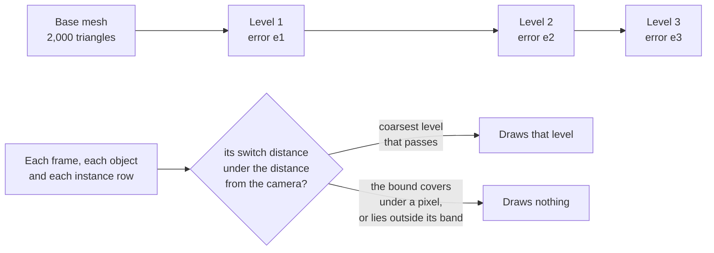

# Levels of detail

> Roadmap step 0.2, first released in null3D 0.1.0. The API is experimental, so it can still change between versions. Morphed objects, and materials that blend or let light through, draw their base mesh at every distance. A skinned object draws a level while the level names the base mesh's own vertices, as the asset tool's levels do. Custom materials, and masks with the `'hash'` alpha mode, switch levels at once, with no fading band. A distance band cuts at once for them too.



An object far from the camera covers few pixels. Its full mesh then costs vertex work that no one sees. A level of detail is a simpler copy of the mesh with fewer triangles. The copy differs from the full mesh by a small distance, its error. Where that distance covers less than about a pixel on the screen, the copy looks the same as the full mesh.

A mesh with levels draws one of them per frame in every object and every instance row that uses it. The engine picks the level on the GPU on WebGPU, and on its job workers on WebGL2. Both use the same rule, so a level switches in at the same distance on every GPU path.

## Give a mesh its levels

`mesh.setLevels` takes the lower levels, from the most detailed down. Each level is another mesh with the base mesh's vertex attributes. Each gives the distance at which it switches in, in one of three ways:

- `error`: the largest distance between its surface and the base mesh's, in the units of the base mesh's positions. An object's scale multiplies it, so a switch moves with the object's size.
- `distance`: a distance in meters for an object of scale 1. It holds on every screen height and at every render scale.
- `coverage`: the share of the render's height that the object's bounds cover, from 0 to 1. It holds on every screen height too.

```ts
const tree = geometry.fromArrays(treeArrays(64));
tree.setLevels([
	{ mesh: geometry.fromArrays(treeArrays(24)), distance: 60 },
	{ mesh: geometry.fromArrays(treeArrays(8)), distance: 140 },
]);
// Every object and instance batch that draws the tree picks its level.
scene.createInstances(tree, 20_000, { material: bark });
```

The switch distances grow from level to level, whatever their measures. The asset tool works out each level's error for you, as the next section shows.

## A material per level

A level may name a material of its own, so a far level shades more cheaply. It can leave out the normal map, or use an opaque mask in place of an alpha-tested one:

```ts
const bark = materials.standard({ map: barkMap, normalMap: barkNormal });
scene.createMesh({ mesh: tree, material: bark });
const barkFar = materials.standard({ map: barkMap, roughness: 0.85 }); // no normal map
tree.setLevels([
	{ mesh: coarse, error: 0.02, material: barkFar },
	{ mesh: coarsest, error: 0.1, material: barkFar },
]);
```

A level without a material draws with the material of the level before it. The base level draws with the object's or the instance batch's material. A glTF file gives a level its own material when the level node's primitive names another material than the node's primitive. Each material draws in its own buckets, so the far levels' pipelines leave out what their materials do not use.

## Levels from the asset tool

`bunx @null3d/cli assets optimize --lod` adds levels to each mesh of 64 triangles or more, as [the asset pipeline](../guides/assets-pipeline.md#levels-of-detail) explains:

```sh
bunx @null3d/cli assets optimize models/ public/models/ --lod
```

The tool can also write each level as a separate download, so a model's coarse shape shows at once and finer detail arrives while the page draws it:

```sh
bunx @null3d/cli assets optimize models/ public/models/ --lod --stages
```

The model file then holds the full vertices and the coarsest level, and each finer level downloads from a file of its own. The engine draws each level as it arrives, and the copies that already draw the model refine in place.

The loader also holds back a level that the camera never shows. It fetches the stage after the file's own level at once. Then it keeps each finer stage until a view has drawn the level that the mesh has now. It waits about two seconds of drawn frames for that pick. A level that never draws cannot lead to a finer one. So the loader sets that stage and the finer ones aside, and their files do not download. The engine decides from the levels that it picked, never from the device's name. The switch follows the camera, the render scale and the `lodThreshold` setting. What the loader set aside is not lost. It looks again about every second and a half. A camera that comes close enough to draw that level then brings the stage and the finer ones. So a level that the camera never draws costs no download, and a level that the camera starts to draw arrives.

`assets.loadGltf` takes `maxLevels` to stop after that many levels, counting the file's own: a page whose objects never come close enough to show the finest level sets 1, and downloads less. [The asset pipeline](../guides/assets-pipeline.md#levels-as-separate-downloads) has the detail.

Each level has about half the triangles of the level above, and shares the mesh's vertices. The loader stores each level over the base mesh's own vertices, so the level costs the GPU its indices alone. The tool orders the vertices coarsest level first, so a coarse level reads a stretch at the start of the vertex buffer. Some levels keep a copy of their vertices instead. A level of cards brings positions of its own, and a level whose base mesh the engine had to split into parts cannot share them. Each level stores its error in the units of the mesh's own positions. The tool stores the levels with the `MSFT_lod` glTF extension. Each node with levels keeps its errors in its extras, as `NULL3D_lod_error`. It also writes the screen coverage that each error implies, in `MSFT_screencoverage`, for a screen 1,080 pixels high. The loader reads the coverage that comes beside an error to tell a measured error from a hand-set one, and reads the coverage alone as the measure for a file that holds no errors. `assets.loadGltf` gives each mesh its levels. So a model's copies and its instance batches pick their levels with no code. Other glTF loaders draw the full mesh.

A measured error changes the picture by less than a pixel at its switch. Such a level switches at once. The loader reads an error as measured only where the file also gives the coverage that the tool writes beside it. A file that gives errors alone holds switch distances that its author set by hand. Those levels fade, as levels given by a distance or a coverage do. A file may bring its own levels, such as levels made in Blender, with errors in the units of the mesh's positions. `assets optimize` keeps them. It stores each level's positions in its base mesh's integer steps, and converts their errors to those steps.

## Cluster levels

A level covers the whole mesh at one detail. A mesh that is close at one end and far at the other picks one detail for all of it. A cluster tree splits the mesh into patches of about 128 triangles instead. Each patch has its own error and its own bounds. One mesh can then draw fine triangles near the camera and coarse ones far from it. Its near and far parts switch detail separately.

The asset tool builds the tree with `--clusters`, as [the asset pipeline](../guides/assets-pipeline.md#cluster-levels) explains. It splits a large static mesh into patches, then simplifies groups of patches into the patches above them. Every patch's indices name the mesh's own vertices, so the tree adds no vertex. It costs about twice the mesh's indices.

A view draws a patch while the patch's own error passes its threshold and the error of the patch above it does not. A patch that fails the threshold is too coarse for that distance, so the walk descends into its children. The chosen patches are the frontier of that one rule. Their errors rise along every chain, so the patches cover the mesh once, and neighbours of different detail meet at their edges with no gap.

The engine draws a tree's patches on both GPU paths. On WebGPU, a compute pass picks the patches that a view draws, copies their indices into a list of the view's own, and the view draws them in one draw. A view that sees none of a mesh's patches draws none of it. The pass runs three dispatches: one to test each patch, one to add the counts up, and one to copy the indices that draw. The list takes about four bytes an index.

On WebGL2, the job workers walk the tree for each view with the same rule, where the device has `WEBGL_multi_draw` (Chrome and Safari). Each chosen patch is a range of the mesh's tree in one multi-draw call, so a frame uploads ranges and no triangles. Ranges that are neighbours in the tree's index list merge, so a frame makes fewer calls. A WebGL2 browser without `WEBGL_multi_draw`, such as Firefox, draws the whole levels that the tool cuts from the tree. They are the same levels that other glTF viewers draw.

A tree can stream as a model loads, with `--clusters --stages`. The model file then holds the tree's first band, and that band draws the first picture. Each later band downloads from a file of its own. A band appends its patches below the patches that already arrived, so the tree refines as the bands come and no new object appears. The patches that a page holds always form a whole tree from the root. A patch whose children have not arrived draws where the camera is close, so the first picture is coarse and still covers the whole surface. The loader holds a band until a view draws a patch of the band above it. `maxLevels` counts a band as it counts a level. [The asset pipeline](../guides/assets-pipeline.md#levels-as-separate-downloads) has the detail.

The patch path draws a mesh that one copy draws, and the file may still hold a tree for a mesh with more copies. A mesh that draws several copies at once keeps its whole triangle list, because the walk picks the patches of one copy. The WebGPU path that draws objects directly also draws the whole levels, because it has no cluster pass. The shadow maps draw the whole levels. Meshes that a skin or a morph target bends, and meshes whose material blends or masks, keep whole levels too.

## How the engine picks a level

A level given by its error switches in where that error covers fewer pixels than the `lodThreshold` quality setting:

```text
pixels = error × scale × render height / (2 × distance × tan(field of view / 2))
```

The setting is 1 pixel from Medium up, and 2 on Low. The render height includes the render scale. So on a taller screen, or at a higher render scale, such a level switches in farther away. When the frame-budget governor lowers the render scale, coarser levels draw. When frames still take too long, the governor doubles the threshold, twice at most.

A level given by its distance switches where the camera is that far from the object's nearest point. The camera's field of view, the screen height and the render scale do not move it. A level given by its coverage switches where the object's bounds cover that share of the render's height. A taller screen does not move that switch either.

An orthographic camera's pixels do not shrink with distance. So its levels follow the object's scale and the camera's zoom alone.

The distance runs from the camera to the nearest point of the object's bounding sphere. A large object therefore switches by its near side, so it does not turn coarse too early. Turning the camera never changes a level. A camera inside the bounds measures almost no distance, so the object keeps its full detail. A view with a camera of its own, such as a render pass, picks with that camera. Mirrors and the outline effect pick as the main camera does.
The same threshold hides an object of a mesh with levels that has nothing left to show. A bound that covers fewer pixels than the threshold draws nothing, and the mesh's last level holds no geometry. [Small objects](#small-objects) gives the distance and the fade.

Levels add no second copy of each object's data. Each view keeps about the room of one copy for each object and instance row that draws, whatever the number of levels and fading bands. A forest of 40,000 copies with four levels takes about 2.6 MB in a view.

## The bias of one object

`setLevelBias` raises or lowers the threshold for one object, as Godot's `lod_bias` does. The bias divides the factor that picks the levels. A bias above 1 draws each switch at a nearer distance, and a bias below 1 keeps the object's detail:

```ts
hero.setLevelBias(0.5); // the hero keeps its detail twice as far out
scenery.setLevelBias(2); // the scenery turns coarse twice as soon
```

The same factor moves the distance at which the object hides. A detailed hero object therefore stays visible farther out. The default is 1. The bias belongs to the object, so two objects that draw one mesh keep different detail. A change rebuilds the engine's tables of what it draws. In a scene without levels the bias does nothing.

## Fading between levels

A level that switches in at once can pop. The engine fades only where a switch would show:

- A level with a measured error, which the asset tool writes, changes the picture by under a pixel at its switch. It switches at once, so it pays for no second draw. A file's error counts as measured only where the file also gives the coverage that the tool writes beside it.
- A level given by a distance, by a coverage or by a hand-set error changes the picture more. It fades.

A fading level hands over in a short band past its switch distance. The band is 8% of the distance long, and the old level and the new one both draw in it. A 4 × 4 dither pattern gives each pixel to one of them, and the share of the new level grows across the band. Each copy shifts the pattern by a phase from a hash of the copy, so neighboring copies do not line up into one grid. The two levels of a band take the same phase, so no pixel draws twice. Nothing sorts.

```ts
// A hand-set error fades by default. This one switches at once.
mesh.setLevels(levels, { fade: false });
// One level decides for itself.
mesh.setLevels([{ mesh: low, distance: 80, fade: false }]);
```

The fragments that the dither drops cost a tile GPU, such as a phone's or an Apple GPU's, its hidden-surface removal. So only the objects inside a band draw with the dither. The shader builds of the bands download with the first mesh whose levels fade. These builds follow the level, whatever the `lodFade` quality setting, because a hand-set level pops without them.

[Custom materials](../shaders/surface-functions.md) fade too, through their own builds, which download with the material's first use. Three kinds switch at once: a material that tests its mask by the [alpha hash](../api/materials.md#alpha-modes), a skinned material, and one that lets light through.

Two add-ons morph a level instead of fading it. The terrain add-on moves each block's vertices toward its parent block's surface over the last part of the approach, so the block matches its parent when the selection hands over. The vegetation add-on moves a tree's leaf cards toward the next level before the switch: the cards that the level drops shrink and the kept ones grow. Both write the target in the mesh's four-number vertex record, which their own custom material's `vertexOffset` reads. Neither adds a draw, and neither writes a vertex in a frame. File meshes keep the dither: the asset tool's simplifier records no mapping between one level's vertices and the next.

## Small objects

An object far away can cover less than a pixel. Its levels then save vertex work, but the object still draws a fragment or two that no one sees. The engine hides it: the mesh's last level holds no geometry. Only a mesh with levels has that last level, so a mesh without levels draws at every distance.

The rule reads the object's bounding sphere. The number of pixels that its world diameter covers follows from the same factor as every level's switch distance:

```text
pixels = diameter × factor × threshold / distance
```

The object hides where that diameter covers fewer pixels than the `lodThreshold` setting. The render height, the render scale and the governor's doubled threshold all feed the factor, so they move the hide distance too. An orthographic camera hides an object by its diameter and the camera's zoom alone.

The object draws nothing past the band that follows the hide distance. That band, 8% of the hide distance long, thins the coarsest level out with the same dither. A shrinking object then fades away instead of popping. The band needs a fading build, which a level that fades has. A mesh whose levels all switch at once disappears at the hide distance.

The shadow maps hide a caster at their own threshold, which is the camera's times `lodShadowFactor`. So a caster's shadow goes before the object itself, while the object covers a few pixels on the screen. The shadow passes draw no band.

## Distance bands

`setDrawRange` gives a band of distances in which a mesh, an instance batch or one of its rows draws. It works as Godot's visibility range and Bevy's `VisibilityRange` do:

```ts
stone.setDrawRange(8, 120); // nothing nearer than 8 m, nothing past 120 m
grass.setDrawRange(0, 60); // a far edge only
```

The mesh draws only while the camera's distance to its nearest point lies inside the band. Each edge fades inside the range over an 8% band, through the same dither. A stone then fades in as it comes near and out as it passes. A mesh that lies outside its band costs no draw on either GPU path. The `lodFade` quality setting turns these edges off on Low, where the dither costs tile GPUs their hidden-surface removal. A row's own range, in the array that `ranges: true` makes for a batch, overrides the batch's.

## See the levels

The development build draws a levels view: `debug.view('levels')` from the sketch, or `?view=levels` in a page's address. Each draw takes a color for its level, from blue for the base mesh to gray for the coarsest. Where two levels hand over in a fading band, the view dithers the two colors, so the band shows. A source that the size rule or a draw range hid draws at its base level in a striped magenta marker, at the place it would have drawn. The view then shows what the culling dropped, rather than a hole.

The view reads the level that the culling picks, so it needs no shader for each material. `debug.cullingSpheres(true)` draws the bounding sphere that culling tests for each object whose mesh has levels, so a sphere that hid by its size shows where it lies. It draws in a development build only. An add-on registers a view of its own through the `debugViews` field of its [feature description](../api/features.md#the-fields).

## Shadows

The shadow maps pick each caster's level by the main camera's distance too. Their threshold is the camera's times the `lodShadowFactor` quality setting: 2 from Medium up, and 4 on Low. So shadows draw a coarser level than the camera sees, and the shadow passes cost less. The shadows' softness hides the difference. Shadow maps draw no fading band.

Far shadow cascades and the shadow tiles of point and spot lights keep their depth between draws. A level that changes as the camera moves shows in them when they next draw.

## Cards beyond the levels

A level of detail keeps one draw and one mesh per object. Far past the last level, an object can draw as a card instead: a quad that stands upright, turns to the eye, and shows a picture of the object. The `@null3d/impostors` add-on draws those cards, and a distance band on the meshes hands the object over to them.

A bake stores the object from many directions, folded onto an octahedral grid, in a color atlas and a surface atlas of normals and depths. Each card blends the three stored views nearest the direction from the card toward the eye, so the picture changes smoothly as the camera moves rather than jumping between views. The card's light comes from the scene, through the stored normal, so a sun that moves relights the cards exactly as it relights the meshes. A copy's turn about the world's up turns its views and its light too, so a turned tree hands over to a card whose crown matches it. A camera that moves around the tree does not turn its light: the card turns to the eye, and the stored normal turns only with the tree. A card casts the crown's shape, and takes the shadows that fall on the surface it shows, when the sketch asks for it.

`setDrawRange` fades a band's edges with the dither, so the hand-over from a mesh to its cards need not pop. The vegetation add-on's `handOverToCards` sets the two bands for a row of plants. [Impostors](../api/impostors.md) gives the calls, and the demo `examples/impostors` draws a forest three ways by distance.

## From three.js

| three.js | null3D |
| --- | --- |
| `const lod = new LOD(); lod.addLevel(high, 0); lod.addLevel(low, 50)` | `highMesh.setLevels([{ mesh: lowMesh, distance: 50 }])`, then draw `highMesh` |
| a `LOD` object whose `far` the sketch checks | `mesh.setDrawRange(start, end)` |
| `lod.addLevel(object, distance, hysteresis)` | `{ mesh, distance }`. The bands replace hysteresis |
| `lod.autoUpdate`, `lod.update(camera)` | None: the engine picks levels in every frame |
| `lod.getCurrentLevel()` | None |

A three.js `LOD` holds whole objects. In null3D the levels belong to the mesh, and every object and instance batch that draws it picks its own level. A level given by its distance switches in at that distance for an object of scale 1, on every screen. The distance measures to the nearest point of the object's bounds. three.js measures to the object's position instead, so a large object switches later in null3D. A level given by its error or its coverage compares at a field of view of 50 degrees, three.js's default. The `fov` option of `setLevels` names another one.

## API reference

`mesh.setLevels` and the options it takes are on the [geometry page's reference](../api/reference/geometry.md). The quality settings are on [the quality page](../api/quality.md).
