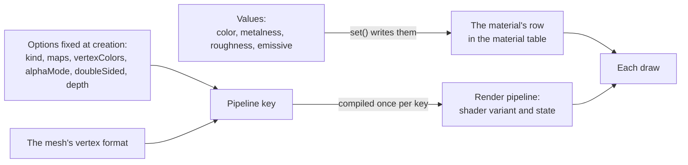
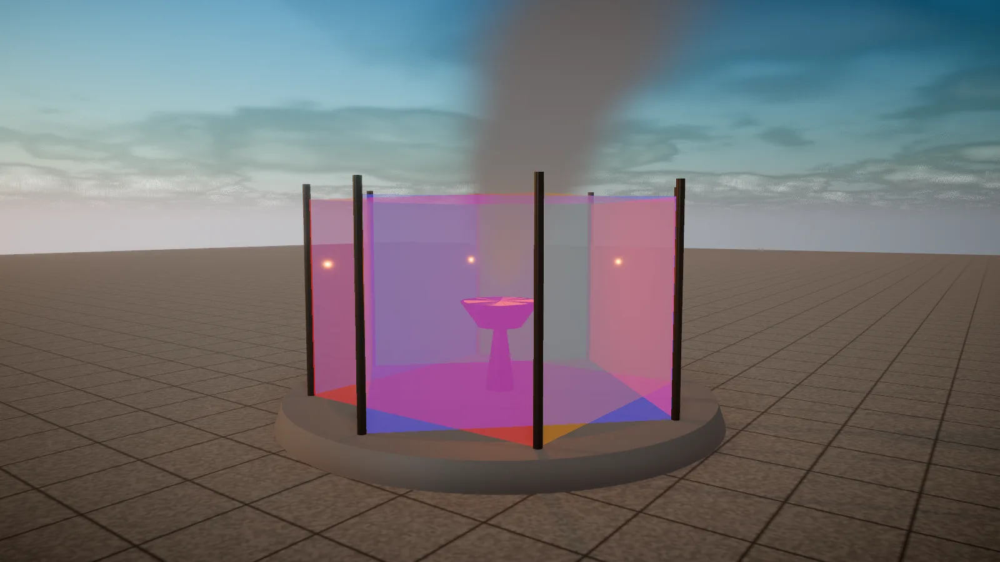
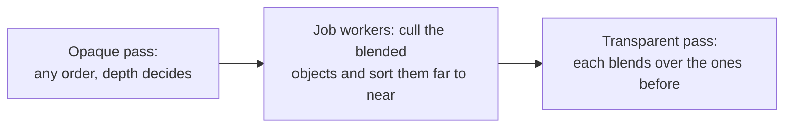

# Materials and pipelines

> Custom materials take a surface function, a vertex offset, their uniforms and up to 6 textures of their own, or a full shader. They take none of the standard texture maps.



A material has two parts. Its values, such as its color and roughness, sit in one row of a table that every shader reads. Its kind and its fixed options choose the render pipeline that draws it.

The GPU compiles a pipeline once for each combination of its shader variant, its state and the mesh's vertex format. A new combination therefore costs a compile, while a new value costs almost nothing.

## The built-in materials

| Material | Model |
| --- | --- |
| `materials.standard` | glTF's metallic-roughness model, lit by the scene's lights |
| `materials.unlit` | Its color alone, without lights |
| `materials.shader` | The standard model, with a WGSL surface function that changes the look |
| `materials.shadowCatcher` | Only the shadows that fall on it, and nothing where the light reaches it |
| `materials.decal` | The standard model, projected by a box onto the surfaces inside it |

The standard material lights a surface with Lambert diffuse light and a GGX highlight. The cube map and the spherical harmonics of the environment give its light, and a table of split-sum terms weighs it. A term for light that bounces more than once keeps a rough surface's energy. [Materials](../api/materials.md) lists every option.

## Values cost almost nothing

`set()` writes a material's values into its row, and the next frame uploads the rows that changed. No pipeline changes, so no shader compiles, and every object that uses the material changes with it. The [animated values demo](https://github.com/null3d-engine/null3d/tree/main/examples/property-animation) changes a lamp, a material and a camera every frame at no cost.

```ts
// sketch.ts
const paint = materials.standard({ color: '#e8554e', roughness: 0.6 });
// Later, from any frame: a cheap change.
paint.set({ roughness: 0.2, emissive: '#ff4000', emissiveIntensity: 0.5 });
```

## Fixed options choose the pipeline

A feature that changes what a shader costs is a variant of the shader, which the engine compiles only for the materials that need it. Other options change the pipeline's state. Either way, the option is fixed when you create the material.

| Option | Where it goes |
| --- | --- |
| The kind: standard, unlit or custom | The shader |
| Texture maps | A shader variant that samples maps, and another for a normal map on a mesh with tangents |
| `vertexColors` | A shader variant that reads the mesh's colors, on meshes that have them |
| `alphaMode: 'mask'` or `'hash'` | A shader variant that drops the fragments whose alpha fails its test |
| `alphaToCoverage` | The pipeline's state: MSAA turns the masked alpha into coverage |
| `alphaMode: 'blend'`, `blending` | The pipeline's blend state, and the transparent pass |
| `transmission` | A shader variant that samples a copy of the opaque objects' colors, and the transparent pass |
| `diffuseTransmission` | A shader variant that lights the surface's back too, and lets that light through to its front |
| `subsurfaceRadius` | The skin pass, which draws the object again with shaders of its own, and the subsurface blur after the scene |
| A clear coat, a sheen, iridescence or anisotropy | A shader variant that lights the layers above the surface, whose shaders load with the first such material |
| `doubleSided` | The pipeline's state: it culls no faces. A blended one draws with two pipelines, one per face, unless `forceSinglePass` asks for one |
| `depthWrite`, `depthTest`, `depthBias` | The pipeline's depth state |
| `colorWrite: false` | The pipeline's color state, and the place in the opaque pass: its objects draw first, so their depth holds back the surfaces behind them |
| `flatShading` | The material's row: every standard shader can light with face normals |

To change one of these options, create one material for each combination in the setup, and give an object another one with `setMaterial`.

```ts
// sketch.ts: two variants, made once in the setup.
const faceted = materials.standard({ color: '#8098d0', flatShading: true });
const cloth = materials.standard({ color: '#8098d0', doubleSided: true });
```

## Alpha modes

A material's `alphaMode` says what its alpha does. The default, `opaque`, ignores it. The `mask` mode draws nothing where the alpha is below the material's `alphaCutoff`. A masked surface is opaque where it draws, so it hides what lies behind it, and its objects draw in any order.

The `hash` mode draws each point opaque or not at all. A hash of the point's place on the mesh sets a threshold, and the point draws where its alpha reaches it. The alpha then sets the share of the surface that draws, and hashed objects need no sort.

The shader that drops fragments costs more than one that never does: a GPU cannot always test depth before it runs such a shader. Tile GPUs, as in phones and Apple's chips, also lose part of their hidden-surface removal. So only masked and hashed materials draw with that variant. The cutoff is a value, and `set({ alphaCutoff })` changes it at no cost.

`alphaToCoverage`, on by default, smooths a mask's cut edges with MSAA. The masked alpha fades over about one pixel above the cutoff, and MSAA covers that share of each edge pixel's samples. The first such material loads extra shader builds; list `'coverage'` in `createEngine`'s `preload` option to load them before play ([Alpha to coverage](../api/materials.md#alpha-to-coverage)). Without MSAA, alpha to coverage is a plain mask.

<details>
<summary>Technical details: alpha to coverage on each path</summary>

Where the target's format has an alpha channel, the GPU turns the alpha into coverage. WebGPU's HDR scene color has none, so there the shader writes the covered samples itself.

</details>

The `blend` mode blends the surface over what lies behind it. Its `blending` chooses how: `normal`, `additive`, `multiply` or `weighted` ([Weighted blending](../api/materials.md#weighted-blending)). [Materials](../api/materials.md#alpha-modes) shows each mode.

## The transparent pass



Weighted blending needs no sort.



### Sorting the blended objects

The result of blending depends on the order in which surfaces draw. A surface must blend over everything behind it. So the engine draws blended objects in a pass of their own, after the opaque ones, farthest first. In each frame, for each view, the job workers cull the blended objects and sort them. An object's depth is the depth of its bounding sphere's center. `mesh.setRenderOrder(order)` comes first: a lower order draws first, at any depth.

The rows of an instance batch sort one by one, so a batch of blended particles draws in the right order. Neighbors in the sorted order that share a mesh and a material draw together. A batch that no other blended object crosses therefore draws in few draw calls.

Sorting by object has these limits:

- Surfaces that cross each other have no right order. One object draws before the other, so where the second lies behind the first, it shows wrong. Split such meshes, or give them `depthWrite: false` so they never hide each other.
- A large object, such as a long glass wall, has one center. A small object can have a center that is farther away than the wall's while it stands in front of the wall. Split large blended meshes, or set their order with `setRenderOrder`.
- The triangles of one mesh draw in the mesh's own order. A closed blended mesh, such as a sphere, draws only its front faces unless it is double-sided. A double-sided one draws its back faces first, then its front faces. So its near side covers its far side. Each run of neighbors that share its mesh and material takes a second draw. On flat surfaces, whose faces never overlap, `forceSinglePass: true` saves it.

### Blending without a sort

Surfaces of the `weighted` blending need no sort. In the camera's view they leave the transparent pass and draw after it, in any order, into two targets of their own. A last step blends their weighted average over the scene, as far as they cover it together ([Weighted blending](../api/materials.md#weighted-blending)). Use it where the limits above make smoke, particles or crossing panes pop. The demo of [weighted blending](https://github.com/null3d-engine/null3d/tree/main/examples/weighted-transparency) blends eight crossing glass panes and 600 smoke puffs in any order.

### Moment transparency

The quality setting `momentTransparency` blends the same surfaces in a layer of its own. It is nearer an exact back-to-front blend than the weighted average is. The page turns it on with the `createEngine` option of the same name, and it stays fixed while the engine runs. It draws each surface twice and keeps a store of four depth moments, so a page pays more for it ([Moment transparency](../api/materials.md#moment-transparency)).

### Transmission

Surfaces that let light through, which `transmission` makes, draw in the transparent pass too, sorted with the blended ones. Before the camera's transparent pass, the engine copies its opaque objects' colors into a texture with blurred levels, which those surfaces sample behind them ([Transmission](../api/materials.md#transmission)).

### What blending costs

Blended objects cost more than opaque ones. The job workers cull and sort them in every frame, and on WebGPU the engine also writes each visible one's data for the GPU. Neighbors that differ in mesh or material need draw calls of their own. The GPU shades every blended layer of a pixel, so large overlapping surfaces cost GPU time. Keep blended objects to what needs them, and use the `mask` mode for cut-out shapes.

## Custom materials share shaders

Reuse one WGSL for materials that differ only in their values. A custom material's WGSL becomes a shader of its own: the standard material's shader with the surface function in it. Every material made from the same WGSL shares that shader, and its pipelines, whatever its values. Its uniforms are values too: they sit beside the material's row, so `set()` changes them without a compile. The fixed options above choose its variants and states, as they do for a standard material. Each new WGSL therefore costs its own pipeline compiles.

## Why a new combination can appear late

A pipeline builds the first time the scene needs a combination of shader variant, state and vertex format that it did not need before. The GPU driver can take many milliseconds for that, on a phone above all. The first frame waits until all of its pipelines are built. After that, the engine does not wait: an object whose pipeline is still building draws nothing until the build ends. On WebGL2 without parallel shader compiles, as in Firefox, the first draw waits for its compile, so that frame is late.

Create every material in the setup and `await scene.warmUp()` before play starts. For objects that appear later, create them hidden, await `scene.warmUp()`, then show them. Some material features, such as transmission and clear coat, download their shaders on first use. List them in `createEngine`'s `preload` option so nothing downloads during play. [Loading screens and warm-up](../guides/loading-screens.md#pipelines-and-warm-up) shows how.

## Related pages

- [Materials](../api/materials.md): every option of each material.
- [Surface functions](../shaders/surface-functions.md): the WGSL of a custom material.
- [Lights](../api/lights.md): what lights a standard material.
- [Color management](color-management.md): how colors turn into linear values.
- [Loading screens and warm-up](../guides/loading-screens.md): build pipelines before play, and load feature shaders up front.
- [Clear coat and sheen variants](https://github.com/null3d-engine/null3d/tree/main/examples/coat-and-sheen): candy paint and carbon fiber under a clear coat, and velvet that glows at its edges.
- [Iridescence and anisotropy variants](https://github.com/null3d-engine/null3d/tree/main/examples/iridescence-and-anisotropy): a beetle's shell, soap bubbles and an oil slick.
- [Diffuse transmission](https://github.com/null3d-engine/null3d/tree/main/examples/translucency): broad leaves and coral petals let the low sun through.
- [Subsurface light and the skin pass](https://github.com/null3d-engine/null3d/tree/main/examples/subsurface): wax, jade and soap glow under the surface.
- [Custom material WGSL and uniforms](https://github.com/null3d-engine/null3d/tree/main/examples/shader-inputs): 900 crystals take their color and their wave from their row.
- [Decal material](https://github.com/null3d-engine/null3d/tree/main/examples/decals): road paint, puddles, cracks and posters project onto a street.
- [Invisible surfaces that hide](https://github.com/null3d-engine/null3d/tree/main/examples/depth-only): a plane with `colorWrite: false` holds back the hall behind it.
