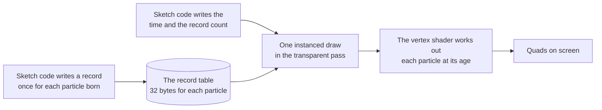

# The particle buffer

> Roadmap step 0.2, first released in null3D 0.1.0. The API is experimental, so it can still change between versions. Use the [particles add-on](../api/particles.md), which fills this buffer for you, unless you write your own emitter. Coding agents must not use these calls.



A particle buffer is a scene object and a flat table of particle records. Sketch code writes one record when a particle is born. The GPU then works out where that particle is and how it looks at its age, in closed form. No pass moves the particles, so a frame at a given time looks the same whatever frames came before it, on WebGPU and on WebGL2.

The `@null3d/particles` add-on builds its systems from buffers. Its emitters, bursts and sub-emitters decide where and when particles are born, then write the records. Use the add-on for most work. This page covers the buffer itself, for an emitter that the add-on does not fit.

## What the buffer holds

| Part | Size | What it is |
| --- | --- | --- |
| The object | one scene object | Its place, turn, scale, layers, visibility and bounds. Birth places are in its space, so moving the object moves every particle. |
| The records | 32 bytes for each of `capacity` | One record for each particle that the buffer holds at once. |
| The values | 512 bytes | The motion and the look of every particle of the buffer. It uploads when `set` changes it. |
| The frame's values | 16 bytes | The time, the record count and the time shift, which the sketch writes in each frame. |

The engine gives the object one material, with the particle shading. It blends and writes no depth. The material takes a `map` for the particles' texture, and without one each particle is a soft round dot. The `blending` option is additive or normal, and it defaults to additive. `layers` chooses the layers that the buffer draws on.

## A record

A record is eight 32-bit numbers, or 32 bytes.

| Bytes | Contents |
| --- | --- |
| 0 to 11 | The birth place: x, y and z in the object's space. |
| 12 to 15 | The birth time, in the buffer's seconds. |
| 16 to 27 | The start velocity: x, y and z in the object's space. |
| 28 to 29 | The lifetime in seconds, as a 16-bit float. |
| 30 to 31 | A 16-bit seed, from 0 to 65,535. |

The seed picks the particle's random size, turn, spin, color and first flipbook frame. Two particles of one buffer get their own values from their own seeds. Call `write(index, record, seed)` with the eight numbers in that order: place, birth time, velocity, lifetime. The seed is the third argument.

Call `writeRecords(block, count, first)` to write many births in one call. The block holds nine numbers for each birth: the eight above and the seed. Row `first` takes the first birth, and the rest follow, wrapping at the capacity. The engine packs the records and marks them, so the sketch's loop fills the block and the call writes it. Pass a block that stays the same size from frame to frame, which keeps the engine's room for it. Call `shiftRecords(from, to, seconds)` to take whole seconds off the birth times of rows `from` to `to`, which moves the time that they count from.

## Layout in practice

The records are one table, with a row for each particle that the buffer holds at once. An index from 0 to `capacity - 1` names a row. The buffer keeps no list of live particles. The shader reads each record's birth time and lifetime, so a particle draws nothing before its birth and nothing after its death.

`frame[1]` says how many records from the first the draw reads, at most the capacity. Set it to the number of rows that hold a record, so rows that the sketch never wrote do not draw. Rows past the count draw nothing even when they hold a live particle. Once the count reaches the capacity, every row runs the vertex shader in every frame. A record past its life leaves before it makes a quad.

An emitter usually fills the table in order and then writes over the oldest rows:

```ts
// The n-th birth goes into row n. After a full table, the rows start again.
buffer.write(born % buffer.capacity, record, born & 0xffff);
```

A capacity that fits the rate over the longest lifetime keeps that safe. A write over a row whose particle is still alive ends that particle early.

A buffer draws as one blended object. Its particles keep the order of their records, and the engine does not sort them among themselves. Additive blending needs no order, which suits most effects. With normal blending, keep the particles faint and soft, as smoke is.

## Write into the buffer

The sketch below writes a fountain straight into a buffer, and the GPU moves every particle.

```ts
import { defineSketch } from '@null3d/engine';

export default defineSketch(async ({ scene, time }) => {
  scene.setActiveCamera(
    scene.createPerspectiveCamera({ position: [0, 2.5, 7], target: [0, 1.2, 0] }),
  );

  const capacity = 2_048;
  const buffer = await scene.createParticleBuffer({
    capacity,
    gravity: [0, -9.8, 0],
    size: [0.03, 0.07],
    colors: ['#ffd28a', '#ff6a2a'],
    alphaOverLife: [1, 0],
  });
  // Bounds around the particles, so a view that holds them draws them.
  buffer.object.setBounds([0, -2, 0], 8);

  const record = new Float32Array(8); // made once, never resized
  const frame = buffer.frame;
  let born = 0;

  return {
    onLateUpdate(dt) {
      // About 240 births a second, at even times through the frame.
      const count = Math.min(Math.round(dt * 240), 512);
      for (let n = 0; n < count; n++) {
        const angle = Math.random() * Math.PI * 2;
        const speed = 1 + Math.random() * 1.5;
        record[0] = 0;
        record[1] = 0.1;
        record[2] = 0;
        record[3] = time.now - dt + ((n + 0.5) * dt) / count;
        record[4] = Math.cos(angle) * speed;
        record[5] = 3 + Math.random();
        record[6] = Math.sin(angle) * speed;
        record[7] = 1.5;
        buffer.write(born % capacity, record, born & 0xffff);
        born++;
      }
      frame[0] = time.now;
      frame[1] = Math.min(born, capacity);
      buffer.commit();
    },
  };
});
```

Await the creation in the setup, because the first call downloads the particle code. If the code does not download, the promise rejects with [E1406](../errors/E1406.md).

Make the record array once. Every birth is then a write into engine memory, so a frame allocates nothing. The frame array is a view into that memory: take it once and assign its numbers.

`commit()` marks the records written since the last call for the next frame's upload. A call in every frame is enough: writes that continue the run are marked there, and a write elsewhere marks its range at once.

The birth time counts from `frame[0]`, which must rise with the frame's time. Keep it smooth: a jump in the time makes every particle jump in its life.

`set(values)` changes the motion and the look for every particle from a later frame on. It takes the same options as creation.

`buffer.object` gives the object for every other object call. Move it, turn it, scale it, set its layers and visibility, or give it bounds. The bounds must cover the particles. Without bounds of your own, the object keeps a point at its origin, and a view that loses that point loses the whole buffer.

`buffer.destroy()` frees the records, the GPU buffers and the object.

## What a frame sends

- The records written since the last frame, in up to four ranges. The first frame after creation sends the whole table. A fifth range merges with the nearest of the four, so writes scattered across the table send a wider range.
- The values, 512 bytes, only after `set` changes them.
- No other data uploads in a frame. The renderer reads the frame's values from the buffer's memory, then writes one small block for each view with the object's matrix and the shift.

A frame's upload therefore grows with the births it writes. The number of particles alive does not change it. The GPU still works out each record that the count covers, in every frame and in every view.

## Limits

- The capacity is a whole number from 1 to 4,194,304. Another value throws [E1108](../errors/E1108.md).
- A scene holds 256 particle buffers. Another throws [E1108](../errors/E1108.md).
- The engine's memory holds 32 bytes for each record, and the GPU holds a copy of the same bytes. A buffer that cannot get its memory throws [E1109](../errors/E1109.md).
- The count is rounded down to a whole number, at most the capacity. A count that is not finite, or that is 0 or less, draws nothing.
- The lifetime is a 16-bit float with about three digits of precision, rounded down. One above 65,504 seconds stores as 65,504. One below about 0.00003 seconds stores as zero, so the particle never draws.
- Birth times are 32-bit floats, so their precision falls as the buffer's clock grows. A buffer that runs for hours moves its time base. It rewrites the birth times at their new times and tells the shader how far that move has reached. The value in `frame[2]` is the first record that still counts from the old base, and `frame[3]` holds the seconds to take off it. The add-on does this after 1,024 seconds.
- A buffer with a map draws nothing in a frame where the map's image is not yet on the GPU.
- A softness above 0 makes the camera copy its opaque depth in each frame, which is one full-screen pass. The Low preset turns soft particles off.
- The particles cast no shadow and lights do not light them. A raycast against the object tests its one triangle at the origin, which has no area, so it never hits a particle.
- After `destroy()`, the buffer's calls and arrays throw.

## Related pages

- [Particles](../api/particles.md): the add-on that makes systems from this buffer, with emitters and sub-emitters.
- [Instances and batching](instances.md): typed arrays that sketch code writes, row by row.
- [Culling](culling.md): how the engine culls the buffer by its object's bounds.
- [GPU tiers and backends](backends.md): the two paths that draw the same particles.
