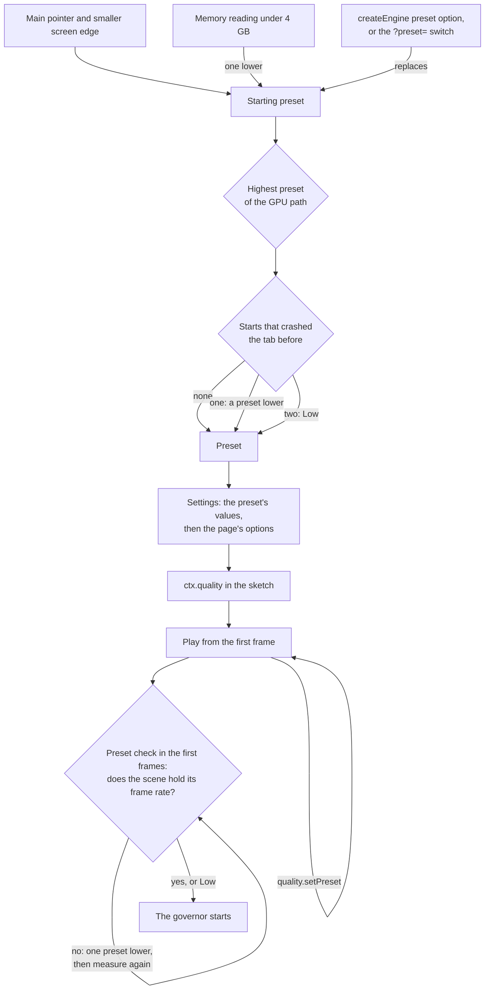
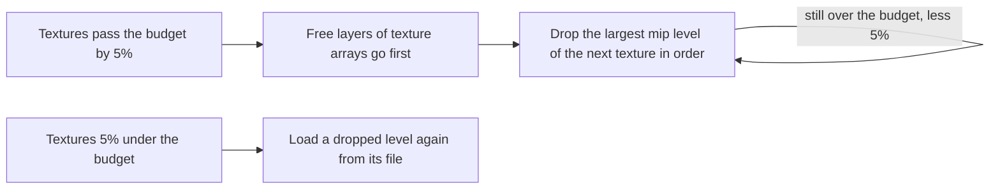
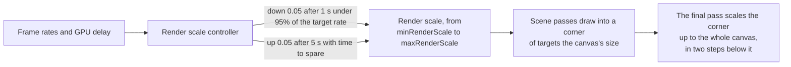
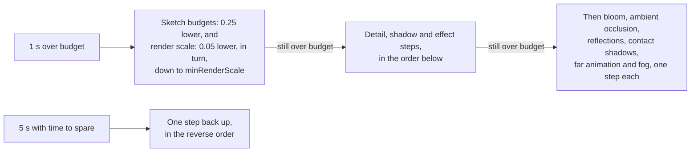

# Quality presets, dynamic resolution and frame budgets

> The engine chooses a preset and checks it in the first frames of play, or before play when the page asks. It applies the preset's pixel ratio cap, render scale range, shadow, texture and anti-aliasing settings, depth prepass, occlusion culling and memory maximum. During play, the frame-budget governor moves a sketch's budgets and the render scale in turn, a budget's step first, then the live shadow settings. A sketch can switch presets with `quality.setPreset`. The presets do not cap the count of point and spot lights. The camera lists up to 1,024 of them on every preset, and up to 128 in each cluster.



A quality preset is one row of settings: the pixel ratio cap, anti-aliasing, shadows, texture filtering and uploads, light limits and memory. null3D has four presets, from the lightest to the heaviest: Low, Medium, High and Ultra. The engine chooses one when it starts, from facts about the device and never from browser or GPU names. Each setting then starts at that preset's value.

Your sketch reads the preset and the settings from `ctx.quality`. Keep your own choices for each device in a table keyed by preset, as the engine does. Never check the device type in your own code.

```ts
import { defineSketch } from '@null3d/engine';

// Particles per preset, in one table, like the engine's own settings.
const PARTICLES = { low: 500, medium: 2000, high: 5000, ultra: 10000 };

export default defineSketch(({ quality }) => {
  let particles = PARTICLES[quality.preset];
  quality.onChange(() => {
    particles = PARTICLES[quality.preset];
  });
  return {
    onUpdate(dt) {
      // Move `particles` particles.
    },
  };
});
```

## How the engine chooses a preset

The engine starts from the kind of device. A coarse main pointer, as on a touch screen, marks a phone or a tablet, and the screen's smaller edge tells them apart. That edge stays the same when the device turns and when the browser's address bar hides.

The [starting preset of each device](quality-preset-tables.md#starting-preset-of-each-device) gives the preset for each kind of device. It also gives the memory reading that lowers the starting preset by one.

Only Chromium browsers report the device's memory, and they report at most 8 GB. So memory can lower a preset, but it never raises one. The engine picks Ultra only when a page asks for it.

A tablet slows down as it heats up, so Medium and High can fall below 60 frames per second after a few minutes. A cool tablet passes the preset check at Medium, so the engine still starts tablets there. Medium and High trade frame rate for sharper shadows and edges. When a steady rate matters more, name Low: `createEngine({ canvas, sketch, preset: 'low' })`.

<details>
<summary>Technical details: an iPad Pro as it heats up</summary>

In the S4 benchmark, an 11-inch iPad Pro held 60 frames per second at Medium while cool. The benchmark is [a town of 5,000 still objects and 200 moving vehicles with a shadow-casting sun](../guides/performance.md#phones-and-tablets). After a few minutes it ran at about 45, with the governor at its lowest render scale and every shadow step taken. At Low, the same iPad held 60 frames per second in 298 of 299 seconds after 5 minutes of warm-up.

</details>

The GPU path then caps the preset, because WebGL2 and WebGPU's compatibility mode lack features that the heavier presets use. For example, compatibility mode cannot draw multisampled float targets.

The [highest preset of each GPU path](quality-preset-tables.md#highest-preset-of-each-gpu-path) gives each cap.

A page can name a preset instead, such as a preset that a player picked in a menu. The GPU path still caps it:

```ts
const engine = await createEngine({ canvas, sketch, preset: 'high' });
console.log(engine.mode.preset); // 'medium' on WebGL2
```

A name that is not `auto`, `low`, `medium`, `high` or `ultra` fails the start with [E1213](../errors/E1213.md). The `?preset=low` switch in the page's address fixes the preset for tests, and wins over the option.

## Starts that crashed the tab

A phone closes a tab that uses too much memory, and the page gets no event for it. So while the engine starts, it keeps a note in the page's `localStorage`. It removes the note once the engine has drawn for its first few seconds, or when the page stops the engine or leaves before then. A note that the next start finds means that the tab crashed during that start:

- After one crashed start, the engine starts one preset lower than it would.
- After two in a row, it starts at Low, in the [lowest quality tier](#the-lowest-quality-tier). If the start that crashed drew with WebGPU, it draws with WebGL2, unless the page names a GPU path.

This also applies to a preset that the page names, so a device that crashed at the player's choice can start again. The `?preset=` switch fixes the preset and starts outside the tier, as it ignores the crashes. The page can read the count in `engine.mode.crashedStarts` and tell the player. When the browser refuses the storage, as in a sandboxed frame, each start counts as a normal one. Hold mode ([Testing your sketch](../guides/testing.md#hold-mode)) and the `?preset=` switch leave the note alone. The note belongs to one sketch module and one origin.

## The preset check

Device hints only suggest a preset. A laptop with a weak GPU and a desktop with a strong one both have a fine pointer. So when the engine chooses the preset itself, it checks the choice with the scene that the sketch built:

1. The sketch's setup runs at the chosen preset and builds its scene. `createEngine` resolves.
2. The engine draws the first frame, with every pipeline built, and play starts: the sketch's `onUpdate`, its input and its animations run as usual.
3. The engine waits until the GPU has finished the first frame and draws at play's rate, for up to 4 seconds. Then, for a moment, it measures two rates: the frames that it presented, and the frames that the GPU finished. It reads the lower one, so frames that wait in a queue on the GPU cannot pass for a healthy rate.
4. When that rate misses the target, the engine lowers the preset by one, waits for the new preset's first frame, and measures again. It stops at a preset that holds the target, or at Low. A rate under a quarter of the target is far below it: the engine then lowers the preset straight to Low, and measures Low. The sketch's `quality.onChange` handlers hear of each lighter preset in the next frame. A setting that the sketch changed with `quality.set` keeps its value on the lighter preset. The lighter preset also gives the anti-aliasing mode, which the device moves its canvas to before it draws that preset's first frame. Every other setting that a device fixes at start keeps the value it started with.
5. The check ends, and `engine.presetChecked` resolves. The [frame-budget governor](#the-frame-budget-governor) waits until then, so the check measures each preset at the full render scale.

The viewer sees the scene from its first frame, so a lighter preset applies in front of the viewer. A sketch that asks for a preset itself with `quality.setPreset` while the check runs ends the check. The sketch's choice then stands, and `engine.mode.presetCheck` stays null.

A page that would rather hide a change of preset behind its loading screen asks for the check before play:

```ts
const engine = await createEngine({ canvas, sketch, presetCheck: 'before-play' });
```

The engine then draws the first frame and measures the scene that the setup built, before the sketch's `onUpdate` runs. `createEngine` resolves after the check. The sketch's `quality.onChange` handlers hear of the new preset at the start of the first frame of play. The `?preset-check=before-play` or `?preset-check=during-play` switch sets the timing from the page's address, and wins over the option.

The [rules of the preset check](quality-preset-tables.md#rules-of-the-preset-check) give its target frame rate, the share of the target that passes, and its times.

### The target frame rate

The preset check and the [frame-budget governor](#the-frame-budget-governor) defend one target frame rate. By default it is the display's refresh rate, at most 60 frames per second. The engine still draws at the display's full rate when the GPU allows it. So a 120 Hz display can show 120 frames per second, and the engine lowers the quality only when frames fall below 60. A preset that holds 60 plays smoothly on a faster display. A higher target would push 120 Hz tablets and laptops to lighter presets.

A game on a fast display can defend the display's full rate instead. The `targetFps` option of `createEngine` sets the target:

```ts
// 120 on a 120 Hz display, 144 on a 144 Hz one, and 60 on a 60 Hz one.
const engine = await createEngine({ canvas, sketch, targetFps: 'display' });
```

A whole number, such as `targetFps: 90`, caps the target at that rate. The target never goes above the display's rate. A higher target costs quality: the check picks a lighter preset where the GPU cannot hold it, and the governor lowers the render scale sooner. The `?target-fps=display` or `?target-fps=90` switch sets the target from the page's address, and wins over the option. Until the engine has measured the display's rate, the target is 60, or the option's rate when that is lower. The [stats overlay](../api/debug.md#stats-overlay-and-frame-figures) shows the display's rate beside the target.

The preset check starts its target at the display's rate that the engine measured before the check's first frame. It never lowers its target during the check. A GPU that falls behind slows the frame callbacks, so the rate measured under the check's own load can read as a slower display. On a Galaxy Tab A9 Plus with a 90 Hz display, that rate read 30 to 45 while the [Skyway showcase demo](https://github.com/null3d-engine/null3d/tree/main/examples/showcase/skyway/) drew.

The engine checks only a preset that it chose itself, when a lighter preset exists. A preset that the page names, the `?preset=` switch, and hold mode skip the check. So does Low, as on phones. The check takes at least three quarters of a second for each preset that it measures. During play, neither `createEngine` nor the first frame waits for it. Before play, `createEngine` waits for it, so keep the loading screen until `createEngine` has resolved and `engine.firstFrame` has too.

### Repeat visits

The engine stores the check's result in the page's `localStorage`, one for each sketch module. A later start of the sketch in the same browser on the same device takes that result and skips the check. [Caches between visits](../getting-started/hosting.md#caches-between-visits) shows the other caches that a repeat visit uses. Its setup already runs at the preset that the check chose, so it plays at that preset from its first frame, and `engine.presetChecked` resolves with `createEngine`.

<details>
<summary>Technical details: first and repeat visit times</summary>

On an 11-inch iPad Pro, the check took about a second for each preset that it measured. With the check before play, the benchmark scenes and demos there showed their first frame after 1 to 2.4 seconds on a first visit. A repeat visit took 0.25 to 0.52 seconds. The check took about 0.8 seconds on a MacBook Pro.

</details>

A stored result applies only while the start matches the one that the check measured:

- The engine would check the same preset, on the same GPU path, with the same `?fps=` switch and the same target setting.
- The browser reports the same GPU, the same device hints and the same screen pixel ratio.
- The canvas's area is within a quarter of the measured one, either way.
- The check ran within the last week, and the last start of the sketch did not crash the tab.

Otherwise the engine measures again and stores the new result. It stores no result that it measured against a target below 60 frames per second, or below the lower target that the page set. A display that saves power with a lower refresh rate gives such a target. The settings fixed at the start keep the values of the preset that the check started from, as they do after the check's own steps. When the browser refuses the storage, each start measures. The `?check=fresh` switch makes the engine measure again too.

The engine also stores the check's rounds each time the check lowers the preset. The check can take many seconds on a slow tablet, and a viewer who leaves the page during it loses no round. The next start begins at the preset that the check had lowered to, and its own check goes on from there. The field `engine.mode.presetCheck` then reports the earlier start's rounds with its own, from the earlier start's first preset.

The check measures the scene from its first frame. So build the first view in the setup, and load its textures there: the check waits while textures upload. A scene that the setup leaves empty passes the check on any GPU.

`engine.mode.presetCheck` reports what the check measured, once `engine.presetChecked` has resolved:

```ts
const engine = await createEngine({ canvas, sketch });
await engine.presetChecked;
const check = engine.mode.presetCheck;
if (check && check.from !== engine.mode.preset)
  console.log(`${check.from} missed ${check.targetFps} fps; the engine runs ${engine.mode.preset}`);
// check.rounds: [{ preset: 'high', presentedFps: 31, completedFps: 29.6 }, ...]
// check.reused: true when the engine took the result from an earlier start
```

## Switching presets

A game can let the player pick a preset in a menu. The `quality.setPreset` call switches presets at a point that the sketch picks, and every setting takes the new preset's value. [Quality API](../api/quality.md#switching-presets) shows the call. `quality.highest` names the heaviest preset that this device can run, so a menu disables the presets above it and says why.

A change of preset can change pipelines and render targets, and building them takes time. So the engine keeps the last frame on screen until the new preset's frame has every pipeline built, and the sketch's frames wait meanwhile. Switch presets at a menu or a loading screen, where the short wait does not show.

## The settings of each preset

Each value is a starting point, which measurements on phones, tablets and desktops tune from release to release. A setting that changes "during play" takes a new value at any time. One that changes "at the start" is fixed while the engine runs. The preset that the engine starts with, or the page's option, gives its value, and `quality.setPreset` keeps it. The memory maximum is fixed before the engine loads.

The [settings of each preset](quality-preset-tables.md#settings-of-each-preset) give each setting that the engine applies, with its value on each preset and when it changes.

The engine makes its memory while it tests the GPU paths. So the memory maximum follows the starting preset and the crashed starts, and the GPU path does not cap it. The `memory` option of `createEngine` replaces it: [Page API](../api/engine.md#memory).

### Pixel ratio cap

The pixel ratio cap is the cheapest large saving on phones. The GPU fills each device pixel, and a screen's device pixels grow with the square of its ratio. So a ratio of 3 fills 2.25 times the pixels of a ratio of 2. The `maxPixelRatio` option of `createEngine` replaces the preset's cap, and `quality.set({ maxPixelRatio })` changes it during play.

### Shadow memory

The shadow settings set the GPU memory that shadows take. The shadow map stores 2 bytes per texel. The atlas stores 4: the tiles of spot and point lights, and the sun's hero tile. The table gives the memory with every tile in use.

| Preset | Shadow map | Shadow atlas | Both | Atlas with a hero |
| --- | --- | --- | --- | --- |
| Low | 4 MiB | 4 MiB | 8 MiB | 20 MiB |
| Medium | 24 MiB | 8 MiB | 32 MiB | 144 MiB |
| High | 24 MiB | 64 MiB | 88 MiB | 272 MiB |
| Ultra | 128 MiB | 96 MiB | 224 MiB | 1,536 MiB, refused |

The shadow map takes its memory once the directional light casts shadows. The atlas takes its own once a spot or point light casts. While the sun names a [hero shadow](shadows.md#a-hero-shadow), the atlas has one more layer. Every layer then takes the size of the preset's `heroTileSize`: 1,024 texels on Low, 2,048 on Medium and High, and 4,096 on Ultra. An atlas above 1 GiB fails with [E1501](../errors/E1501.md). So on Ultra, a hero leaves room for 15 light tiles at most. [Shadows](shadows.md#what-shadows-cost) gives the cost of each.

### Texture filtering and uploads

The anisotropic filtering cap limits the `anisotropy` option of every texture, so surfaces seen at a slant cost fewer texture reads on the lighter presets. The upload budget limits the texel bytes that one frame sends to the GPU, so loading many textures does not make one frame slow. A larger texture goes up over several frames. `quality.set({ maxAnisotropy, uploadBytesPerFrame })` changes either during play.

### Texture memory

The texture memory budget caps the GPU memory of the scene's textures. A phone or a tablet closes a tab that uses too much memory, with no warning, so the budget keeps textures well below that point. Each preset's budget stays under half the lowest point that the engine's tab memory test measured on the devices that the preset serves. Phones and tablets take at most 1,008 MiB on any preset: half the 2,016 MiB at which an iPad Pro's tab closed. The page's `textureMemoryMiB` option replaces the preset's budget and the cap, and `quality.set({ textureMemoryMiB })` changes it during play.



When the textures pass the budget, the engine drops the largest mip level of one texture at a time. It stops once they fit 5% under the budget. The texture keeps its size, and the GPU samples its next level where it needed the largest. It drops levels from textures in this order:

1. A texture that holds more detail than any object on screen needs. The engine estimates the need from each object's size on screen.
2. The texture that the camera has not seen for the longest time.
3. The largest texture.

A texture loses at most 3 levels, so a texture of 1024 x 1024 texels keeps at least 128 x 128. A texture under 64 KiB keeps all its levels, because dropping them would save little. Only a texture that the engine can load again from its file drops levels: a texture from `assets.loadTexture` or from a glTF model. A texture that the sketch makes from an image or from data keeps its levels and counts toward the budget. So do environment maps, the built-in room's among them.

When room returns, 5% under the budget, the engine loads the dropped levels again from the texture's file. The browser's cache usually holds the file. The texture draws with the levels it has until the new ones are on the GPU. The band of 5% on either side keeps the engine from dropping and loading the same levels in turn. The sketch reads the memory and the dropped levels in `quality.textureMemory`: [Quality API](../api/quality.md#texture-memory).

### Anti-aliasing

Low smooths edges with FXAA, and the other presets with MSAA. MSAA draws 4 samples per pixel, which costs a phone's GPU memory and bandwidth. FXAA draws one sample and smooths edges in the final pass, at a small cost in sharpness. The `antialias` option of `createEngine` replaces the preset's mode. The mode stays fixed while the engine runs, because the scene's targets and pipelines depend on it. Two cases move it. When the start-up preset check lowers the preset, the engine draws with the lower preset's mode. In compatibility mode with MSAA, the first effect that needs HDR color moves the engine to FXAA ([The post-processing chain](post-processing.md#effects-on-devices-without-hdr-color)). A sketch's own preset change never moves it. [GPU tiers and backends](backends.md#color-and-anti-aliasing-on-each-tier) compares the modes.

### Moment transparency

The `momentTransparency` option of `createEngine`, or the `?moments=on` or `?moments=off` switch, blends the camera's blended surfaces in the moment transparency layer, which needs no sort. [Moment transparency](../api/materials.md#moment-transparency) describes the layer and the materials that it draws. Every preset leaves it off, because it draws those surfaces twice, and the setting stays fixed while the engine runs.

The layer costs memory and GPU time. On the [Island showcase](https://github.com/null3d-engine/null3d/tree/main/examples/showcase/island/) at High at 1920 x 1080, GPU textures grew by 40 MiB on WebGPU and by 52 MiB on WebGL2. In the [S1 benchmark](../guides/performance.md) at High, on a MacBook Pro in Chrome, it added about 0.6 ms of GPU time a frame on WebGPU. On WebGL2 it added about 1.1 ms. It adds almost no processor time. A desktop GPU's fill rate is not a phone's, so measure on the phone.

<details>
<summary>Technical details: the moment layer's memory</summary>

The layer's moment store and color sum take 8 bytes per pixel each at the render size. Its surfaces write both, which is 16 bytes per pixel a frame, or 33 MB at 1920 x 1080. The composite reads both and writes the scene color, and SMAA 1x's two 8-bit steps take 8 bytes per pixel more. Its resolve step writes a copy of the scene color, at 4 or 8 bytes per pixel by the scene color's format. A multisampled scene also needs a copy of one depth sample, at 4 bytes per pixel. So the targets that the layer adds come to 32 to 36 bytes per pixel before the render graph shares any with another pass. The 33 MB counts the writes alone, and the memory is larger. The weighted blending writes 10 bytes per pixel into its two sums. SMAA smooths the layer's edges under the share that its moments cover, and the opaque geometry keeps MSAA's samples.

</details>

### The depth prepass

With the depth prepass, the engine first draws the depth of the opaque objects, with no color. The opaque pass then shades each pixel once, for its nearest surface. Without the prepass, a pixel can be shaded for several surfaces before the nearest one covers them. The prepass costs a second pass over the objects' vertices. So it saves GPU time where objects hide many others and their shading costs much, such as in a lit street of buildings. It costs time where a scene has many vertices and little overdraw.

Some objects stay out of the prepass and shade as they would without it. These are blended objects, line batches, and objects whose material has an alpha cutoff or skips depth writes or the depth test.

On WebGL2, every preset turns the prepass on, except on the [lowest quality tier](#the-lowest-quality-tier). On WebGPU and in its compatibility mode, every preset leaves it off. The preset table shows this default. Ambient occlusion, [contact shadows](shadows.md#contact-shadows), screen-space bounce light and screen-space reflections read the prepass's depth. So they draw the prepass while they run, whatever the preset or the option says. Bounce light runs on High and Ultra on WebGPU outside compatibility mode, so those presets draw the prepass there.

Each opaque object then has a depth pipeline beside its own, which the first frame and a warm-up build too. The `depthPrepass` option of `createEngine` replaces the preset's choice. Compare the scene's GPU time with `?prepass=on` and `?prepass=off`, and `quality.set({ depthPrepass })` changes it during play.

WebGL2 draws the prepass because of Apple GPUs. On them, a depth prepass restores early rejection of hidden pixels in WebGL2, so each pixel is shaded about once. In the S4 benchmark on an iPad, WebGL2 went from 38 to 60 frames per second on Low. On Medium it went from 17 to 37 frames per second. The images stay the same. On Android phones that ran S4, WebGL2 kept its frame rate with the prepass, and its CPU time did not change. On WebGPU the GPU removes hidden surfaces itself, so the prepass only adds work. On the same iPad it added about 4 ms per frame to S4 on Medium.

Both GPU paths draw the prepass, and it gives the same image as a frame without it. The opaque pass shades a pixel only where its depth equals the prepass's depth exactly.

<details>
<summary>Technical details: why both passes compute the same depth</summary>

So both passes must compute each vertex's depth to the last bit. On WebGPU, the prepass uses a shader that computes positions only. Custom materials and sprites place their vertices in their own way, so there they draw with their own vertex shader. On WebGL2, every object draws with the vertex shader of its own material. A fragment shader that writes nothing completes each such program. On WebGL2, two separate shader programs can compute slightly different depths for one triangle, and a surface would then vanish from the frame.

</details>

One case differs: two opaque surfaces at exactly the same depth. Without the prepass, the surface drawn first shows. With it, both pass the test for equal depth, so the surface drawn last shows. The engine chooses its own draw order, so an exact tie has no defined winner. The winner may also differ between GPU paths, as WebGL2 draws the prepass by default and WebGPU does not. Give overlapping surfaces, such as decals and ground markings, a depth bias, or move one a little, so one is nearer.

```ts
// Draw the prepass on every GPU path.
const engine = await createEngine({ canvas, sketch, depthPrepass: true });
// Draw no prepass, on WebGL2 too.
const plain = await createEngine({ canvas, sketch, depthPrepass: false });
```

### GPU occlusion culling

With GPU occlusion culling, each camera skips the opaque objects that others hide. It draws the depth of the large opaque objects that showed in its last frame, and builds a depth pyramid from it. Then it draws only the objects that show. [Culling](culling.md#gpu-occlusion-culling-on-webgpu) describes the two phases. High and Ultra turn it on for desktops. Phones and tablets keep it off on every preset. A check during play turns its passes off while they hide too little or make the GPU's frame longer, so a scene where they do not pay loses almost nothing.

The `gpuOcclusion` option of `createEngine` replaces the preset's choice, and `?occlusion=on` or `?occlusion=off` wins over the option, to compare the scene's GPU time. It is fixed while the engine runs. It runs only on WebGPU, so `quality.settings.gpuOcclusion` is false on WebGL2. It runs beside the depth prepass, which ambient occlusion and screen-space bounce light turn on.

## Dynamic resolution



The engine can draw the scene at a render scale below the canvas's size. Its final pass then scales the image up to the canvas. The render scale is a part of the canvas's width and height. At 0.5, the scene fills a quarter of the canvas's pixels. Most of a frame's GPU work grows with the pixels that it fills. So a lower scale keeps the frame rate on a GPU that falls behind, and the image gets softer.

During play, the engine moves the scale between the `minRenderScale` and `maxRenderScale` settings:

- It watches how often frames reach the screen and how often the GPU finishes one. It also watches how long the GPU takes to finish each frame.
- A second of frames is over budget when its frame rate, on average, is under 95% of the target rate. At a target of 60, that is under 57 frames per second. After a second over budget, the scale drops by 0.05. The engine then waits a second, so it judges frames at the new scale.
- After 5 seconds at the target rate on average, with the GPU done with each frame within about one frame, the scale rises by 0.05. The average covers the whole 5 seconds.
- The target is the [target frame rate](#the-target-frame-rate): the display's refresh rate, at most 60 frames per second unless the page asks for more. The `?fps=` switch caps it at the rate that it holds.
- It takes no step in the first 2 seconds of play, or while textures wait to upload. It starts to judge the frames again after a pause.

<details>
<summary>Technical details: how the controller judges frames and trials a rise</summary>

The engine's benchmark reports count such a second as a miss too. Each quarter of the second must also run at least 2% slower than the target, so one short stall amid full-rate frames does not count. A second is over budget too when the GPU finishes each frame two frames late or later.

Safari calls a drawing worker from a timer, which slows when the GPU falls behind. There the engine takes the display's rate from the page's frame callbacks. In Safari, some frames wait an extra callback even at the full rate.

The governor's target starts at the display's rate that the engine measured when the sketch's setup returned. A GPU that falls behind slows the frame callbacks, which then read as a slower display. So the target falls to a slower rate only while the GPU finishes each frame within the target's own frame time. Then the display or the browser slowed the frames, as a display that saves power does.

Frames at 57 to 59 frames per second hold the target but have no time to spare, so the scale stays where it is.

A rise is on trial for 30 seconds. If the scale drops back within that time, the next rise to that scale waits twice as long, up to 80 seconds. Each scale keeps its own wait, so a rise to a scale that has not failed still comes after 5 seconds. A phone that heats up can hold a higher scale for a few seconds and then fall behind. So the scale settles below the point where frames fall behind.

</details>

The scene's render targets keep the canvas's size at every scale, and the scene draws into their top-left corner. So a new scale makes no GPU object and allocates no memory. `engine.measure()` counts the GPU objects that the engine made, in `gpuObjects`.

A sketch reads the scale in `quality.renderScale`, and changes the range with `quality.set`:

```ts
import { defineSketch } from '@null3d/engine';

export default defineSketch(({ quality, page }) => {
  page.onMessage((type, data) => {
    // A menu fixes the scale, or gives the range back to the engine.
    if (type === 'resolution' && data === 'half') quality.set({ minRenderScale: 0.5, maxRenderScale: 0.5 });
    if (type === 'resolution' && data === 'auto') quality.set({ minRenderScale: 0.5, maxRenderScale: 1 });
  });
  return {
    onUpdate() {
      // quality.renderScale is the scale of the frame being drawn.
    },
  };
});
```

A `minRenderScale` of 1 keeps the whole canvas. Hold mode draws at `maxRenderScale`, so tests draw the same image on every run. Below a scale of 1, the final pass runs in two steps. [The post-processing chain](post-processing.md#below-the-whole-canvass-render-scale) gives both steps, the effect of `sharpen` and the two costs that a lowest scale of 1 avoids.

<details>
<summary>Technical details: the 8-bit GPU paths</summary>

Some GPU paths draw the scene's color in 8 bits: WebGPU's compatibility mode, and WebGL2 devices that cannot draw multisampled float targets. There, with MSAA, a lowest scale below 1 adds the final pass, which copies the image to the canvas. At a lowest scale of 1, the scene's render pass writes straight to the canvas.

</details>

## The frame-budget governor



Dynamic resolution is the first part of the frame-budget governor. A sketch can register budgets for its own systems with `quality.setBudget`. Then a step of their scale comes before each step of the render scale, and their remaining steps come once the render scale is at `minRenderScale`. [Quality API](../api/quality.md#budgets-for-the-sketchs-own-systems) gives the rule. The scale can stop at `minRenderScale` while frames still take too long. The governor then lowers the detail, the live shadow settings and the effects' settings, one step at a time:

1. The `lodThreshold` of the [levels of detail](lod.md) doubles, twice at most. The shadow maps' threshold doubles with it. Coarser levels then draw nearer the camera, and small objects hide nearer it. A level's error stays under the threshold, so two pixels look much as one does, while far objects lose most of their vertices. This step happens only while a mesh has levels.
2. The far shadow cascades draw half as often, for example every 4th frame instead of every 2nd, and at most every 8th frame. This step needs a directional light with two cascades or more.
3. The shadow filter blends 3 x 3 texels instead of 5 x 5.
4. Bloom's chain halves its base, once, while the base has more than 64 texels on the canvas's shorter side. Each level draws into a corner of half its target, so the chain loses its finest level. The glow keeps its size, with a softer core, and no target is made. This step happens only while bloom is on.
5. Ambient occlusion draws at a quarter of the render size instead of half. This step happens only while ambient occlusion draws at half the size.
6. Ambient occlusion draws nothing, which removes its passes and the depth prepass that it forces. This step happens only while ambient occlusion draws, and only after the steps above. A device that holds its frame rate never reaches it.
7. Screen-space reflections trace at a quarter of the render size instead of half. This step happens only while reflections trace at half the size.
8. Contact shadows take 4 steps per ray. This step happens only while the directional light casts shadows and `contactShadowSteps` is above 4.
9. Far characters update their poses half as often, up to every 4th frame. Each step doubles the interval, so the step happens only while the `farAnimationInterval` setting is below 4. A sketch reads `quality.governor.farAnimationInterval` to give it to its far characters ([Animation](../api/animation.md#crowds)).
10. The volumetric fog draws half the slices of its grid, into the same textures, so its rays turn a little coarser along the view and no texture is made. This step happens only while the volumetric fog draws.

Each step follows the rules of dynamic resolution. Frames must stay over budget for a second before a step down, and keep time to spare for 5 seconds before a step up. A wait follows each step, and no step happens early in play, after a pause, or during uploads. The governor raises the settings in the reverse order, so the render scale comes back last. It takes shadow steps only where a directional light casts shadows. A lower render scale picks coarser levels of detail too, as the render height counts in each level's error in pixels. It never changes the preset, nor a setting that is fixed while the preset runs, such as the shadow map's size.

Phones slow down as they heat up, often after a few minutes of play. The governor responds as it does to any slow frames: after a second over budget, it lowers the next setting. The target is the [target frame rate](#the-target-frame-rate): by default the display's refresh rate, at most 60 frames per second. When the browser lowers the rate of its frames to save battery, the rate that the engine measures falls. The target falls with it, as long as the GPU keeps up with the frames.

`quality.governor` reports what the governor lowered, and the `quality.onChange` handlers run after each shadow step. So a sketch can lighten its own work at the same time: [Quality API](../api/quality.md#the-frame-budget-governor) shows how. `quality.set({ governor: false })` turns the governor off. The scene then draws at `maxRenderScale`, with the shadow settings as set, as a benchmark or a recorded video needs. Hold mode has no governor.

### The lowest quality tier

Some devices reach the lowest render scale and still miss the target. Below the four presets sits a lowest tier for them. The governor enters it when the render scale has held at its floor for 5 seconds and frames still miss the target. Its cuts are a render scale floor of one third of the canvas's width and height, no sun shadows, and no bloom. Reflection passes draw at a quarter of the render size. On WebGL2 it also turns the depth prepass off.

The tier changes live settings that a sketch can read. These are `minRenderScale`, `castShadows`, `bloom` and `reflectionScale`, and `depthPrepass` where the GPU path draws it. The four presets keep their values, so no other look changes. `quality.governor.lowest` reports whether the tier applies. A `minRenderScale` that the sketch sets itself wins over the tier's floor and cap. The scale stays at or above it in the tier and after it, and the tier keeps its other cuts.

The entry goes on trial as a step down does. Frames that come clearly slower after it take the tier back, and close it for a wait that doubles with each failed entry. The governor leaves the tier when the frames keep time to spare for as long as a step up waits. That is 5 seconds at first, and longer after failed step ups. It then waits 5 seconds before the tier can enter again, so a device cannot flap.

`?tier=lowest` starts a page in the tier, for tests, devices and a known weak class. A page that starts in the tier also caps the render scale at one third, so it draws at that scale from the first frame. The governor stays the default path to the tier.

A sketch whose own thread limits its frames keeps the tier out. Its smaller render cannot make the sketch work cheaper, so the picture only loses detail. `defineSketch(setup, { lowestTier: false })` sets that.

### Settings of an add-on's feature

An add-on's feature declares its own settings in the same form as the engine's table: a value on each preset, an optional WebGL2 column, and the values it takes. The feature's budget joins the sketch's budgets. A step of the budgets' scale then lowers the feature's share of full quality with the sketch's own systems. A setting that names a `governor` follows that share: a count shrinks with it, and an interval doubles with each step. The stats overlay shows the feature's values and its budget beside the engine's figures. [Add-on feature descriptions](../api/features.md#preset-settings-and-the-frame-budget-governor) shows how a feature declares them.

## Related pages

- [Quality API](../api/quality.md): `ctx.quality`, its settings, `setPreset` and its errors.
- [Loading screens and warm-up](../guides/loading-screens.md): the preset check during loading, and a preset change behind a loading screen.
- [Phones and tablets](../guides/phones.md): pixel ratios, memory and testing on real devices.
- [GPU tiers and backends](backends.md): how the engine picks the GPU path.
- [Page API: createEngine](../api/engine.md): the `preset`, `maxPixelRatio` and `memory` options, and `engine.mode`.
