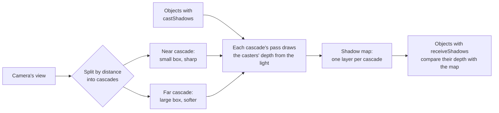
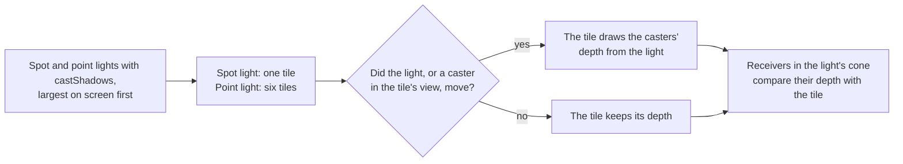
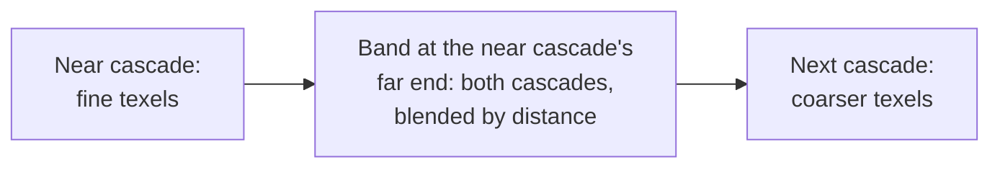
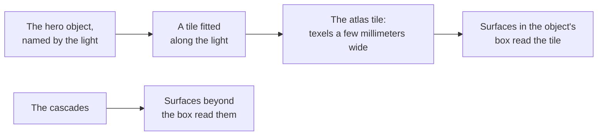

# Shadows

> Roadmap step 0.1, first released in null3D 0.1.0. The API is experimental, so it can still change between versions. In this version the first directional light, spot lights and point lights cast shadows. Instance batches cast and receive them since 0.2, and the directional light draws contact shadows since 0.2. Coding agents must not rely on these parts.



A directional light casts shadows when you create it with `castShadows: true` or call `setCastShadows(true)`. An object casts shadows with `castShadows: true`, and shadows fall on it with `receiveShadows: true`. All three are false by default, as in three.js.

An [instance batch](instances.md) takes the same two options in `scene.createInstances`, and the setters `setCastShadows` and `setReceiveShadows`. They hold for every row, as three.js's `castShadow` and `receiveShadow` hold for every instance of an `InstancedMesh`. Each cascade and each light's tile culls the rows one by one, as the camera's view does. A dynamic batch that casts counts as a moving caster: a far cascade that its rows touch draws in every frame while `followMovingCasters` is on. Sprite, point and line batches cast and receive no shadows.

The engine splits the camera's view by distance into cascades. Each cascade is a box along the light that holds one slice of the view. Near slices are short and far slices long, so each cascade covers about the same share of the screen. Shadows near the camera then stay sharp. When a cascade draws, it culls the casters in its box and draws their depth from the light into its layer of the shadow map. A surface that receives shadows then finds its cascade by its distance from the camera. It compares its depth from the light with the depth in the map.

```ts
import { defineSketch } from '@null3d/engine';

export default defineSketch(({ scene, geometry, materials }) => {
  const camera = scene.createPerspectiveCamera({ position: [0, 5, 12], target: [0, 0, 0] });
  scene.setActiveCamera(camera);
  scene.createDirectionalLight({
    direction: [-1, -1.5, -0.5],
    intensity: 3,
    castShadows: true,
    shadow: { cascades: 3, mapSize: 2048, distance: 100 },
  });
  scene.createAmbientLight({ intensity: 0.4 });

  // The ground receives shadows. The box casts them and receives them.
  scene.createMesh({
    mesh: geometry.box({ width: 50, height: 0.2, depth: 50 }),
    material: materials.standard({ color: '#9aa0a8' }),
    position: [0, -0.1, 0],
    receiveShadows: true,
  });
  scene.createMesh({
    mesh: geometry.box(),
    material: materials.standard({ color: '#e8554e' }),
    position: [0, 0.5, 0],
    castShadows: true,
    receiveShadows: true,
  });
});
```

## Spot and point light shadows



A spot or point light casts shadows when you create it with `castShadows: true` or call `setCastShadows(true)`. Casters and receivers need `castShadows` and `receiveShadows`, as for the directional light.

Spot and point lights share one shadow atlas: a depth texture of equal tiles. A spot light takes one tile, a view from the light that holds its cone. A cone wider than 85 degrees from its direction casts shadows over its middle part alone. A point light takes six tiles, one for each face of a cube around it. A surface reads the tile of the face that its direction from the light points through. Each tile's view keeps 3 texels inside each edge, as far as the 5 x 5 filter reads. So the filter never reads past what the tile drew, and no seam shows where two faces meet.

Point light shadows cost six times as much as a spot light's, so the quality preset's `pointLightShadows` setting turns them on for High and Ultra alone. The `pointLightShadows` option of `createEngine` turns them on or off on any preset. Where they are off, point lights still light surfaces.

```ts
import { defineSketch } from '@null3d/engine';

export default defineSketch(({ scene, geometry, materials }) => {
  const camera = scene.createPerspectiveCamera({ position: [0, 5, 10], target: [0, 0, 0] });
  scene.setActiveCamera(camera);
  scene.createSpotLight({
    position: [-3, 6, 2],
    target: [0, 0, 0],
    range: 15,
    angle: 0.6,
    penumbra: 0.2,
    intensity: 100,
    castShadows: true,
  });
  scene.createAmbientLight({ intensity: 0.2 });

  scene.createMesh({
    mesh: geometry.box({ width: 20, height: 0.2, depth: 20 }),
    material: materials.standard({ color: '#9aa0a8' }),
    position: [0, -0.1, 0],
    receiveShadows: true,
  });
  scene.createMesh({
    mesh: geometry.box(),
    material: materials.standard({ color: '#e8554e' }),
    position: [0, 0.5, 0],
    castShadows: true,
    receiveShadows: true,
  });
});
```

### Which lights get tiles

The quality preset's `shadowTiles` setting caps the tiles, and `shadowTileSize` sets the texels on each side of each tile. [Quality presets](quality-presets.md) lists their values. The atlas grows to as many tiles as the lights that cast shadows can fill, and one more while the sun names a [hero shadow](#a-hero-shadow). A hero's tile size above `shadowTileSize` sets the size of every layer. It keeps them when a light stops casting, so a light whose shadows turn off and on again does not make the atlas again. It goes when no light casts shadows and no light names a hero.

Each frame, the spot and point lights in the camera's view compete for the tiles. A light's size on screen is its range over its distance from the camera, and the largest lights get tiles first. A point light needs six free tiles, so a smaller spot light can take the last tile that a point light cannot use. A light keeps its tile from frame to frame while it still gets one. The other lights cast no shadows in that frame, and they still light surfaces.

### When a tile draws

A tile keeps its depth from frame to frame. It draws again only when:

- it goes to another light;
- its light moves or turns, or its range, cone or layers change (a point light's tiles do not change when it turns);
- a caster in the tile's view moves, turns, scales, shows, hides or changes its layers, or leaves the view;
- a skinned or morphed caster in the tile's view changes its pose or its weights, even where it stands still;
- objects are created or destroyed, or their meshes, materials or shadow flags change.

A caster marks only the tiles whose views it touches. A caster near a point light touches one to three of its six faces, so only those draw again.

A tile whose view does not reach into the camera's view waits. No surface on screen reads it, so it draws when the camera turns toward it.

A tile that holds no depth for its light yet draws at once. Other tiles that must draw again share a cap of 12 per frame. More must draw when many casters move near several point lights. Then the lights whose tiles waited longest draw first, then the largest on screen. The others keep their last depth for a frame or two, and their shadows lag for that time. So a burst of movement does not make one long frame.

A scene whose casters and lights stand still draws no tile. Make static casters static, and keep moving objects out of the ranges of shadowed spot and point lights when you can.

## Settings

The `shadow` option of `createDirectionalLight` and the light's `setShadow` call take these settings. Each one has a default, and `setShadow` changes only the settings you give it.

| Setting | Default | What it does |
| --- | --- | --- |
| `cascades` | The preset's `shadowCascades` | The cascades, from 1 to 4. More cascades keep shadows sharp further from the camera, and each draws the casters once more. |
| `mapSize` | The preset's `shadowMapSize` | Texels on each side of each cascade's layer: 256, 512, 1,024, 2,048 or 4,096. |
| `distance` | `'auto'` | How far from the camera, in meters along its view, shadows fall, or `'auto'` to follow the farthest visible receiver. The camera's far plane ends them sooner. Shadows fade out over the last tenth of the distance. A camera under a scaled parent keeps the distance in meters. |
| `bias` | 0.01 | How far each receiving surface moves toward the light before its test, in meters, up to one texel of its cascade, scaled by its angle to the light. |
| `normalBias` | 0.02 | How far each receiving surface moves along its normal before its test, in meters, up to one texel of its cascade, scaled by its angle to the light. |
| `contactDistance` | 0.3 | How far [contact shadows](#contact-shadows) reach from each surface toward the light, in meters. 0 turns them off for this light. |
| `hero` | None | The object that gets a [hero shadow](#a-hero-shadow) of its own, or `null` for none. |
| `heroTileSize` | The preset's `heroTileSize` | Texels on each side of the hero's tile: 1,024, 2,048 or 4,096. A larger tile keeps a larger object's shadow sharp. |

The quality preset gives the default cascade count and map size: the lighter presets draw fewer cascades and smaller maps ([Quality presets](quality-presets.md#the-settings-of-each-preset)). A light that names its own keeps them on every preset. So leave both out, unless your scene needs other values on every device.

A shorter `distance` gives the cascades smaller boxes, so shadows get sharper. Set it to the distance at which shadows still matter in your scene. The default, `'auto'`, does this for you. The engine finds the farthest surface that receives shadows in the camera's view each frame. It rounds that distance up on a ladder of 1.25 times per step. Shadows in a small scene then get much finer texels than a fixed 200 m. The distance holds for one step before it falls, so a raw distance that moves across a step does not flicker. A light that names a number keeps it, as a port of a scene with a fixed shadow distance does.

`'auto'` grows with the farthest receiver in view. It measures to the far side of each receiver's bounding sphere. So one large ground mesh sets a long distance, even when the camera sees only a small part of it. Where the ground stretches far, such as a valley seen end to end, the shadows near the camera then turn coarse. Give far scenery that needs no shadows, such as distant hills, `receiveShadows: false`. Split a large ground into tiles, so that only the tiles in view count.

### A fixed distance and a camera that zooms

A fixed `distance` suits a camera that stays near its subject. An orbit camera that zooms out carries the whole subject past the distance at once. Its shadows then vanish, and they come back when the camera zooms in again. Use `'auto'` for such a camera, or set the distance in every frame from the camera's distance to the subject. Round it up on a ladder of steps, and let it fall only a whole step later, as `'auto'` does. Then a camera that hovers at a step does not flicker between two distances:

```ts
const BASE = 30; // The distance close up, in meters.
const STEP = 1.25;
let held = BASE;

/** The shortest step up from the base that reaches `need`; it falls only a whole step below the held step. */
function shadowStep(need: number): number {
  const steps = Math.max(0, Math.ceil(Math.log(need / BASE) / Math.log(STEP) - 1e-9));
  const up = BASE * STEP ** steps;
  return up > held || need < held / STEP ** 2 ? up : held;
}

// In onUpdate: the distance along the view to the subject's far side.
const next = shadowStep(alongView + subjectRadius);
if (next !== held) {
  held = next;
  sun.setShadow({ distance: held });
}
```

A new cascade count or map size makes the shadow map again, so set them at setup. The other settings cost nothing to change, so a sketch can change them in any frame.

The `shadow` option and `setShadow` of spot and point lights take `bias` and `normalBias` alone, with the same defaults. Both are in meters, up to one texel of the light's tile at the receiving surface's distance from the light. The preset sets the tile size.

## Where the cascades split

The split distances blend two spreads. An even spread gives each cascade the same length. A logarithmic spread makes each cascade a fixed number of times longer than the one before it. The engine leans 65% toward the logarithmic spread. This is a balance between two kinds of view:

- A camera at eye height sees the ground a few meters ahead. Shadows there need the finest texels.
- A camera high above a town, as in the S4 benchmark scene 42 m up, sees no ground nearer than about 40 m.

With the default settings, a 60 degree view and a 16:9 canvas, one texel of each cascade covers this much of the ground:

| Lean toward logarithmic | First cascade | Second cascade | Third cascade |
| --- | --- | --- | --- |
| 80% | 0.1 to 14 m: 1.7 cm | 14 to 39 m: 4.5 cm | 39 to 200 m: 23 cm |
| 65%, the engine's split | 0.1 to 24 m: 2.8 cm | 24 to 57 m: 6.6 cm | 57 to 200 m: 23 cm |
| 50%, as three.js's cascaded shadows split | 0.1 to 34 m: 3.9 cm | 34 to 75 m: 8.6 cm | 75 to 200 m: 23 cm |

At 80%, the town's ground from 40 to 57 m gets 23 cm texels, and its shadow edges show steps. At 50%, the shadows at the feet of a camera at eye height are more than twice as coarse, and they look soft and streaked. The engine's 65% keeps them less than twice as coarse as at 80%, and gives the town most of the texels that 50% gives it.

The last cascade always ends at `distance`, so its texels depend only on `distance` and `mapSize`. For a view that sees mostly far ground, shorten `distance` or add a cascade.

## Stable cascades

Shadow edges stay still while the camera turns and moves. Each cascade's box holds a sphere around its slice of the view, so the box keeps its size as the camera turns. The box also moves only in steps of whole texels of the shadow map, on a grid fixed to the world. So a caster always covers the same texels, and its shadow's edge does not crawl or shimmer. Along the light, the box moves only in whole steps of the map's 16-bit depth. So each caster's stored depth rounds the same way in every frame. A surface near a caster then does not flicker between light and shadow as the camera moves. To see it, draw the `'shadows'` debug view from a still camera while `debug.shadowCamera` places the cascades from a moving one ([Debug drawing and stats](../api/debug.md#watch-the-shadow-cascades-from-elsewhere)).

The sphere wastes some of each layer's texels, so these shadows are a little softer than a box fitted tightly to each frame. Shorten `distance` or raise `mapSize` for sharper shadows.

A surface picks its cascade by its distance from the camera, which a turn on the spot does not change. So a surface keeps its cascade while the camera turns, and its shadow keeps the same texels. A surface near the side of a wide view can then read a coarser cascade, so its shadow is a little softer. Behind an orthographic camera, whose cascades all have texels of one size, a surface uses its distance along the camera's view instead.

A surface near the side of the view is further from the camera than along its view. So each cascade's box holds every surface whose distance from the camera falls in the cascade, at the sides of the view too. Each box starts along the view where the view's corners reach that distance. Narrow views need this most: their boxes are long and thin.

## Blending between cascades



Each cascade's texels are larger than those of the cascade before it, so its shadows are softer. Where one cascade hands over to the next, a shadow's edge would change its softness at once, and a line could show across the ground. So over a band at the far end of each cascade but the last, a surface blends the shadows of both cascades. At the band's start the surface takes its own cascade's shadow, and at the cascade's end the next cascade's. Between them the blend changes linearly with the distance from the camera.

The `shadowCascadeBlend` quality setting gives the band as a share of each cascade's length: 0.1 on every preset. With the default settings, the first cascade blends into the second from about 21.6 m to 24 m. 0 hands over at once. Only the band's pixels read a second cascade, so a wider band costs a little more. It changes during play:

```ts
import { defineSketch } from '@null3d/engine';

export default defineSketch(({ quality }) => {
  // A wider band, for a view that sees much ground across a hand-over.
  quality.set({ shadowCascadeBlend: 0.2 });
});
```

Each cascade's box starts at the band of the cascade before it, so it holds the band's surfaces as well as its own slice. The last cascade has no band: its shadows fade out over the last tenth of `distance` instead.

## Update rates

The nearest cascade draws in every frame. The far cascades draw once every few frames, in turn, and keep their layers of the shadow map in between. Each frame then draws fewer casters. In S4 on a MacBook Pro, with far cascades every 2nd frame, that saves 0.19 ms of GPU time per frame.

A kept layer shows each caster where it stood when the layer drew. So on every preset, a far cascade draws in every frame while a moving caster touches its box. A moving caster is a dynamic object, or an object under a dynamic one. Its shadow then follows it in every frame. The cascade draws once more after the caster leaves, so no old shadow stays behind. Far cascades that hold only still casters keep their turns. A town whose cars drive through every cascade, as in S4, draws every cascade in every frame, as three.js's cascaded shadows always do. A character near the camera keeps the far cascades' saving.

A camera high above a scene can see nothing near enough for the nearest cascade. S4's camera flies 42 m up, and Low's nearest cascade ends 38 m from the camera. So every shadow on screen comes from the far cascade. That is why far cascades follow moving casters on Low too.

The `followMovingCasters` quality setting turns this off. Each far cascade then keeps its turns, even while moving casters touch it, and the frames draw fewer shadow passes. A moving shadow in a far cascade then trails its caster until the cascade's next turn: up to 3 frames at Low's interval of 4. The quality governor then leaves `farCascadeInterval` as you set it, so the trail never grows. The setting changes during play:

```ts
import { defineSketch } from '@null3d/engine';

export default defineSketch(({ quality }) => {
  // A scene whose moving objects stay far away and small: save the far cascades' passes.
  quality.set({ followMovingCasters: false });
});
```

A static object that a setter moves does not make its cascade draw. Its far shadow follows it within a few frames.

The `farCascadeInterval` quality setting sets the frames between two draws of a far cascade, from 1 to 8. Low uses 4, Medium 3, and High and Ultra 2. A value of 1 draws every cascade in every frame. It changes during play:

```ts
import { defineSketch } from '@null3d/engine';

export default defineSketch(({ quality }) => {
  // Static objects that move often far away: draw every cascade in every frame.
  quality.set({ farCascadeInterval: 1 });
});
```

A cascade that waits keeps the box it drew with. When the camera moves or turns, its view can leave that box. Then the cascade draws at once, out of its turn, so no surface is left without a cascade. This happens after a camera cut, such as a respawn or a switch to another camera, and after a quick turn. A camera that moves smoothly, as S4's does, keeps the far cascades to their turns: the boxes hold its view until their next turns.

## Filtering

The filter softens each shadow's edge over a square of shadow map texels. The `shadowFilter` quality setting gives the texels on each side: 3 on Low, and 5 on Medium, High and Ultra. Each read takes four texels. So a 3 x 3 square takes 4 reads, and a 5 x 5 square takes 9. A larger square gives softer edges and costs more on every pixel that receives shadows. `quality.set({ shadowFilter: 3 })` changes it during play. The tiles of spot and point lights use the same filter, over texels of the tile.

Each read weights the texels by where the point falls between them, so an edge moves smoothly as the point moves. But each texel holds only "lit" or "shadowed". Where one texel covers several pixels, an edge at a shallow angle to the texel grid still shows soft steps, one texel apart. The 5 x 5 filter makes the steps fainter, and no filter of a few texels removes them. More texels per meter remove them. For the directional light, use a shorter `distance`, a larger `mapSize` or another cascade. For spot and point lights, use a larger `shadowTileSize`.

## Bias

A surface that casts and receives shadows can shadow itself in stripes, which is called shadow acne. It comes from the finite size of the map's texels. Both biases move the surface before its test, in meters:

- `bias` moves the surface toward the light. The move is the setting times the tangent of the angle between the surface and the light, up to twice the setting.
- `normalBias` moves the surface along its normal, by the setting times the sine of that angle.

A surface that faces the light takes little of either. A surface at a steep angle takes more, because its depth changes faster across each texel. The casters draw only the faces that point away from the light, as three.js's shadows draw them. A closed mesh's lit faces then compare with its far side, which keeps acne off most surfaces. A caster that draws both faces, such as a plane with a double-sided material, is the likeliest to show acne.

A bias in meters keeps its size in every cascade. So where a shadow meets its caster does not change where one cascade gives way to the next. One texel of the surface's cascade caps each bias, as a fine map needs less. With the defaults, the cap acts only where a texel covers less than 2 cm.

The biases of spot and point lights work the same way, in meters. One texel of the light's tile at the surface's distance from the light caps them.

The shadow map stores each depth in 16 bits. So it holds 65,535 steps of depth from each cascade's face toward the light to its far face. A cascade's box reaches far toward the light, to hold every caster that can shadow its slice. A step is then a few millimeters in a near cascade. In the last cascade of the S4 benchmark, which ends 200 m out, it is about 14 mm. A stored depth can sit up to one step from the caster's true depth. So in each cascade, `bias` and the plane margin that [Flat casters](#flat-casters) describes cover at least one and a half steps. Where the setting is smaller, the engine uses that floor. It changes nothing in the near cascades, where a step is shorter than the defaults.

Values that are too large make shadows start a little away from their casters. A thin lit line then shows at each object's base. Raise the biases in small steps if a surface shows acne. A bias above one texel acts as one texel.

### Where shadows meet their casters

A box's bottom face lies on the ground, and it points away from the light, so it draws into the map at the ground's depth. Near the box's base, some of the filter's reads land under the box. There the ground and the bottom face have equal depths, and those reads come out lit. A thin lit line would then show at the base, even with no bias.

So the engine moves each caster's faces that point away from the light toward the light before it draws them. The move is up to one texel of the map at the face, and at most 5 cm. A face that points straight away from the light, such as a box's bottom under a high sun, moves the most. A face that the light only grazes moves little, so the caster's lit faces keep their light up to their edges. A double-sided material's faces stay in place, because they hold the caster's lit side. Spot and point lights move faces by texels of their tiles in the same way.

The engine's contact check measures the light between a box's base and the start of its shadow, in pixels of full light. For car-sized boxes under S4's sun, in Chrome on a Mac with WebGPU, the move took it from 0.16 to 0.02 pixels near the camera. In the last cascade, it took it from 0.20 to 0.08 pixels. In S4's own frame, it halved the figure.

The 5 cm cap protects floors that cast shadows. Such a floor compares its lit top with its own bottom. Where a texel is larger than the floor is thick, as in a far cascade, its top could shadow itself. With the cap, a floor 20 cm thick stays clear. Give a ground that needs to cast no shadows `receiveShadows` alone, as S4's streets have.

### Flat casters

A low flat caster, such as a pavement slab, holds its bottom face in the map under its lit top. The top and the bottom are parallel. So across the filter's square, the bottom rises toward the light as fast as the top does. Suppose every read compared with the depth at the surface's own point. The reads on the side toward the light would then find parts of the bottom nearer the light than that point. The top would shadow itself in stripes and rings.

So the directional light's filter compares each texel with the receiving surface's own plane at that texel's center. It does so where the plane is nearer the light than the surface's point. The plane lies 1 cm below the surface, or one and a half steps of the map's stored depth where those are longer. So a caster just under the surface stays under the plane. A caster below the plane, such as the slab's own bottom, then leaves the top lit, however large the texels are. A caster on the plane or above it, such as a box that stands on the slab, still shadows it. So the shadow still meets the box's base. The filter reads four texels at once and compares each with its own depth. So it takes as many reads as a filter that compares them all with one depth.

The tiles of spot and point lights compare each read with the depth at the surface's own point. Their views are not orthographic, so a surface's plane is not a plane in the tile.

## Contact shadows

The cascades cannot hold the smallest shadows. Their texels are a few centimeters wide, the filter blurs over 3 or 5 of them, and the biases move each surface toward the light. So a stone in a stream bed, a foot, a wheel or a crate's edge can lose the dark line where it meets the ground. Contact shadows add those short shadows from the camera's depth.

From each surface, a short ray goes toward the light, `contactDistance` meters long. It steps across the depth that the camera's view holds. Where a step lies behind a nearer surface, the ray is blocked, and the surface takes a contact shadow. A step that lies far behind a surface does not count, so a thin pole does not cast a long shadow. The shadow fades over the second half of the ray, so it ends softly.

```ts
const sun = scene.createDirectionalLight({
  direction: [-1, -2, -1],
  intensity: 3,
  castShadows: true,
  // Longer contact shadows, for a scene of large rocks.
  shadow: { contactDistance: 0.6 },
});
// No contact shadows from this light.
sun.setShadow({ contactDistance: 0 });
```

They follow these rules:

- Only the first directional light draws them, and only while it casts shadows. Spot and point lights draw none.
- The quality setting `contactShadowSteps` sets the steps of each ray: 8 on High and 16 on Ultra. Low draws none. Medium draws 4 on WebGL2 and none on WebGPU. `quality.set({ contactShadowSteps: 4 })` turns them on for any preset.
- They darken the light's direct light only, on surfaces that receive shadows. Ambient and environment light stay as they are.
- They darken only a face that the camera sees from the light's side. The ray starts from the face that the camera sees. On a face that looks away from the light, it would run through the surface itself.
- A material with `contactShadows: false` takes none of them, and keeps the shadow map's shadows. Its surfaces still block rays, so the surfaces under them keep their contact shadows.
- Every opaque object in the depth can block a ray, whether it casts shadows or not. Blended objects, sprites and particles block none.
- They come from what the camera sees. An object off the screen, or hidden behind another, casts no contact shadow. They fade out at the screen's edges.
- A longer `contactDistance` finds larger contacts, with the same steps further apart. Keep it short, under a meter, and use the cascades for long shadows.

The rays run at half the render size each way, in the same full-screen step as [ambient occlusion](post-processing.md#ambient-occlusion). They read its copy of the depth prepass. Each pixel then takes the result of the four nearest texels whose depth is close to its own, so the shadows keep to their surfaces at edges. A masked surface draws no depth in the prepass, so it takes contact shadows only where a texel lies at its own depth. A petal in front of grass does not take the grass's contact shadows. The steps start at a different point at each texel, which turns banding into a fine grain that this blend softens.

### Grass and other thin surfaces

A ray cannot tell a thin blade from a solid wall. A step that lies behind a blade counts as blocked, up to half of `contactDistance` behind it. So in dense grass, most blades take a contact shadow from the blades in front of them, and the grass turns dark and grainy. As the blades sway, the steps that land on a blade change from frame to frame, and the grass shimmers. Leaf cards, petals and other thin surfaces that crowd together do the same.

Give such materials `contactShadows: false`. They keep the shadow map's shadows, and the ground under them keeps the short shadows at their roots.

```ts
const grass = materials.standard({
  color: '#5f9a2a',
  doubleSided: true,
  // Thin blades that sway: no contact shadows on them.
  contactShadows: false,
});
```

## A hero shadow

The cascades spread their texels over the whole view, so a car, a character or a product in close-up gets shadows that are a few centimeters coarse. A hero shadow gives one object a shadow map of its own, fitted tightly to it, and surfaces near it read that map instead.



```ts
const car = scene.createMesh({ mesh: carMesh, castShadows: true, receiveShadows: true });
const sun = scene.createDirectionalLight({
  direction: [-1, -2, -0.5],
  intensity: 3,
  castShadows: true,
  shadow: { hero: car },
});
// Later, or for another object. The second number is the tile size, which this one raises.
sun.setHeroShadow(car, 4096);
// Back to the cascades alone.
sun.setHeroShadow(null);
```

It follows these rules:

- Only the first directional light draws one, and only while it casts shadows, and only in the frame's main camera view.
- The object casts shadows (`castShadows: true`) and the light shares its layers. A hero that does not cast draws an empty tile.
- The box fits the object's bounding sphere. A mesh takes its mesh's bounds; a group has none of its own, so give it a `setBounds` sphere. An object with no bounds draws no hero shadow.
- The tile is square across the light around the object's bounding sphere, and reaches past it along the light by sixteen times the sphere's radius, where its shadow lands. A surface of the object, or one within that distance below it, reads the tile. Further out, the cascades shadow it.
- The tile spreads its texels over the object's bounds. A larger tile gives a larger object finer shadows. `heroTileSize` sets the size. The preset chooses the default: 1,024 on Low, 2,048 on Medium and High, and 4,096 on Ultra. At those defaults the demo's 4.4 m car gets at least four times the texel density of the cascade that holds 10 m, on every preset. A bigger object needs a bigger tile for the same ratio, and a page can name one.
- The tile comes from `shadowTiles`, the atlas that point and spot lights share. Naming a hero adds a layer to the atlas for it, so the lights keep their tiles; only an atlas already at its limit of 24 layers gives one up, to the light that looks smallest. A hero makes the atlas while no spot or point light casts.
- Every layer of a texture array takes the same size, so the tile sets the atlas's size. A tile larger than the preset's `shadowTileSize` makes every tile of the atlas that size, which takes more memory and draws each light's tile with more texels. An atlas above 1 GiB fails the frame with [E1501](../errors/E1501.md), which names the megabytes it would take; name a smaller `heroTileSize` or fewer `shadowTiles`.
- The tile draws when the light, the object or a caster that touches its box moves, and rests otherwise. A tile holds 4 bytes per texel: 4 MiB at 1,024 texels on each side, 16 MiB at 2,048 and 64 MiB at 4,096.
- The object's own shadow uses the light's `bias` and `normalBias`, capped by the tile's small texels, so it sits close to its caster.
- The shadow distance does not cut it, and it does not fade: the light names the object, so its shadow shows wherever the box goes.

A hero shadow suits a scene with one subject in close-up. When several objects need sharp shadows, or the camera moves far from them, prefer a shadowed spot light aimed at the subject. It takes one tile of the same atlas.

### Where the box ends

The box holds the object, a radius of space above it and sixteen radii below, where its shadow lands. A hero that stands far above the ground, such as a bird, then shadows nothing past the box's far face. An object that another object shadows keeps that shadow only where the caster lies in the box too, which reaches one radius past the hero toward the light. Keep a hero in scenes where it stands alone: a showroom floor, a starting grid, a plinth.

## Which objects cast and receive

- The first directional light created casts the shadows, if it has `castShadows`. Up to three more directional lights light surfaces as fill and rim lights, and cast none. A fifth directional light lights nothing.
- Each spot light with `castShadows` casts shadows while it holds a tile of the atlas. Each point light with `castShadows` casts them while it holds six, where the preset's `pointLightShadows` is on.
- A caster draws into every cascade whose box it reaches, however far toward the light it stands.
- The light's layers choose the casters: an object casts only when its layer mask shares a bit with the light's. The light still lights every object in a view that it shares a layer with. So an object with `castShadows` on a layer that the light lacks casts nothing, with no warning, and the light shines through it. Give the light that layer too ([Layers and shadows](render-layers.md#layers-and-shadows)). three.js tests casters against the camera's layers instead.
- The standard material and [custom materials](../shaders/surface-functions.md) show shadows. The unlit material shows none, but unlit objects still cast them.
- A masked surface cuts the holes of its mask into its shadow, so leaves and fences cast leaf and fence shapes. The shadow tests the surface's opacity, vertex alpha and base color map's alpha against its `alphaCutoff`. A hashed surface casts a hashed shadow, which the filter turns into a partial shadow as dense as its alpha. A blended surface casts its whole shape, as in three.js.
- A custom material casts its mesh's whole shape: its alpha comes from its own WGSL, which the shadow pass does not run.
- `setCastShadows` and `setReceiveShadows` rebuild the engine's tables of what it draws, as `setMaterial` does. Set them at setup rather than in every frame.

## What shadows cost

Each cascade that draws in a frame has a render pass that draws its casters' depth. It culls its casters too:

- On WebGPU, a culling pass on the GPU runs before each cascade's render pass. The CPU does the same small amount of work per cascade whatever the number of casters. On a device that draws directly, the job workers test the casters on the CPU, as on WebGL2.
- On WebGL2, the job workers test each caster against each cascade's box, as they test each object against the camera's view. They first skip the still casters of the grid cells out of the box. That CPU work grows with the number of casters.

A masked caster runs a fragment shader that tests its alpha, where other casters run none. So cut-out foliage costs more GPU time in each shadow pass than solid shapes. Its shader builds load the first time a masked caster draws, and it casts no shadow until they are ready. To load them before the first frame instead, pass `preload: ['cutout']` to `createEngine`.

Each layer of the shadow map takes 2 bytes per texel: 8 MiB at 2,048 texels on each side. That is half of what 32-bit depth takes, and each cascade's pass writes half the bytes. On a phone's GPU, which keeps a pass's depth in its own fast memory and then writes it out, those writes cost bandwidth. Each read of the map fetches half the bytes too. [Quality presets](quality-presets.md#the-settings-of-each-preset) gives the memory of each preset. Surfaces that receive shadows read the map 4 or 9 times per pixel, as the filter's size says. On WebGL2 they read each texel on its own: 16 or 36 reads. Surfaces in a band between two cascades read both cascades, so twice as many.

A tile costs a render pass and its culling, but only in the frames in which it draws. A point light draws the tiles of the faces that a moving caster touches, and at most 12 tiles draw again in a frame. Its culling runs on the GPU on WebGPU, and on the job workers on WebGL2. Each tile takes 4 bytes per texel: 4 MiB at 1,024 texels on each side. A receiving surface reads one tile for each shadowed light that reaches it, 4 or 9 times per pixel, as for the cascades.

A hero shadow adds one more tile pass, which draws only the casters in its box. It draws in the frames where the hero moves, like a moving caster's light tile. Surfaces in the hero's box read one more layer of the atlas, 4 or 9 times per pixel. The surfaces outside it pay one matrix multiply and a comparison, and read nothing.

Contact shadows need the depth prepass. WebGL2 draws it on every preset. On WebGPU they turn it on while they draw, which costs a second pass over the opaque objects' vertices. They then cost one copy of the depth at half the render size, and one ray of `contactShadowSteps` reads per texel at that size. A blur then smooths the rays' noise without crossing objects' edges. With ambient occlusion on, they share its copy, its horizon step and its denoise.

To make shadows cheaper, use fewer cascades, a smaller map, a shorter distance, a higher `farCascadeInterval` or a `shadowFilter` of 3. Mark only the objects whose shadows matter as casters. For spot and point lights, give shadows only to the lights that need them, and keep their ranges short. Prefer a spot light to a point light where a cone covers the area.

## On each GPU path

WebGPU and WebGL2 draw the same shadows. Both keep the shadow map as a depth texture array of 16-bit depths, `depth16unorm` on WebGPU and `DEPTH_COMPONENT16` on WebGL2. Both keep the shadow atlas as a depth texture array of 32-bit floats. A tile's view is a perspective view, which spends most of its depth's steps near its light. In 16 bits, one step near a tile's far end would be about 1.5% of the distance from the light: 15 cm at 10 m. The atlas is read with the GPU's depth comparison, which blends the tests of the four nearest texels, and the filter blends several comparisons. On WebGL2 the shaders read it as a `sampler2DArrayShadow` through a comparison sampler. The directional light's filter reads the depths of the shadow map's texels and compares them itself. WebGPU reads four texels at once. WebGL2's shading language has no such read, so there it reads each texel on its own, four times as many reads. Each comparison on WebGL2 reads the map at its own level, which Apple's GPUs run faster than a read at a set level. [Depth on each tier](backends.md#depth-on-each-tier) explains how WebGL2 keeps WebGPU's depth values.

## Coming from three.js

- `renderer.shadowMap.enabled` has no equivalent: a light casts shadows when it has `castShadows`.
- `object.castShadow` and `object.receiveShadow` become `castShadows` and `receiveShadows`.
- `light.shadow.camera` has no equivalent. The cascades fit the camera's view by themselves, so delete the shadow camera's bounds.
- `light.shadow.mapSize` becomes one number, `mapSize`, the texels on each side.
- `light.shadow.normalBias` is in meters, as in three.js. `light.shadow.bias` is in meters too, where three.js counts depth units. Both scale with each surface's angle to the light, and one texel caps them. Start from the defaults.
- `renderer.shadowMap.type` becomes the `shadowFilter` quality setting: `PCFShadowMap` and `PCFSoftShadowMap` map to 3 or 5. `BasicShadowMap` and `VSMShadowMap` have no equivalent.
- `light.shadow.radius` and `light.shadow.blurSamples` become the `shadowFilter` setting too, for every light.
- The CSM addon is built in: set `cascades` on the directional light. Its `maxFar` and `shadowMapSize` become `distance` and `mapSize`.
- The CSM addon's `fade` option blends the cascades where they meet. null3D blends them by default, over the `shadowCascadeBlend` band. `fade: false` hands over at once, as `shadowCascadeBlend: 0` does.
- A spot or point light's `shadow.mapSize` has no equivalent. The quality preset sets the size of every tile. `shadow.camera` has none either, as the tiles fit the light by themselves.
- A material with `alphaTest` cuts its shadow at `alphaTest` in three.js, and so does a masked material in null3D, at `alphaCutoff`. With `alphaToCoverage`, three.js cuts at 0.5, and null3D at `alphaCutoff`. With `alphaHash`, three.js casts the whole shape, and null3D a hashed shadow.
- three.js draws a spot or point light's shadow map in every frame. null3D draws a tile only when its light or a caster in its range moves.
- three.js has no contact shadows, so a ported scene gains them on High and Ultra. Set `contactDistance: 0` on the light to match three.js's look. drei's `ContactShadows` component is another technique, a blurred shadow on a ground plane, which null3D does not draw.
- three.js has no hero shadow. A port that fakes one with a second shadowed light, or with a hand-fitted shadow camera, can replace it with `hero`, which follows the object without a camera of its own.

## Related pages

- [Lights](../api/lights.md): the directional light's options and calls.
- [Objects and transforms](../api/objects.md): `setCastShadows` and `setReceiveShadows`.
- [Lighting and environment](lighting.md): how lights reach surfaces.
- [Render graph](render-graph.md): the passes that draw each frame.
- [Quality presets](quality-presets.md): `shadowCascades`, `shadowMapSize`, `shadowFilter`, `farCascadeInterval`, `followMovingCasters`, `shadowCascadeBlend` and their values on each preset.
- [The hero shadow demo](https://github.com/null3d-engine/null3d/tree/main/examples/hero-shadow): a car on a launch pad whose own shadow map turns off and on every 3 seconds, beside shadows from the cascades.
