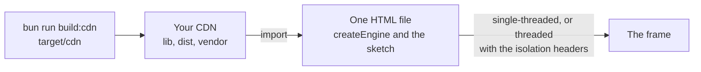

# Try null3D from a CDN

> Roadmap step 0.2, first released in null3D 0.1.0. The API is experimental, so it can still change between versions.

A page can draw a null3D scene with no build step: one HTML file that imports the engine from a CDN. This suits a quick trial, a documentation example or a CodePen-style page. A project that grows past a trial uses Vite and the plugin, as [Install null3D](install.md) shows.



## Make the CDN build

The build holds the engine's JavaScript, its shaders, both WebAssembly builds and its vendor files. The npm package leaves the built shaders out, because they are large and a Vite build supplies them. A page with no build step therefore needs this folder.

```sh
bun run build
bun run build:cdn
```

`bun run build` builds the WebAssembly core. `bun run build:cdn` then writes the folder `target/cdn` in a minute or two. The folder is large: most of it is the shader builds for each kind of device. Upload the folder to your CDN under one prefix, such as `https://cdn.example.com/null3d/`, and keep its layout. `--out <folder>` writes it somewhere else:

```sh
bun run build:cdn --out ~/sites/null3d
```

Give every file a CORS header, because the engine imports its modules and downloads its `.wasm` files in CORS mode:

```http
Access-Control-Allow-Origin: *
```

## One HTML file

Save this page, change the CDN address to your own, and serve it from a web server. A browser refuses the modules and workers of a page opened from a file on disk.

```html
<!doctype html>
<html lang="en">
  <head>
    <meta charset="utf-8" />
    <title>null3D from a CDN</title>
    <style>
      html, body { margin: 0; height: 100%; }
      canvas { display: block; width: 100%; height: 100%; }
    </style>
  </head>
  <body>
    <canvas id="scene"></canvas>
    <script type="module">
      const CDN = 'https://cdn.example.com/null3d/';

      // The sketch is a module of its own, so the engine can run it in a worker or on this thread.
      const sketch = `
import { defineSketch } from "${CDN}lib/index.js";

export default defineSketch(({ scene, geometry, materials }) => {
  scene.setBackground('#0b1220');
  const camera = scene.createPerspectiveCamera({ position: [0, 1, 4], target: [0, 0, 0] });
  scene.setActiveCamera(camera);
  scene.createMesh({
    mesh: geometry.box(),
    material: materials.unlit({ color: '#ff6a00' }),
  });
});
`;

      const { createEngine } = await import(`${CDN}lib/index.js`);
      await createEngine({
        canvas: document.querySelector('#scene'),
        sketch: URL.createObjectURL(new Blob([sketch], { type: 'text/javascript' })),
      });
    </script>
  </body>
</html>
```

The sketch is a module at a `blob:` address, which the page makes from the string. It imports the engine from the CDN by its full address. That works in a worker too, where a page's import map does not reach.

## Import maps

An import map gives the engine its package name, as a bundled project has it. Then the sketch and the page write `@null3d/engine`:

```html
<script type="importmap">
  {
    "imports": {
      "@null3d/engine": "https://cdn.example.com/null3d/lib/index.js",
      "@null3d/engine/stats": "https://cdn.example.com/null3d/lib/stats.js"
    }
  }
</script>
<script type="module">
  import { createEngine } from '@null3d/engine';
  // ...
</script>
```

A worker does not read the page's import map. A sketch that runs in a worker imports the engine by its full address. The page can also make the sketch's module with the address written into it, as the example above does.

## Both thread modes

The build holds both WebAssembly builds, and the engine picks one at start:

| The page's headers | The engine runs |
| --- | --- |
| No isolation headers | Single-threaded, on the page's thread |
| COOP `same-origin` and COEP `require-corp` | Threaded, with its sketch, render and job workers |

The two headers need a server that can send them. A page on a host that cannot, such as GitHub Pages, runs single-threaded. [Hosting and cross-origin isolation](hosting.md) explains them.

## The Content-Security-Policy

A page that sends a policy needs the CDN and the `blob:` addresses in it, and `'wasm-unsafe-eval'` for the engine's WebAssembly. An inline script needs `'unsafe-inline'`:

```http
Content-Security-Policy: default-src 'self'; script-src 'self' 'unsafe-inline' blob: https://cdn.example.com 'wasm-unsafe-eval'; worker-src 'self' blob: https://cdn.example.com; connect-src 'self' https://cdn.example.com; style-src 'self' 'unsafe-inline'
```

- `blob:` in `script-src`: the page makes the sketch module at a `blob:` address.
- `blob:` in `worker-src`: the engine starts each worker from a `blob:` address when its files come from another origin, and the sketch is one there.
- The CDN in `worker-src`: Firefox checks the modules that a worker imports against it.
- The CDN in `script-src` and `connect-src`: the scripts and the WebAssembly files come from there.

Missing items give [E1422](../errors/E1422.md), [E1423](../errors/E1423.md) or [E1418](../errors/E1418.md), as [Hosting](hosting.md#the-engines-files-on-a-cdn) lists them.

## What needs a build step

A page with no build step draws with the engine's own materials, geometry and shaders. Its limits:

- Custom shader WGSL, from a `.wgsl` file or a tagged string, is compiled by the Vite plugin. A page with no build step cannot compile it.
- A sketch in TypeScript, or one that imports other modules by a relative path, needs a bundler. Write the sketch in JavaScript at a `blob:` address or a URL of its own.
- The add-on packages, such as the controls and the particles, are separate packages. A page loads them only from a build of its own.

## Related pages

- [Hosting and cross-origin isolation](hosting.md): the headers, the policy, Brotli and the third-party notices.
- [Install null3D](install.md): the packages and the Vite plugin.
- [Your first scene](first-scene.md): a project with a build step.
