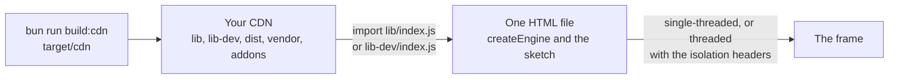

# Try null3D from a CDN

> Roadmap step 0.2, first released in null3D 0.1.0. The API is experimental, so it can still change between versions.

A page can draw a null3D scene with no build step: one HTML file that imports the engine from a CDN. This suits a quick trial, a documentation example or a CodePen-style page. A project that grows past a trial uses Vite and the plugin, as [Install null3D](install.md) shows.



## Make the CDN build

The build holds the engine's JavaScript, its shaders, both WebAssembly builds and its vendor files, with each foundation add-on under `addons/<name>/`. The npm package leaves the built shaders out, because they are large and a Vite build supplies them. A page with no build step therefore needs this folder.

```sh
bun run build
bun run build:cdn
```

`bun run build` builds the WebAssembly core. `bun run build:cdn` then writes the folder `target/cdn` in a minute or two. The folder is large: most of it is the shader builds for each kind of device. Both [entries](#production-and-development-entries) share those builds, so the development entry adds only a few MB. Upload the folder to your CDN under one prefix, such as `https://cdn.example.com/null3d/`, and keep its layout. `--out <folder>` writes it somewhere else:

```sh
bun run build:cdn --out ~/sites/null3d
```

Give every file a CORS header, because the engine imports its modules and downloads its `.wasm` files in CORS mode:

```http
Access-Control-Allow-Origin: *
```

## Production and development entries

The build holds the engine's entry point twice. Both draw the same scene. They differ in the checks that run and in the switches that the page's address can set.

| Entry | Import | Development checks | Address switches | Use it for |
| --- | --- | --- | --- | --- |
| Production | `lib/index.js` | Never run | Ignored | Pages that you ship, and every measure of speed or frame rate |
| Development | `lib-dev/index.js` | Run | Read | Trying things out and finding faults |

The development entry runs the same checks as the Vite dev server. A bad argument throws an error with its code, such as [E1203](../errors/E1203.md), and a call on a destroyed object throws [E1101](../errors/E1101.md). Debug drawing and debug views draw only in a development build, such as this entry ([Debugging](../guides/debugging.md#development-checks)). The entry also reads the switches in the page's address, such as `?gpu=`, `?hold=` and `?preset=` ([Switches for tests](../guides/testing.md#switches-for-tests)).

In each frame, some of those checks read every static object and a share of the rows of static batches. So a large scene runs slower from the development entry than from the production entry. Time a page, judge its frame rate or compare it with three.js only from the production entry. A demo from the development entry is fine to try, but its frame rate is not what your users get.

The production entry behaves like a production build from Vite and the plugin. The checks never run, and the page ignores address switches, so a link cannot change how it runs. Its files still hold the checks' code, which a Vite build removes from the download.

Use one entry for the whole page: the page's import, the sketch's import, the import map and each add-on. An add-on's development entry is `addons/<name>/lib-dev/index.js`. A page that mixes the two loads two copies of the engine's code.

To see which entry a page runs, read the address that it imports. On a page with the [isolation headers](#both-thread-modes), the `?threads=off` switch also tells them apart. With it, `engine.mode.build` is `'single'` from the development entry and `'threaded'` from the production entry.

A benchmark page may time a production build and still set switches, such as `?gpu=webgl2`. It needs a third form. `bun run build:cdn --url-switches` makes the production entry read the address switches. Use that build for benchmark pages only, and never ship it, because a link can then change how the page runs.

## One HTML file

Save this page, change the CDN address to your own, and serve it from a web server. A browser refuses the modules and workers of a page opened from a file on disk.

```html
<!doctype html>
<html lang="en">
  <head>
    <meta charset="utf-8" />
    <title>null3D from a CDN</title>
    <style>
      html, body { margin: 0; height: 100%; }
      canvas { display: block; width: 100%; height: 100%; }
    </style>
  </head>
  <body>
    <canvas id="scene"></canvas>
    <script type="module">
      const CDN = 'https://cdn.example.com/null3d/';

      // The sketch is a module of its own, so the engine can run it in a worker or on this thread.
      const sketch = `
import { defineSketch } from "${CDN}lib/index.js";

export default defineSketch(({ scene, geometry, materials }) => {
  scene.setBackground('#0b1220');
  const camera = scene.createPerspectiveCamera({ position: [0, 1, 4], target: [0, 0, 0] });
  scene.setActiveCamera(camera);
  scene.createMesh({
    mesh: geometry.box(),
    material: materials.unlit({ color: '#ff6a00' }),
  });
});
`;

      const { createEngine } = await import(`${CDN}lib/index.js`);
      await createEngine({
        canvas: document.querySelector('#scene'),
        sketch: URL.createObjectURL(new Blob([sketch], { type: 'text/javascript' })),
      });
    </script>
  </body>
</html>
```

The sketch is a module at a `blob:` address, which the page makes from the string. It imports the engine from the CDN by its full address. That works in a worker too, where a page's import map does not reach.

The page imports the production entry. While you work on the page, change both `lib/index.js` addresses to `lib-dev/index.js`, so the development checks run and their errors name your mistakes.

## Import maps

An import map gives the engine its package name, as a bundled project has it. Then the sketch and the page write `@null3d/engine`:

```html
<script type="importmap">
  {
    "imports": {
      "@null3d/engine": "https://cdn.example.com/null3d/lib/index.js",
      "@null3d/engine/stats": "https://cdn.example.com/null3d/lib/stats.js"
    }
  }
</script>
<script type="module">
  import { createEngine } from '@null3d/engine';
  // ...
</script>
```

For the development entry, map the names to `lib-dev/index.js` and `lib-dev/stats.js`.

A worker does not read the page's import map. A sketch that runs in a worker imports the engine by its full address. The page can also make the sketch's module with the address written into it, as the example above does.

## Both thread modes

The build holds both WebAssembly builds, and the engine picks one at start:

| The page's headers | The engine runs |
| --- | --- |
| No isolation headers | Single-threaded, on the page's thread |
| COOP `same-origin` and COEP `require-corp` | Threaded, with its sketch, render and job workers |

The two headers need a server that can send them. A page on a host that cannot, such as GitHub Pages, runs single-threaded. [Hosting and cross-origin isolation](hosting.md) explains them.

## The Content-Security-Policy

A page that sends a policy needs the CDN and the `blob:` addresses in it, and `'wasm-unsafe-eval'` for the engine's WebAssembly. An inline script needs `'unsafe-inline'`:

```http
Content-Security-Policy: default-src 'self'; script-src 'self' 'unsafe-inline' blob: https://cdn.example.com 'wasm-unsafe-eval'; worker-src 'self' blob: https://cdn.example.com; connect-src 'self' https://cdn.example.com; style-src 'self' 'unsafe-inline'
```

- `blob:` in `script-src`: the page makes the sketch module at a `blob:` address.
- `blob:` in `worker-src`: the engine starts each worker from a `blob:` address when its files come from another origin, and the sketch is one there.
- The CDN in `worker-src`: Firefox checks the modules that a worker imports against it.
- The CDN in `script-src` and `connect-src`: the scripts and the WebAssembly files come from there.

Missing items give [E1422](../errors/E1422.md), [E1423](../errors/E1423.md) or [E1418](../errors/E1418.md), as [Hosting](hosting.md#the-engines-files-on-a-cdn) lists them.

## What needs a build step

A page with no build step draws with the engine's own materials, geometry and shaders. Its limits:

- Custom shader WGSL, from a `.wgsl` file or a tagged string, is compiled by the Vite plugin. A page with no build step cannot compile it. Custom shader files from an add-on are compiled when the add-on packs, as the add-on's own build shows.
- A sketch in TypeScript, or one that imports other modules by a relative path, needs a bundler. Write the sketch in JavaScript at a `blob:` address or a URL of its own.

## Add-ons from the CDN

Every foundation add-on sits in the build under `addons/<name>/`, in the layout of its own package. A page imports it by its full address, as it imports the engine, so a sketch in a worker reaches it too. The add-on's built code imports the engine from the same build. So the two never come from different versions. `addons/<name>/lib/index.js` imports the production entry. `addons/<name>/lib-dev/index.js` imports the development entry.

```html
<script type="module">
  const CDN = 'https://cdn.example.com/null3d/';
  const sketch = `
import { defineSketch } from "${CDN}lib/index.js";
import { createTerrain, terrainTextures } from "${CDN}addons/terrain/lib/index.js";

export default defineSketch((ctx) => {
  const { scene, textures } = ctx;
  scene.createAmbientLight({ intensity: 0.7 });
  scene.createDirectionalLight({ direction: [0.4, -1, 0.3], intensity: 2.4 });
  const camera = scene.createPerspectiveCamera({ position: [0, 180, 180], target: [0, 0, 0] });
  scene.setActiveCamera(camera);
  const layers = terrainTextures(textures, { size: 64 });
  const terrain = createTerrain(ctx, {
    size: 400,
    height: (x, z) => 6 * Math.sin(x * 0.02) * Math.cos(z * 0.02),
    layers: [{ map: layers.grass, tile: 8, roughness: 1 }],
  });
  const eye = [0, 0, 0];
  return {
    onUpdate() {
      camera.getWorldPosition(eye);
      terrain.update(eye);
    },
  };
});
`;

  const { createEngine } = await import(`${CDN}lib/index.js`);
  await createEngine({
    canvas: document.querySelector('#scene'),
    sketch: URL.createObjectURL(new Blob([sketch], { type: 'text/javascript' })),
  });
</script>
```

An import map can name an add-on for the page's own modules, but a worker reads no import map. Name the add-on by its full address in the sketch, as the example does.

The build also writes `null3d-third-party-notices.txt`, with the license notices of the engine and of each add-on that ships other projects' code. Keep that file with the folder when you publish it, or show its text in your credits.

## Related pages

- [Hosting and cross-origin isolation](hosting.md): the headers, the policy, Brotli and the third-party notices.
- [Install null3D](install.md): the packages and the Vite plugin.
- [Performance guide](../guides/performance.md#measure-fairly): how to measure a page fairly.
- [Your first scene](first-scene.md): a project with a build step.
