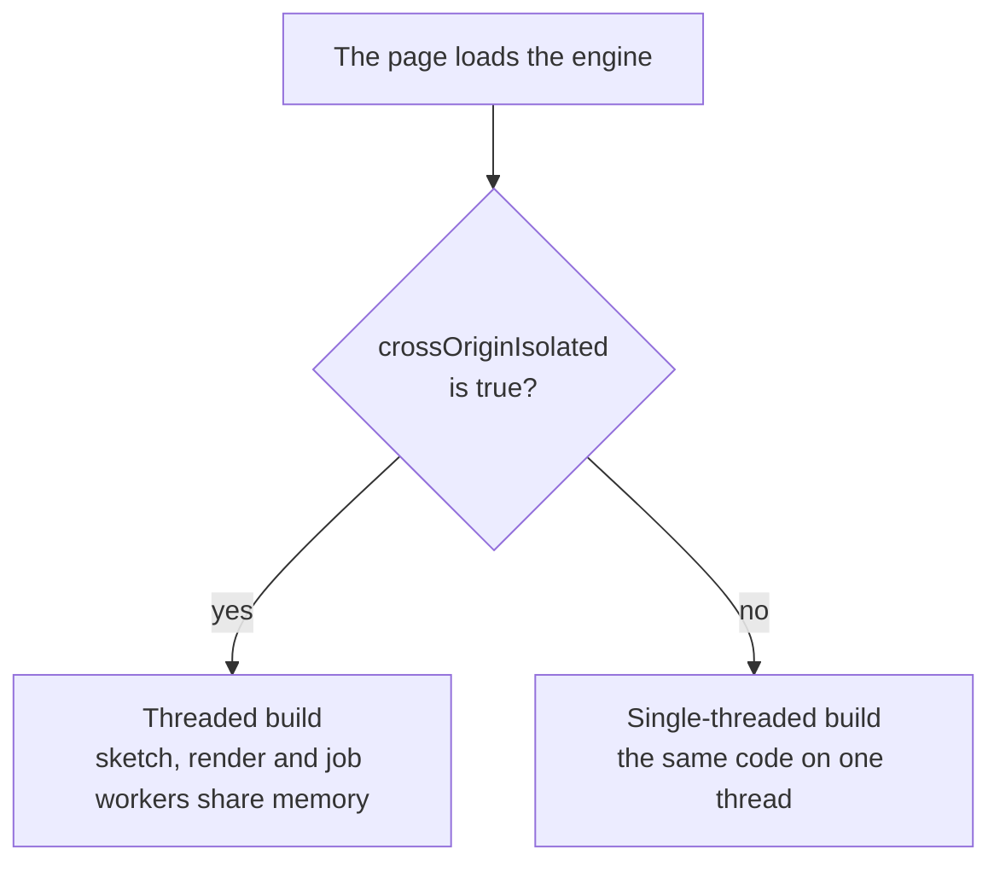

# Hosting and cross-origin isolation

> Roadmap step 0.1, first released in null3D 0.1.0. The API is experimental, so it can still change between versions.



null3D runs on worker threads that share memory, and browsers allow shared memory only on pages that are cross-origin isolated. A page becomes isolated when its server sends two HTTP headers. Without them the engine still runs, on one thread.

## The two headers

Send these on the HTML page's response:

```http
Cross-Origin-Opener-Policy: same-origin
Cross-Origin-Embedder-Policy: require-corp
```

Chrome and Firefox also accept `Cross-Origin-Embedder-Policy: credentialless`, which loads files from other sites without cookies instead of requiring each file to opt in. Safari does not support `credentialless`, so a page that must run threaded in Safari uses `require-corp`.

To check a page, open the browser console and read `crossOriginIsolated`. It is `true` on an isolated page. The engine also reports the mode in `engine.capabilities.threaded`.

## Files from other sites

With `require-corp`, the browser loads a file from another origin only when that file allows it. This covers models, textures, fonts and scripts from a CDN or a separate asset domain. Each such file needs one of these:

- A CORS response (`Access-Control-Allow-Origin`) to a request in CORS mode. `fetch` uses CORS mode for other origins by default.
- The header `Cross-Origin-Resource-Policy: cross-origin`.

Files from the page's own origin need nothing.

## Content-Security-Policy

The engine starts under a strict policy. Send this one, or add its parts to your own:

```http
Content-Security-Policy: default-src 'self'; script-src 'self' 'wasm-unsafe-eval'; worker-src 'self'
```

- `script-src 'self' 'wasm-unsafe-eval'`: the engine core, the meshopt and Draco decoders and the KTX2 transcoder are WebAssembly, and a policy blocks WebAssembly unless it holds `'wasm-unsafe-eval'`. This keyword allows WebAssembly and no JavaScript `eval`. Without it, `createEngine` rejects with [E1418](../errors/E1418.md). The engine needs no `'unsafe-eval'`.
- `worker-src 'self'`: the engine's sketch, render, job and probe workers, and the glTF loader's worker.
- `connect-src`: the engine downloads its `.wasm` files and your sketch module from the page's origin, which `default-src 'self'` allows. Add the origin of each CDN that your sketch loads models or textures from.

The engine needs no inline script and no inline style. It sets styles from code, which a policy does not block. A page's own inline `<style>` element needs `style-src 'self' 'unsafe-inline'`.

A worker follows the policy of its own script's response, not the page's. A host that sends the header on every file, as the examples below do for the isolation headers, applies the same policy to the workers.

## The engine's files on a CDN

A page can also load the engine from a CDN with no build step of its own. [Try null3D from a CDN](cdn.md) gives that page, and the build folder it imports.

The production build's files, `dist/assets/`, may come from another origin than the HTML page, such as a CDN. Point Vite's `base` option at the CDN, and serve the HTML page from your own origin:

```ts
// vite.config.ts
export default defineConfig({ base: 'https://cdn.example.com/my-game/', plugins: [null3d()] });
```

A browser starts a worker only from a script of the page's own origin. So for each worker, the engine makes a small script in the page's memory, at a `blob:` address, which has the page's origin. That script imports the worker's real script from the CDN. You copy no worker file to your own origin.

The CDN must send this header on every file of the build: the scripts, the workers' scripts and the `.wasm` files.

```http
Access-Control-Allow-Origin: *
```

It may name the page's origin in place of `*`. `Cross-Origin-Resource-Policy` alone does not serve, because the engine imports modules and downloads `.wasm` files in CORS mode. The HTML page still sends the two isolation headers. Without them the engine runs single-threaded, as on any host.

The CDN also sends each `.wasm` file with `Content-Type: application/wasm`, and lets browsers keep it. Chrome then keeps the compiled engine core between visits ([Let Chrome keep the compiled core](#let-chrome-keep-the-compiled-core)).

A worker that starts from a `blob:` address follows the page's policy. Add these parts to the page's policy, with your CDN's origin:

```http
Content-Security-Policy: default-src 'self'; script-src 'self' https://cdn.example.com 'wasm-unsafe-eval'; worker-src 'self' blob: https://cdn.example.com; connect-src 'self' https://cdn.example.com
```

- `blob:` in `worker-src`: the engine starts each worker from a `blob:` address.
- The CDN in `worker-src`: Firefox checks the modules that a worker imports, such as your sketch, against `worker-src`.
- The CDN in `script-src`: the page's and the workers' scripts come from there.
- The CDN in `connect-src`: the engine downloads its `.wasm` files from there.

When an item is missing, `createEngine` rejects with a code that names it, or a load that needs a file from the CDN does:

| Missing | Error |
| --- | --- |
| `blob:` or the CDN in `worker-src`, or the CDN in `connect-src` | [E1422](../errors/E1422.md), which names the directive |
| `Access-Control-Allow-Origin` on a file | [E1423](../errors/E1423.md), which names the CDN |
| `'wasm-unsafe-eval'` in `script-src` | [E1418](../errors/E1418.md) |

Without the CDN in `script-src`, the browser blocks the page's own script before the engine runs, and the browser's console names the directive.

## Two builds

A WebAssembly module built for shared memory cannot load on a page without it, so null3D ships two builds. The engine's loader reads `crossOriginIsolated` and fetches the matching one, so you never pick a build yourself.

| Build | Loaded when | What you get |
| --- | --- | --- |
| Threaded | The page is isolated | Sketch code and rendering in workers, with parallel job workers |
| Single-threaded | Any other case | The same API and features, on one thread |

The single-threaded build is fully supported. Use it where you cannot set headers, such as some game portals and embeds.

A game starts in either build. Do not gate its Play button on `crossOriginIsolated`, and do not offer a single-threaded mode of its own: the engine falls back by itself. Read `engine.capabilities.threaded` to record which build a run used.

## Headers on common hosts

Netlify and Cloudflare Pages read a `_headers` file at the root of the site:

```text
/*
  Cross-Origin-Opener-Policy: same-origin
  Cross-Origin-Embedder-Policy: require-corp
```

Vercel reads `vercel.json`:

```json
{
  "headers": [
    {
      "source": "/(.*)",
      "headers": [
        { "key": "Cross-Origin-Opener-Policy", "value": "same-origin" },
        { "key": "Cross-Origin-Embedder-Policy", "value": "require-corp" }
      ]
    }
  ]
}
```

nginx:

```nginx
add_header Cross-Origin-Opener-Policy same-origin always;
add_header Cross-Origin-Embedder-Policy require-corp always;
```

GitHub Pages cannot send custom headers, so a null3D page there runs single-threaded.

## Desktop apps with Electron

Electron ships Chromium, so a null3D game runs in it as it runs in Chrome. The threaded build needs the same cross-origin isolation as on a website. Two common setups do not give it:

- `win.loadFile('index.html')` opens the page at a `file://` address. Such a page cannot be isolated, so the engine runs single-threaded. With Vite's default `base`, the window also stays blank: the page's script addresses start with `/`, which a `file://` page reads from the root of the disk.
- A Chromium switch that turns on `SharedArrayBuffer` does not help. `crossOriginIsolated` stays `false`, and the engine reads that value to choose its build.

Serve the production build from a custom scheme, and send the two headers on each response. This main process serves the `dist/` folder that `bunx vite build` writes at `app://game/`. It needs Electron 25 or later, which has `protocol.handle`:

```js
// main.js (Electron main process)
const { app, protocol, net, BrowserWindow } = require('electron');
const path = require('node:path');
const { pathToFileURL } = require('node:url');

// Call this before the app is ready.
protocol.registerSchemesAsPrivileged([
  { scheme: 'app', privileges: { standard: true, secure: true, supportFetchAPI: true } },
]);

app.whenReady().then(() => {
  const root = path.join(__dirname, 'dist');
  protocol.handle('app', async (request) => {
    const file = path.join(root, decodeURIComponent(new URL(request.url).pathname));
    if (!file.startsWith(root + path.sep)) return new Response('Not found', { status: 404 });
    const response = await net.fetch(pathToFileURL(file).toString());
    const headers = new Headers(response.headers);
    headers.set('Cross-Origin-Opener-Policy', 'same-origin');
    headers.set('Cross-Origin-Embedder-Policy', 'require-corp');
    return new Response(response.body, { status: response.status, headers });
  });
  new BrowserWindow({ width: 1280, height: 720 }).loadURL('app://game/index.html');
});
```

Each of the three privileges is necessary:

- `standard` makes the scheme's addresses work as `https:` addresses do, with an origin. Without it, the browser refuses to start the engine's workers, and `createEngine` rejects with [E1405](../errors/E1405.md).
- `secure` makes the page a secure context, which isolation and WebGPU need. Without it, the page is not isolated, and the engine runs single-threaded.
- `supportFetchAPI` lets the engine download its `.wasm` files with `fetch`. Without it, `createEngine` rejects with [E1406](../errors/E1406.md).

The `startsWith` check refuses an address that points outside `dist/`. The game's own files come from the same scheme, so they need no other header. A file from a website, such as a model on a CDN, needs CORS or CORP headers, as [Files from other sites](#files-from-other-sites) says.

To check the app, open its developer tools and read `crossOriginIsolated` in the console, or read `engine.capabilities.threaded` in the page's code. Both are `true` when the engine runs threaded.

## Send the files with Brotli

The engine's shader text compresses well with Brotli, which finds text that repeats far apart. gzip finds only repeats that are close together. So the host's compression changes what a page downloads at its start. In this version, a pipelined page's start downloads about:

| The host sends | The engine's JavaScript at the start |
| --- | --- |
| Brotli | 130 KB |
| gzip at level 9 | 165 KB |
| gzip at level 6, a common setting for compression on the fly | about 167 KB |
| Files as they are | 0.6 MB |

The engine core is the start's largest file. Its WebAssembly file takes 2.0 MB as it is, about 0.8 MB with gzip and about 0.6 MB with Brotli. Many servers compress only text, and send `.wasm` files as they are. To check a host, open the browser's network panel and compare the core's transferred size with its size.

Netlify, Cloudflare Pages and Vercel send Brotli to browsers that accept it. GitHub Pages sends gzip only. nginx sends gzip with its own module, and Brotli with the `ngx_brotli` module. With nginx, compress the files once when you deploy them, with `brotli -q 11` on each file in `dist/assets/`, the `.wasm` files included. Then send the compressed files with `brotli_static on;`. nginx's own gzip compresses only the types that `gzip_types` lists, so add `application/wasm` there.

The null3D Vite plugin's own servers compress with Brotli too, as [During development](#during-development) says. [A fast start](../guides/start-time.md) gives the other steps that shorten a start.


## Publish the third-party notices

The engine and some add-ons ship code from other projects, under their licenses. A production build with the null3D Vite plugin collects every package's notices into `null3d-third-party-notices.txt` beside the page. Keep that file with the build when you publish it, or show its text in your game's credits.

[Third-party notices](third-party-notices.md) lists every part and its license. The same text is in `node_modules/@null3d/engine/THIRD-PARTY-NOTICES.txt`. The command-line tool's notices stay out of the file, because a page ships none of the tool's code.

## Caches between visits

A repeat visit starts sooner when the browser keeps what the first visit downloaded and made. Six caches do that, and each keeps something else:

| Cache | What it keeps | Who sets it up |
| --- | --- | --- |
| The HTTP cache | The build's files: the engine, its workers, the shaders and your own files | The host, with the headers below |
| Chrome's code cache | The machine code that Chrome compiled from the engine core | Chrome, for each `.wasm` file that the host sends as `application/wasm` and that the HTTP cache keeps ([Let Chrome keep the compiled core](#let-chrome-keep-the-compiled-core)) |
| A service worker's cache | Every file the game needs, so it plays with no network | Your game, as [Offline play](#offline-play) shows |
| The cache of derived data | Data that the engine and add-ons make from files, such as transcoded KTX2 textures, and data that your sketch makes itself | The engine, with no setup. `assets.cache` gives your sketch its own namespace ([Caching](../api/assets.md#caching)) |
| The stored preset check | The quality preset that the device held | The engine, in `localStorage` ([Quality presets](../concepts/quality-presets.md#repeat-visits)) |
| The stored pipeline list | Which GPU pipelines the first frame needed, so the next start builds them while it loads | The engine, in `localStorage` ([Loading screens](../guides/loading-screens.md#repeat-visits)) |
| The back/forward cache | The whole running page, for the browser's back and forward buttons | The browser ([Content pages](../guides/content-pages.md#second-visits-and-navigation)) |

The HTTP cache and a service worker's cache keep files, so a repeat visit downloads less. The code cache and the cache of derived data keep the work done on those files, so a repeat visit skips it. A page whose KTX2 files are all in it never downloads the transcoder. The browser can delete any of them to free space, and the engine then downloads or makes the data again.

## Let browsers keep the build files

Every engine thread loads its own copy of its script and of the core's loader. When the host lets the browser keep those files, each copy after the first comes from the cache. When the host asks the browser to check each file again, the copies wait for one another, one round trip each. A computer with many cores starts many threads, and on a slow phone connection one round trip can take more than half a second.

With worker threads, the sketch worker imports the sketch module while the engine core downloads. The page also downloads the job worker's script then, and the job workers that start later take it from the cache. That saves a round trip only when the host lets the browser keep the file.

A sketch that names its files in the `downloads` option of `defineSketch` starts them as soon as its module has loaded ([The download list](../api/sketch.md#the-download-list)). Over HTTP/1.1 a browser opens at most six connections to one server, and each large file holds one until it has arrived. So two listed files download at a time, and four at most while the setup's loads wait for them. The engine's own files, such as the first frame's shaders, then still find a free connection. Over HTTP/2 every request shares one connection. The listed files ask for low priority there, so a server that follows priorities sends the engine's own files first.

Vite names the files in `assets/` with a hash of their content, so a file under a given name never changes. Serve them with a long cache lifetime, and serve the HTML page so that browsers check it each time:

```text
/assets/*
  Cache-Control: public, max-age=31536000, immutable
/*.html
  Cache-Control: no-cache
```

That is the `_headers` form for Netlify and Cloudflare Pages. In nginx, add `add_header Cache-Control "public, max-age=31536000, immutable" always;` inside a `location /assets/` block.

Send no `Vary: Origin` header with the build's files when they come from the page's own origin. A worker's request for a module carries an `Origin` header that the page's own download of the same file does not. With `Vary: Origin`, the browser then checks the file again, one round trip, instead of taking its copy. A CDN that answers with `Access-Control-Allow-Origin: *` needs no `Vary: Origin` either.

### Let Chrome keep the compiled core

The engine core is about 2 MB of WebAssembly, and the browser compiles it as it downloads. Chrome then keeps the machine code that it compiled, beside the file in the HTTP cache. A repeat visit that takes the core from the HTTP cache reads that code and skips most of the compile. The engine loads its other `.wasm` files, such as the KTX2 transcoder, the same way. Chrome keeps the code only when the host does both of these:

- Send each `.wasm` file with `Content-Type: application/wasm`, with nothing after it. Chrome refuses a parameter such as `; charset=utf-8`. Most hosts send this type already. To check, read the headers with `curl -I` and the address of a `.wasm` file in your build's `assets/` folder.
- Let the HTTP cache keep the file, as the headers above do. A file served with `no-cache` keeps its code too, when the server answers the browser's check with `304 Not Modified`. A file served with `no-store` keeps nothing.

With another type the engine still starts: it compiles the file as it downloads, but Chrome compiles it again on each visit.

Chrome writes the code while the page runs, not when the download ends. It first compiles each function quickly, and optimizes the functions that run most. Once it has new optimized code, it waits until no further function has been optimized for two seconds, and then writes it. With 1 MB of new optimized code, it writes at once. The engine keeps optimizing for its first seconds, so a repeat visit gains only after an earlier visit ran the engine for a while. On the engine's test page in Chrome 158, the write came about 6 seconds after the first frame. A repeat visit that read it compiled none of the core again, and its optimizing work fell from about 110 ms to 30 ms. In the engine's startup benchmark at full speed, a repeat visit that read the compiled core finished its first frame at 160 ms. Without it, the first frame took 176 to 180 ms. It compiled 3 of the core's functions again, against 273. Chrome 156 and earlier have a fault in this wait, which can put the write off for up to about half an hour. So they rarely keep the code. Chrome 157 fixed it.

## Offline play

A game can play with no network after its first visit. Its own service worker caches the page and the build's files, and answers the page's requests from that cache. null3D ships no service worker. A production build with the null3D Vite plugin writes a list of the build's files for one, `null3d-files.json`, beside the page:

```json
{
  "version": "3f9c2a7d41e0b865",
  "start": ["index.html", "assets/index-B1x9Qd2e.js", "assets/null3d_bg-gnm1VqEU.wasm"],
  "features": {
    "skinning": ["assets/shaders-skinning-wgsl-Ck2dJx81.js"],
    "ktx2": ["assets/basis_transcoder-D165VYSC.wasm"]
  }
}
```

- `start` holds every file that a page may need to start. These are the pages and their scripts, the engine's workers, both engine builds, each GPU path's shaders and the files of your custom materials' builds (`material-*.js`).
- The start holds the renderers of both GPU paths. A page downloads only its own path's renderers. But a cached game also starts offline on the other path, as on a device whose GPU or browser changed since its first visit. A page that switches paths, such as a benchmark page, downloads each path's renderers the first time it draws with that path. Later loads take them from the browser's cache.
- `features` holds the files that each feature downloads on its first use, by the feature's name. A page that does not use a feature never downloads its files, so a game caches only the features that it uses.
- `version` changes whenever a file of the build changes. Each address is relative to the list.

| Feature | Files | The game uses it when it calls |
| --- | --- | --- |
| `ao`, `background`, `bloom`, `lines`, `morph`, `occlusion`, `skinning`, `sky`, `sprites` | The feature's shaders, and the code of sprites and lines | The calls that `createEngine`'s `preload` lists for the same name ([Engine](../api/engine.md)) |
| `gltf` | The glTF loader, its worker, and the meshopt and Draco decoders | `assets.loadGltf` |
| `ktx2` | The KTX2 loader and the Basis Universal transcoder | `assets.loadTexture` or `assets.loadGltf` with a KTX2 texture |
| `environment` | The readers of environment maps, the built-in environments and the code that prefilters them | `assets.loadEnvironment` or `assets.builtinEnvironment` |
| `lut` | The readers and makers of color grading tables | `assets.loadLut` or `assets.lutFromData` |

Each feature's shaders come in a file for each GPU path and each device's settings. A device can need another of them during play, for example when bloom turns on HDR color, so a feature's list holds them all. Shaders that need two features, such as a skinned mesh with a hashed material, have files of their own. The list puts such a file under each of its features, so a game that caches either feature has it. The start's files and the skinning shaders are the largest groups, several MB each as the cache keeps them, uncompressed. Your build's output lists each file with its size. With compression, the downloads are about a fifth of that.

This service worker caches the page, the start's files and the features that the game names:

```js
// public/sw.js
const FEATURES = ['skinning', 'gltf', 'ktx2'];
const PREFIX = 'game-';

self.addEventListener('install', (event) => event.waitUntil(update()));

self.addEventListener('fetch', (event) => {
  if (event.request.mode === 'navigate') event.waitUntil(update().catch(() => {}));
  event.respondWith(
    caches.match(event.request, { ignoreSearch: true }).then((hit) => hit ?? fetch(event.request)),
  );
});

/** Caches the build that the server holds now, once, and deletes the caches of older builds. */
async function update() {
  const list = await (await fetch('null3d-files.json', { cache: 'no-store' })).json();
  const name = PREFIX + list.version;
  const cache = await caches.open(name);
  if (await cache.match('./')) return;
  const features = FEATURES.flatMap((feature) => list.features[feature]);
  // Two features can name one file, such as a shared table of shader paragraphs, and a cache
  // refuses a list that names a file twice.
  await cache.addAll([...new Set(['./', ...list.start, ...features])]);
  for (const old of await caches.keys())
    if (old.startsWith(PREFIX) && old !== name) await caches.delete(old);
}
```

The page registers it once the first frame has drawn, and in production builds only. The worker's downloads then leave the connection to the start's own files, and the dev server's pages stay out of the cache:

```ts
// page.ts, after createEngine
engine.firstFrame.then(
  () => {
    if (import.meta.env.PROD) void navigator.serviceWorker?.register('./sw.js');
  },
  () => {}, // the engine stopped before its first frame: cache nothing
);
```

A worker that starts with the page shares the connection with every file of the start, so the first frame comes later. Over HTTP/1.1, a long list holds every connection the browser opens to the host.

Put the game's own files that the build does not hold, such as its models in `public/`, in the list that `cache.addAll` takes. On each visit with a network, the worker checks the list. When the build changed, it caches the new build in one step and deletes the old caches. The new build then runs from the next visit.

`cache.addAll` keeps no file until every file of its list has arrived. A visitor who leaves before then starts the whole list again on the next visit, and each such visit shares its connection with the start. So keep the list to the files that the game needs. A build of many pages lists the files of every page in `start`.

### Keep the page isolated

The cache keeps each response with its headers, so the cached page keeps the two isolation headers and the engine starts threaded offline. A service worker that makes a new response for the page, instead of one from `fetch` or the cache, must copy those headers. Without them the page loses its isolation, and the engine starts its single-threaded build with no error. A development build of the engine warns in the console when a service worker controls a page that is not isolated. To check a production build, reload the page offline and read `crossOriginIsolated` in the console.

### The preload list and the cache

The cache decides where the files come from, and `preload` decides when they load. Cache each feature that the game lists in `preload`, or an offline start fails while it waits for that feature's shaders. A feature that the game caches but does not preload loads from the cache on its first use, with no network. A feature that the game neither caches nor preloads needs the network on its first use.

The preset can also draw a feature that the sketch never asks for. High and Ultra, and WebGL2's Medium, draw [screen-space bounce light](../concepts/post-processing.md#screen-space-bounce-light), whose steps read `'ao'`'s depth and normals and the `'color_copy'` of the scene color from the first frame. WebGPU's High and Ultra also cull hidden objects on the GPU, which reads the `'occlusion'` shaders from the first frame. A game that plays offline on those presets caches these features as well as the ones that it preloads.

### Keep the engine's cache

The engine keeps its [cache of derived data](../api/assets.md#the-cache-of-derived-data) in the origin private file system, in a folder whose name starts with `null3d-derived-`. A service worker's cache never holds it, so the worker above can delete its old caches freely. A page that clears the origin's storage, for example with the `Clear-Site-Data` header, makes the engine transcode its textures again.

## During development

The null3D Vite plugin sends both isolation headers on every response from `vite` and `vite preview`. That includes the `.wasm` files and the worker scripts. `vite preview` also lets the browser keep the hashed files in `assets/`, as a well-set host does.

Both servers compress what a phone or tablet on the network downloads, with Brotli, or with gzip for a browser that lacks Brotli. The dev server compresses its answers to every request from another device, and leaves requests over `localhost` as they are. The preview compresses the build's scripts, WebAssembly, glTF models and other text for every request. After its first answers, it compresses each file again at Brotli's best level while no request waits. Later visits then download the same sizes as from a host that compresses its files ahead of time.

Shared memory and WebGPU also need a secure context: HTTPS, or `localhost`. WebGPU, and so the High and Ultra presets, only exist there. A page served over plain HTTP on a network address silently falls back to WebGL2 at Medium. An Android phone connected by USB can reach your computer's `localhost` through `adb reverse tcp:5173 tcp:5173`.

To test on a phone or tablet over your local network, serve HTTPS with a local certificate. Make one with [mkcert](https://github.com/FiloSottile/mkcert), for `localhost` and your computer's network name:

```sh
mkdir certs
mkcert -cert-file certs/cert.pem -key-file certs/key.pem localhost my-computer.local
```

Keep the `certs` folder out of version control, because it holds a private key. Turn on the plugin's `https` option, and the dev server serves HTTPS on your local network:

```ts
// vite.config.ts
export default defineConfig({ plugins: [null3d({ https: true, certDir: 'certs' })] });
```

The plugin serves this HTTPS over HTTP/1.1. Over HTTP/2, Safari on an iPad sometimes stops while a worker loads its modules. The dev server sends each module as its own file, and every engine thread loads its own copy of each. So a page asks for hundreds of files, and HTTP/1.1 sends six at a time. For other browsers, the plugin's `http2: true` option serves HTTP/2, which sends every request at once.

The device must trust mkcert's root certificate. `mkcert -CAROOT` prints its folder. Copy `rootCA.pem` to the device and install it. On an iPhone or iPad, also turn on full trust in Settings > General > About > Certificate Trust Settings.

A browser that has not been given the root certificate shows a warning. You can accept it and continue, but then Chrome keeps no file from the site in its cache. Every load downloads every file again, so each reload is as slow as a first visit, and every timing of a start is wrong. Over a simulated phone connection, a reload of the dev server took 30 seconds instead of 15. Install the root certificate on every device that tests a page.

The dev server also asks the browser to check every module on each load. So time a start only on a production build that a host serves, as [A fast start](../guides/start-time.md#test-a-production-build) explains.

## What isolation changes

`Cross-Origin-Opener-Policy: same-origin` cuts the link between your page and any cross-origin window it opens. A sign-in flow that opens a popup on another site and waits for a message through `window.opener` stops working. Check such flows before you turn isolation on.

## Related pages

- [Architecture: threads and the frame](../concepts/architecture.md): what the worker threads do.
- [GPU tiers and backends](../concepts/backends.md): which browsers get WebGPU.
- [A fast start](../guides/start-time.md): what a host, a page and a sketch do for a fast start.
