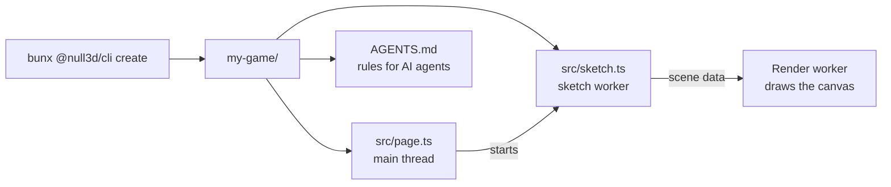

# Project structure



`bunx @null3d/cli create` writes a new project from a template. Start with the template closest to your app, then change its scene.

| Template | What its scene shows |
| --- | --- |
| `empty` | A cube that turns, lit by a directional light and an ambient light. It is the smallest project, for a scene of your own. |
| `product` | A product viewer: shapes from `@null3d/geometry` with glazed, metal, wood and cloth materials on a turntable. A soft room light, shadows on a shadow catcher, the Neutral tone curve, and orbit controls with damping and limits. |
| `game` | A small game: a player that keys, a gamepad or a dragged finger moves, gems to pick up, rocks in instance batches, a follow camera and a score on the page. |

Each template holds the same project files, which the next sections list. The `product` template also pins `@null3d/controls` and `@null3d/geometry`.

## Make a project

```sh
bunx @null3d/cli create my-game --template game
cd my-game
bun install
bunx vite
```

`create` writes the template's files, and it writes the version of the command into each package pin. It installs nothing, so run `bun install` in the new folder.

| Option | Effect | Without it |
| --- | --- | --- |
| `--template <name>` | The template to copy: `empty`, `product` or `game` | `empty` |

The folder must not exist, or it must be empty. A folder with files stays as it is, and the command stops.

## The files

| File | What it holds |
| --- | --- |
| `src/page.ts` | The page module, on the main thread. It owns the HTML and calls `createEngine`. |
| `src/sketch.ts` | The sketch module, in the sketch worker. It builds the scene and runs its `onUpdate` in every frame. |
| `index.html` | The page and its canvas. |
| `vite.config.ts` | Vite with the null3D plugin, which sends the headers that the workers need. |
| `tsconfig.json` | The TypeScript settings that `bunx @null3d/cli test` checks the project with. |
| `package.json` | The project's name, scripts and packages. Every `@null3d/*` package takes one version. |
| `.gitignore` | The folders that git skips: `node_modules/`, `dist/`, `test-results/` and `.vite/`. |
| `AGENTS.md` | The rules for an AI agent that works in the project. |
| `.agent/agent-hook.mjs` | The hook that checks the rules before each command and each edit. |
| `.claude/settings.json` | The Claude Code settings that run the hook. |
| `.codex/hooks.json` | The Codex settings that run the hook. |

[Your first scene](first-scene.md) explains the page module, the sketch module and the engine's calls.

## The agent files

`AGENTS.md` names the installed null3D version and the `null3d-develop` skill. The template holds no copy of the skill. [Working with AI agents](../guides/agents.md) shows how to install it: as a Claude Code plugin, with `bunx skills add`, or by a copy of its folder. When the project has `.claude/skills/null3d-develop/SKILL.md`, an agent reads that file. Otherwise the agent reads the engine docs in `node_modules/@null3d/engine/docs/`, which match the installed version.

Claude Code runs the hook through `.claude/settings.json`, and Codex runs it through `.codex/hooks.json`. Both run the same file, `.agent/agent-hook.mjs`. Codex runs the hooks of a folder that you trust.

The hook is optional. To stop its checks, delete its entries in `.claude/settings.json` and `.codex/hooks.json`.

The hook refuses some commands so that they do not run. It flags some source rules and lets the edit go on.

| Rule | What the hook does | What the message gives |
| --- | --- | --- |
| A command that waits with `sleep` | Refuses the command | The fix |
| A command that stops a process by name | Refuses the command | The fix |
| A command that follows a log | Refuses the command | The fix |
| An object, array or string made in `onUpdate` | Flags it; the edit goes on | The file, the line and the fix |
| A DOM name in the sketch module | Flags it; the edit goes on | The file, the line and the fix |
| An import of a name that the installed engine does not export | Flags it; the edit goes on | The file, the line and the fix |

The hook reads its rules from the installed packages, which `bun install` writes. Before that install, the hook cannot check a call. It tells the agent to install the packages, and the call goes on.

<details>
<summary>Technical details: where the hook's rules come from</summary>

The hook takes every rule from `@null3d/cli/agent-rules`. That module holds each rule and its message once, so a project and any other null3D tool agree.

</details>
