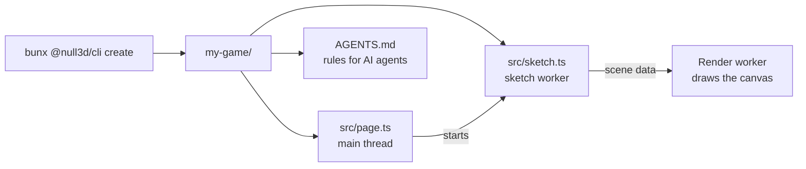

# Project structure

> Roadmap step 0.3, first released in null3D 0.1.0. The API is experimental, so it can still change between versions. The `empty` template is the only template today.



`bunx @null3d/cli create` writes a new project from a template. Start with the `empty` template, then add the scene that your app needs.

## Make a project

```sh
bunx @null3d/cli create my-game
cd my-game
bun install
bunx vite
```

`create` writes the template's files, and it writes the version of the command into each package pin. It installs nothing, so run `bun install` in the new folder.

| Option | Effect | Without it |
| --- | --- | --- |
| `--template <name>` | The template to copy | `empty` |

The folder must not exist, or it must be empty. A folder with files stays as it is, and the command stops.

## The files

| File | What it holds |
| --- | --- |
| `src/page.ts` | The page module, on the main thread. It owns the HTML and calls `createEngine`. |
| `src/sketch.ts` | The sketch module, in the sketch worker. It builds the scene and runs its `onUpdate` in every frame. |
| `index.html` | The page and its canvas. |
| `vite.config.ts` | Vite with the null3D plugin, which sends the headers that the workers need. |
| `tsconfig.json` | The TypeScript settings that `bunx @null3d/cli test` checks the project with. |
| `package.json` | The project's name, scripts and packages. Every `@null3d/*` package takes one version. |
| `AGENTS.md` | The rules for an AI agent that works in the project. |
| `.agent/agent-hook.mjs` | The hook that checks the rules before each command and each edit. |
| `.claude/settings.json` | The Claude Code settings that run the hook. |
| `.codex/hooks.json` | The Codex settings that run the hook. |

[Your first scene](first-scene.md) explains the page module, the sketch module and the engine's calls.

## The agent files

`AGENTS.md` names the installed null3D version and the `null3d-develop` skill. The project does not hold a copy of the skill today. When the project has `.claude/skills/null3d-develop/SKILL.md`, an agent reads that file. Otherwise the agent reads the engine docs in `node_modules/@null3d/engine/docs/`, which match the installed version.

Claude Code runs the hook through `.claude/settings.json`, and Codex runs it through `.codex/hooks.json`. Both run the same file, `.agent/agent-hook.mjs`. Codex runs the hooks of a folder that you trust.

The hook refuses three commands, so they do not run. They are a command that waits with `sleep`, one that stops a process by name, and one that follows a log. The message gives the fix.

The hook flags three source rules and lets the edit go on. It flags an object, array or string made in `onUpdate`. It flags a DOM name in the sketch module. It flags an import of a name that the installed engine does not export. A planned API does not exist, so its name is absent from the installed declarations. The message names the file, the line and the fix.

The hook takes every rule from `@null3d/cli/agent-rules`. That module holds each rule and its message once, so a project and any other null3D tool agree. The hook reads the module from the installed packages, and `bun install` writes them. Before that install, the hook cannot check a call. It tells the agent to install the packages, and the call goes on.
