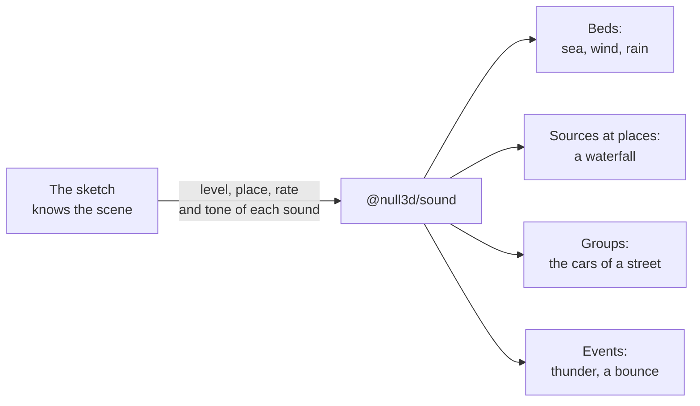

# Sound in a scene



A scene sounds right when its sounds follow what the camera sees. The sea grows louder as the camera nears the shore, and a passing car's engine moves from one ear to the other. The sketch knows all of that, so the sketch drives the sound. [Sound (@null3d/sound)](../api/sound.md) plays it on the page with the browser's audio, and this guide shows the four kinds of sound a scene needs.

## Set up the sound

The sketch makes the sounds with `createSound`, and the page connects with `connectSound`. Call `update` once a frame, in `onLateUpdate`.

```ts
// sketch.ts
import { defineSketch } from '@null3d/engine';
import { createSound } from '@null3d/sound';

export default defineSketch((ctx) => {
  const camera = ctx.scene.createPerspectiveCamera({ position: [0, 2, 10], target: [0, 1, 0] });
  ctx.scene.setActiveCamera(camera);
  const sound = createSound(ctx, { listener: camera });
  // ... the sounds below ...
  return {
    onLateUpdate() {
      sound.update();
    },
  };
});
```

```ts
// page.ts: the sound starts on the user's first click, tap or key.
import { connectSound } from '@null3d/sound/page';
const sound = connectSound(engine, { startOnInput: true });
```

A sound button suits a page that people browse. Call `sound.start()` from its click handler, and `sound.setMuted` to mute it after that.

## Beds whose level the scene sets

A bed is a sound that fills the space, such as the sea, wind or rain. Its level comes from a measure of the scene where the camera stands. That might be the distance to the shore, the trees around the camera, or the wind's speed. Make it with no `near` and no `far`, and set its level in each frame.

```ts
const wind = sound.loop({ file: '/sounds/wind.mp3', positional: false });
const at = new Float64Array(3);
const air = new Float32Array(3);
// In onUpdate: louder and brighter as the wind blows harder and the camera climbs.
camera.getWorldPosition(at);
windField.sample(at[0], at[1], at[2], air);
const speed = Math.hypot(air[0], air[2]);
const height = Math.min(1, Math.max(0, (at[1] - groundHeight(at[0], at[2])) / 60));
wind.setLevel(Math.min(1, speed / 10) * (0.4 + 0.6 * height));
wind.setTone(0.4 + 0.6 * Math.min(1, speed / 12));
```

A bed that comes from one side can still have a place. The sea is louder toward the water. So place it out to sea from the camera, along the way the shore faces, and keep it positional. Its level still comes from the sketch.

## Sources at places

A source at a place falls off with distance by itself. Give it `near`, the distance within which it plays at its full level, and `far`, where it has faded out. A waterfall heard across a valley might take `near: 5` and `far: 400`. With `far`, the sound also loses its highs with distance, as real sounds do.

```ts
const fall = sound.loop({ file: '/sounds/waterfall.mp3', near: 5, far: 400 });
fall.setPosition(lip[0], lip[1] - drop, lip[2]);
```

Choose `far` as the distance at which a listener would stop hearing the thing, and `near` as the distance at which it is as loud as it gets. The ranges differ by kind:

| The source | `near` | `far` |
| --- | --- | --- |
| A stream, a fountain or water over stones | 3 | 50 |
| A bird or a voice nearby | 2 | 60 |
| A car or a van beside its road | 5 | 120 |
| A bus or a lorry | 8 | 200 |
| A crowd or a street of people | 5 | 150 |
| A waterfall, which is loud and carries | 5 | 400 |
| The breakers along a beach | 30 | 400 |
| The open sea heard from shore | 40 | 300 |
| Thunder, heard across a city | 100 | 4000 |

A source whose `far` reaches a kilometer is heard from the whole map, and a scene's opening view roars when nothing stands near it.

A long source, such as a stream, has a place that moves with the camera: the nearest point of its course. Work that point out in each frame and move the source there.

## Groups of many sources

A street of cars, a swarm of bees or the traffic of a city has more sources than a browser can mix. A group plays one file from each member, and gives a few voices to the loudest members where the listener stands. A voice that moves to another member fades out first.

```ts
const cars = sound.group({ file: '/sounds/car.mp3', count: 40, voices: 6, near: 4, far: 150 });
// In onUpdate: each car's place, and its engine's pitch from its speed.
for (let i = 0; i < 40; i++) {
  cars.setPosition(i, x[i], y[i], z[i]);
  cars.setRate(i, 0.8 + speed[i] / 30);
}
```

A sketch that keeps its places in one array of three numbers each copies them in one call: `cars.positions.set(places)`. A member whose level is 0, such as a parked car, takes no voice.

## Events

A shot plays its file once for each event, such as thunder, a door or a bounce. A physics library's contact events suit it ([Using a physics library](physics.md)).

```ts
const bounce = sound.shot({ file: '/sounds/bounce.mp3', voices: 4, near: 2, far: 60 });
// In the contact handler: a harder hit is louder.
bounce.play(x, y, z, Math.min(1, impact / 8));
```

## A mix that works

- Normalize the files to one loudness, such as -20 LUFS, so a level of 1 means the same for each. If you cannot change the files, multiply each sound's level by a gain that brings it there.
- Keep beds below the sources that tell a story. The sea at 0.6 and a passing car at 1 lets the car stand out.
- Tie a sound to the motion that makes it. Rustling leaves follow the wind's speed and the trees near the camera, and an engine's rate follows its car's speed.
- Tie a bed's level to the scene. A level that follows the distance to the shore never jumps when the camera cuts.
- Give every source a reach that matches what makes it. Waves are heard near water, and an engine near its own car. A source whose `far` reaches a kilometer makes an opening view over open water roar. A scene's first frame is the test: where nothing makes a sound, the mix is silent.
- Never write a level as a step. Move it along a curve that passes through its neighbors, so a car that stops fades through silence rather than cutting off at a threshold. Let the frame's own time smooth what the scene writes.
- Count the voices of a group. They add as power, so three voices at full level sound about five decibels louder than one loop. Give a group's members a lower level than a loop's.
- Write massed ambience as one loop scaled by density, such as a wood's leaves from the canopy around the camera. One source for each of fifty trees adds up in a way no listener calls rustling. A density that levels off cannot pile up.
- Check the mix at fixed camera places, not by ear alone: the opening pose, the shore, a town square and the climb. The opening should be silent, and each place should lead with the sound its view shows. No level should move faster between frames than a listener would expect.

## How the sound reaches the speakers

The browser offers its audio on the page's main thread only, and the sketch runs in a worker. The add-on bridges the two with a table that the page shares. The sketch writes each sound's values there, and a mixer on the browser's audio thread reads them and drives each voice.

Where the page shares its memory with its workers, no message travels in a frame. The page's thread then does no work while the sounds play. When the engine pauses or the page is hidden, the sketch's frames stop, and the sound fades out with them.

The page can still play its own sounds with Web Audio, such as music or the clicks of its buttons. Such sounds belong to the page, so they need no add-on.

## Related pages

- [Sound (@null3d/sound)](../api/sound.md): every call, the distances, the voices and the costs.
- [Sources at places](https://github.com/null3d-engine/null3d/tree/main/examples/sound): a thunderstorm on the moor, where each strike's thunder plays from where it struck.
- [Beds whose level the scene sets](https://github.com/null3d-engine/null3d/tree/main/examples/showcase/creek): the creek's loops follow the water and the wind.
- [Groups of many sources](https://github.com/null3d-engine/null3d/tree/main/examples/showcase/skyway): the hover cars, rain, thunder and city of a rainy night.
- [Cars and a bus as one group](https://github.com/null3d-engine/null3d/tree/main/examples/showcase/island): the island's traffic sounds from its lanes.
- [Messages between sketch and page](../api/page.md): messages for events that the page shows.
- [Using a physics library](physics.md): events from a physics world, such as a bounce.
- [Hosting and cross-origin isolation](../getting-started/hosting.md): when a page shares its memory.
