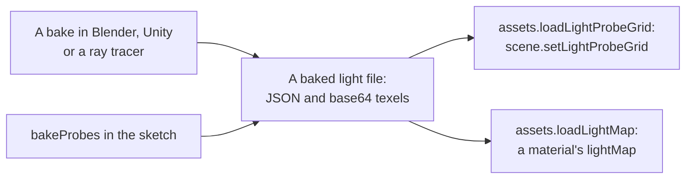

# Baked light data

> Roadmap step 0.3, first released in null3D 0.1.0. The format is stable: version 1 holds the members that this page lists, and a reader ignores members that it does not know. A change that an earlier reader would misread takes a new version number. A light map's direction is read from the file, and no material draws it yet.



A baked light file holds light that a tool worked out before the page runs. The engine reads two kinds: a probe grid for `scene.setLightProbeGrid`, and a light map for a material's `lightMap`. A tool outside the engine writes the same file that the engine's own `bakeProbes` writes. This page is the format's reference, so a bake tool in any language can write a file that the engine reads.

## The file

A file is JSON. Three members come first:

| Member | Value |
| --- | --- |
| `format` | The string `null3d.baked-light` |
| `version` | The whole number `1`. A reader refuses any other version |
| `kind` | `probe-grid` or `light-map` |

The rest of the file depends on its kind. A reader ignores members that it does not know. A bake tool may write members that an earlier engine leaves out, and the file still reads. The `version` number changes only when a reader that predates the file would read it wrongly. This engine refuses any version that it does not know.

The large values are base64. Decode them as bytes, not as text.

## A probe grid

A probe grid file holds the four values of `LightProbeGridData`. They are the grid's origin, its spacing, its probe counts and its coefficients.

```json
{
	"format": "null3d.baked-light",
	"version": 1,
	"kind": "probe-grid",
	"origin": [0, 1, 0],
	"spacing": [1, 1, 1],
	"counts": [2, 2, 2],
	"coefficients": "AAAAAAAAAD4AAIA+AADAPgAAAD8AACA/AABAPwAAYD8AAIA/AACQPwAAoD8AALA/AADAPwAA0D8AAOA/AADwPwAAAEAAAAhAAAAQQAAAGEAAACBAAAAoQAAAMEAAADhAAABAQAAASEAAAFBAAABYQAAAYEAAAGhAAABwQAAAeEAAAIBAAACEQAAAiEAAAIxAAACQQAAAlEAAAJhAAACcQAAAoEAAAKRAAACoQAAArEAAALBAAAC0QAAAuEAAALxAAADAQAAAxEAAAMhAAADMQAAA0EAAANRAAADYQAAA3EAAAOBAAADkQAAA6EAAAOxAAADwQAAA9EAAAPhAAAD8QAAAAEEAAAJBAAAEQQAABkEAAAhBAAAKQQAADEEAAA5BAAAQQQAAEkEAABRBAAAWQQAAGEEAABpBAAAcQQAAHkEAACBBAAAiQQAAJEEAACZBAAAoQQAAKkEAACxBAAAuQQAAMEEAADJBAAA0QQAANkEAADhBAAA6QQAAPEEAAD5B"
}
```

| Member | Value |
| --- | --- |
| `origin` | The grid's corner of least x, y and z, in meters: three numbers |
| `spacing` | The distance between probes along each axis, in meters: three numbers above 0 |
| `counts` | The probes along each axis: three whole numbers of 2 or more |
| `coefficients` | Base64 of 12 32-bit floats for each probe, little-endian |

The probes run x fastest, then y, then z. Each probe holds four RGB coefficients in the order that the shader reads them: L0, then L1 along y, z and x. The 12 floats are three for L0 and three for each L1 axis. `bakeProbes` writes the same values. A bake that a tool makes therefore matches the engine's own bake for the same scene.

## A light map

```json
{
	"format": "null3d.baked-light",
	"version": 1,
	"kind": "light-map",
	"width": 2,
	"height": 2,
	"encoding": "rgb8",
	"radiance": "/wAAAP8AAAD/////",
	"direction": "AH8AfwAAAAB/gQAA"
}
```

| Member | Value |
| --- | --- |
| `width`, `height` | The texels across and down: whole numbers of 1 or more |
| `encoding` | `rgb8`, three bytes per texel in sRGB, or `rgba16float`, eight bytes per texel as little-endian half floats in linear light |
| `radiance` | Base64 of the texels, rows along v from the first texel at u = 0, v = 0 |
| `direction` | Optional. Base64 of three signed bytes per texel, each axis of the light's direction divided by 127 |

Use `rgba16float` for light above 1, such as a window or a lamp that the bake kept bright. It takes 8 bytes for each texel, against 3 for `rgb8`. A `direction` adds 3 bytes for each texel: a directional light map takes twice the memory of an `rgb8` radiance. The engine reads the direction but no material draws with it yet.

## Load a file

```ts
import { defineSketch } from '@null3d/engine';

export default defineSketch(async ({ scene, assets, materials }) => {
  // A probe grid, ready for the scene.
  const grid = await assets.loadLightProbeGrid('/light/probe-grid.json');
  scene.setLightProbeGrid(grid);

  // A light map, which a material takes as one of its maps.
  const map = await assets.loadLightMap('/light/light-map.json');
  const wallTexture = await assets.loadTexture('/tex/wall.png');
  const wall = materials.standard({ map: wallTexture, lightMap: map.texture, lightMapIntensity: 2 });
  return {};
});
```

`loadLightProbeGrid` gives the texture and the three placement values, so its result goes straight to `scene.setLightProbeGrid`. The grid replaces the environment's diffuse light, as a grid that `bakeProbes` made does.

`loadLightMap` gives a texture for a material's `lightMap`. It also gives the direction bytes, if the file holds them. The texture is an `rgba8unorm` texture in sRGB, or an `rgba16float` texture in linear light. The file's three colour bytes become three channels and an opaque fourth, because the engine has no three-channel texture format. The first load of either kind loads the reader, which is about 2 KB after Brotli. A page that reads no baked light file downloads none of it.

Both calls throw [E1434](../errors/E1434.md) for a file that the engine cannot read. The message names the fault. It may name a version that the engine does not read, or a payload that does not hold the count that the file gives. It may also name a file that a download cut short.

## Save a grid that the engine baked

`assets.lightProbeGridFile` writes the file of a grid that `bakeProbes` made. Send the bytes to your server, or save them from the page.

```ts
import { defineSketch, bakeProbes } from '@null3d/engine';

export default defineSketch(async ({ scene, assets }) => {
  const environment = await assets.skyEnvironment();
  scene.setEnvironment(environment);
  const bake = bakeProbes(scene, { box: { min: [-12, 0, -12], max: [12, 8, 12] }, environment });
  const grid = bake.finish();
  const file = await assets.lightProbeGridFile(grid);
  // `file` is a Uint8Array of the JSON text, which loadLightProbeGrid reads again.
  return {};
});
```

## What the loader checks

A reader refuses a file whose contents do not agree with its own members. Each fault comes with a message that names it:

- a missing or wrong `format` member, or text that is not JSON;
- a `version` that this engine does not read;
- a `kind` other than the one that the call reads;
- text that stops before its JSON is complete, as a cut-short download leaves it;
- a `spacing` of 0 or less, or `counts` outside the grid's limits;
- a `coefficients` payload whose floats are not 12 for each probe in `counts`;
- a `width` or a `height` outside the texture's limits, or an unknown `encoding`;
- a `radiance` or a `direction` payload whose bytes do not match the file's size;
- a payload that is not base64.

## Limits

- A grid takes at most 256 probes along x, 256 along y and 83 along z. Its texture is cut into sub-volumes that hold the coefficients: the first holds the probe's own colour and one direction's red, and the others hold the rest of the directions. The z side carries a padding slice at either end of every sub-volume.
- A light map's side is at most 4,096 texels, and one payload is at most 256 MiB, as every texture file is.
- The grid's texture takes 24 bytes of GPU memory for each probe, plus the padding slices, so a grid of 24 x 8 x 24 probes takes about 117 KiB. A light map's texture takes 4 bytes for each texel from `rgb8`, and 8 from `rgba16float`.
