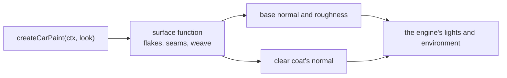

# Car paint

> Roadmap step 0.3, first released in null3D 0.1.0. The API is experimental, so it can still change between versions.

The car paint draws a metallic base under a clear coat. Three parts change the look: metal flakes,
panel seams, and an optional carbon weave. Each part reads the mesh's texture coordinates, so the
paint fits any panel that has them.



The paint is an example add-on in the repository, in the `examples/addons/car-paint` folder. It is
not an npm package. Copy the folder into your project and import its entry point.

## Use it

```ts
import { createCarPaint } from './addons/car-paint';

const paint = createCarPaint(ctx, {
  color: '#9e0b16',
  metalness: 0.72,
  roughness: 0.34,
  flakes: { cells: [120, 210], tilt: 0.25 },
  seams: { spacing: [0.34, 0], width: 0.0022 },
  clearcoat: 1,
  clearcoatRoughness: 0.02,
});

scene.createMesh({ mesh: body, material: paint });
```

## Options

| Option | Meaning | Default |
| --- | --- | --- |
| `color` | The base color | `#9e0b16` |
| `metalness` | How metallic the base is, from 0 to 1 | `0.72` |
| `roughness` | The base's perceptual roughness, from 0 to 1 | `0.34` |
| `clearcoat` | How much clear coat covers the paint, from 0 to 1 | `1` |
| `clearcoatRoughness` | The coat's perceptual roughness, from 0 to 1 | `0.02` |
| `flakes` | `{ cells, tilt, spread }`, or `false` | `{ cells: [120, 210], tilt: 0.25, spread: 0.18 }` |
| `seams` | `{ spacing, width, shade }`, or `false` | `{ spacing: [0.34, 0], width: 0.0022, shade: 0.85 }` |
| `weave` | `{ cells, shine }`, or `false` | `false` |

- `flakes.cells` counts flake cells across each texture coordinate.
- `flakes.tilt` is how far a flake bends the base normal.
- `flakes.spread` is the roughness that the flakes add once a cell shrinks below a pixel.
- `seams.spacing` gives the interval between seams along each texture coordinate. A value of 0
  draws no seam along that coordinate.
- `seams.width` is the groove's half width in the texture coordinates.
- `weave.cells` counts weave cells across each texture coordinate.
- `weave.shine` is how strongly a tow's rounded cross-section shapes its highlight, from 0 to 1.

## How the parts draw

The **flakes** tilt the base normal in each cell. A cell that shrinks below a pixel fades to the
smooth normal, and the roughness widens to the flakes' spread. This is the same idea that the sky
uses for its stars: the footprint of the pixel sets a floor on the pattern's size. The flakes
therefore flash up close and average to a smooth metal far away, without shimmering as the car
moves. The clear coat keeps its own smooth normal, so the flakes never disturb the coat's
reflection.

The **seams** are grooves at the look's intervals. Each groove draws at least as wide as a pixel.
The base darkens in the groove and the coat's normal bends into it, so a highlight runs along the
seam.

The **weave** is a 2 x 2 twill of rounded tows. A tow's normal slopes across it and stays level
along it, so the highlight runs along the tow and the two directions of the twill shine their own
way. The gaps between the tows draw darker and rougher.

## Cost

The paint pays for the clear coat's lobe. The flakes cost two cell hashes and one footprint read
for each pixel. The seams cost a few derivatives for each pixel. The weave adds its own pattern,
slope and roughness change. A material without flakes, seams or a weave draws the same surface as a
plain metallic paint.

## Limits

- A mesh must have texture coordinates. A mesh without them does not draw with the paint.
- The parts read the texture coordinates, so uneven coordinates stretch the flakes, the seams and
  the weave. Change `cells` and `spacing` to match the mesh.

## Related pages

- [Materials](../api/materials.md): the clear coat and its options.
- [Surface functions](../shaders/surface-functions.md): the surface record that the paint returns.
- [The Showroom demo](https://github.com/null3d-engine/null3d/tree/main/examples/coat-and-sheen): a
  car that uses the paint.
