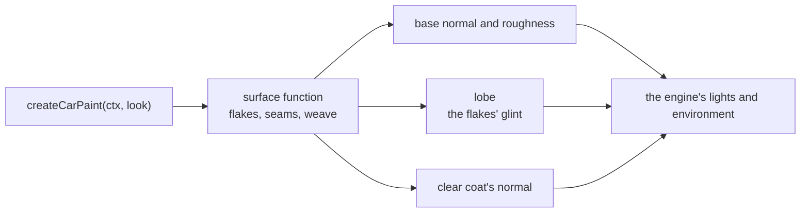

# Car paint

> Roadmap step 0.3, first released in null3D 0.1.0. The API is experimental, so it can still change between versions.

The car paint draws a metallic base under a clear coat. Three parts change the look: metal flakes,
panel seams, and an optional carbon weave. Each part reads the mesh's texture coordinates, so the
paint fits any panel that has them.



The paint is an example add-on in the repository, in the `examples/addons/car-paint` folder. It is
not an npm package. Copy the folder into your project and import its entry point.

## Use it

```ts
import { createCarPaint } from './addons/car-paint';

const paint = createCarPaint(ctx, {
  color: '#9e0b16',
  metalness: 0.72,
  roughness: 0.34,
  flakes: { cells: [120, 210], tilt: 0.25 },
  seams: { spacing: [0.34, 0], width: 0.0022 },
  clearcoat: 1,
  clearcoatRoughness: 0.02,
});

scene.createMesh({ mesh: body, material: paint });
```

## Options

| Option | Meaning | Default |
| --- | --- | --- |
| `color` | The base color | `#9e0b16` |
| `metalness` | How metallic the base is, from 0 to 1 | `0.72` |
| `roughness` | The base's perceptual roughness, from 0 to 1 | `0.34` |
| `clearcoat` | How much clear coat covers the paint, from 0 to 1 | `1` |
| `clearcoatRoughness` | The coat's perceptual roughness, from 0 to 1 | `0.02` |
| `flakes` | `{ cells, tilt, angle, max }`, or `false` | `{ cells: [120, 210], tilt: 0.25, angle: 0.25, max: 64 }` |
| `seams` | `{ spacing, width, shade }`, or `false` | `{ spacing: [0.34, 0], width: 0.0022, shade: 0.85 }` |
| `weave` | `{ cells, shine }`, or `false` | `false` |

- `flakes.cells` counts flake cells across each texture coordinate.
- `flakes.tilt` is how far the flakes' normals spread from the surface normal. It sets the width
  of the band where they catch a light.
- `flakes.angle` is a light's angular radius in radians, which sets how many flakes glint at once.
  A smaller value suits a hard sun, where the glints are rarer and brighter. A larger one suits a
  broad studio light, where more flakes catch it together. Every light answers the same angle.
- `flakes.max` is the most that one pixel's glint may exceed the smooth lobe. It bounds a bright
  single flake.
- `seams.spacing` gives the interval between seams along each texture coordinate. A value of 0
  draws no seam along that coordinate.
- `seams.width` is the groove's half width in the texture coordinates.
- `weave.cells` counts weave cells across each texture coordinate.
- `weave.shine` is how strongly a tow's rounded cross-section shapes its highlight, from 0 to 1.

## How the parts draw

The **flakes** are the metal's microfacets, drawn with the glint model of Deliot and Belcour. Each
pixel covers a number of flake cells. The paint counts how many of the flakes in that footprint
reflect a light into the eye, and uses that count in place of the smooth highlight. A pixel whose
flakes miss the light draws no highlight, and one where a flake catches it draws a bright spot. The
count's average is the smooth lobe, so a car far away draws as smooth metal, without shimmering as
it moves. The spot stays where the light reflects, so the sparkle follows each light as the car
turns. The clear coat keeps its own smooth normal, so the flakes never disturb the coat's
reflection.

The model replaces the base highlight of the main directional light and of each point and spot
light. Area lights draw their own smooth highlight, with no glints.

The **seams** are grooves at the look's intervals. Each groove draws at least as wide as a pixel.
The base darkens in the groove and the coat's normal bends into it, so a highlight runs along the
seam.

The **weave** is a 2 x 2 twill of rounded tows. A tow's normal slopes across it and stays level
along it. The highlight therefore runs along the tow, and the two directions of the twill shine
their own way. The gaps between the tows draw darker and rougher.

## Cost

The paint pays for the clear coat's lobe. The flakes cost the footprint's derivatives and one hash
for each pixel, and the lobe adds two hashes and a short sum of terms for each pixel and each light
that reaches it. The seams cost a few derivatives for each pixel. The weave adds its own pattern,
slope and roughness change. A material without flakes, seams or a weave draws the same surface as a
plain metallic paint.

## Limits

- A mesh must have texture coordinates. A mesh without them does not draw with the paint.
- The parts read the texture coordinates, so uneven coordinates stretch the flakes, the seams and
  the weave. Change `cells` and `spacing` to match the mesh.
- The glints come from the main directional light and from each point and spot light. Area lights
  draw the base highlight alone.

## Related pages

- [Materials](../api/materials.md): the clear coat and its options.
- [Surface functions](../shaders/surface-functions.md): the surface record that the paint returns.
- [A material's own lobe](../shaders/surface-functions.md#a-materials-own-lobe): the hook that the
  glints use.
- [The Showroom demo](https://github.com/null3d-engine/null3d/tree/main/examples/coat-and-sheen): a
  car that uses the paint.
