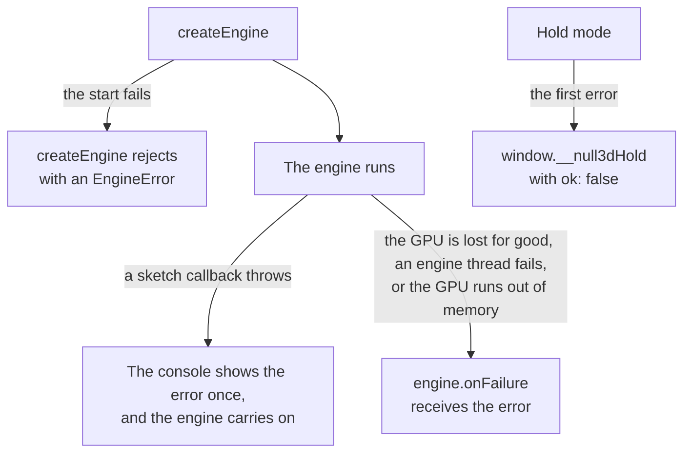

# Debugging

> The in-page inspector and the MCP server run in development builds only.



The engine reports a problem in one of four places, as the diagram shows. Each message says what failed and how to fix it. Some problems raise no error, such as a canvas that shows only the background. [Common failures](#common-failures) lists them with their fixes.

## Error messages

Every error that the engine throws is an `EngineError`. Its message starts with a code. It says what failed and how to fix it, and it links to the code's page:

```text
E1203: setPosition() got NaN for x on an object (slot 2). Check the value computed before this call. NaN often comes from dividing zero by zero, or from normalizing a zero-length vector. See https://github.com/null3d-engine/null3d/blob/generated/docs/errors/E1203.md
```

The error also holds the code in `error.code` and the page's address in `error.docs`. [Error codes](../errors/index.md) lists every code with its cause and fix.

The first error in a thread can show its fix a moment later, while the engine downloads the text that holds the fixes. A start's error waits for that text, so it arrives complete.

## Where problems appear

| When | What happens |
| --- | --- |
| The engine cannot start, for example without a usable GPU path ([E1301](../errors/E1301.md)) | `createEngine` rejects with an `EngineError` |
| The sketch module throws while it loads, for example when it reads `document` | `createEngine` rejects with [E1410](../errors/E1410.md), which quotes the module's error |
| The sketch module has no default export of `defineSketch(...)` | `createEngine` rejects with [E1401](../errors/E1401.md) |
| The setup function throws | `createEngine` rejects with [E1405](../errors/E1405.md), which quotes your error |
| During the start, an engine thread fails or the GPU is lost for good | `createEngine` stops the engine and rejects with [E1404](../errors/E1404.md) or [E1302](../errors/E1302.md) |
| A callback such as `onUpdate` throws | The console shows each distinct error once, with its stack. The engine carries on, and calls the callback again when it next runs |
| After the start, the GPU is lost and cannot come back, or an engine thread fails | `engine.onFailure` receives [E1302](../errors/E1302.md) or [E1404](../errors/E1404.md). The first handler that attaches after the failure still receives it, and the console shows it too. The canvas keeps the last frame: destroy the engine and start a new one |
| After the start, the WebGPU device runs out of memory or rejects the engine's work | `engine.onFailure` receives [E1304](../errors/E1304.md) or [E1305](../errors/E1305.md), once per GPU device. The engine draws on without the objects that failed |
| After the start, the GPU's driver refuses to build a pipeline that draws objects, such as a custom material's | The engine builds it once more, alone, after the other builds. When the driver refuses it again, `engine.onFailure` receives [E1307](../errors/E1307.md), once per GPU device, with the pipeline's name. The engine draws on without the objects that draw with that pipeline. A refused pipeline of a pass of the frame's own, such as the final pass, or a descriptor that the browser's validation refuses, still ends the frames with [E1404](../errors/E1404.md) |
| Sketch code runs after `destroy()`, from a timer, a promise or an event listener | The call throws [E1420](../errors/E1420.md). Remove such code in the sketch's `onDestroy` |
| Hold mode | The hold stops at the first error, and the result says why. [Testing your sketch](testing.md#when-a-hold-fails) lists the cases |

Catch the error of `createEngine`, and show the page without the scene:

```ts
// page.ts
import { createEngine, EngineError } from '@null3d/engine';

try {
  const engine = await createEngine({
    canvas: document.querySelector('canvas')!,
    sketch: new URL('./sketch.ts', import.meta.url),
  });
  engine.onFailure((error) => showFallback(error.message));
} catch (error) {
  showFallback(error instanceof EngineError ? error.message : String(error));
}
```

`showFallback` stands for your own code, such as a still image and a short message.

## Development checks

In the Vite dev server, the engine checks the arguments of each call. A value that is not a finite number throws [E1203](../errors/E1203.md). An object used after `destroy` throws [E1101](../errors/E1101.md). The error comes from the call itself, so its stack points at your line.

A production build from `bunx vite build` leaves the checks out, so it runs faster. Find problems in the dev server first. A bad value that reaches a production build draws a wrong frame, or no frame, and throws nothing.

A page that loads the engine from the [CDN build](../getting-started/cdn.md#production-and-development-entries) picks its build by the address it imports. `lib-dev/index.js` runs the checks, and `lib/index.js` leaves them out. Engine code built without the null3D plugin, or with no bundler at all, runs the checks too. Never time a page that runs them.

## Logs and breakpoints in the sketch

The sketch runs in a worker. The browser shows a worker's console messages in the page's console, so `console.log` in the sketch works as usual. In the browser's developer tools, the sketch worker is a thread of its own. Set breakpoints in the sketch's file there, or put a `debugger` statement in the sketch's code.

To debug on one thread, add `?threads=off` to the page's address. The engine then runs the single-threaded build, and the sketch runs on the page's thread. Compare with a normal run to find a fault that only one build shows.

## How the engine runs on this device

The engine picks a GPU path and a thread mode at the start. Log what it picked:

```ts
console.log(engine.capabilities.tier, engine.mode);
// webgpu {build: 'threaded', latency: 'pipelined', renderThread: 'render-worker', jobWorkers: 6, hold: null}
console.log(JSON.stringify(engine.report)); // every result of the start's tests
```

Add `engine.report` to a bug report. It holds the result of every test, and the GPU's name where the browser shows one.

When the page draws although a worker was meant to, `engine.mode.renderFallback` says why:

| Value | Meaning |
| --- | --- |
| `no-surface` | The browser cannot draw with the GPU path in a worker. |
| `no-answer` | The engine's test worker did not answer in time, twice, as on a stalled GPU or a very busy machine. |
| `failed-to-start` | The test worker's script did not load. |

A development build also logs a warning with the reason. Drawing on the page works, but the page's own code then shares its thread with the drawing ([Page API: createEngine](../api/engine.md#what-the-engine-reports)).

Switches in the page's address force a choice, so you can find which path shows a fault. The engine reads them in development builds. A production build reads them only when the Vite plugin's `urlSwitches` option is on:

| Switch | Effect |
| --- | --- |
| `?gpu=webgl2`, `?gpu=webgpu`, `?gpu=compat` | Draw with that GPU path, where the device has it |
| `?threads=off` | Run the single-threaded build |
| `?render=main` | Draw on the page's main thread |
| `?latency=low` | Use the low latency mode |
| `?inspect` | Open the in-page inspector, which lists the scene and edits it live, in a development build ([The in-page inspector](#the-in-page-inspector)) |

[Testing your sketch](testing.md#switches-for-tests) lists more switches.

## See the scene with debug drawing

`ctx.debug` draws lines over the scene for one frame. Use it to see positions, directions, bounds and cameras:

```ts
// sketch.ts, in onUpdate
debug.axes(player);                                  // the player's own axes
debug.sphere([0, 1, 0], 2, '#ff0000');               // a trigger zone
debug.arrow(muzzle, aim, 10);                        // where a shot goes, from two vectors of yours
```

Only development builds draw the lines. [Debug drawing and stats](../api/debug.md) lists every call.

To check normals, depth, overdraw, triangle edges, shadows or levels of detail, draw the whole scene with a debug view. In the sketch, `debug.view('wireframe')` draws every triangle's edges, and `debug.view('lit')` draws the materials again. `?view=levels` in the page's address shows a demo's levels with no code change. [Debug views](../api/debug.md#debug-views) lists the views.

To see whether shadow edges crawl as the camera moves, draw `'shadows'` from a still camera. Then let `debug.shadowCamera` place the cascades from the moving one ([Watch the shadow cascades from elsewhere](../api/debug.md#watch-the-shadow-cascades-from-elsewhere)).

## Reproduce a frame

A bug that shows at one moment is easier to fix when every run reaches it. Hold mode steps the sketch to a set time in fixed steps, with seeded random numbers and no input. The command `bunx @null3d/cli shot` holds your page in a headless browser. When the hold fails, it prints the sketch time and the frame of the first error:

```text
Drew no frame of /: E1408: hold mode stopped at 1 seconds, in frame 61: E1203: setPosition() got NaN for x on an object (slot 2). ...
```

It also saves the errors and warnings that the page logged, with their stacks, in a JSON file. [Testing your sketch](testing.md) explains hold mode.

## Measure

The stats overlay shows frame figures over the top-right corner of the canvas, or over its bottom-right corner with the `corner` option. Its header shows the frame rate. A click opens a card with each thread's CPU time and the GPU's time against the target frame rate. The card also shows memory, draw calls, triangles and objects drawn, and what holds the frame rate back.

It lists the GPU time of each step of the frame that the GPU timed, such as the opaque pass or bloom. An add-on feature that reports figures gets a row of its own, with its GPU time, its settings, its budget and its memory.

Show it from the page with `createEngine({ stats: true })`, `engine.stats(true)` or the `?stats` switch, or from the sketch with `debug.stats(true)`.

The call `debug.frameStats()` gives the sketch the engine's figures, for logs and tests. Both work in production builds too. A development build also breaks memory down by engine system. [Debug drawing and stats](../api/debug.md#stats-overlay-and-frame-figures) lists the figures.

`engine.measure(seconds)` measures the running engine from the page: CPU time per frame by thread and phase, GPU time, frame intervals, uploads, draw calls and memory. [Debug drawing and stats](../api/debug.md#frame-measurement) shows an example, and the [performance guide](performance.md) explains the numbers.

To test a page's handling of a lost GPU, call `engine.simulateGpuLoss()`. The engine starts a new GPU device and draws the whole scene again, as it does after a real loss. The `gpuLosses` figure of `engine.measure()` counts the losses that the engine carried on after since it started, the simulated ones included.

## The in-page inspector

`?inspect` opens a panel at the left edge of the page, over the canvas. The panel lists the scene as a tree, with each object's name and kind under its parent. A search box narrows the tree by name or kind. A click selects an object and outlines it in the view. It then shows the object's fields:

- position, rotation and scale;
- visibility and the static or dynamic flag;
- for a mesh, its base color, roughness, metalness and opacity.

The panel also shows the frame figures at its foot, which it reads every second.

The panel runs in a development build only, and its code loads when the page first asks for it. A held page and a replay open no panel and publish no bridge. A change lasts until the page reloads. Live edits are for exploring: write the final values into the sketch and its tests.

The page publishes the panel's bridge as `window.__null3dInspector`, and the engine's `inspect` method runs the same calls from your own code. Both exist in a development build only:

```ts
const objects = await engine.inspect?.('objects');
if (engine.inspect) {
  await engine.inspect('setObject', { selector: 'cr', position: [0, 1, 0] });
  await engine.inspect('setMaterial', { selector: 'cr', values: { color: '#ff0000' } });
}
```

Each call that names an object takes a selector, and each call returns a JSON-safe value. A selector is an object's name, its slot as `#<slot>`, `#camera` for the active camera, or a slot number.

| Call | Arguments | Answer |
| --- | --- | --- |
| `objects` | `{ filter?, limit? }` | `{ objects, count, truncated }`: the live objects, or those whose name or kind holds the filter, at most 50,000. Each gives its slot, handle, name, kind, static or dynamic flag, visibility, layers, parent, child count and, for a mesh, its material's id. `count` counts every match, and `truncated` is true when the list holds fewer |
| `object` | `{ selector }` | One object, with its position, rotation, scale, world position, flags and material values |
| `setObject` | `{ selector, position?, rotation?, rotationEuler?, scale?, visible?, dynamic?, layers? }` | The object after the change. `rotation` is a quaternion; `rotationEuler` is X, Y and Z angles in radians |
| `setMaterial` | `{ selector, values }` | The mesh after the change. `values` takes the material's values, such as `color`, `opacity`, `metalness` and `roughness` |
| `stats` | none | The frame figures that `debug.frameStats` returns |
| `errors` | none | The errors that the sketch's code and the engine's frame calls reported, newest last |
| `graph` | none | The compiled render graph as DOT text |
| `setQuality` | `{ preset?, settings? }` | The preset and settings after the change |
| `highlight` | `{ selector? }` | The outlined object, or none |
| `info` | none | The GPU path, the preset and the render scale |
| `capture` | none | `{ png, bytes }`: the next frame as a PNG image in base64 text, and its size in bytes. The page answers this call itself |

## The MCP server

`bunx @null3d/cli mcp` starts a Model Context Protocol server over stdio. A coding agent lists and changes the scene's objects, captures a frame, and reads the frame figures, the errors and the render graph. It can also switch the quality preset or the GPU path. The page needs a development build, because a production build leaves the inspection channel out.

By default the server starts the project's own Vite dev server and a headless Chrome, which works on a cloud agent with no window. With `--connect <endpoint>` it drives a Chrome that you already run with a debugging port, so the agent sees exactly what you see. A held page and a replay publish no bridge. [The `mcp` command](../cli/null3d.md#mcp) lists every option and tool.

Live changes are for exploring. Write the final values into the sketch and the tests, and check them with `bunx @null3d/cli test`.

## Common failures

| What you see | Cause | Fix |
| --- | --- | --- |
| The canvas shows only the background | The sketch set no active camera | Call `scene.setActiveCamera(camera)` |
| An object that should show does not | It is behind the camera, or outside the camera's near and far distances (0.1 to 2,000 meters by default) | Draw its place with `debug.axes`, and check the camera's `near` and `far` |
| Objects are black | The scene has no light, and `materials.standard` needs light | Add a light, or use `materials.unlit` |
| Parts of a custom material draw black | The shader computes NaN there, such as from `normalize` of a zero vector, `pow` of a negative number or a division of zero by zero. The engine draws NaN as black, so it cannot spread through bloom | Guard the math: `normalize` only vectors longer than 0, and `pow` only numbers of 0 or more |
| `document is not defined` or `window is not defined` | The sketch's code uses the page's DOM, which a worker does not have | Keep DOM code in the page, and send the sketch [messages](../api/page.md) |
| `engine.mode.build` is `single` | The page is not cross-origin isolated | Send the two headers that [Hosting and cross-origin isolation](../getting-started/hosting.md) lists |
| Rows written to an instance batch do not move | The batch is static, and the rows are not marked | Call `markDirty`, or create the batch with `dynamic: true` ([Instances and batching](../concepts/instances.md)) |
| Writes to instance rows stop working in the single-threaded build | The sketch kept the batch's arrays from the setup, and the engine's memory grew | Read `batch.positions` and the other arrays each time you use them |
| `createEngine` fails with E1419 | Another engine still draws on the canvas | Call `destroy()` on the old engine. React's StrictMode starts, destroys and starts an effect's engine: the second start waits for the destroy |
| A new texture shows only its material's color for a few frames | Texels go to the GPU over several frames | Keep the first view's textures small, or wait a few frames before you remove the loading screen ([Loading screens and warm-up](loading-screens.md)) |

## Related pages

- [Error codes](../errors/index.md): every code, with its cause and fix.
- [Testing your sketch](testing.md): hold mode, image tests and switches.
- [Debug drawing and stats](../api/debug.md): lines over the scene, the stats overlay, and `engine.measure`.
- [Performance guide](performance.md): what to do when frames take too long.
