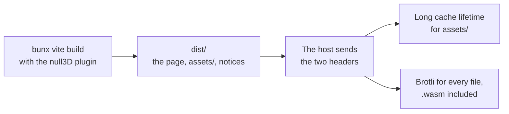

# Deploying



A null3D project ships as the static files of a Vite production build. This page lists what the host must do with those files, so that the engine runs on worker threads and starts fast. [Hosting and cross-origin isolation](../getting-started/hosting.md) explains each step in full.

## Build for production

```sh
bunx vite build
bunx vite preview
```

`bunx vite build` writes the build to `dist/`. The null3D Vite plugin compiles the sketch for its worker, ships the engine's WebAssembly core and drops the engine's development checks. It also writes these files beside the page:

| File | What it is for |
| --- | --- |
| `null3d-third-party-notices.txt` | The licenses of the code that the engine ships. Publish it with the build, or show its text in your credits ([Third-party notices](../getting-started/third-party-notices.md)). |
| `null3d-files.json` | The list of the build's files, for a service worker that caches the game for offline play ([Offline play](../getting-started/hosting.md#offline-play)). |

`bunx vite preview` serves the build with the same headers and caching as a well-set host. Test a start there, never on the dev server ([A fast start](start-time.md#test-a-production-build)).

## Send the two headers

Worker threads need the page to be cross-origin isolated. The host sends two headers with the page:

```text
Cross-Origin-Opener-Policy: same-origin
Cross-Origin-Embedder-Policy: require-corp
```

| Host | Where the headers go |
| --- | --- |
| Netlify, Cloudflare Pages | A `_headers` file at the root of the site |
| Vercel | The `headers` list of `vercel.json` |
| nginx | `add_header` lines with `always` |
| GitHub Pages | No custom headers, so the page runs single-threaded |

[Headers on common hosts](../getting-started/hosting.md#headers-on-common-hosts) gives each file. Without the headers, the engine loads its single-threaded build. The page still runs, with the same API and features, on one thread. Files from other sites need CORS or `Cross-Origin-Resource-Policy` headers under isolation ([Files from other sites](../getting-started/hosting.md#files-from-other-sites)).

Serve the page over HTTPS. WebGPU and shared memory need a secure page. Over plain HTTP, the engine draws with WebGL2. A browser that drives a test must also start with `--enable-unsafe-webgpu`: [Testing your sketch](testing.md#the-browser-must-take-the-webgpu-path) gives the setup.

## Let browsers keep the files

Vite names the files in `assets/` with a hash of their content, so a file under a given name never changes. Let browsers keep those files for a year, and have them check the HTML page on each visit. Send `.wasm` files with `Content-Type: application/wasm`, so Chrome keeps the compiled core. [Hosting](../getting-started/hosting.md#let-browsers-keep-the-build-files) gives the headers for each host, and its [compiled core](../getting-started/hosting.md#let-chrome-keep-the-compiled-core) section gives the rule.

## Compress with Brotli

Brotli shrinks the engine's files more than gzip does, because the engine's shader text repeats far apart. The engine core's WebAssembly file takes about 0.6 MB with Brotli. Compress every file of the build, `.wasm` included: Netlify, Cloudflare Pages and Vercel do it for you, and nginx needs `ngx_brotli`'s `brotli_static`. [Send the files with Brotli](../getting-started/hosting.md#send-the-files-with-brotli) gives each host's settings.

## Size budgets

A page's start downloads the engine, then the files of the first view. Keep each part small:

| Part | Size after Brotli | How to check it |
| --- | --- | --- |
| The engine's JavaScript at the start | About 217 KB on WebGL2 and 203 KB on WebGPU, for a pipelined page | The network panel |
| The engine core: its WebAssembly file and its JavaScript glue | About 627 KB | The network panel |
| Your own models and textures | Your choice | `bunx @null3d/cli assets optimize --report report.json` |
| An add-on's files after the start | The budgets of the `sizes` gate | `bunx @null3d/cli check-addon` |

So the engine's start takes about 844 KB after Brotli, before the page's own code and the scene's files. The JavaScript counts the engine's code for the page and its workers and the GPU path's renderer. It also counts the largest shader file that a start can load. [Send the files with Brotli](../getting-started/hosting.md#send-the-files-with-brotli) gives the figures for gzip and for files as they are.

The host stores the shader files of both GPU paths, and a page downloads one path's. A build that ships a subset copies no files of the paths it leaves out. That saves most of the shader set's size in the app package, the installer and the host. The start stays the same.

A visitor who downloads the whole app also downloads less: an Electron installer, a zip of the site, or the files that a service worker caches. [Ship a subset of the GPU paths](assets-pipeline.md#ship-a-subset-of-the-gpu-paths) gives the measured sizes.

`assets optimize` makes models and their textures smaller, and its report warns for each quality preset whose texture memory a model passes ([The budget report](assets-pipeline.md#the-budget-report)). Phones and tablets start at the Low and Medium presets, which give textures less memory.

To shorten the start, begin the first view's downloads at the top of the setup. Draw the first frame before the large models arrive ([A fast start](start-time.md)).

## Check the deployed page

1. Open the deployed page, and read `crossOriginIsolated` in the browser's console. It is `true` when the headers arrived.
2. Read `engine.capabilities.threaded` and `engine.capabilities.tier` in your page, to see which build and GPU path the engine took.
3. In the network panel, check that the `.wasm` files arrive compressed, with `Content-Type: application/wasm`.
4. Reload the page. The files in `assets/` should come from the cache, with no request to the host.
5. Open the page on a phone, over the deployed HTTPS address.

## Related pages

- [Hosting and cross-origin isolation](../getting-started/hosting.md)
- [A fast start](start-time.md)
- [Network use](../getting-started/network-use.md)
- [Try null3D from a CDN](../getting-started/cdn.md)
- [Phones and tablets](phones.md)
