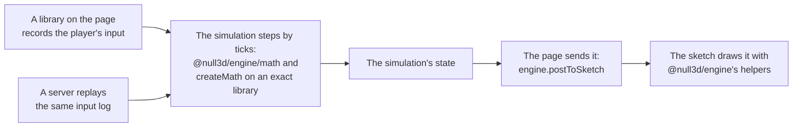

# Using null3D with a deterministic simulation

> Roadmap step 0.3, first released in null3D 0.1.0. The API is experimental, so it can still change between versions.



Some games keep their rules in a simulation: code that steps the game by ticks from a seed and a log of the player's input. A server can then replay the log and check a score. The replay must give the same bits as the player's browser, on every JavaScript engine. So the simulation may use only exact arithmetic, and no page API.

null3D draws such a game. The sketch draws the simulation's state, and nothing that the sketch does changes that state. The simulation may import one part of null3D: the helpers in its maths entry.

## What a simulation may import

The maths entry holds the math helpers that use exact arithmetic alone: `+`, `-`, `*`, `/`, `Math.sqrt`, `Math.abs`, `Math.min` and `Math.max`. Their results are the same bits in V8, JavaScriptCore and SpiderMonkey.

| Import from | Helpers |
| --- | --- |
| `@null3d/engine/math/vec3` | `create`, `set`, `copy`, `add`, `sub`, `multiply`, `scale`, `scaleAndAdd`, `negate`, `dot`, `cross`, `length`, `squaredLength`, `distance`, `squaredDistance`, `normalize`, `lerp`, `min`, `max`, `transformQuat` and `transformMat4` |
| `@null3d/engine/math/quat` | `create`, `set`, `copy`, `identity`, `fromMat4`, `lookAt`, `rotationTo`, `multiply`, `invert`, `normalize` and `dot` |
| `@null3d/engine/math/mat4` | `create`, `identity`, `copy`, `multiply`, `invert`, `compose` and `decompose` |
| `@null3d/engine/math/math` | `clamp`, `lerp`, `inverseLerp`, `mapLinear`, `smoothstep`, `degToRad`, `radToDeg` and `euclideanModulo` |
| `@null3d/engine/math` | `createMath`, and the types `Vec2Like`, `Vec3Like`, `QuatLike`, `Mat4Like`, `EulerOrder`, `MathFunctions` and `MathHelpers` |

Each helper is the same function as the main entry's helper of that name, so the [Math helpers](../api/math.md) page describes it. Import a sub-path as a namespace or by name. A bundler then keeps only the helpers that the simulation calls: six helpers add about 1.2 KB.

```ts
// sim/ship.ts: simulation code
import * as math from '@null3d/engine/math/math';
import * as quat from '@null3d/engine/math/quat';
import * as vec3 from '@null3d/engine/math/vec3';

const forward = vec3.create();
const AHEAD = [0, 0, -1];

export function stepShip(position: number[], heading: number[], thrust: number): void {
  vec3.transformQuat(forward, AHEAD, heading);
  vec3.scaleAndAdd(position, position, forward, math.clamp(thrust, 0, 1) * 0.2);
  quat.normalize(heading, heading);
}
```

Never import `@null3d/engine` itself in simulation code. Its bundle brings the engine's page code with it: `Atomics`, `document`, `navigator`, `requestAnimationFrame`, a top-level `FinalizationRegistry`, and helpers that call `Math.sin`, `Math.cos`, `Math.acos`, `Math.exp` and `Math.random`. A replaying engine that scans the simulation for those names refuses it. Bun 1.3.11 bundled six helpers from `@null3d/engine` into 87,902 bytes. From the sub-paths, the same six took 1,202 bytes.

The maths entry leaves out four groups:

- The helpers that turn by an angle or ease over time, `quat.setAxisAngle`, `fromEuler`, `rotateX`, `rotateY`, `rotateZ` and `slerp`, `vec3.angle` and `math.damp`. They need a sine, a cosine, an arc cosine or an exponential. The browser's `Math` computes those differently on different JavaScript engines. Build them with `createMath` on exact functions instead.
- The random helpers, `math.random`, `seed`, `randFloat`, `randInt` and `randFloatSpread`. They share one generator per thread, which starts from `Math.random`. Draw a simulation's random numbers from its own seeded generator.
- The `color` helpers. Most of them use `**`, and a simulation has no use for color.
- Everything else of the engine: scenes, cameras, raycasts and input belong to the sketch and the page.

## Angles and exponentials: createMath

`createMath({ sin, cos, acos, exp })` returns the eight helpers that the maths entry leaves out, built on the four functions that you pass. Pass an exact math library's functions, which give the same bits on every JavaScript engine. clockwork2's `dmath` is one:

```ts
// sim/turn.ts: simulation code
import { createMath } from '@null3d/engine/math';
import * as quat from '@null3d/engine/math/quat';
import { acos, cos, exp, sin } from '@clockwork2/engine/dmath';

// Once, at load: createMath allocates the helpers.
const exact = createMath({ sin, cos, acos, exp });
const turn = quat.create();
const UP = [0, 1, 0];

export function steer(heading: number[], angle: number): void {
  exact.quat.setAxisAngle(turn, UP, angle);
  quat.multiply(heading, heading, turn);
}

export const ease = (speed: number, goal: number, dt: number) => exact.math.damp(speed, goal, 4, dt);
```

- The helpers come grouped as the main entry groups them: `exact.quat.setAxisAngle`, `fromEuler`, `rotateX`, `rotateY`, `rotateZ` and `slerp`, `exact.vec3.angle` and `exact.math.damp`.
- Each takes the same arguments and does the same arithmetic as the main entry's helper of its name. Given `Math.sin`, `Math.cos`, `Math.acos` and `Math.exp`, its results are the main entry's, bit for bit.
- Import the four functions by name, as above. A whole namespace passed as a value, as in `createMath(dmath)`, makes a bundler keep every function of the library.
- `createMath` throws [E1213](../errors/E1213.md) when one of the four is not a function.
- The helpers cost about 2.2 KB together, in one object, which a bundler keeps whole.

An exact library and the browser's `Math` can differ in the last bit. So the sketch draws the state that the simulation computed, rather than computing it again with its own helpers.

## Keep decisions out of the sketch

Nothing in the sketch is in the input log, and no server runs it. So anything that decides a result belongs in the simulation:

- **Input.** The sketch's `ctx.input` hears the page's events, which the log does not hold. The simulation reads its input from the library that records it.
- **Picking.** Pointer events on objects, `scene.raycast` and `camera.screenToRay` test the scene that the engine last drew, in its WebAssembly core. A replay has no such scene. Hit-test the recorded pointer position against the simulation's own shapes, with a camera that the simulation owns. The simulation builds the camera's projection matrix itself. Then `mat4.multiply`, `mat4.invert` and `vec3.transformMat4` turn a screen point into a ray.
- **Physics.** A physics library in the sketch, as [Using a physics library](physics.md) shows, moves things that only look right. Collisions and forces that decide a result run in the simulation, written with exact arithmetic.
- **The camera.** [Camera controls](../api/controls.md) move the camera from the sketch's input. A camera that the game's rules aim, such as one that follows the player, comes from the simulation's state.
- **Time.** The sketch's `dt` follows the display. The simulation steps by its own ticks, and the sketch draws the latest state it got, or blends between the last two.

The sketch still draws with the main entry's helpers, which use the browser's `Math` at full speed.

## Sending the state to the sketch

The page sends the simulation's state after each tick with `engine.postToSketch`. The sketch takes it with `page.onMessage`, as [Messages between the page and the sketch](../api/page.md) shows, and draws it in `onUpdate`. The page sends one message per tick, so send only the numbers that the sketch draws. When the sketch runs in a worker, the browser copies each message's data.

## A production build of a game's engine files

A game can take null3D's files as one folder: the engine's code, its workers, its cores, its shader modules and the sketch. This suits a game whose page module another build makes. A Vite build with the null3D plugin writes the folder from a two-line entry, and the game's own module imports the entry.

```ts
// engine-entry.ts
export { createEngine } from '@null3d/engine';
export const SKETCH = new URL('./sketch.ts', import.meta.url);
```

```ts
// vite.config.ts
import null3d from '@null3d/vite-plugin';
import { defineConfig } from 'vite';

export default defineConfig({
  base: './', // the folder works from any address
  plugins: [null3d()],
  build: {
    outDir: 'dist/engine',
    modulePreload: false, // the entry is a module that another module imports, not a page
    rollupOptions: {
      input: { entry: 'engine-entry.ts' },
      preserveEntrySignatures: 'exports-only', // keep the entry's exports
      output: { entryFileNames: 'entry.js' },
    },
  },
});
```

The game's module then imports `createEngine` and `SKETCH` from the folder's `entry.js`, and passes `SKETCH` as the `sketch` option. The plugin also writes `null3d-files.json`, which lists the files that the start loads and those of each feature, as [Hosting](../getting-started/hosting.md) describes.

The shader modules decide most of the folder's size. Build only the shader permutation words that the game draws with:

1. Record the words from a run of the game's page, as [Build only the shader permutations you draw with](assets-pipeline.md#build-only-the-shader-permutations-you-draw-with) shows. Name the game's pages with `--page`, or `--live` for a page that the recorder drives through its states. Record on both GPU paths, and at the low and high presets.
2. In a checkout of null3D, build the shader modules from the list: `NULL3D_SHADER_PERMUTATIONS=<list> bun run shaders`. The checkout's `packages/engine/src/generated` then holds them.
3. Build the game with `NULL3D_ENGINE_SHADERS` set to that folder, such as `NULL3D_ENGINE_SHADERS=<checkout>/packages/engine/src/generated bunx vite build`. The plugin then takes the narrowed modules in place of the full set.

A small game scene with three lanes and a ship drew with 5 words. Its folder held 297 files and 26,057,130 bytes, 4,737,421 after Brotli. The same folder built with the 172 words of null3D's examples held 759 files and 225,683,678 bytes. The full set of shader modules is 4,117,799,356 bytes. Record again after the game gains a feature that turns on a new word. The engine names a word that the set lacks the first time a pipeline needs it.

## API reference

The [Math helpers reference](../api/reference/math.md) lists `createMath` and its types.
