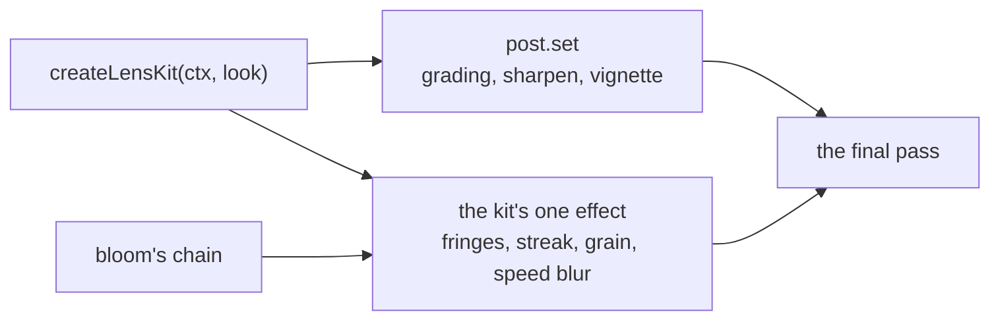

# Lens kit

> Roadmap step 0.3, first released in null3D 0.1.0. The API is experimental, so it can still change between versions.

The lens kit gives a scene one camera look. It sets the engine's own grade, sharpening and
vignette from one object. It draws the camera's smaller marks in a single full-screen effect: film
grain, color fringes, an anamorphic streak and a radial speed blur. A mark that a look leaves at 0
costs no work, and a look with all four at 0 adds no effect at all.



The kit is an example add-on in the repository, in the `examples/addons/lens-kit` folder. It is not
an npm package. Copy the folder into your project and import its entry point.

## Use it

```ts
import { createLensKit } from './addons/lens-kit';

const lens = createLensKit(ctx, {
	sharpen: 0.35,
	vignette: { intensity: 0.55, size: 1.05, falloff: 2.2 },
	grading: { lift: [-0.02, -0.02, -0.02], gain: [1.05, 1.05, 1.05], saturation: 1.08 },
	bloomLevel: 2,
	aberration: 0.8,
	streak: 0.45,
	grain: 0.045,
	speedBlur: 0,
});

// Later, change part of the look. A value that a call leaves out keeps its own.
lens.set({ vignette: false });
```

## Options

| Option | Meaning | Default |
| --- | --- | --- |
| `sharpen` | How much the picture sharpens, 0 or more, or `false` | `false` |
| `vignette` | The core's vignette settings, or `false` | `false` |
| `grading` | The core's grading controls, or `false` | `false` |
| `bloomLevel` | The level of bloom's chain that the streak reads | `3` |
| `aberration` | How far red and blue pull apart at the corners, in pixels | `0` |
| `streak` | How much of bloom's glow bleeds sideways | `0` |
| `grain` | How much the grain changes each pixel's brightness, 0 to 1 | `0` |
| `speedBlur` | How far the frame smears toward the middle, 0 to 1 | `0` |

## How the parts draw

The **grade**, the **sharpening** and the **vignette** are the engine's own settings, which the kit
writes with `post.set`. The grade is the core's grading controls, and a job worker bakes them into
the table that the final pass reads. The kit therefore keeps no color table of its own, and a look
that must show a surface's own color passes `grading: false`.

The **color fringes** move the red and the blue channels apart toward the edges. The offset grows
with the distance from the middle, so the center stays sharp. The outermost band of the frame keeps
a smaller offset, because a sample pulled beyond the picture reads the frame's own edge row.

The **streak** reads a level of bloom's chain with `effectBloom`. That level holds the light that
passed bloom's threshold, already blurred. The streak spreads that light sideways, so it never
blurs the picture a second time. The spread carries the light's own color, so a red reflection
flares red rather than taking a tint of its own. Bloom must be on, or the streak adds nothing.

The **speed blur** adds samples along the line from each pixel to the middle. It reads neighboring
pixels, so it draws its own pass.

The **grain** changes each pixel's brightness from an integer hash of the pixel and the time. It
changes 24 times a second whatever the frame rate, so it looks like film rather than like the
display.

The effect runs on linear HDR color, after the exposure and before the tone curve, as every custom
effect does. Grain on linear color therefore reads softer than the same value on display color. Tune
it by eye.

## Use it with the engine's own settings

The kit writes `grading`, `sharpen` and `vignette`, and a later `post.set` that carries any of
those three takes them back. Write every look through the kit, or set those three yourself and give
the kit only its own marks. The kit does not own the depth of field, the bloom, the ambient
occlusion or the outlines, so those stay with `post.set`.

`lens.effect` is the effect while a mark is above 0, and `null` while every mark is 0. Read it to
know whether the marks draw, such as on a device that has no HDR target.

## Cost

The kit's marks draw in one full-screen pass with up to 18 reads of neighboring pixels. A mark that
a look leaves at 0 skips its reads. The fringes take 2, the streak 10 and the speed blur 6, and the
grain takes none. A look with only the grain therefore pays no neighbor read. A look with every mark
at 0, such as one that wants the grade alone, adds no pass at all.

The grade and the vignette run inside the final pass and add no pass of their own. The sharpening at
the whole canvas's render scale adds the first step of the two-step pass, as any `sharpen` value
does. Below the whole canvas's render scale, effects do not join passes, so each draws one.

On a MacBook Pro with an M3 Max, the canvas is 3840 by 2160 CSS pixels with the pixel ratio held at
2. That draws 33 megapixels. There the whole look costs about 3 to 4 ms of GPU time a frame, on
WebGPU and in compatibility mode. The cost follows the pixels: a megapixel costs about a tenth of
a millisecond. WebGL2 keeps no figure for the whole look, because its cleared frame moves by more
than the look there. Its marks stand instead. The add-on's README holds the figure at each preset
and for each mark.

## Limits

- The effect needs HDR color, as bloom does. On a device without a float target it stays off, and
  the grade and the vignette still apply.
- The streak needs bloom. A look that leaves bloom off adds nothing where the streak would show.
- `bloomLevel` is fixed when the effect is made. A `set` that changes it makes the effect again.
- The effect draws no depth of field, no bloom and no ambient occlusion. The engine's own settings
  draw those.

## Related pages

- [Post-processing](../concepts/post-processing.md): the chain, its passes, and where an effect runs.
- [Custom passes and render targets](custom-passes.md): the effect hook that the kit uses, and its
  uniforms.
- [Color grading](../api/post.md): the grading controls that the kit sets.
- [The post effects demo](https://github.com/null3d-engine/null3d/tree/main/examples/post-effects): a
  neon alley whose look comes from the kit.
