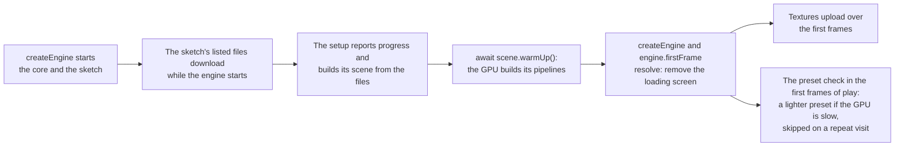

# Loading screens and warm-up



A loading screen covers the canvas while the engine starts and the sketch loads its files. It stays while the sketch builds its scene and the GPU gets ready to draw it. The page draws the screen in HTML, and the sketch tells it how far loading has come with messages.

Then comes warm-up: the GPU builds a pipeline for each kind of object in the scene. When the engine chose the quality preset itself, it then checks that the GPU draws the scene fast enough at that preset. By default it checks in the first moments of play, so the loading screen does not wait for it.

## Report progress from the sketch

The `downloads` option of `defineSketch` names the files that the setup loads. A live start begins to download them as soon as the sketch's module has loaded, often while the engine's core still downloads. The handler of `assets.onProgress` counts them as they arrive, including the bytes that arrived before the setup added it. The setup's loads take the files that arrived or are on their way, so nothing downloads twice. The [glTF model demo](https://github.com/null3d-engine/null3d/tree/main/examples/gltf-model) reports its downloads through the shared loading helper.

```ts
// sketch.ts
import { defineSketch } from '@null3d/engine';

const LEVEL = '/levels/one.json';
const TERRAIN = '/tex/terrain.png';
const ROCKS = '/tex/rocks.png';

export default defineSketch(
  async ({ assets, page, scene }) => {
    assets.onProgress((loaded, total) =>
      page.post('loading', {
        text: 'Downloading the scene files',
        value: total > 0 ? loaded / Math.max(total, loaded) : undefined,
      }),
    );
    const [level, terrain, rocks] = await Promise.all([
      assets.loadJson(LEVEL),
      assets.loadTexture(TERRAIN, { wrap: 'repeat', anisotropy: 8 }),
      assets.loadTexture(ROCKS),
    ]);
    // Build the scene from the level and its textures here.
    await scene.warmUp();
  },
  { downloads: [LEVEL, TERRAIN, ROCKS] },
);
```

List the files in the order that the setup needs them, and name only the files that the first frame waits for. Two listed files download at a time, so the engine's own files, such as the first frame's shaders, still find free connections to the server. When the setup loads a listed file that has not started, that file goes first. It starts at once, unless four listed files already download. [The download list](../api/sketch.md#the-download-list) gives the rules.

Start the files that the first frame does not need when the sketch's `engine.firstFrame` resolves. They then leave the network to the first frame's files ([The engine field](../api/sketch.md#the-engine-field)). For a later stage that loads during play, `assets.preload` downloads its files together when the call runs.

A development build watches the setup's loads. It warns once when a load started its download only after another load's file had arrived, while no other file downloaded. The warning names both files. Start both loads before you await either, as `Promise.all` does above, or name both in `downloads`. When the second address comes from the first file's contents, the order is needed: pass `serialLoadWarning: false` to turn the warning off ([Loads one after another](../api/sketch.md#loads-one-after-another)).

The handler gets the bytes downloaded so far and the bytes expected so far. The total is the length of each response that announced one, so it grows as the scene starts more files.

A file that fails counts as done, so the bar still reaches its end. The failed load rejects with an error that says what went wrong. [Assets](../api/assets.md) covers the loading calls and their errors.

[A fast start](start-time.md) gives what each of these steps saved on a phone's connection.

## Show progress on the page

The page passes `onSketchMessage` to `createEngine`, so it hears the messages that the sketch sends during its setup. It removes the loading screen when `engine.firstFrame` resolves: until the GPU has finished the first frame, the canvas is blank. When the promise rejects, the engine stopped before that frame, and the screen shows the error instead.

A percentage must come from work that is counted. `onProgress` gives the engine core's bytes, measured against the length that the server announced. `assets.onProgress` gives a scene's files the same way. Neither knows how much of the whole start is left.

So the page measures each phase on its own, and it names the phase beside its number. Within a phase the bar never falls, even when a scene's total grows as it starts more files. When the label changes, a new measure starts from 0, as `show` does below.

```ts
// page.ts
import { createEngine } from '@null3d/engine';

const label = document.querySelector<HTMLElement>('#label')!;
const bar = document.querySelector<HTMLElement>('#bar')!;
let phase = '';
let shown = 0;
/** Shows a phase's share of its own work. A new phase starts a measure of its own. */
const show = (text: string, value?: number) => {
  if (text !== phase) {
    phase = text;
    shown = 0;
  }
  label.textContent = text;
  if (value === undefined) return; // no total: the bar keeps moving
  shown = Math.max(shown, value);
  bar.style.width = `${Math.round(shown * 100)}%`;
};

const engine = await createEngine({
  canvas: document.querySelector('canvas')!,
  sketch: new URL('./sketch.ts', import.meta.url),
  onProgress: (stage, progress) => {
    if (stage === 'core-download' && progress?.total)
      show('Downloading the engine', progress.done / progress.total);
  },
  onSketchMessage: (name, data) => {
    const message = data as { text?: string; value?: number };
    if (name === 'loading') show(message.text ?? '', message.value);
  },
});
try {
  await engine.firstFrame;
  document.querySelector('#loading')?.remove();
} catch (error) {
  // The engine stopped before its first frame: say why on the loading screen.
  show((error as Error).message);
}
```

A stage without a countable total shows no percentage. Keep the bar moving, or show a count that the engine does know. Do not take a number from a timer or from the stage's place in the start.

A handler that `engine.onSketchMessage` adds after `createEngine` resolves hears the setup's messages late, once the setup ends. That is too late for a progress bar.

A start can also wait for memory. When the browser has refused the engine's memory for 10 seconds, `onProgress` reports `memory-wait`. The engine then tries for about 35 seconds more, so tell the user that the start takes longer than usual.

## Pipelines and warm-up

The GPU draws each object with a pipeline: compiled shaders, and the drawing state that goes with them. One pipeline serves every object with the same shading model and the same vertex format of mesh. A thousand materials of one shading model share it, so a scene needs few pipelines, often fewer than ten. [Performance guide](performance.md#how-the-engine-batches-builds-pipelines-and-times-frames) lists what sets pipelines apart.

Pipelines take time to build. In the engine's warm-up test, a scene of ten pipelines took up to 0.4 seconds to build in Chrome and Safari on a MacBook Pro. It took 0.8 seconds on WebGPU in Firefox.

The engine's benchmark scenes need 2 to 4 pipelines each. In the engine's warm-up time test, they took these times on a phone and a tablet:

| Device and GPU path | First visit | Repeat visit |
| --- | --- | --- |
| 11-inch iPad Pro, Safari, WebGPU | 21 to 31 ms | 21 to 32 ms |
| 11-inch iPad Pro, Safari, WebGL2 | 35 to 53 ms; S4 0.41 s | 35 to 61 ms |
| Galaxy S24+, Chrome, WebGL2 | 45 to 115 ms | 29 to 88 ms |

On a first visit, the browser compiles every shader. On a repeat visit, it reuses what it compiled before. The S4 benchmark, a town with a shadow-casting sun, was the slowest scene on each device.

A larger scene needs many more pipelines, because each pass, effect and custom material adds its own. A custom material's shader holds the whole lit shading code around its own function, so its pipelines are among the slowest to build. On a phone, a showcase scene's first frame builds 45 to 63 pipelines, which take most of the start. The build takes a few seconds on a fast phone, and up to about 24 seconds on a slow tablet.

Safari reused its compiled shaders on a repeat visit. Chrome's own cache of compiled pipelines on Android is too small to keep a scene's worth. The engine's stored list does the work, as [Repeat visits](#repeat-visits) says. [A fast start](start-time.md#pipelines-on-phones) gives each figure.

The engine builds pipelines without blocking any thread:

- On WebGPU, the browser builds each pipeline in the background.
- On WebGL2, the browser compiles each program in the background where it has the `KHR_parallel_shader_compile` extension. Chrome, Safari and Brave have it on the Mac, and Safari and Brave have it on the iPad. Firefox does not, and neither does Chrome on some Android phones, such as the Galaxy S24+. There, the first draw with a program waits for its compile.

The first frame waits until every pipeline that it needs is built, so it shows the whole scene. After the first frame, the engine draws each frame at once. An object whose pipeline is still building draws nothing until the pipeline is built, and the rest of the scene draws as usual. The engine's own passes give the first frame only the pipelines that it draws with. Their other pipelines build in the background once the first frame shows. An example is the light clustering of a scene without point, spot or area lights ([A fast start](start-time.md#pipelines-on-phones)). A `scene.warmUp()` after the first frame waits for them too.

### Repeat visits

The engine keeps a list of the pipelines that the first frame of each sketch built, in the page's `localStorage`. On the next start in the same browser, the thread that draws builds them as soon as it has its GPU. The engine downloads and the setup runs meanwhile. On a slow tablet, the list cut the island showcase's repeat-visit wait by more than half ([A fast start](start-time.md#pipelines-on-phones)). The [Island showcase](https://github.com/null3d-engine/null3d/tree/main/examples/showcase/island) is that scene.

## The first frame

`engine.firstFrame` resolves once the GPU has finished the first frame after the setup, with every pipeline built. It rejects when the engine stops drawing first, with the failure that ended its frames. So a loading screen that waits for it can say why the scene never came.

The promise of `createEngine` resolves once the sketch's setup has run. Either can come first. So remove the loading screen only once both have resolved, as the page above does. Neither waits for the preset check, unless the page asks for the check before play, as the next section says.

A setup function that awaits `scene.warmUp()` after it creates the scene, as the sketch above does, lets the engine build the pipelines while the setup runs. The engine then draws the first frame as soon as they are built.

## The preset check

When the page leaves the quality preset to the engine, the engine checks its choice in the first frames of play. For about three quarters of a second, it measures the frame rate while the sketch plays. The sketch's `onUpdate`, its input and its animations run as usual.

Where the GPU cannot hold the [target frame rate](../concepts/quality-presets.md#the-target-frame-rate), the engine lowers the preset and measures again. By default the target is the display's rate, up to 60 frames per second. Once the check has ended, `engine.presetChecked` resolves, and `engine.mode.preset` holds the preset that it chose.

So the loading screen goes at the first frame, and a lighter preset applies in front of the viewer. The pixel ratio, the shadows and the anti-aliasing change. The last frame stays on screen while the new preset's pipelines build. A page that would rather hide that change asks for the check before play:

```ts
// page.ts
const engine = await createEngine({
  canvas: document.querySelector('canvas')!,
  sketch: new URL('./sketch.ts', import.meta.url),
  presetCheck: 'before-play',
});
```

The engine then draws the scene that the setup built, and measures it before the sketch's `onUpdate` runs. The promise of `createEngine` resolves after the check, and the loading screen hides its frames. The viewer waits for them: the check takes most of the start on a tablet. During play, the first frame shows as soon as the GPU has drawn it. A phone starts at Low, which has no lighter preset, so the engine skips the check. [Quality presets](../concepts/quality-presets.md#the-preset-check) gives the rules.

<details>
<summary>Technical details: what the check costs on each device</summary>

An 11-inch iPad Pro measured this with the check before play. Each benchmark scene and demo showed its first frame about 1 second after the call to `createEngine`. It took about 2 seconds when the check lowered the preset once. On a MacBook Pro, the instances demo's loading screen left 0.49 seconds after navigation on a first visit. With the check before play, it left after 1.18 seconds. On a Galaxy S24+, the first frame showed after 0.23 to 0.43 seconds.

On the iPad, the first frame of a repeat visit showed after 0.25 to 0.52 seconds.

</details>

The engine stores the check's result in the page's `localStorage`. A repeat visit in the same browser on the same device takes that result. Its setup runs at the checked preset, and the check does not run. Only the first visit, and the first after a week, runs the check.

A viewer who leaves during the check loses none of the presets it measured. The next visit starts at the preset that the check had lowered to, and its check goes on from there. [Quality presets](../concepts/quality-presets.md#repeat-visits) says when a stored result applies, and [Caches between visits](../getting-started/hosting.md#caches-between-visits) shows the other caches that a repeat visit uses.

So build the whole first view in the setup, with its textures. The check measures the scene from its first frame, and waits while textures upload. A sketch whose setup leaves the scene empty gets a preset that the scene may not hold.

## Textures after the loading screen

A texture returns at once, and its texels go to the GPU over the frames that follow. Each frame uploads no more texel bytes than the quality preset's upload budget, so a scene with many large textures does not stall a frame. Until a texture's texels arrive, its material draws with its color alone. [Textures](../api/textures.md) says how uploads work.

Keep the textures of the first view small, so the first frames show them. Or wait a few frames before you remove the loading screen.

## A later loading stage

Objects created during play need pipelines too, when their shading model and vertex format are new to the scene. To show a new stage complete, create its objects hidden, warm up, then show them:

```ts
// sketch.ts, during play
const pieces = level.map((part) =>
  scene.createMesh({ mesh: part.mesh, material: part.material, position: part.position }),
);
for (const piece of pieces) piece.setVisible(false);
await scene.warmUp(); // every pipeline that the scene needs is built
for (const piece of pieces) piece.setVisible(true);
```

`scene.warmUp()` builds the pipelines of every object in the scene, hidden objects too, and resolves once they are all built. The scene keeps drawing while it waits. Without a warm-up, each new object appears when its pipeline is built, which can be a few frames after the others.

<details>
<summary>Technical details: how many pipelines one new object adds</summary>

An object of a new kind can need more than one pipeline. Where the scene draws the depth prepass, the object also gets a depth pipeline. On a computer's WebGPU at High and Ultra it gets a third, for the occlusion culling's depth pass. So `engine.measure()` can count 2 or 3 pipelines for one new object ([The depth prepass](../concepts/quality-presets.md#the-depth-prepass)).

</details>

In hold mode, the engine draws one frame, which waits for its pipelines, so `scene.warmUp()` resolves at once.

A warm-up shares the GPU with the frames that the scene draws while it waits. So warm up the stages of cheap objects before a heavy stage shows. On a slow GPU, each frame of a heavy stage can take seconds, and every warm-up after it waits that long too.

In SwiftShader, a software GPU, a hero object's richer materials warmed up in 1.3 seconds before a city showed. After the city showed, the same warm-up took more than 20 seconds.

## Loading everything up front

Most shaders come with the engine's start. The shaders of a feature that many games leave out download the first time the sketch uses it. So a page that never uses the feature never downloads them. [Shaders that load on first use](first-use-shaders.md) lists every such feature and the moment its shaders download. For example, `'skinning'` downloads with the first skinned mesh, and `'bloom'` when `post.set` turns bloom on.

Each feature has a file for each GPU path and each device's settings, and each file takes at most 128 KB after Brotli. Shaders that need two such features, such as a skinned mesh with a hashed material, sit in a file of their own. A page downloads it only when it uses both.

A model that `assets optimize` wrote carries a list of the features its draws need. The engine asks for those files as it reads the model, so such a model needs no `preload` entry ([The asset pipeline](assets-pipeline.md#the-shader-list)). A new object draws once its pipelines are built, as on any first use. The skinned meshes of a model, and an effect, appear whole in one frame.

<details>
<summary>Technical details: how the first-use shader files are split</summary>

A WebGL2 file is larger than its WebGPU twin, and many WebGL2 files take more than 32 KB. The engine starts the download as soon as it knows the sketch needs it. A glTF file with skins or morph targets starts it while the engine reads the file, so the download runs beside the texture decode.

</details>

A game that must fetch nothing while it plays lists its features in `createEngine`:

```ts
// main.ts
const engine = await createEngine({
  canvas,
  sketch: new URL('./sketch.ts', import.meta.url),
  preload: ['skinning', 'bloom', 'lines'],
});
```

The listed files download beside the engine's own shaders, so the start waits only for the largest file. Their downloads start right after the engine tests the GPU, while the engine's core downloads. The list also loads the file of each pair or group of listed features whose shaders need them together. When the sketch turns a listed feature on during play, the engine downloads nothing.

<details>
<summary>Technical details: what a preload list builds before the first frame</summary>

Their shaders compile before the first frame, as far as the files alone allow. On the Mac, a list of three features added about 70 ms to the start. On WebGL2 the feature's first objects then draw at once. On WebGPU a new object's pipeline still needs the scene's targets and its material's state, so it can take a frame to build. Skinned meshes wait for their pipelines in the same way: which ones they need depends on their materials.

</details>

To build those too before the loading screen goes, create the objects in the setup and `await scene.warmUp()`, as [A later loading stage](#a-later-loading-stage) shows. The `createEngine` call throws [E1421](../errors/E1421.md) for a name it does not know.

The engine does not put every feature into the start's file. That file would then grow for every page, also for the pages that never use a feature. A list keeps the cost on the games that ask for it.

## A change of preset

A player who picks another preset in a menu changes pipelines and render targets. The `quality.setPreset` call builds them without a gap in the picture. The engine keeps the last frame on screen until the new preset's frame has all of its pipelines built. The promise resolves once that frame is on screen. A page can cover the canvas meanwhile, as a loading screen does:

```ts
// sketch.ts, in the setup
page.onMessage(async (name, preset) => {
  if (name !== 'preset') return;
  await quality.setPreset(preset as 'low' | 'medium' | 'high' | 'ultra');
  page.post('preset-ready', quality.preset);
});
```

[Quality API](../api/quality.md#switching-presets) says what the call changes. The [Island](https://github.com/null3d-engine/null3d/tree/main/examples/showcase/island), [Creek](https://github.com/null3d-engine/null3d/tree/main/examples/showcase/creek) and [Skyway](https://github.com/null3d-engine/null3d/tree/main/examples/showcase/skyway) showcases change preset from a Quality menu while the last frame stays on screen.

## Measure the warm-up

`engine.measure()` reports the first frame's warm-up in its `load` figures:

| Figure | What it is |
| --- | --- |
| `load.warmUpMs` | Time from the start of the first frame's pipeline builds until none was building |
| `load.firstDrawMs` | Time the first frame's draw took, with the compiles that it waited for |
| `load.firstFramePipelines` | The pipelines that the first frame built |
| `load.drawingStart` | When the thread that draws got its GPU device, its shader file, the core and its renderer, in milliseconds from the page's navigation. It shows which of them held up the first frame |
| `pipelines` | The pipelines built during the measurement, which stays at 0 in steady play |
| `skippedDraws` | Draws that frames skipped because their pipeline was still building, so their objects were missing. A warm-up before new objects show keeps it at 0 |

Where a browser compiles WebGL2 programs without the extension, `load.warmUpMs` is about 0, and `load.firstDrawMs` holds the compile time instead. Their sum is the time that the pipelines hold up the first frame on every browser.

## Related pages

- [A fast start](start-time.md): the host's part of a start, downloads that start together, and a first frame before the large models.
- [Sketch API](../api/sketch.md#the-download-list): the download list, and the warning for loads one after another.
- [Assets](../api/assets.md): `assets.preload`, `assets.onProgress` and the loading calls.
- [Textures](../api/textures.md): how texture uploads work.
- [Performance guide](performance.md): what makes the GPU build a pipeline, and the costs of a frame.
- [Engine](../api/engine.md): `createEngine`, `engine.firstFrame` and `engine.measure`.
- [Scene](../api/scene.md): `scene.warmUp`.
