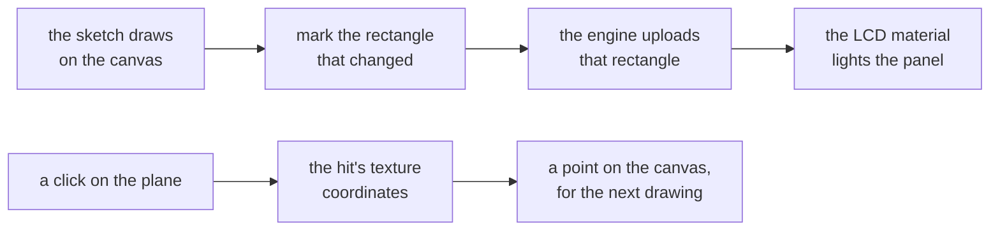

# In-world screens

> Roadmap step 0.3, first released in null3D 0.1.0. The API is experimental, so it can still change between versions.

A screen is a plane in the world whose material samples an `OffscreenCanvas`. The sketch draws on
the canvas with the 2D context, and the engine uploads only the rectangles that changed. Each screen
keeps its own refresh rate, so a slow readout costs less than a fast one.



The screens add-on in the repository, in the `examples/addons/screens` folder, holds the pattern.
It is not an npm package. Copy the folder into your project and import its entry point.

## Make a screen

```ts
import { createScreen } from './addons/screens';

const screen = createScreen(ctx, {
  width: 512,
  height: 256,
  refreshHz: 12,
  size: [2.4, 1.2],
  draw: (context) => {
    context.fillStyle = '#061019';
    context.fillRect(0, 0, 512, 256);
    context.fillStyle = '#9fe8ff';
    context.font = 'bold 48px sans-serif';
    context.fillText('REACTOR 62.0', 24, 90);
  },
});
screen.mesh.setPosition(0, 1.4, -3);
```

`draw` runs in the setup, before the first upload, so a held frame shows the picture. A program that
changes its reading each frame repaints only the part that changed:

```ts
onUpdate(() => {
  paintTheReading(context);          // the number, the bar and the lights
  screen.mark({ x: 24, y: 150, width: 464, height: 290 });
  screen.flush();                    // sends a change that the rate held back
});
```

`screen.paint(draw, changed)` draws and uploads the rectangle that changed. Without a rectangle it
uploads the whole canvas. `screen.mark(rect)` adds a rectangle without drawing, and `screen.flush()`
uploads the marked rectangles as one change.

A refresh that the rate or an upload in flight holds back returns false, and the change waits for
the next call. Call `flush` from the frame's update so it goes out.

## The LCD look

The material draws the panel as an LCD by distance. Each texel shows red, green and blue bars when
it covers several pixels. A band of light drifts up the panel, the foot of each texel row darkens,
and a share of the texels stays dead. The pattern's size comes from the texture coordinates'
derivatives, so the look follows the distance without a camera value. A distant panel draws as a
smooth image.

`screen.boot()` runs a boot glitch: rows tear sideways, a dark band rolls up the panel, and the
picture fades in. `screen.set` changes the look and the power at any time.

| Option | Meaning | Default |
| --- | --- | --- |
| `subpixels` | How strongly the red, green and blue bars show up close | `0.6` |
| `scan` | The drifting band and the gaps between texel rows | `0.45` |
| `deadPixels` | The share of texels that stay dark | `0.0015` |
| `glow` | How brightly the panel glows | `1.4` |
| `bootSeconds` | How long a boot glitch lasts, in seconds | `0.9` |
| `power` | The panel's power, from 0 for off to 1 | `1` |

A screen made with `lcd: false` draws its canvas through the unlit material with no panel math, and
takes no values.

## Clicks on a screen

A pointer hit on a mesh carries its texture coordinates. `screen.pointOf(event)` turns them into a
point on the canvas, in the canvas's own coordinates from its top-left corner.
`screen.texelOf(event)` gives the whole texel under the point.

```ts
screen.onClick((point) => {
  screen.paint((context) => {
    context.fillStyle = '#ffd678';
    context.fillRect(point.x - 4, point.y - 4, 8, 8);
  }, { x: point.x - 4, y: point.y - 4, width: 8, height: 8 });
});
```

## Cost

The LCD look adds one texture sample and the panel's math to each pixel. That is two derivative
reads, a few hashes, the sub-pixel bars, the scan band and the dead-texel test. A screen made with
`lcd: false` skips that work. The upload side is the canvas texture path: a changed rectangle costs
its own bytes, and the refresh rate caps the reads. [Textures](../api/textures.md#canvases) gives
that path's figures and its upload budget.

## Limits

- The shader draws on both GPU paths. It uses `fwidth`, which both paths have.
- A screen's mesh needs texture coordinates, as `geometry.plane` gives.
- A held frame runs no update. Paint the picture through `draw` or in the setup.
- A large canvas at a high refresh rate costs its rectangle's bytes each read. Give a screen only
  the rate that its content needs.

## Licence

MIT OR Apache-2.0. The engine's two licence files at the repository root hold the terms.
