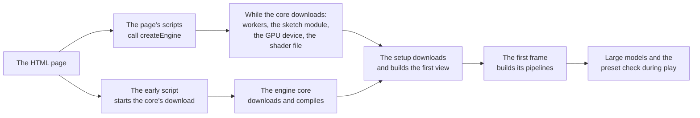

# A fast start

> Roadmap step 0.1, first released in null3D 0.1.0. The API is experimental, so it can still change between versions.



A visitor waits from the moment the page's address loads until the first frame shows. Most of that wait is downloads, the round trips between them, and on a phone the GPU's pipeline builds. A round trip takes 150 to 560 ms on a phone's network, so each download that waits for another one adds that much. The host, the page and the sketch each decide part of the start. This guide gives the steps that shorten it, in the order of the start.

## Where the time goes

The engine's demos were timed as a production build over a simulated phone connection. It had 150 ms for each round trip and 10 Mbit/s, and the browser's cache was empty. Before the changes that this guide describes, a first visit spent its time on these steps:

| Step | Time | What the browser waited for |
| --- | --- | --- |
| The HTML page | 0.5 s | Three round trips on a new connection: TCP, TLS and the request |
| The engine core | 2.3 s | The core's WebAssembly file, 2.0 MB as the server sent it, with no compression. Brotli makes it about 0.6 MB |
| The sketch module's imports | 0.6 to 1.0 s | Three or four rounds of imports, one after another, which started once the core was ready |
| The sketch module's top-level code | 1.2 s in one scene | Terrain that the module built as it loaded, before its setup could start |
| The scene's own files | 22 s in one scene | 18 MB of models in two batches. The second batch started only once the first was built |
| The first frame's pipelines | 0.7 to 1.3 s | The shaders that the first frame needs, compiled while the last files downloaded |

Three demos whose first view needs no large file drew their first frame 4.6 to 8.9 seconds after the address loaded. The demo that waited for 18 MB of models took 25.7 seconds. The same demos took 27 to 85 seconds from the Vite dev server over the same connection, as [Test a production build](#test-a-production-build) explains.

Each change below was then measured alone, on the same connection:

| Change | Measured | Before | After |
| --- | --- | --- | --- |
| [Compress every file](#compress-every-file), `.wasm` included, with a smaller page script and no offline cache | A small demo's first frame | 4.6 s | 3.0 s |
| The same | The garden demo's repeat visit | 3.0 s, or 5.6 s with its offline cache | 1.7 s |
| [The sketch module loads while the core downloads](#what-the-engine-does-while-the-core-downloads) | From the core's arrival to the setup's start | 0.64 to 0.96 s | 0.15 to 0.51 s |
| [The first frame before the large models](#draw-the-first-frame-before-the-large-models) | The garden demo's first frame | 25.7 s | 5.7 s, with every model in at 25.0 s |
| The splat scan draws once the nearest parts are in | The splat demo's first frame | 29.1 s | 8.8 s, with every part in at 28.2 s |
| [The first view's downloads start together](#start-the-first-views-downloads-at-the-top-of-the-setup): a light map and a model | The character demo's first frame | 8.55 s | 8.2 s |
| [The preset check during play](#the-preset-check) | A small demo's loading screen on a first visit, at full speed on a MacBook Pro | 1.18 s | 0.49 s |
| [Chrome keeps the compiled core](#let-the-browser-keep-the-files) | A repeat visit's first frame on the engine's test page, at full speed, and the core's functions that it compiled again | 176 to 180 ms, 273 functions | 160 ms, 3 functions |

<!-- TODO(lead): replace the single-change rows above with the figures of the combined build, measured by the timing helper's script on the same link, once the pull request's changes stand together. -->

### On real phones

The same demos also ran on real phones, over a tunnel of about 105 ms for each round trip and 1 to 60 Mbit/s. Before the changes, a first visit drew its first frame in these times:

| Device | Small demo | Skyway | Island | Garden |
| --- | --- | --- | --- | --- |
| Galaxy S25, Chrome | 4.7 s | 7.8 s | 13.4 s | 25.1 s |
| Pixel 9, Chrome | 6.5 s | 10.3 s | 18.8 s | 38.8 s |
| Galaxy Tab A9 Plus, Chrome | 9.1 s | 20.2 s | 46.7 s | failed |
| iPhone 17, Safari | 7.4 s | | | |

<!-- TODO(phones helper): add the after figures on the same devices, and the iPhone 17's other demos, once the combined build has run there. -->

A phone's processor makes the largest difference from a computer. The first frame's pipeline builds take seconds there, as [Pipelines on phones](#pipelines-on-phones) shows. The Galaxy Tab A9 Plus failed to build one custom material's pipeline in the garden demo, and on repeat visits of the island.

<!-- TODO(tab-crash helper): say what the Galaxy Tab A9 Plus's pipeline failure is (VK_ERROR_UNKNOWN from the driver for one shader) and what the engine does about it, once that work ends. -->

## Compress every file

The host's compression decides the size of the start's largest downloads. Send every file of the build with Brotli where the host has it, and with gzip where it does not:

| File | As it is | gzip | Brotli |
| --- | --- | --- | --- |
| The engine core, `null3d_bg-<hash>.wasm` | 2.0 MB | 0.8 MB | 0.6 MB |
| The WebGL2 start shader file | 1.2 MB | 0.21 MB | 0.05 MB |
| The WebGPU start shader file | 0.42 MB | 0.09 MB | 0.04 MB |

Many servers compress only text, and send `.wasm` files as they are. Open the browser's network panel, and compare the core's transferred size with its size. With nginx, add `application/wasm` to `gzip_types`, or send files that you compress when you deploy, as [Hosting](../getting-started/hosting.md#send-the-files-with-brotli) shows.

The null3D Vite plugin compresses in both of its servers. `vite preview` compresses the build's files and models with Brotli, `.wasm` included, for every visitor. The dev server compresses its answers to other devices, such as a phone on the network, and leaves `localhost` as it is.

Models compress less, because their textures are compressed already. Brotli saved 0 to 25% on most of the demos' models, and 74% on one. The asset tool, `bunx @null3d/cli assets optimize`, makes models smaller to download before the host compresses them ([The asset pipeline](assets-pipeline.md)).

## Let the browser keep the files

A repeat visit is fast when the browser keeps what the first visit downloaded. Vite names each file in `assets/` with a hash of its content. Serve those files as immutable, and the HTML page so that the browser checks it each time, as [Hosting](../getting-started/hosting.md#let-browsers-keep-the-build-files) shows. A repeat visit then downloads only the page.

- A file served with `no-cache` costs one round trip on every visit, even when it has not changed. Give your own large files, such as models, a hash or a version in their addresses, such as `statue-v3.glb`, and serve those addresses as immutable. Serve every other address with `no-cache`, so a changed file never shows its old copy.
- Send no `Vary: Origin` header with the build's files when they come from the page's own origin. A worker's request for a module carries an `Origin` header that the page's own download of the file does not. With `Vary: Origin`, the browser checks the file again, one round trip, instead of taking its copy.
- Send `.wasm` files with `Content-Type: application/wasm`, with nothing after it. Chrome 157 and later then keep the compiled engine core beside the file, and a repeat visit skips most of its compile. Chrome writes that code a few seconds into a visit, about 6 seconds after the first frame on the engine's test page. Chrome 156 and earlier rarely write it ([Let Chrome keep the compiled core](../getting-started/hosting.md#let-chrome-keep-the-compiled-core)).

## Serve over HTTP/2

Over HTTP/1.1, a browser opens at most six connections to a host. The page, every engine worker and every download share them. A large download holds a connection, and the other requests wait in a queue. Over HTTP/2 or HTTP/3, one connection carries every request at once. Cloudflare Pages, Netlify, Vercel and most CDNs serve HTTP/2. The network panel's Protocol column shows `h2` or `h3` for each file.

The null3D Vite plugin serves its HTTPS over HTTP/1.1 by default, in `vite` and in `vite preview`. Over HTTP/2, Safari on an iPad sometimes stalls while a worker loads its modules from the dev server. The plugin's `http2: true` option serves HTTP/2 for other browsers. Over the simulated phone connection, it cut a small demo's first visit from the dev server from 13.8 to 7.2 seconds. Its reload fell from 11.7 to 4.7 seconds.

## Keep the early core script

A production build with the null3D Vite plugin adds a small script to the head of each page that starts the engine. The script starts the core's download as soon as the HTML arrives, before the page's own scripts have downloaded and run. It picks the build that `createEngine` will pick, and the engine takes its download. In the engine's startup benchmark on Slow 4G, the first frame came 0.2 seconds sooner on a MacBook Pro. On a Galaxy S24+ it came about 0.3 seconds sooner.

- Keep the script as the first tag in the page's head. A step that rewrites the built HTML must keep its `<script type="module" async>` tag.
- Add no `<link rel="preload">` for the core. The HTML cannot know which build the device takes, and a wrong guess downloads 0.6 MB more. Safari can also download the core twice.
- Create the engine as soon as the page can. A page that waits for something else first, such as a framework's hydration, delays every step that the engine takes while the core downloads.
- The dev server's pages have no early script.
- A page that loads the engine from a CDN adds the script itself, as [Try null3D from a CDN](../getting-started/cdn.md#start-the-core-early) shows.

## What the engine does while the core downloads

`createEngine` starts the rest of the start while the core downloads:

- It starts the sketch worker and the render worker, and the sketch worker imports the sketch module with all its imports.
- It tests the GPU, then asks for the WebGPU device and downloads the device's shader file and its renderer's code.
- It downloads the job workers' script, so a job worker that starts later takes it from the cache.

So when the core arrives, the setup starts almost at once.

<!-- TODO(side-effects helper): once the engine package marks its modules' side effects and a scene module's imports shrink, add the measured change here. -->

`engine.measure()` reports when the thread that draws had its device, its shader file and its renderer, in `load.drawingStart` ([Measure a start](#measure-a-start)).

The sketch module's top-level code therefore runs before the engine has started, and also when the start fails. Work there must not need the engine: a call that makes scene data before the core starts fails with [E1403](../errors/E1403.md). Work that needs no engine can run there and overlap the download, such as a height grid that the first view reads. Hold mode, a replay and a recording load the module only after the engine has started. There, such work still holds up the setup ([Sketch API](../api/sketch.md)).

## Start the first view's downloads at the top of the setup

A download that the setup starts after an `await` waits for that `await`, and the connection can stand idle meanwhile. So start every file that the first view needs on the setup's first lines, and await each one only where the scene needs it:

```ts
// sketch.ts
import { defineSketch } from '@null3d/engine';

const STATUE = '/models/statue-v3.glb';

export default defineSketch(async ({ assets, page, scene }) => {
  page.post('loading', { text: 'Downloading the statue' });
  // Both downloads start now, together.
  const statue = assets.loadGltf(STATUE);
  const sky = assets.loadEnvironment('/env/evening-v2.ktx2');

  // Build what needs no file while the files download.
  const camera = scene.createPerspectiveCamera({ position: [0, 2, 8], target: [0, 1, 0] });
  scene.setActiveCamera(camera);
  scene.createDirectionalLight({ direction: [-1, -2, -1], intensity: 3 });

  scene.setEnvironment(await sky);
  scene.instantiate(await statue);
});
```

`assets.preload` does the same for files that later code loads: it starts every download at once, and each later load takes its file from memory. A load of a file that is still downloading waits for that download, and starts no second one.

Post the first loading message on the setup's first line, so the loading screen names the scene's own work from the start.

<!-- TODO(preload-list helper): once defineSketch's download list and the development warning about loads that wait for each other land, describe them here and in loading-screens.md, and merge the helper's api/sketch.md text on the sketch's engine.firstFrame. -->

## Draw the first frame before the large models

The first frame waits for the setup. When the setup awaits a large model, the visitor sees the loading screen for the whole download. So build the first view in the setup, and let the large models that it does not need arrive after the first frame. Each one appears as it lands.

Start those downloads after the first frame, not in the setup. Over HTTP/1.1, large files that the setup starts take all six connections, and the first frame's own shader and code files wait behind them. A lower fetch priority does not help: the large files take the free connections before the shader requests exist. Started with the setup, a scene's 2.85 MB of town models made its first frame 0.7 to 1.0 seconds later.

In the sketch, `engine.firstFrame` resolves once the GPU has finished the first frame, as `engine.firstFrame` does on the page. Start the later downloads when it resolves:

```ts
// sketch.ts
import { defineSketch } from '@null3d/engine';

const FOREST = '/models/forest-v2.glb';

export default defineSketch(async ({ assets, engine, scene }) => {
  // Build the first view here.

  const addForest = async () => {
    scene.instantiate(await assets.loadGltf(FOREST));
  };
  // A held frame or a replay waits for the forest, so it shows the finished scene.
  if (engine.held) await addForest();
  else void engine.firstFrame.then(addForest); // the forest appears as it lands
});
```

Never await `engine.firstFrame` in the setup, because the first frame waits for the setup. A frame number is no such signal. The thread that draws can still be drawing the first frame while the sketch runs the second ([Sketch API](../api/sketch.md)).

`engine.held` is true in hold mode and in a replay, so tests still draw the finished scene. A held start that waits for many files starts them all on the setup's first line with `assets.preload`. It then builds the scene in one fixed order. The engine's showcase demos take a `?grown` switch that does the same on a live page. A page that measures frame rates then measures the finished scene.

<!-- TODO(picture-flake helper): held pictures of scenes that load many files can still differ between runs, because the engine makes each file's content in the order that the loads finish. Say what holds once that work ends. -->

A scene that streams its content, such as a splat scan, can draw once the parts nearest the camera are in. The rest then stream in after the first frame. The engine's splat demo drew its first frame after 8.8 seconds that way, over the simulated phone connection. It took 29.1 seconds when it waited for every part.

A model that appears after the first frame draws once its pipelines are built, on both GPU paths. Without `KHR_parallel_shader_compile`, as in Chrome on some Android phones, each new WebGL2 program compiles at its first draw. That frame then runs long, once for each new program. To show a later group of models whole, create them hidden and warm up, as [A later loading stage](loading-screens.md#a-later-loading-stage) shows.

The same holds for work that the first view does not need. Light maps that a scene can draw without, such as a sky's environment, need not be awaited: hand them over when they land. Make a map that only one mode of the page uses, such as a studio's room light, when that mode is first picked.

## The preset check

When the engine picks the quality preset itself, it checks the preset in the first frames of play on a first visit. The loading screen goes at the first frame, and the check measures while the sketch plays. Where the GPU misses the target frame rate, the engine lowers the preset in front of the viewer. `engine.presetChecked` resolves once the check has ended. A repeat visit takes the stored result and runs no check, and a phone starts at Low, which has no check.

A page that would rather hide a change of preset behind its loading screen passes `presetCheck: 'before-play'` to `createEngine`. The check then runs before play, and `createEngine` waits for it, at least three quarters of a second for each preset that it measures. The `?preset-check=` switch sets the same from the page's address ([The preset check](loading-screens.md#the-preset-check)).

<!-- TODO(stored-check helper): on a Galaxy Tab A9 Plus, the check during play measured while the first frame's pipelines were still building, so it read the frame rate too low; and a skyway repeat visit did not reuse its stored result in one run. Say what holds once that work ends. -->

## Pipelines on phones

Building the first frame's pipelines is the largest processor cost of a start on a phone. Each pipeline is one compile on the device's GPU driver. The demos built these pipelines for their first frame, on a first visit:

| Device | Small demo, 17 pipelines | Skyway, 54 to 55 | Island, 62 to 63 | Garden, 46 |
| --- | --- | --- | --- | --- |
| Galaxy S25 | 0.4 s | 1.8 s | 4.1 s | 5.4 s |
| Pixel 9 | 0.9 s | 3.1 s | 6.0 s | 6.7 s |
| Galaxy Tab A9 Plus | 2.8 s | 10.9 s | 23.5 s | failed |

A MacBook Pro built each demo's in 0.3 to 1.3 seconds. On a repeat visit, the small demo built its pipelines 4 to 5 times faster on each phone. The larger demos built theirs no faster. Chrome on Android keeps about 2 MB of a site's compiled GPU code between visits, so a scene with many large shaders overflows it.

- Keep the first view's pipelines few. A pipeline serves every object of one shading model, vertex format and set of material features, as the [Performance guide](performance.md#how-the-engine-batches-builds-pipelines-and-times-frames) lists. A new feature on one material, such as a normal map, makes a new pipeline.
- Warm up behind the loading screen, so play builds no pipeline ([Loading screens and warm-up](loading-screens.md#pipelines-and-warm-up)).
- Time the start on the phones and tablets of your audience. A desktop browser that emulates a phone builds pipelines at the computer's speed.

<!-- TODO(pipelines-phones helper): add what the engine changes about first-frame pipeline builds on phones, and the measured cost of each pipeline, once that work ends. -->

## Cache for offline play after the first frame

A service worker that caches the build for offline play downloads files of its own. When it starts at the page's load, its downloads share the connection with the start. A worker that caches every file of a large build makes every first visit slower, and every repeat visit too until its cache is complete. The engine's demo page dropped such a worker: it sent about 1,570 requests and 820 MB over the start's connections.

- Register the service worker once `engine.firstFrame` has resolved.
- Cache only what the game needs: its pages, the start's files and the features that it uses, as [Offline play](../getting-started/hosting.md#offline-play) shows.
- Keep the list small. The call `cache.addAll` keeps nothing until every file of its list has arrived. A visitor who leaves early then starts the list again on the next visit.

## Test a production build

Judge a start only on a production build that a host serves as above. The Vite dev server sends each module as a file of its own, and asks the browser to check every module on each load. Each engine thread loads its own copy of each module. Over the simulated phone connection, the dev server took 27 to 85 seconds to the first frame. The production build took 4.6 to 25.7 seconds.

A phone or tablet that tests the page must trust its certificate. Chrome keeps no file in its cache from a site whose certificate it accepted after a warning. Every load then downloads every file again: a reload of the dev server took 30 seconds instead of 15. Install the certificate's root on the device, as [During development](../getting-started/hosting.md#during-development) shows.

## Measure a start

`engine.measure()` gives the start's times in its `load` figures ([Performance guide](performance.md#measure)):

| Figure | What it is |
| --- | --- |
| `load.coreMs` | From the start of `createEngine` until the core was downloaded and compiled |
| `load.probeMs` | From the start of `createEngine` until the probe of the GPU paths finished |
| `load.drawingStart` | When the thread that draws got its WebGPU adapter and device, its shader file, the core and its renderer, in milliseconds from the page's navigation |
| `load.engineStartMs` | How long `createEngine` took, with the setup, and with the preset check before play |
| `load.firstFrameMs` and `load.firstFrameDoneMs` | From the page's navigation until the first frame was submitted, and until the GPU finished it |
| `load.warmUpMs` and `load.firstFramePipelines` | How long the first frame's pipelines took to build, and how many it built |

In the browser's developer tools, pick the Slow 4G profile. Time a first visit with the cache turned off, then a repeat visit with it on:

- In the network panel, check the transferred size of the core's `.wasm` file and of the shader files. A transferred size equal to the size means no compression.
- Check the Protocol column for `h2` or `h3`.
- In each request's timing, a long Queueing or Stalled time means the six connections of HTTP/1.1 are full.
- Look along the waterfall for gaps with nothing downloading, and for downloads that start only when another one ends.
- On a repeat visit, every build file should come from the cache. A `304` answer is a round trip that immutable files avoid.
- In the Performance panel, look for long tasks in the sketch worker before the setup's first message.

Chrome's network throttling does not slow a service worker's own downloads. Its CPU throttling slows the page's thread, while the engine's setup and drawing run in workers. So time the setup's work and the pipeline builds on a real phone, through remote debugging.

The engine's repository times the engine's own start with `bun run bench:startup`. It loads the engine's test page cold and warm in Chrome, on Slow 4G by default. It prints the median of each stage, with the drawing thread's device, shader file and renderer.

## Related pages

- [Hosting and cross-origin isolation](../getting-started/hosting.md): compression, cache headers, the compiled core and offline play.
- [Loading screens and warm-up](loading-screens.md): progress, warm-up and the preset check.
- [Quality presets](../concepts/quality-presets.md#the-preset-check): the preset check's rules.
- [Phones and tablets](phones.md): networks and repeat visits.
- [Network use](../getting-started/network-use.md): what the engine downloads, and when.
