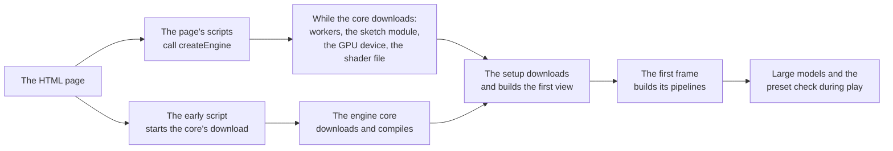

# A fast start



A visitor waits from the moment the page's address loads until the first frame shows. Most of that wait is downloads, the round trips between them, and on a phone the GPU's pipeline builds. A round trip takes 150 to 560 ms on a phone's network, so each download that waits for another one adds that much. The host, the page and the sketch each decide part of the start. This guide gives the steps that shorten it, in the order of the start.

The steps that shorten a start, in the order of the start:

1. [Compress every file](#compress-every-file), `.wasm` included.
2. [Let the browser keep the files](#let-the-browser-keep-the-files).
3. [Serve over HTTP/2](#serve-over-http2).
4. [Keep the early core script](#keep-the-early-core-script), and create the engine as soon as the page can.
5. [Start the first view's downloads at the top of the setup](#start-the-first-views-downloads-at-the-top-of-the-setup).
6. [Draw the first frame before the large models](#draw-the-first-frame-before-the-large-models).
7. [Keep the first view's pipelines few](#pipelines-on-phones).
8. [Start an offline cache only after the first frame](#cache-for-offline-play-after-the-first-frame).
9. [Test a production build](#test-a-production-build), and [measure the start](#measure-a-start).

## Where the time goes

The engine's demos were timed as a production build over a simulated phone connection. It had 150 ms for each round trip and 10 Mbit/s, and the browser's cache was empty. These are the steps of a first visit today, with what each costs when it is skipped:

| Step | Cost when skipped | What shortens it |
| --- | --- | --- |
| The HTML page | 0.5 s | Three round trips on a new connection: TCP, TLS and the request. [Serve over HTTP/2](#serve-over-http2) |
| The engine core | 2.3 s | 2.0 MB of WebAssembly with no compression. [Compress every file](#compress-every-file) makes it about 0.6 MB |
| The sketch module's imports | 0.6 to 1.0 s | Three or four rounds of imports, one after another. [The import chain, asked for at once](#what-the-engine-does-while-the-core-downloads) |
| The sketch module's top-level code | 1.2 s in one scene | Terrain built as the module loaded. [Start the first view's downloads early](#start-the-first-views-downloads-at-the-top-of-the-setup) |
| The scene's own files | 22 s in one scene | 18 MB of models in two batches. [Draw the first frame before the large models](#draw-the-first-frame-before-the-large-models) |
| The first frame's pipelines | 0.7 to 1.3 s | Shaders compiled while the last files downloaded. [Keep the first view's pipelines few](#pipelines-on-phones) |

With these steps applied, the engine's demos draw the first frame in 2.7 to 7.6 seconds over that link. On real phones, they draw it in 3.5 to 39 seconds. The block below gives each demo's figure.

<details>
<summary>Technical details: measured starts on a simulated phone link and on real phones</summary>

Each figure is the median of three loads, in seconds to the first finished frame. A cold load starts with an empty cache, and a reload comes after a first visit of 30 seconds.

Over HTTP/1.1:

| Demo and load | Time |
| --- | --- |
| Small demo, cold | 2.9 s |
| Skyway, cold | 3.5 s |
| Island, cold | 7.6 s |
| Creek, cold | 4.3 s |
| Island, reload | 2.2 s |
| Creek, reload | 1.3 s |

Over HTTP/2:

| Demo and load | Time |
| --- | --- |
| Small demo, cold | 2.7 s |
| Skyway, cold | 2.8 s |
| Island, cold | 7.0 s |
| Creek, cold | 3.3 s |
| Island, reload | 2.4 s |
| Creek, reload | 0.9 s |

The same demos ran on real phones, over a tunnel of about 100 ms for each round trip and 4 to 9 Mbit/s. A first visit in a fresh session drew its first frame in these times:

| Device | Small demo | Skyway | Island | Creek |
| --- | --- | --- | --- | --- |
| Galaxy S25, Chrome | 3.5 to 7.3 s | 5.7 s | 8.1 s | 5.7 s |
| Pixel 9, Chrome | 4.0 s | 6.5 s | 13.4 s | 8.7 s |
| Galaxy Tab A9 Plus, Chrome | 11.3 s | 17.7 s | 39 s | 31 s |
| iPhone 17, Safari | 8.9 s | 17.2 s | 20.4 s | 11.1 s |

The phones start at Low and run no preset check. On the Galaxy Tab A9 Plus, the check runs during play for 12 to 38 seconds after the first frame, and settles on Low. There the creek demo lost its GPU in 2 of 6 loads. The iPhone 17's repeat visits drew their first frame in 0.4 to 3.1 seconds. The small demo's times follow the tunnel's speed, which differed between the two runs.

</details>

A phone's processor makes the largest difference from a computer. The first frame's pipeline builds take seconds there, as [Pipelines on phones](#pipelines-on-phones) shows. The Galaxy Tab A9 Plus failed to build one custom material's pipeline in the creek demo, and on repeat visits of the island.

The engine builds a pipeline that the driver refuses once more, alone. When the driver refuses it again, the engine leaves that pipeline's objects out and draws on, with [E1307](../errors/E1307.md), which does not stop it. So the island draws on that tablet without its far tree cards, at 1.1 frames a second at Low. The creek demo reaches its first frame at 71 seconds there, but the tablet runs out of GPU memory 4 seconds later ([E1302](../errors/E1302.md)).

## Compress every file

The host's compression decides the size of the start's largest downloads. Send every file of the build with Brotli where the host has it, and with gzip where it does not:

| File | As it is | gzip | Brotli |
| --- | --- | --- | --- |
| The engine core, `null3d_bg-<hash>.wasm` | 1.9 MB | 0.8 MB | 0.6 MB |
| The largest WebGL2 start shader file | 1.4 MB | 0.21 MB | 0.06 MB |
| The largest WebGPU start shader file | 0.47 MB | 0.09 MB | 0.04 MB |

A device loads one start shader file, picked by what its GPU supports. [Send the files with Brotli](../getting-started/hosting.md#send-the-files-with-brotli) gives the size of the engine's whole start for each kind of compression.

Many servers compress only text, and send `.wasm` files as they are. Open the browser's network panel, and compare the core's transferred size with its size. With nginx, add `application/wasm` to `gzip_types`, or send files that you compress when you deploy, as [Hosting](../getting-started/hosting.md#send-the-files-with-brotli) shows.

The null3D Vite plugin compresses in both of its servers. `vite preview` compresses the build's files and models with Brotli, `.wasm` included, for every visitor. The dev server compresses its answers to other devices, such as a phone on the network, and leaves `localhost` as it is.

Models compress less, because their textures are compressed already. Brotli saved 0 to 25% on most of the demos' models, and 74% on one. The asset tool, `bunx @null3d/cli assets optimize`, makes models smaller to download before the host compresses them ([The asset pipeline](assets-pipeline.md)).

## Let the browser keep the files

A repeat visit is fast when the browser keeps what the first visit downloaded. Vite names each file in `assets/` with a hash of its content. Serve those files as immutable, and the HTML page so that the browser checks it each time, as [Hosting](../getting-started/hosting.md#let-browsers-keep-the-build-files) shows. A repeat visit then downloads only the page.

- A file served with `no-cache` costs one round trip on every visit, even when it has not changed. Give your own large files, such as models, a hash or a version in their addresses, such as `statue-v3.glb`, and serve those addresses as immutable. Serve every other address with `no-cache`, so a changed file never shows its old copy.
- Send no `Vary: Origin` header with the build's files when they come from the page's own origin. A worker's request for a module carries an `Origin` header that the page's own download of the file does not. With `Vary: Origin`, the browser checks the file again, one round trip, instead of taking its copy.
- Send `.wasm` files with `Content-Type: application/wasm`, with nothing after it. Chrome 157 and later then keep the compiled engine core beside the file, and a repeat visit skips most of its compile. Chrome writes that code a few seconds into a visit, about 6 seconds after the first frame on the engine's test page. Chrome 156 and earlier rarely write it ([Let Chrome keep the compiled core](../getting-started/hosting.md#let-chrome-keep-the-compiled-core)).

On the engine's test page, a repeat visit took 160 ms to the first frame with the compiled core kept. It took 176 to 180 ms with only the file kept. Chrome recompiled 3 functions in the first case, and 273 in the second.

## Serve over HTTP/2

Over HTTP/1.1, a browser opens at most six connections to a host. The page, every engine worker and every download share them. A large download holds a connection, and the other requests wait in a queue. Over HTTP/2 or HTTP/3, one connection carries every request at once. Cloudflare Pages, Netlify, Vercel and most CDNs serve HTTP/2. The network panel's Protocol column shows `h2` or `h3` for each file.

The null3D Vite plugin serves its dev server over HTTP/1.1, because Safari on an iPad sometimes stalls over HTTP/2. Its `http2: true` option serves HTTP/2 for other browsers ([During development](../getting-started/hosting.md#during-development)).

<details>
<summary>Technical details: HTTP/2 on the dev server</summary>

Over the simulated phone connection, HTTP/2 cut a small demo's first visit from the dev server from 13.8 to 7.2 seconds. Its reload fell from 11.7 to 4.7 seconds.

</details>

## Keep the early core script

A production build with the null3D Vite plugin adds a small script to the head of each page that starts the engine. The script starts the core's download as soon as the HTML arrives, before the page's own scripts have downloaded and run. It picks the build that `createEngine` will pick, and the engine takes its download. In the engine's startup benchmark on Slow 4G, the first frame came 0.2 seconds sooner on a MacBook Pro. On a Galaxy S24+ it came about 0.3 seconds sooner.

- Keep the script as the first tag in the page's head. A step that rewrites the built HTML must keep its `<script type="module" async>` tag.
- Add no `<link rel="preload">` for the core. The HTML cannot know which build the device takes, and a wrong guess downloads 0.6 MB more. Safari can also download the core twice.
- Create the engine as soon as the page can. A page that waits for something else first, such as a framework's hydration, delays every step that the engine takes while the core downloads.
- The dev server's pages have no early script.
- A page that loads the engine from a CDN adds the script itself, as [Try null3D from a CDN](../getting-started/cdn.md#start-the-core-early) shows.

## What the engine does while the core downloads

`createEngine` starts the rest of the start while the core downloads:

- It starts the sketch worker and the render worker, and the sketch worker imports the sketch module with all its imports.
- It tests the GPU, then asks for the WebGPU device and downloads the device's shader file and its renderer's code.
- It downloads the job workers' script, so a job worker that starts later takes it from the cache.

So when the core arrives, the setup starts almost at once.

Because the sketch worker imports the sketch module during the download, the module's top-level code runs before the engine has started. It also runs when the start fails. Work there must not need the engine: a call that makes scene data before the core starts fails with [E1403](../errors/E1403.md). Work that needs no engine can run there and overlap the download, such as a height grid that the first view reads. Hold mode, a replay and a recording load the module only after the engine has started. There, such work still holds up the setup ([Sketch API](../api/sketch.md)).

The Vite plugin also writes into the built sketch module every file that the module reaches through its imports. So the sketch worker asks for all of them as soon as the module arrives. It needs no round trip for each step of the chain. A sketch's code then arrives in about 2 rounds instead of 4 to 6. Over HTTP/1.1 the six connections still queue those files, so the gain there is small.

<details>
<summary>Technical details: the engine package's sideEffects field</summary>

The engine's package declares no `sideEffects` list. A build with one started more slowly.

</details>

`engine.measure()` reports when the thread that draws had its device, its shader file and its renderer, in `load.drawingStart` ([Measure a start](#measure-a-start)).

## Start the first view's downloads at the top of the setup

A download that the setup starts after an `await` waits for that `await`, and the connection can stand idle meanwhile. So start every file that the first view needs on the setup's first lines, and await each one only where the scene needs it:

```ts
// sketch.ts
import { defineSketch } from '@null3d/engine';

const STATUE = '/models/statue-v3.glb';

export default defineSketch(async ({ assets, page, scene }) => {
  page.post('loading', { text: 'Downloading the statue' });
  // Both downloads start now, together.
  const statue = assets.loadGltf(STATUE);
  const sky = assets.loadEnvironment('/env/evening-v2.ktx2');

  // Build what needs no file while the files download.
  const camera = scene.createPerspectiveCamera({ position: [0, 2, 8], target: [0, 1, 0] });
  scene.setActiveCamera(camera);
  scene.createDirectionalLight({ direction: [-1, -2, -1], intensity: 3 });

  scene.setEnvironment(await sky);
  scene.instantiate(await statue);
});
```

`assets.preload` does the same for files that later code loads: it starts every download at once, and each later load takes its file from memory. A load of a file that is still downloading waits for that download, and starts no second one.

The engine's add-ons follow the same rule. The sound add-on downloads its recordings beside its mixer, and the splats add-on starts its decoder and its selection beside its first file.

Post the first loading message on the setup's first line, so the loading screen names the scene's own work from the start.

Name the first view's files in the `downloads` option of `defineSketch`, in the order that the setup needs them: `defineSketch(setup, { downloads: [...] })`. They start to download as soon as the sketch module loads, often before the core has arrived.

<details>
<summary>Technical details: how the download list is scheduled</summary>

Two files download at a time, at a low priority, so the engine's own files still find free connections. A load that waits for a listed file moves it to the front, and up to four then download at once. Hold mode, replays and recordings ignore the list ([The download list](../api/sketch.md#the-download-list)).

</details>

Over the simulated phone link, the creek demo's eleven models took 21.3 seconds with the download list. They took 25.9 seconds without it, with every model drawn before the first frame. With nothing downloading before the first frame, it took 0.2 seconds with the list and 3.3 seconds without.

List only the files that the first frame needs, and start the rest from `engine.firstFrame`, as the next section shows. A development build warns once in a live start when a scene's own load started only after another one finished, with nothing else downloading. Pass `serialLoadWarning: false` to turn the warning off where the second address comes from the first file.

## Draw the first frame before the large models

The first frame waits for the setup. When the setup awaits a large model, the visitor sees the loading screen for the whole download. So build the first view in the setup, and let the large models that it does not need arrive after the first frame. Each one appears as it lands.

Start those downloads after the first frame, not in the setup. Over HTTP/1.1, large files that the setup starts take all six connections, and the first frame's own shader and code files wait behind them. A lower fetch priority does not help: the large files take the free connections before the shader requests exist. Started with the setup, a scene's 2.85 MB of town models made its first frame 0.7 to 1.0 seconds later.

On the simulated phone link, the creek demo's first frame takes 5.7 seconds when its large models come after it. It takes 25.7 seconds when the setup waits for them.

In the sketch, `engine.firstFrame` resolves once the GPU has finished the first frame, as `engine.firstFrame` does on the page. Unlike the page's promise, it never rejects: when the engine stops first, it stays pending. Start the later downloads when it resolves:

```ts
// sketch.ts
import { defineSketch } from '@null3d/engine';

const FOREST = '/models/forest-v2.glb';

export default defineSketch(async ({ assets, engine, scene }) => {
  // Build the first view here.

  const addForest = async () => {
    scene.instantiate(await assets.loadGltf(FOREST));
  };
  // A held frame or a replay waits for the forest, so it shows the finished scene.
  if (engine.held) await addForest();
  else void engine.firstFrame.then(addForest).catch((error) => console.error(error)); // the forest appears as it lands
});
```

Never await `engine.firstFrame` in the setup, because the first frame waits for the setup. A frame number is no such signal. The thread that draws can still be drawing the first frame while the sketch runs the second ([The engine field](../api/sketch.md#the-engine-field)).

`engine.held` is true in hold mode and in a replay, so tests still draw the finished scene. A held start that waits for many files starts them all on the setup's first line with `assets.preload`. It then builds the scene in one fixed order. The [Island demo](https://github.com/null3d-engine/null3d/tree/main/examples/showcase/island/) takes a `?grown` switch that does the same on a live page. A page that measures frame rates then measures the finished scene.

While the engine holds frames or replays, the sketch's `assets` calls run one at a time, in the order the sketch made them. So the held picture never depends on which file lands first ([Hold mode](testing.md#hold-mode)).

A scene that streams its content, such as a splat scan, can draw once the parts nearest the camera are in. The rest then stream in after the first frame. The engine's splat demo drew its first frame after 8.8 seconds that way, over the simulated phone connection. It took 29.1 seconds when it waited for every part.

A model that appears after the first frame draws once its pipelines are built, on both GPU paths. Without `KHR_parallel_shader_compile`, as in Chrome on some Android phones, each new WebGL2 program compiles at its first draw. That frame then runs long, once for each new program. To show a later group of models whole, create them hidden and warm up, as [A later loading stage](loading-screens.md#a-later-loading-stage) shows.

The same holds for work that the first view does not need. Light maps that a scene can draw without, such as a sky's environment, need not be awaited: hand them over when they land. Make a map that only one mode of the page uses, such as a studio's room light, when that mode is first picked.

## The preset check

When the engine picks the quality preset itself, it checks the preset in the first frames of play on a first visit. The check can lower the preset in front of the viewer. On a Galaxy Tab A9 Plus, a check during play ran 12 to 38 seconds after the first frame. A check before play held the loading screen 8 to 18 seconds after it. `presetCheck: 'before-play'` hides the change behind the loading screen, and `createEngine` waits for it. The `?preset-check=` switch sets the same from the page's address ([The preset check](loading-screens.md#the-preset-check)).

On a slow tablet the check takes many seconds, as each lighter preset builds its pipelines. It stores each round as it lowers the preset, so the next start begins at the preset that it reached. A page or a tool that measures steady play waits for `engine.presetChecked`, because the check can lower the preset inside the measured window. A repeat visit takes the stored result and runs no check, and a phone starts at Low, which has no check.

## Pipelines on phones

Building the first frame's pipelines is the largest processor cost of a start on a phone. Each pipeline is one compile on the device's GPU driver. The demos built these pipelines for their first frame, on a first visit:

| Device | Small demo | Skyway | Island | Creek |
| --- | --- | --- | --- | --- |
| Galaxy S25 | 0.4 s | 1.8 s | 4.1 s | 5.4 s |
| Pixel 9 | 0.9 s | 3.1 s | 6.0 s | 6.7 s |
| Galaxy Tab A9 Plus | 2.8 s | 10.9 s | 23.5 s | failed |
| iPhone 17 | 2.4 s | 11.8 s | 13.1 s | 16.5 s |
| MacBook Pro | 0.1 s | 0.2 s | 0.3 s | 0.7 s |

The phones built 16 to 17, 53 to 55, 61 to 63 and 45 to 46 pipelines for the four demos. The MacBook Pro built 31, 73, 84 and 73 at its higher preset, in a fraction of the time.

On a repeat visit, Safari reused its compiled shaders, and the iPhone 17 built each demo's pipelines in 0.2 seconds or less. In Chrome on Android, the small demo built its pipelines 4 to 5 times faster, and the larger demos built theirs no faster.

<details>
<summary>Technical details: Chrome's pipeline cache</summary>

Chrome on Android keeps about 2 MB of a site's compiled WebGPU pipelines between visits, and 128 KB on a low-end phone. A computer keeps 6 MB. A scene with many large shaders overflows it, so the engine keeps a list of its own.

</details>

- Keep the first view's pipelines few. A pipeline serves every object of one shading model, vertex format and set of material features, as the [Performance guide](performance.md#how-the-engine-batches-builds-pipelines-and-times-frames) lists. A new feature on one material, such as a normal map, makes a new pipeline.
- Warm up behind the loading screen, so play builds no pipeline ([Loading screens and warm-up](loading-screens.md#pipelines-and-warm-up)).
- Time the start on the phones and tablets of your audience. A desktop browser that emulates a phone builds pipelines at the computer's speed.

The engine keeps a list of the pipelines that a sketch's first frame built, in the page's `localStorage`. On the next start, the thread that draws builds each of those pipelines as soon as its shader arrives. The engine downloads and the setup runs meanwhile. Hold mode, replays and recordings neither read nor store the list, and `?builds=fresh` turns it off ([Repeat visits](loading-screens.md#repeat-visits)).

<details>
<summary>Technical details: how the stored pipeline list works</summary>

The list is kept for each engine version, GPU path, set of the device's shader bits, preset and canvas format. A scene that changed since the last start builds some pipelines that no frame takes, and its first frame stores a new list. Before the first frame, the engine also builds in the background the pipelines that the frame's list asks for partway through. Identical pipelines share one build.

</details>

On a repeat visit, the stored list cut the island's time on a Galaxy S25 from 3.81 to 1.56 seconds. It measures from the setup's end to the first frame.

These figures run from the setup's end to the first frame:

| Demo and device | Without the list | With the list |
| --- | --- | --- |
| Island, Galaxy S25, first visit | 5.79 s | 3.77 s |
| Island, Galaxy S25, repeat visit | 3.81 s | 1.56 s |
| Skyway, Galaxy S25, repeat visit | 2.29 s | about 1.5 s |
| Creek, Galaxy S25, repeat visit | 4.78 s | about 3.0 s |
| Island, Galaxy Tab A9 Plus, repeat visit | 23.6 s | 8.8 to 11.2 s |

## Cache for offline play after the first frame

A service worker that caches the build for offline play downloads files of its own. When it starts at the page's load, its downloads share the connection with the start. A worker that caches every file of a large build makes every first visit slower, and every repeat visit too until its cache is complete. On the engine's demo page, a worker that cached every file sent about 1,570 requests and 820 MB over the start's connections.

- Register the service worker once `engine.firstFrame` has resolved.
- Cache only what the game needs: its pages, the start's files and the features that it uses, as [Offline play](../getting-started/hosting.md#offline-play) shows.
- Keep the list small. The call `cache.addAll` keeps nothing until every file of its list has arrived. A visitor who leaves early then starts the list again on the next visit.

## Test a production build

Judge a start only on a production build that a host serves as above. The Vite dev server sends each module as a file of its own, and asks the browser to check every module on each load. Each engine thread loads its own copy of each module. Over the simulated phone connection, the dev server took 27 to 85 seconds to the first frame. The production build took 4.6 to 25.7 seconds.

A phone or tablet that tests the page must trust its certificate. Chrome keeps no file in its cache from a site whose certificate it accepted after a warning. Every load then downloads every file again: a reload of the dev server took 30 seconds instead of 15. Install the certificate's root on the device, as [During development](../getting-started/hosting.md#during-development) shows.

## Measure a start

`engine.measure()` gives the start's times in its `load` figures ([Performance guide](performance.md#measure)):

| Figure | What it is |
| --- | --- |
| `load.coreMs` | From the start of `createEngine` until the core was downloaded and compiled |
| `load.probeMs` | From the start of `createEngine` until the probe of the GPU paths finished |
| `load.drawingStart` | When the thread that draws got its WebGPU adapter and device, its shader file, the core and its renderer, in milliseconds from the page's navigation |
| `load.engineStartMs` | How long `createEngine` took, with the setup, and with the preset check before play |
| `load.firstFrameMs` and `load.firstFrameDoneMs` | From the page's navigation until the first frame was submitted, and until the GPU finished it |
| `load.warmUpMs` and `load.firstFramePipelines` | How long the first frame's pipelines took to build, and how many it built |

In the browser's developer tools, pick the Slow 4G profile. Time a first visit with the cache turned off, then a repeat visit with it on:

- In the network panel, check the transferred size of the core's `.wasm` file and of the shader files. A transferred size equal to the size means no compression.
- Check the Protocol column for `h2` or `h3`.
- In each request's timing, a long Queueing or Stalled time means the six connections of HTTP/1.1 are full.
- Look along the waterfall for gaps with nothing downloading, and for downloads that start only when another one ends.
- On a repeat visit, every build file should come from the cache. A `304` answer is a round trip that immutable files avoid.
- In the Performance panel, look for long tasks in the sketch worker before the setup's first message.

Chrome's network throttling does not slow a service worker's own downloads. Its CPU throttling slows the page's thread, while the engine's setup and drawing run in workers. So time the setup's work and the pipeline builds on a real phone, through remote debugging.

<details>
<summary>Technical details: how the engine's own start is timed</summary>

The engine's repository times its own start with `bun run bench:startup`. It loads the engine's test page cold and warm in Chrome, on Slow 4G by default. It prints the median of each stage, with the drawing thread's device, shader file and renderer.

</details>

## Related pages

- [Hosting and cross-origin isolation](../getting-started/hosting.md): compression, cache headers, the compiled core and offline play.
- [Loading screens and warm-up](loading-screens.md): progress, warm-up and the preset check.
- [Quality presets](../concepts/quality-presets.md#the-preset-check): the preset check's rules.
- [Phones and tablets](phones.md): networks and repeat visits.
- [Network use](../getting-started/network-use.md): what the engine downloads, and when.
