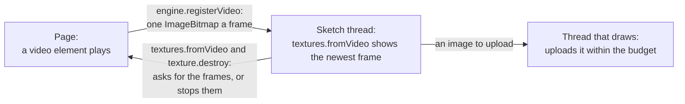

# Video textures

> Roadmap step 0.3, first released in null3D 0.1.0. The API is experimental, so it can still change between versions.



A video element lives on the page, where it plays with its own controls and sound, in the formats that the browser supports. The scene shows it on a surface. The page sends the sketch the image of each frame that the video presents, and the sketch gives the newest frame to a texture.

## Show a video on a surface

Register the video on the page, then follow it in the sketch under the same name.

```ts
// page.ts
import { createEngine } from '@null3d/engine';

const canvas = document.querySelector('canvas')!;
const engine = await createEngine({ canvas, sketch: new URL('./sketch.ts', import.meta.url) });

const video = document.createElement('video');
video.src = '/clips/intro.mp4';
video.muted = true;
video.loop = true;
video.playsInline = true;
// Keep the element in the page but out of sight. An element that display: none hides may give no
// frame in some browsers, so park it past the page's edge instead. Its sound comes from the page
// as any video's does.
video.style.position = 'absolute';
video.style.left = '-10000px';
video.style.width = '1px';
video.style.height = '1px';
document.body.append(video);

engine.registerVideo(video, { name: 'intro', maxSize: 512 });
await video.play();
```

```ts
// sketch.ts
import { defineSketch } from '@null3d/engine';

export default defineSketch(({ scene, geometry, materials, textures }) => {
  scene.setBackground('#0b0f16');
  const camera = scene.createPerspectiveCamera({ fov: 45, position: [0, 0, 3] });
  scene.setActiveCamera(camera);
  const screen = textures.fromVideo('intro');

  scene.createMesh({
    mesh: geometry.plane({ width: 3.2, height: 1.8 }),
    material: materials.unlit({ map: screen }),
  });
});
```

The texture follows the video: pause, seek, loop and playback speed all show, because the page sends the frames that the video presents. The video has no pixels until its first frame arrives, and until then the material draws with its color alone. A video that is paused at the call still shows, because the sketch asks for the frame that it holds then.

Stop the frames with `texture.destroy()` in the sketch, or with the function that `engine.registerVideo` returns on the page.

## Sizes and the upload budget

A video usually has far more texels than a surface needs. The page scales each frame down to `maxSize`, the most texels of its widest or tallest side, with the video's shape. The default is 512: a 16:9 video then gives a 512 by 288 frame of 576 KiB. Each frame uploads in its turn, within the preset's `uploadBytesPerFrame`: 2 MiB on Low, up to 16 MiB on Ultra.

| Frame | Bytes | Fits the Low preset's 2 MiB budget |
| --- | --- | --- |
| 320 by 180 | 225 KiB | yes |
| 512 by 288 | 576 KiB | yes |
| 1024 by 576 | 2.25 MiB | no, over two frames |

A frame that does not fit the budget takes more than one frame to upload, and the frames that come meanwhile are dropped. The texture then shows fewer frames a second, rather than an upload that never finishes. Keep a frame within the 2 MiB budget of the Low preset, which the lightest devices run, so that a frame goes up whole. A surface that covers a few pixels on screen does not need a large frame.

The video's own frame rate sets the cost. A 30 frames a second video uploads its frame 30 times a second, which is 17 MiB a second for a 512 by 288 frame. The `frameRate` option caps the frames that the page sends, and a call that comes sooner sends nothing.

## What a video costs while it does nothing

- A video that no texture follows sends no frames, because the sketch asks for them. A page that registers a video and never shows it pays nothing.
- A sketch that follows a name that the page never registers gets no frame, and draws with its material's color alone. The engine reports no error.
- A paused video presents no frame, so the page sends none. The engine makes no image and uploads nothing, and the texture keeps the last frame.
- Each frame is one `ImageBitmap` that the browser makes from the video. It goes into the texture that the sketch made, so the engine allocates no texture for it. The engine closes the image once the frame is on the GPU.

## Browser limits

- A browser plays the video formats that it supports, as for any video element. An H.264 MP4 file plays in the browsers that the engine runs on.
- A page shows a video with sound only after the user acts, unless the video is muted. Start a muted video as the example does, or play it from a click.
- A video from another origin needs `video.crossOrigin = 'anonymous'` and the server's CORS headers. Without them, the browser refuses to copy the video's pixels into an image. No frames arrive, and the texture keeps the frame it had.
- A browser that refuses to play the video, as an autoplay policy does before the user acts, sends no frames. The material then draws with its color alone, and the engine reports no error.
- The engine reads each frame through `createImageBitmap`, which every supported browser has. It does not need `VideoFrame`, which Safari and Firefox cannot make from a video element.
- Keep the element in the page's layout, out of sight. An element that `display: none` hides may give no frame in some browsers.
- A browser reports each frame that the video presents, and the page sends that frame. Some browsers report none for a video element that the page never shows. The page then checks the video's time on each display frame while it plays, and stops that check while the video is paused.
- A phone plays a video at the rate that its heat allows, and the browser may lower that rate. A video that must keep time with the scene, such as a synchronized caption track, reads the video's time in the page.
- The video's own element handles playback. The engine never plays, pauses or seeks it, so a page that shows a video in the scene and on the page at once runs one element and one timeline.

## Related pages

- [Textures](../api/textures.md): `textures.fromVideo`, and the upload budget of every texture.
- [Materials](../api/materials.md): `materials.unlit` for a screen that shows a video as it is.
- [Messages between sketch and page](../api/page.md): the other messages that the two threads send.
- [Quality presets](../concepts/quality-presets.md): `uploadBytesPerFrame` on each preset.
