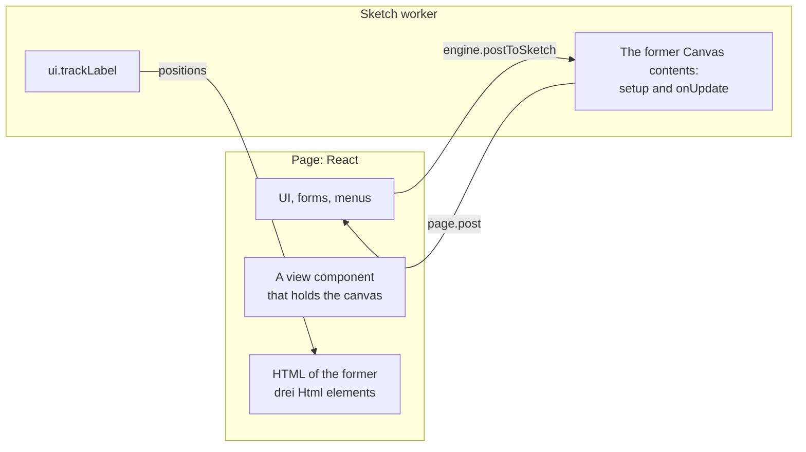

# Porting React Three Fiber

React Three Fiber describes a three.js scene as React components that run on the main thread. In null3D, the scene lives in a sketch that runs in a worker. React keeps the page UI. A port moves the component tree inside `<Canvas>` into sketch code, and connects React to the sketch with messages.



The React tree above the former `<Canvas>` barely changes. The subtree inside `<Canvas>` becomes the sketch.

## A view component

This component holds one engine for each sketch, while the app shows other views. Leaving the view takes the canvas off the page and pauses the engine. Coming back puts it on the page again, with no new start.

```tsx
import { useEffect, useRef } from 'react';
import { createEngine, type Engine } from '@null3d/engine';

type Props = {
  sketch: URL;
  onMessage?: (name: string, data: unknown) => void;
  onReady?: (engine: Engine) => void;
};

/** How long an engine waits off the page before the component destroys it. */
const KEEP_MS = 60_000;

type Kept = { canvas: HTMLCanvasElement; engine: Promise<Engine>; timer?: number };
const kept = new Map<string, Kept>();

function keptEngine(sketch: URL): Kept {
  let entry = kept.get(sketch.href);
  if (!entry) {
    // The kept engine owns its canvas, which moves between hosts with the engine.
    const canvas = document.createElement('canvas');
    canvas.style.cssText = 'width:100%;height:100%;display:block';
    entry = { canvas, engine: createEngine({ canvas, sketch }) };
    entry.engine.catch(() => kept.delete(sketch.href));
    kept.set(sketch.href, entry);
  }
  clearTimeout(entry.timer);
  return entry;
}

export function SceneView({ sketch, onMessage, onReady }: Props) {
  const hostRef = useRef<HTMLDivElement>(null);
  const onMessageRef = useRef(onMessage);
  onMessageRef.current = onMessage;

  useEffect(() => {
    const host = hostRef.current!;
    const entry = keptEngine(sketch);
    let mounted = true;
    let off: (() => void) | undefined;
    host.append(entry.canvas);
    entry.engine.then(
      (engine) => {
        if (!mounted) return;
        engine.attach(host);
        off = engine.onSketchMessage((name, data) => onMessageRef.current?.(name, data));
        onReady?.(engine);
      },
      (error) => console.error(error),
    );
    return () => {
      mounted = false;
      off?.();
      entry.engine.then((engine) => engine.detach(), () => {});
      entry.timer = window.setTimeout(() => {
        kept.delete(sketch.href);
        entry.engine.then((engine) => engine.destroy(), () => {});
      }, KEEP_MS);
    };
  }, [sketch]);

  return <div ref={hostRef} style={{ width: '100%', height: '100%' }} />;
}
```

- Make the sketch's address once, at module level: `const sketchUrl = new URL('./sketch.ts', import.meta.url)`. A new address on each render would start a new engine.
- React's StrictMode runs effects twice in development. The second run finds the kept engine and attaches it, so development starts one engine, as production does.
- Each mount adds its own message handler and removes it when it unmounts. An old component never hears the sketch.
- A kept engine holds its memory and GPU buffers. For a view that the app shows once, destroy the engine when the component unmounts instead.

A simpler component also works. It renders a `<canvas>`, creates the engine in its effect, and calls `destroy()` in the cleanup. Under StrictMode, the second start waits for the first engine to stop, then draws on the same canvas. [Page API: createEngine](../api/engine.md) describes `attach`, `detach` and `destroy`.

## State between React and the sketch

React sends a change to the sketch when its state changes:

```tsx
const [color, setColor] = useState('#c0392b');
const engineRef = useRef<Engine>();
useEffect(() => {
  engineRef.current?.postToSketch('config', { color });
}, [color]);

// <SceneView sketch={sketchUrl} onReady={(e) => { engineRef.current = e; e.postToSketch('config', { color }); }} />
```

The sketch applies the change, and sends events back:

```ts
// sketch.ts
page.onMessage((name, data) => {
  if (name === 'config') bodyMaterial.set({ color: (data as { color: string }).color });
});
sole.on('click', () => page.post('part-selected', { name: 'sole' }));
```

```tsx
<SceneView
  sketch={sketchUrl}
  onMessage={(name, data) => {
    if (name === 'part-selected') setSelected((data as { name: string }).name);
  }}
/>
```

Never copy per-frame scene state into React state. React would then render again in every frame, on the main thread.

## React Three Fiber and drei in null3D

| React Three Fiber or drei | null3D |
| --- | --- |
| `<Canvas camera={{ position, fov }}>` | `scene.createPerspectiveCamera({ position, fov })` in the sketch |
| `<Canvas dpr={[1, 2]}>` | `createEngine({ maxPixelRatio: 2 })`, or the quality preset's cap |
| `<Canvas shadows>` | `castShadows` on lights and meshes, and `receiveShadows` on the surfaces that show shadows |
| `<Canvas gl={{ antialias, alpha }}>` | `createEngine({ antialias: 'msaa' })` and `createEngine({ transparent: true })` |
| `<Canvas frameloop="demand">` | `engine.setPaused(true)` while nothing changes |
| `<mesh>` with `<boxGeometry>` and `<meshStandardMaterial>` | `scene.createMesh({ mesh: geometry.box(), material: materials.standard() })` |
| `<group>` | `scene.createGroup()` and `setParent` |
| `<primitive object={gltf.scene} />` | `scene.instantiate(prefab)` |
| `useFrame((state, delta) => ...)` | `onUpdate(dt)` |
| `useThree()` | The sketch's context: `scene`, and `ctx.engine.viewport` for the size |
| `useLoader(GLTFLoader, url)` and drei `useGLTF(url)` | `await assets.loadGltf(url)` |
| `useGLTF.preload(url)` and `<Preload all />` | `assets.preload([...])` and `scene.warmUp()` |
| `<Suspense fallback>`, drei `<Loader>` and `useProgress` | `assets.onProgress` and a message; the page shows the loader |
| drei `useAnimations(animations, ref)` | `object.animator()` |
| drei `<OrbitControls makeDefault />` | `createOrbitControls(ctx, camera, options)` from `@null3d/controls` |
| drei `<Environment preset="studio" />` | An environment map that `bunx @null3d/cli assets env` makes from the preset's HDR file, or `assets.builtinEnvironment('room')` for neutral light |
| drei `<Environment files="x.hdr" background />` | `scene.setEnvironment(await assets.loadEnvironment('/x.hdr'))` and `scene.setBackground` |
| drei `<ContactShadows />` | `materials.shadowCatcher` on a ground plane, which shows the directional light's shadow |
| drei `<Html>` | `ui.trackLabel` in the sketch, and `engine.labels.bind` on the page with the HTML that React renders |
| drei `<Text>` and `<Text3D>` | HTML labels, a texture with the text drawn in it, or a text mesh baked into glTF |
| drei `<Instances>`, `<Instance>` and `<Merged>` | `scene.createInstances` |
| drei `<Sky>` | `scene.setBackground({ sky: { sunPosition, turbidity, rayleigh } })`, with the same props |
| drei `<Stars>` | `scene.createPoints` |
| drei `<Float>` | A sine offset in `onUpdate` |
| drei `<Center>` and `<Bounds>` | `prefab.bounds`, and a camera fit computed at setup |
| drei `<Stats>` | `debug.stats(true)` in the sketch, or `createEngine({ stats: true })` on the page |
| Mesh events: `onClick`, `onPointerDown`, `onPointerUp`, `onPointerMove`, `onPointerOver`, `onPointerOut` | `object.on('click' \| 'pointerdown' \| 'pointerup' \| 'pointermove' \| 'pointerenter' \| 'pointerleave', fn)`, then `page.post` if React needs to know |
| `@react-three/postprocessing` | `post.set`, as [Porting post-processing](threejs-postprocessing.md) shows |
| `@react-three/rapier` | Rapier in the sketch worker, as [Using a physics library](../guides/physics.md) shows |
| Props that React changes in every frame | Logic in `onUpdate`; React sends intent, not frames |

Some parts behave differently:

- Only the closest object and its parents get a pointer event. React Three Fiber also passes the event to the objects behind it.
- `onPointerMissed` has no equivalent. Set a flag in the click handlers, and treat a release of the button without it as a miss.
- `materials.shadowCatcher` shows the light's own shadow. drei's `<ContactShadows />` draws a blurred shadow from above, and null3D has no equivalent of that blur.

## Adaptive quality

drei's `<PerformanceMonitor>`, `<AdaptiveDpr>` and `<AdaptiveEvents>` measure the frame rate on the main thread, and the app lowers the pixel ratio. null3D has this built in. Its frame-budget governor runs in the engine on every page, with no component ([Quality presets](../concepts/quality-presets.md)). Remove the drei components, and do not build your own frame timer, because it would fight the governor.

| drei | null3D |
| --- | --- |
| `<PerformanceMonitor onDecline onIncline>` that sets `dpr` | The governor lowers the render scale when frames run over budget for about a second. It raises it after about 5 seconds with time to spare. |
| `onChange={({ factor }) => setDpr(...)}` | `quality.set({ minRenderScale, maxRenderScale })` sets the range that the render scale moves in. `quality.renderScale` reads the current scale. |
| `onDecline` handlers that cut particles or effects | `quality.setBudget({ name, ms, min, onScale })`. The governor lowers the budget's scale in steps of 0.25, one before each step of the render scale, and `onScale` sets the count from the scale. `quality.onChange` runs after each step past the render scale. |
| `onFallback` after `flipflops` | Nothing. A step up that fails doubles the governor's wait before it tries again, so quality settles. |
| `<AdaptiveDpr pixelated />` with `performance.regress()` | No equivalent. The governor follows frame times, not camera movement. Remove the `regress()` calls. |
| `<AdaptiveEvents />` | Nothing. null3D casts no pointer rays on the main thread. |

The governor judges each window by the slower of two rates: the frames presented, and the frames that the GPU finished. A frame counter on the main thread sees only the first, so it misses a GPU that falls behind.

```ts
// The app used <PerformanceMonitor onChange={({ factor }) => setDpr(0.5 + 1.5 * factor)} />.
// The cap of 2 moves to createEngine({ maxPixelRatio: 2 }) on the page.
quality.set({ minRenderScale: 0.5, maxRenderScale: 1 });
const SPARKS = { low: 500, medium: 1000, high: 2000, ultra: 4000 };
let sparkScale = 1;
const sparkCount = () => Math.round(SPARKS[quality.preset] * sparkScale);
quality.setBudget({
  name: 'sparks',
  ms: 1,
  min: 0.5,
  onScale: (scale) => {
    sparkScale = scale;
    sparks.setActiveCount(sparkCount());
  },
});
quality.onChange(() => sparks.setActiveCount(sparkCount())); // a new preset
```

To measure the scene's own cost while you port it, turn the governor off with `quality.set({ governor: false })`. Turn it on again before you ship.

## Step by step

1. List every component inside `<Canvas>` with its props, and mark the props that come from React state.
2. Write a sketch that creates the same objects at setup. Props that React changes become `page.onMessage` handlers.
3. Move the `useFrame` bodies into `onUpdate`, and turn refs into handles or batch rows.
4. Replace `<Canvas>` with the view component.
5. Route the events: mesh events become `object.on(...)` in the sketch, and `page.post` tells React.
6. Replace each drei `<Html>` with a tracked label, and let React render its HTML on the page.
7. Compare images of each camera view, then measure the timings ([Verifying a port](verification.md)).

## Related pages

- [Porting from three.js](threejs-overview.md)
- [The render loop, threads and the DOM](threejs-loop-and-threads.md)
- [Messages between sketch and page](../api/page.md)
- [HTML UI around the scene](../guides/ui-overlays.md)
- [Quality presets](../concepts/quality-presets.md)
- [three.js to null3D mapping](threejs-mapping.md)
